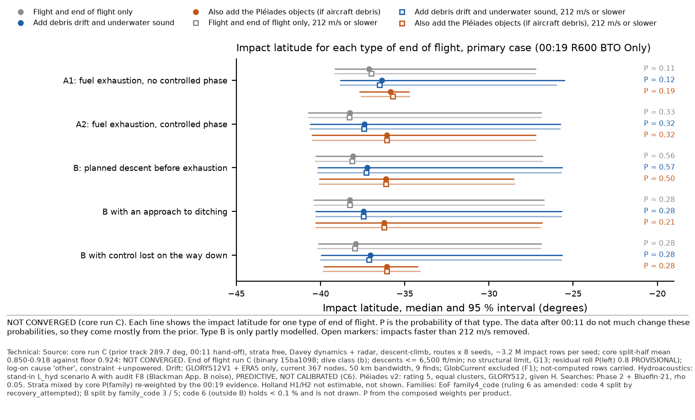
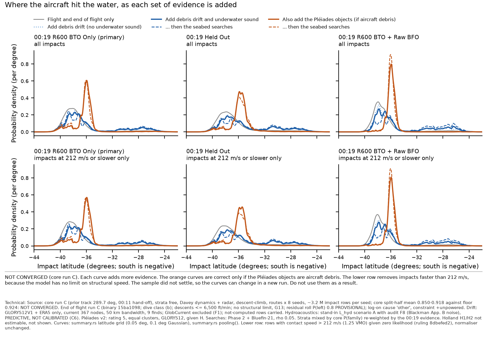
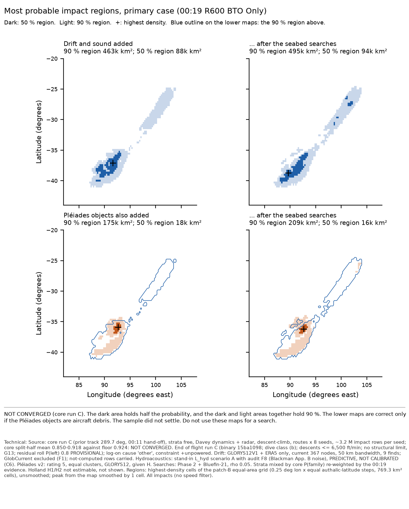
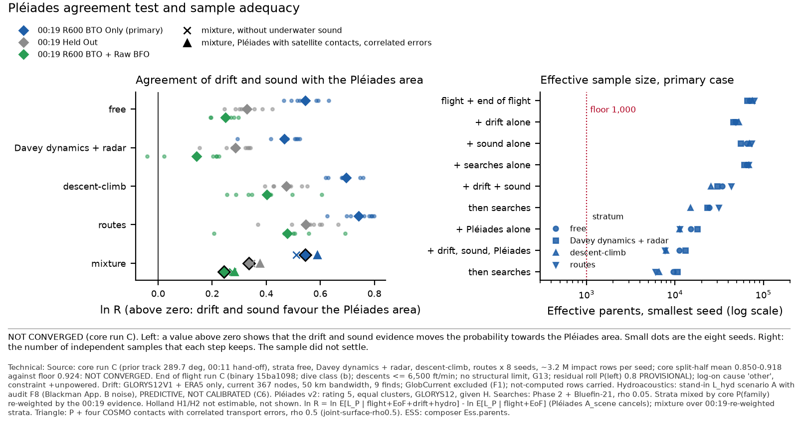
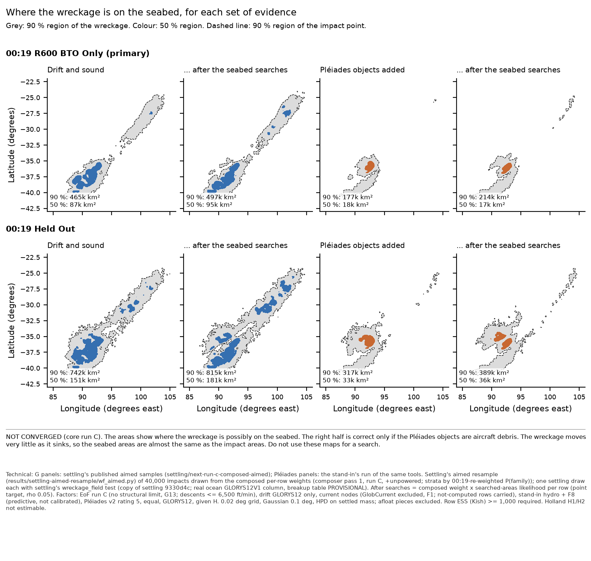

# Composer pass 1 on core run C: first end-to-end composition (architecture stand-in for the composer)

11 Oct 2026, 04:31-07:55 UTC (coordination entries timed ~08:10 were posted at 07:55). **Run by an architecture stand-in on the composer's behalf (Pete's milestone, ruling dd1b877e); the composer
module reviews it.** Branch `core/composer-pass1-runc`. Machinery: `crates/compose` as merged at 960b3147 (unchanged), a driver
`engine/crates/compose/examples/pass1.rs` adapted from `pass0.rs`, and glue in `results/composer-pass1-run-c/` adapted from
`results/composer-pass0/` (whose pooling, grid, smoothing and statistics functions are imported unchanged).

> **Labels on every number in this note:** run C NOT CONVERGED (core split-half mean 0.850-0.918 against the 8-replicate floor 0.924) ·
> EoF physics provisional; no structural limit (G13) · hydro predictive, not calibrated (stand-in L_hyd + audit F8) · drift GLORYS12 only,
> current nodes (367; not the run A extension) · GlobCurrent excluded (F1) · H products conditional on the Pléiades objects being MH370
> debris · Holland H1/H2 not estimable. The pass is the first worth reading; it is not an estimate of where the aircraft is.

## 1. What the pass did

- **Samples.** End of flight's run C sweep: 4 strata × 8 seeds, 102.4 M impact rows (`end-of-flight/next-run-c/<stratum>/seed-k/impacts32.npy`,
  compact float32; all four `READY`, `SWEEP-DONE`). Every row was used; nothing was subsampled.
- **Factors** (per row, `prep_inputs_c.py`): end of flight's 00:19 option (`derived_logliks` r600-bto; `loglik:r600/no-offset` for R600 BTO +
  Raw BFO; 0 for Held Out) + `constraint_log_factor(..., 'unpowered')`; drift `lnL_glorys12_h50` from drift's run C export (state 1, else
  not computed); hydro stand-in L_hyd scenario A with audit F8 (Blackman App. B noise at the IMS station); Pléiades v2 run C columns
  (`lnL_pleiades_glorys12`; `lnL_both_glorys12` for + COSMO; `reader.load_rho` ρ = 0 and 0.5 for the correlated-error sensitivity);
  searched areas' point-target non-detection likelihood (ρ 0.05) applied directly.
- **Products** for each 00:19 option, in two versions (all rows; contact speed ≤ 212 m/s, ruling 8dbefed2): P1 = flight + EoF;
  **G** = P1 + drift + hydro; Ga = G + searches; D = G without hydro (P1 + drift), Da; **H** = P1 + {drift, hydro, Pléiades} given H; Ha;
  Hn = H without hydro, Hna; PE (Pléiades alone, the ln R denominator); Gx / Hx / PEx (not-computed rows excluded); Hc / PEc (+ COSMO);
  Hr0 / PEr0 and Hr5 / PEr5 (P + COSMO, ρ = 0 and 0.5); Y, S (single factors). 22 products × 6 option-versions × 4 strata = 528 composer
  products; 504 written to `products-per-stratum.csv` (the filter rows omitted).
- **Strata.** Each stratum composed separately (8 replicates), then mixed by core's P(family) re-weighted by the 00:19 evidence (primary,
  ruling C), with fixed P(family) and P_core × Z (all evidence in the product) beside (`mixtures.csv`).
- **Compute.** Outside the heavy lock; composer single-threaded (about 3-4.5 min per option-version per stratum), prep and summaries 1-2
  threads. Peak intermediate disk 4.3 GB (two strata of float32 inputs), deleted per stratum. New data kept: the composed row weights for
  the seabed step on the exchange (section 6) and 6 MB of results.
- **Chain marker.** `/tmp/mh370-runc-chain.DONE` was touched by this stand-in at **05:52:12 UTC**. Inputs present then: end of flight 4/4
  `READY` + `SWEEP-DONE` + run C summaries; drift run C export 4/4 strata (`.exported`; SHA256SUMS verified 32/32 seeds); Pléiades run C
  columns for all four strata, 32/32 seeds listed in and matching `SHA256SUMS` (no top-level `READY` yet); hydroacoustics' own run C
  columns `READY` (not used; hydro regenerated here); settling's run C core-set samples written in settling's workspace (`field/nrcA`, `nrcB`,
  no exchange copy, no `READY`); searched areas: the stand-in's run C note not yet on the branch (the composer applies the coverage
  likelihood directly, so nothing was missing for the composition). All composer inputs had been read by 05:45 UTC.

## 2. Checks

- `cargo test -p mh370-compose`: **9 of 9 pass** (library unchanged since 960b3147).
- **End of flight evidence reproduced:** every stratum's P1 increment equals end of flight's `family-evidence-run-c.json` ln Ẑ (+unpowered,
  four options incl. ~v212) to max |Δ| = 1.1 × 10⁻¹⁰. Re-weighted stratum weights (R600 BTO Only): 0.590 / 0.238 / 0.145 / 0.027 against
  EoF's 0.590 / 0.2388 / 0.1446 / 0.0266 (EoF rounds core P(family) to 3 decimals).
- **Searched-areas transcription:** max |Δ| = 0.0 against `mh370 evaluate` on core (b) (deviation 3).
- **Row alignment:** drift and Pléiades `row` = 0..n−1 and `parent` equal to impacts, asserted for all 32 seeds.
- **Determinism:** the free stratum was prepared twice (inputs deleted between); the Held Out composition reproduced every product's
  ln-evidence increment exactly (max |Δ| = 0.0, 22 products).
- **Exported row weights reproduce the composer:** the R600 BTO Only G, Ga and H and the Held Out Ha row-weight files on the exchange give
  medians −37.17, −37.12, −36.04, −35.71 and 95 % limits equal to the composer's to 0.01°. This confirms Ga = G × L_search per row.
- **Seabed areas reproduce settling:** the stand-in's area code on settling's published aimed samples gives settling's own wreckage areas
  exactly (465.1 / 497.3 / 742.3 / 814.6 k km²).
- **ρ surface:** Hr0 − Hc = −12.43 nat per stratum, the 2 ln A_scene constant the ρ surfaces omit (Pléiades 02:21 UTC).

## 3. Convergence status

**Every product of every option, version and stratum is UNCONVERGED** on the source split-half (core run C mean over 35 partitions: free
0.918, Davey dynamics + radar 0.910, descent-climb 0.892, routes 0.850; floor 0.924). Factor split-halves (seeds 1-4 against 5-8, tolerance
0.1 nat, provisional) that also fail (`factor-split-half-summary.txt`):

| factor | 00:19 R600 BTO Only | 00:19 Held Out | 00:19 R600 BTO + Raw BFO |
|---|---|---|---|
| terminal option, hydro, searches | pass in every stratum | pass | pass |
| debris drift | pass (≤ 0.10) | **routes 0.115** | **routes 0.128** |
| Pléiades (given H) | **Davey dynamics + radar 0.156, routes 0.111** | **Davey dynamics + radar 0.154** | **Davey dynamics + radar 0.166, routes 0.117** |
| set G | pass | **routes 0.111** | **routes 0.130** |
| set H | **Davey dynamics + radar 0.149** | **Davey dynamics + radar 0.162** | **Davey 0.164, routes 0.146** |

Below the composer's ESS floor (1,000 effective parents in a seed): **00:19 R600 BTO + Raw BFO, G (506-765 in free, Davey dynamics + radar,
descent-climb), Ga (186-922), Gx, H (600-971 in all four strata), Ha, Hc, Hr0, Hr5**. Those products are reported, labelled, and not
read as results. 00:19 R600 BTO Only and Held Out keep ≥ 5,078 effective parents per seed in every product (smallest: R600 BTO Only Hc, routes).

## 4. Results (UNCONVERGED; strata re-weighted by the 00:19 evidence)

### 4.1 Per end-of-flight family first

Families are end of flight's `family4_code` (ruling 6 as amended: code 4 split by `recovery_attempted`), with B split by `family_code`
(3 approach to ditching, 5 control lost en route); code 6 (outside B) holds < 0.1 % everywhere. **The family shares are mostly the module's
prior**: the 00:19 data move them by ≤ 0.02 (Held Out against R600 BTO Only), and drift and hydro by ≤ 0.02; only the Pléiades factor
(given H) and the raw BFO move them more. Per-family results are conditional on the family, not evidence for it.

Each cell: P(family); median impact latitude (95 % interval), degrees.

| 00:19 option | product | A1 | A2 | B | mixture | 50 % / 90 % region (k km²) |
|---|---|---|---|---|---|---|
| **R600 BTO Only** (primary) | flight + EoF | 0.111; −37.11 (−39.13 to −27.23) | 0.326; −38.25 (−40.70 to −26.92) | 0.563; −38.08 (−40.27 to −26.83) | −37.99 (−40.40 to −26.90) | 65 / 331 |
| | **G** | 0.115; −36.35 (−38.81 to −25.53) | 0.318; −37.40 (−40.60 to −25.77) | 0.566; −37.22 (−40.12 to −25.68) | **−37.17 (−40.27 to −25.69)** | 88 / 463 |
| | G after searches | 0.089; −35.44 (−39.05 to −25.05) | 0.351; −37.45 (−40.67 to −25.62) | 0.560; −37.14 (−40.26 to −25.45) | −37.12 (−40.40 to −25.46) | 94 / 495 |
| | G without hydro | 0.128; −36.69 (−38.78 to −26.01) | 0.321; −37.43 (−40.61 to −25.83) | 0.551; −37.30 (−40.16 to −25.75) | −37.26 (−40.29 to −25.80) | 89 / 461 |
| | **H** (given H) | 0.185; −35.84 (−37.67 to −34.76) | 0.319; −36.07 (−40.49 to −27.25) | 0.495; −36.12 (−40.06 to −28.55) | **−36.04 (−40.15 to −28.94)** | 18 / 175 |
| | H after searches | 0.139; −35.99 (−38.46 to −34.59) | 0.357; −36.23 (−40.61 to −26.51) | 0.504; −36.22 (−40.24 to −26.89) | −36.18 (−40.34 to −27.09) | 16 / 209 |
| | H without hydro | 0.208; −35.73 (−37.64 to −34.76) | 0.324; −36.01 (−40.49 to −27.33) | 0.468; −36.11 (−40.10 to −28.30) | −35.99 (−40.15 to −29.01) | 19 / 178 |
| **Held Out** | flight + EoF | 0.119; −36.63 (−38.91 to −27.33) | 0.330; −37.65 (−40.50 to −27.07) | 0.550; −37.66 (−40.10 to −26.99) | −37.50 (−40.20 to −27.05) | 85 / 596 |
| | **G** | 0.126; −35.54 (−38.55 to −25.77) | 0.325; −36.36 (−40.34 to −25.94) | 0.549; −36.50 (−39.89 to −25.85) | **−36.28 (−40.01 to −25.86)** | 152 / 754 |
| | G after searches | 0.112; −33.57 (−38.71 to −25.45) | 0.349; −35.90 (−40.44 to −25.77) | 0.538; −35.67 (−40.04 to −25.60) | −35.57 (−40.16 to −25.63) | 178 / 827 |
| | **H** | 0.184; −35.51 (−37.23 to −33.46) | 0.332; −35.63 (−40.19 to −28.40) | 0.483; −35.82 (−39.80 to −29.37) | **−35.70 (−39.85 to −29.88)** | 32 / 312 |
| | H after searches | 0.163; −35.46 (−37.40 to −32.87) | 0.354; −35.66 (−40.33 to −27.50) | 0.482; −35.85 (−39.97 to −27.86) | −35.71 (−40.03 to −28.27) | 35 / 397 |
| **R600 BTO + Raw BFO** (G, H below the ESS floor) | flight + EoF | 0.109; −36.87 (−38.24 to −27.83) | 0.150; −37.30 (−39.72 to −26.74) | 0.742; −37.66 (−39.46 to −26.80) | −37.50 (−39.47 to −26.90) | 40 / 208 |
| | G | 0.094; −35.11 (−38.15 to −25.91) | 0.160; −36.29 (−39.24 to −25.60) | 0.746; −36.69 (−38.92 to −25.50) | −36.54 (−38.95 to −25.56) | 55 / 300 |
| | G after searches | 0.080; −29.00 (−37.84 to −25.65) | 0.186; −35.72 (−39.44 to −25.34) | 0.734; −35.66 (−39.15 to −25.12) | −35.38 (−39.17 to −25.19) | 77 / 348 |
| | H | 0.099; −35.48 (−37.31 to −34.72) | 0.182; −35.73 (−38.23 to −34.18) | 0.719; −35.99 (−37.53 to −35.01) | −35.91 (−37.55 to −34.75) | 11 / 57 |
| | H after searches | 0.027; −35.61 (−37.40 to −34.14) | 0.199; −35.77 (−38.70 to −33.94) | 0.773; −36.03 (−37.92 to −35.07) | −35.98 (−38.18 to −34.56) | 7 / 58 |

B split (R600 BTO Only, G): approach to ditching 0.28, control lost en route 0.28; under H 0.21 and 0.28. A, controlled then lost (code 4)
is inside A1 or A2 by ruling 6 as amended. Every row of every product, incl. the 212 m/s version, is in `families.csv`.

### 4.2 Mixture over families; the over-speed version beside

| 00:19 option | product | all rows: median (95 %) | 90 % region | contact speed ≤ 212 m/s: median (95 %) | 90 % region | weight removed by the filter (all / A1 / A2 / B) |
|---|---|---|---|---|---|---|
| R600 BTO Only | flight + EoF | −37.99 (−40.40 to −26.90) | 331k km² | −38.10 (−40.45 to −26.89) | 334k km² | 0.100 / 0.56 / 0.03 / 0.05 |
| | **G** | −37.17 (−40.27 to −25.69) | 463k km² | −37.28 (−40.33 to −25.75) | 467k km² | 0.100 / 0.52 / 0.04 / 0.05 |
| | G after searches | −37.12 (−40.40 to −25.46) | 495k km² | −37.24 (−40.45 to −25.54) | 496k km² | 0.086 |
| | **H** | −36.04 (−40.15 to −28.94) | 175k km² | −36.05 (−40.21 to −28.46) | 187k km² | 0.133 / 0.46 / 0.05 / 0.07 |
| | H after searches | −36.18 (−40.34 to −27.09) | 209k km² | −36.20 (−40.39 to −26.90) | 222k km² | 0.118 |
| Held Out | G | −36.28 (−40.01 to −25.86) | 754k km² | −36.40 (−40.08 to −25.94) | 766k km² | 0.097 / 0.45 / 0.03 / 0.05 |
| | H | −35.70 (−39.85 to −29.88) | 312k km² | −35.69 (−39.91 to −29.55) | 332k km² | 0.108 / 0.36 / 0.04 / 0.06 |
| R600 BTO + Raw BFO | G | −36.54 (−38.95 to −25.56) | 300k km² | −36.67 (−39.00 to −25.58) | 297k km² | 0.098 / 0.58 / 0.04 / 0.05 |
| | H | −35.91 (−37.55 to −34.75) | 57k km² | −35.93 (−37.68 to −34.75) | 58k km² | 0.081 / 0.36 / 0.05 / 0.05 |

- The fixed-weight and all-evidence mixtures differ from the re-weighted one by ≤ 0.03° in the median (0.06° for R600 BTO + Raw BFO G after searches) and ≤ 1.6k km² (`mixtures.csv`).
- The filter removes 10 % of the weight, more than half of it from A1: P(A1) falls from 0.111 to 0.054 (R600 BTO Only, flight + EoF) and
  from 0.185 to 0.117 under H. The filtered A1 is therefore the feasible part of A1 only; G13 stays open.
- 90 % regions are unsmoothed equal-area cells (patch-B grid); 50 % regions are in the family table.
- Not-computed rows (drift outside its support) are carried (ruling 1); excluding them (Gx / Hx) shrinks R600 BTO Only G 463k → 304k km² and
  H 175k → 53k km², and moves the G median 0.33° north (−36.84). Not-computed weight per seed: drift 0.17-0.28 (R600 BTO Only), 0.16-0.25
  (Held Out), 0.025-0.040 (Raw BFO); Pléiades, hydro, searches, terminal 0.

### 4.3 Evidence increments and per-factor ESS (mixture over fixed strata; ln-evidence against flight + EoF)

| factor or product | R600 BTO Only | Held Out | R600 BTO + Raw BFO | smallest effective parents per seed, R600 BTO Only (stratum) |
|---|---|---|---|---|
| + drift alone (absolute density) | −127.955 | −127.804 | −127.898 | 45,764 (Davey dynamics + radar) |
| + hydro alone (stand-in) | −0.028 | −0.027 | −0.077 | 55,518 (Davey dynamics + radar) |
| + searches alone | −0.303 | −0.336 | −0.719 | 60,613 (Davey dynamics + radar) |
| G | −127.979 | −127.832 | −127.929 | 25,412 (descent-climb) |
| G after searches (increment of searches on G) | −0.248 | −0.238 | −0.449 | 14,812 (descent-climb) |
| + Pléiades alone (given H; absolute, incl. A_scene) | −8.015 | −7.616 | −7.540 | 11,144 (descent-climb) |
| H | −135.444 | −135.108 | −135.216 | 7,698 (routes) |

Per stratum and per (seed, mode): `products-per-stratum.csv`, `evidence-increments-per-seed-mode.csv`. Hydro alone moves the evidence by
−0.02 to −0.10 nat in every option: within this stand-in it is a weak factor, and its sign is the stand-in's, not a calibrated likelihood.

### 4.4 Tension of H against G (evidence ratio, overlap, displacement)

ln R = ln E[L_P | flight + EoF + drift + hydro] − ln E[L_P | flight + EoF] (A_scene cancels); positive = drift and hydro favour the
Pléiades area.

| quantity | R600 BTO Only | Held Out | R600 BTO + Raw BFO (below ESS floor) |
|---|---|---|---|
| **ln R**, re-weighted (fixed) strata | **+0.543** (+0.541) | **+0.336** (+0.336) | +0.244 (+0.238) |
| ln R without hydro | +0.511 | +0.345 | +0.275 |
| ln R, not-computed excluded | +0.536 | +0.328 | +0.242 |
| ln R, P + COSMO, ρ = 0 / **ρ = 0.5** (correlated errors) | +0.608 / **+0.588** | +0.391 / +0.377 | +0.289 / +0.282 |
| ln R, contact speed ≤ 212 m/s | +0.616 | +0.399 | +0.385 |
| ln R per stratum: free / Davey + radar / descent-climb / routes | +0.545 / +0.466 / +0.695 / +0.741 | +0.328 / +0.286 / +0.474 / +0.546 | +0.250 / +0.143 / +0.403 / +0.478 |
| ln R seed range within free (8 seeds) | +0.46 to +0.63 | +0.25 to +0.42 | +0.19 to +0.30 |
| 90 % HDR overlap (Jaccard) G vs H, before / after searches | 0.33 / 0.33 | 0.40 / 0.43 | 0.17 / 0.13 |
| share of H's 90 % region inside G's | 0.92 | 0.97 | 0.91 |
| mode displacement G → H, before / after searches | 89 NM / 208 NM | 89 NM / 89 NM | 192 NM / 89 NM |
| mean displacement G → H, before / after searches | 52 NM / 102 NM | 74 NM / 125 NM | 96 NM / 222 NM |
| ρ = 0.5: Jaccard; mode / mean displacement | 0.29; 89 / 46 NM | 0.35; 89 / 69 NM | 0.13; 192 / 90 NM |

Reading (provisional): within this pipeline, drift and the stand-in hydro **do not conflict** with the Pléiades hypothesis; they mildly
favour its area (R ≈ 1.7 for R600 BTO Only, 1.4 for Held Out). The positive value comes from drift (without hydro +0.51; hydro changes it by
+0.03 / −0.01 / −0.03). Correlated transport errors (ρ = 0.5) change ln R by ≤ 0.02 against ρ = 0 and leave the sign. The stratum spread
(+0.47 to +0.74) is larger than the seed spread within free (±0.09), and the Pléiades factor fails split-half in Davey dynamics + radar
(0.16 nat) and routes (0.11): **ln R is not resolved at the 0.1-0.2 nat level**, as in pass 0. The peaks are 89 NM apart, about one
smoothing cell of the equal-area map plus one; mode displacements are grid-quantised and the mean displacement is the steadier quantity.

### 4.5 G and H without hydro

Brief requirement (hydro predictive, audit C6). G without hydro (D) and H without hydro (Hn) are in every table: R600 BTO Only G median
−37.26 vs −37.17 with hydro, 461k vs 463k km²; H −35.99 vs −36.04, 178k vs 175k km². Hydro moves the family shares more than the
positions: it lowers A1 from 0.128 to 0.115 under G and from 0.208 to 0.185 under H (consistent with the stand-in penalising fast steep entries that would
have been heard and were not; not checked row by row).

## 5. COVERAGE (Pete's sampling-coverage rule, 10 Oct)

**(a) Feasible set** (777-200ER end of flight after the 00:19 log-on; sources as in the end-of-flight physics prior and its ruling, 10 Oct):
uncontrolled spiral or dive after fuel exhaustion, including rapid descents well above 6,500 ft/min and push-over/unloading (Boeing's
ATSB-requested simulations; Holland's rapid-descent reading of the 00:19 BFOs); controlled glide and ditching after exhaustion; a piloted
descent begun before exhaustion (B), from any time after the last arc-6-era handshake; in-flight breakup when the dive passes the design
dive speed VD/MD (CS-25.335), so contact speeds are bounded by the structure, not only by drag; impact anywhere the fuel range and the 7th
arc allow.

**(b) Model's reach (what these samples can produce at all):**
- descents above 6,500 ft/min and unloading are **not reachable** (EoF run C README); the bounded push-over exists only as a default-off switch;
- **no structural limit (G13)**: 10 % of the weight (56 % of A1) arrives above 212 m/s and up to ~380 m/s, outside the feasible set; the
  212 m/s version removes it but cannot put in the breakup end state that should replace it;
- B starts from the 00:11 hand-off: descents begun before 00:11 are not in run C (core's run D look-ahead is the fix);
- drift: 367 GLORYS12 nodes; 13-28 % of the weight lies outside their support (carried at the mean; G10, run A extension is the fix);
- Pléiades v2 grid 78-115 E, 45-5 S: no run C row not computed; searches: Phase 2 + Bluefin-21 only (Ocean Infinity layers excluded);
- hydro: coupling with no angle, speed or breakup dependence (G-H1), τ drawn from the prior (EoF's τ sidecar not used by the stand-in).

**(c) Proposal coverage: effective impact rows (Kish, within one seed; smallest over seeds and strata, with that stratum)**

| 00:19 option | product | A1 | A2 | B | 36-33 °S | north of 30 °S | all rows |
|---|---|---|---|---|---|---|---|
| R600 BTO Only | flight + EoF | 190,177 | 577,538 | 1,018,436 | 68,549 | 15,934 | 1,813,540 |
| | G | **1,276** (descent-climb) | 35,723 | 52,844 | 13,178 | **1,053** (descent-climb) | 59,324 |
| | G after searches | **320** (descent-climb) | 30,192 | 36,708 | 9,484 | 1,053 | 31,566 |
| | H | 2,757 | 11,819 | 10,183 | 6,642 | 2,615 | 23,482 |
| | H after searches | 1,036 | 9,774 | 7,360 | 3,539 | 2,615 | 15,954 |
| Held Out | G | 3,839 | 71,977 | 55,843 | 44,222 | 1,760 | 94,705 |
| | H | 8,159 | 25,203 | 17,660 | 23,120 | 6,473 | 54,550 |
| R600 BTO + Raw BFO | flight + EoF | 4,570 | 7,786 | 36,877 | 3,441 | **451** | 51,461 |
| | G | **8** | **111** | 1,124 | **294** | **25** | **517** |
| | H | **96** | **119** | **474** | **234** | **18** | **707** |
| R600 BTO Only, ≤ 212 m/s | G | 33,883 | 37,528 | 62,464 | 14,785 | 2,168 | 110,397 |
| | H | 7,085 | 12,274 | 10,554 | 7,608 | 2,570 | 26,180 |

Full table per stratum, family code and band: `coverage-ess.csv`. Family A1 under G holds its weight on few rows, and those are mostly
over-speed rows: with them removed, A1's ESS rises from 1,276 to 33,883. The A1 latitude under G is therefore set by a handful of
infeasible-speed impacts in the all-rows version.

**Gaps and status** (for architecture to record in ARCHITECTURE.md; this stand-in did not edit it):

| gap | type | affects | status |
|---|---|---|---|
| G13 no structural limit / transonic drag; contact speeds > 212 m/s | reach (infeasible states) | every product; A1 above all | OPEN; 212 m/s version shown everywhere (stop-gap) |
| rapid descents > 6,500 ft/min, unloading | reach | A1/A2 near the arc; Holland-type readings | OPEN (EoF plan item 4) |
| B only from 00:11 | reach | B's share and position | OPEN (core run D) |
| G10 drift support (13-28 % not computed) | reach | G, H; areas move by up to ×3 (Gx/Hx) | OPEN (drift run A, started at the chain marker) |
| R600 BTO + Raw BFO under G/H | proposal coverage | every G/H product of that option (ESS below the floor; A1 8, north of 30 °S 25) | **NEW**, OPEN: not estimable; aimed proposal needed |
| A1 under G after searches (R600 BTO Only) | proposal coverage | per-family A1 in Ga (320 rows in descent-climb) | NEW, OPEN; family shares still estimable |
| core routes stratum: only 14 of 48 routes distinct (guidance captures a waypoint once it is behind; core ~07:17 UTC) | reach (core) | routes stratum (re-weighted weight 0.024-0.027) and its large ln R (+0.74) | NEW (core's finding), OPEN |
| Holland H1/H2 | proposal coverage | not composed (1-7 effective impacts per seed, EoF family-evidence-run-c.json) | OPEN (G7): reported as not estimable, not dropped |
| hydro coupling (G-H1), calibration (C6) | reach / calibration | hydro factor | OPEN; G and H also shown without hydro |
| seabed for R600 BTO + Raw BFO and the 212 m/s versions | budget | no seabed PDF for those | OPEN (this pass) |

**Parameter bounds narrower than the feasible range** are those of end of flight's run C (README labels) and of the factor modules; this
pass adds none. The 212 m/s cap is a ruling (8dbefed2), sourced as 1.25 VMO.

## 6. Seabed PDF (gap G12): aimed resample from the composed weights

**Method (G12 fix).** The composed per-row weights were written to `mh370-exchange/composer/next-run-c/row-weights/<option>-<product>/`
in settling's contract (`results/settling-aimed-resample/README.md`): one f32 per impacts32 row, value = W_Q(stratum) × pooled
within-stratum weight, with `manifest.json`, `SHA256SUMS`, `READY`. 'After searches' = G (or H) × L_search per row, which is exact (the
files reproduce the composer's G and Ga medians and 95 % limits to 0.01°). **Ocean settling picked the G files up and published its own
aimed resample** (`settling/next-run-c-composed-aimed/`, READY ~07:02 UTC; 40,000 draws per product, settling 9330d4c, real ocean). Settling's
run C core-set samples carry `READY` at 06:56 UTC. The seabed numbers below for G are **settling's published samples**; the stand-in's area
code reproduces settling's published wreckage areas exactly from them (465.1 / 497.3 / 742.3 / 814.6 k km²). The stand-in's own provisional
run of the same tools (`wf_aimed.py` + `wreckage_field` on a copy of 9330d4c) agreed to < 1 % (R600 BTO Only G: 462k km²).

| 00:19 option | product | row ESS (Kish) | distinct impacts of 40,000 | 90 % region: impacts (all rows) → wreckage (k km²) | 50 % region, wreckage (k km²) | settled offset p50 / p90 / p99 (km) | afloat mass share | status |
|---|---|---|---|---|---|---|---|---|
| R600 BTO Only | **G** | 2.93 M | 39,959 | 468.1 → 465.1 | 87.4 | 0.43 / 4.55 / 22.96 | 0.170 | estimable |
| | G after searches | 2.02 M | 39,925 | 502.3 → 497.3 | 95.5 | 0.45 / 4.74 / 23.53 | 0.169 | estimable |
| Held Out | **G** | 4.18 M | 39,980 | 758.2 → 742.3 | 151.0 | 0.43 / 4.36 / 22.10 | 0.171 | estimable |
| | G after searches | 2.84 M | 39,965 | 833.5 → 814.6 | 181.5 | 0.44 / 4.47 / 22.72 | 0.170 | estimable |
| R600 BTO Only | **H** (given H) | 0.79 M | 39,976 | 176.9 → 177.5 | 18.4 | 0.42 / 4.19 / 21.44 | 0.173 | estimable (stand-in run) |
| | H after searches | 0.59 M | 39,892 | 214.1 → 214.4 | 16.9 | 0.43 / 4.32 / 22.10 | 0.172 | estimable (stand-in run) |
| Held Out | **H** | 1.95 M | 40,000 | 316.8 → 317.0 | 32.6 | 0.42 / 3.98 / 20.01 | 0.174 | estimable (stand-in run) |
| | H after searches | 1.61 M | 39,999 | 405.0 → 388.9 | 35.6 | 0.42 / 4.02 / 20.22 | 0.173 | estimable (stand-in run) |

**H rows.** Held until Pléiades' run C `READY` (07:38:41 UTC). At `READY` the 32 column files the composer read were re-verified
(0 mismatches); the only change to Pléiades' `SHA256SUMS` was six added source-package lines, so the composed H stands unchanged. The H and
H-after-searches row weights were then written (07:43 UTC; the files reproduce the composer's H medians and limits) and the stand-in ran
settling's tools on them (07:48-07:51 UTC). Settling's watcher covers these files; if settling publishes its own H samples, they replace
the stand-in's rows above. All outcomes fell inside settling's ocean window (0 refused).

**Reading.** Settling adds +0.2 to +0.5 % to every 90 % area (resampled impacts → wreckage) and the settled offset is 4.0-4.7 km at p90: **each
seabed PDF is its impact PDF to under 1 % in area**, as on core (b). **G12 is closed for G, Ga, H and Ha** of both options: the aimed
resample keeps 39,892-40,000 distinct impacts and a row ESS of 0.59-4.18 M, where pass 0 r2 (resampling from flight + EoF) kept 368-865
effective impacts for R600 BTO Only. (The all-rows impact areas are 0.2-4.6 % larger than the resampled ones, largest for Held Out H after searches, 405k against 387k km²:
40,000 draws under-represent the dispersed northern tail. The wreckage areas come from the resample.)

## 7. Deviations (declared)

1. **Constraint `+unpowered`, not `+alive`.** Pass 0 composed under `+alive`. Run C is composed under `+unpowered` (airborne at
   00:19:37 and not powered at 01:15:56), the reference ruled ~19:10 UTC 10 Oct (variant (b)), at settling's request (~23:45 UTC), so that
   the composed weights and settling's samples share one constraint. `+alive` was not composed. The 01:15:56 handshake has no
   observation ID; the stand-in invented `m0115.handshake-unanswered` beside pass 0's invented `m0019b.burst-exists` (gap 4).
2. **Hydroacoustics:** the stand-in L_hyd (scenario A, `lhyd.py` sha 5000c56e, unchanged) with audit fix F8 applied by a subclass in
   `prep_inputs_c.py`: the IMS SNR uses Blackman App. B noise = proxy 3376 + the module's own per-station offset
   (`results-data/blackman_noise/blackman_noise_offsets.json`: H01W +5.443 dB, H08S −0.651 dB). Nothing else changed: no structured
   calibration error (the module's amendment 2 is not in the stand-in), no P_D cap. The module's own run C columns
   (`hydroacoustics/next-run-c/`, `lnL_gated` = 0, `lnL_soft` sensitivity) were NOT used, as the brief directs. The hydro module data
   were read from the module's worktree `d74bf70e…/hydro-wt` at 3b5b4446 (the pass-0 path no longer exists).
3. **Searched areas** applied directly: `seabed_loglik.py` is a transcription of `seabed-search/lib.rs` (raster decode, bilinear
   coverage, shared-dependence miss probability, point target) with `run.toml` (ρ 0.05). Reason: `mh370 evaluate` refuses the run C
   compact layout ("impacts.npy has an older column layout"). Validated against pass 0's `mh370 evaluate` output on core (b) next-free
   seed 1: 3,199,968 rows, NaN pattern identical, max |Δ ln L| = 0.0 (1,012,317 non-zero rows). The searched-areas stand-in's own run C
   outputs were not on the branch at compose time and were not used.
4. **Inputs stored float32** (the run C sources are float32); the driver reads them as f64. Drift's GLORYS12 h50 and Pléiades values are
   float32 at source; L_hyd and ln L_search lose about 1e-7 relative.
5. **One terminal option per composer invocation** (six per stratum) to keep peak RAM near 5 GB; no not-H Pléiades columns (allowed
   since merge 960b3147); refusal cases R1-R7 of pass 0 not repeated.
6. **Source split-half statistic:** core's mean over the 35 balanced partitions (free 0.918, Davey dynamics + radar 0.910,
   descent-climb 0.892, routes 0.850) against the 8-replicate floor 0.924; the minimum (0.856 / 0.862 / 0.856 / 0.822) is recorded beside.
   Pass 0 recorded the minimum. Either fails, in every stratum.
7. **Factor split-half** halves are seeds 1-4 against 5-8 (compose() splits the replicate list in two); tolerance 0.1 nat (provisional).
   The PDF split-half overlap in the tables is ONE partition (1-4 vs 5-8), not core's 35-partition statistic.
8. **Strata weights:** core's unrounded P(family) (`early-families-mixture.json`) x the composer's own P1 increment. End of flight's
   `family-evidence-run-c.json` uses P(family) rounded to 3 decimals; the two agree to ±0.001 (section 2).
9. **Seabed:** the G and G-after-searches seabed PDFs are settling's own published aimed resample (from the composer's row weights).
   The stand-in also ran settling's `wf_aimed.py` and `wreckage_field` test itself (copy of settling's worktree 9330d4c, 2 threads) as a
   cross-check and, for H, as the fallback if settling has not run H by the deadline (section 6 says which source each row uses). The seabed
   areas use pass 0's construction on settling's grid and reproduce settling's published areas exactly. 'After searches' weights are G (or
   H) × L_search per row (exact). R600 BTO + Raw BFO and the 212 m/s versions have no seabed PDF in this pass (disk: 23-27 GB free).
10. **Two orchestrators by mistake.** A second copy of the stratum chain was started at ~04:58 UTC while the first could not be stopped
    (no process list in the sandbox). Single-writer locks were added to `prep_inputs_c.py` and `run_stratum_c.sh` before either chain
    wrote; every seed file and every composer run had exactly one writer. Side effect: up to five prep processes ran at once for about
    two minutes (above the four-thread cap), and the stratum logs were truncated (cosmetic).
11. **Ln R after searches** not computed (denominator flight + EoF + searches + Pléiades not composed), as in pass 0.
12. **Mean displacement** uses the equal-area cell map; mode displacement the one-cell-smoothed map, as in pass 0.

## 8. Requests (posted to each inbox)

- **Core:** hand-off per-mode evidence and observation list (gaps 1, 2, unchanged); a compact reader in `mh370 evaluate` (gap 24);
  patch B (summary.rs) so the transcription can be deleted (gap 18); for the Raw BFO option an aimed proposal (gap 27).
- **End of flight:** a feasibility flag or the in-flight-breakup end state so that one definition replaces four consumer-side 212 m/s
  filters (gap 25, G13); IDs for the `alive` / `unpowered` constraints (gap 4); Holland H1/H2 sampler (gap 28, G7).
- **Debris drift:** none new; run A (extension nodes) closes G10, the largest single sensitivity here (Gx/Hx move G's 90 % area by 34 %).
- **Pléiades:** please post the run C `READY`; the COSMO observation ID the composer should declare (pass 1 still declares
  `cosmo-skymed:F1-F4`); the factor's split-half fails in Davey dynamics + radar (0.15-0.17 nat) and routes (0.10-0.12) on run C.
- **Hydroacoustics:** say which per-row column the composer should carry as the labelled hydro factor in pass 2 (the stand-in + F8 here;
  the module's `lnL_soft` with amendment 2 is the candidate) (gap 26).
- **Ocean settling:** composed row weights are on the exchange in your contract (section 6); please post the run C `READY`, and review the
  stand-in's use of `wf_aimed.py` and the `wreckage_field` test.
- **Searched areas:** the transcription of your likelihood (`seabed_loglik.py`) reproduces `mh370 evaluate` exactly on (b); please review
  it, or publish per-impact columns for run C.
- **Composer module:** review this pass; confirm or replace the 0.1-nat factor split-half tolerance (it now fails on real factors in two
  strata); a native per-row weight writer (contract above) in the runner stage.

## Files

- `composer-pass1-run-c/interface-gaps.csv` — gap table with a pass-1 status column (28 rows; 24-28 new).
- `composer-pass1-run-c/pass1-results.json` — every mixture, family table, tension quantity and stratum weight.
- `products-per-stratum.csv` (504 rows), `mixtures.csv`, `families.csv`, `evidence-increments-per-seed-mode.csv`, `coverage-ess.csv`,
  `factor-split-half-summary.txt`, `tables.md` (every table of this note, all six option-versions).
- `fig1`-`fig5` (PNG and PDF), each with an STE100 and a technical footnote in the bottom quarter.
- Code: `engine/crates/compose/examples/pass1.rs`; `results/composer-pass1-run-c/*.py, *.sh` (paths are this stand-in's workspace layout:
  `<ws>/repo/...`, `<ws>/glue`; adapt before re-running).
- Exchange: `mh370-exchange/composer/next-run-c/row-weights/<option>-<product>/` (settling contract; README there).

— Modular Architecture (stand-in for the Composer)
