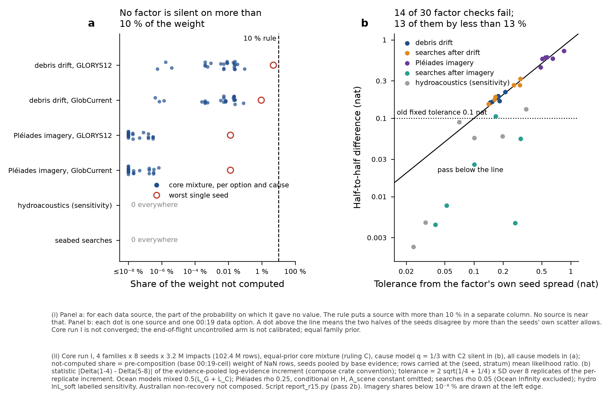

# Composer pass 2b on core run I: the 15 Oct 2026 ruling on not-computed rows applied

15 Oct 2026, 05:17-06:15 UTC. Run by a sub-agent of the coordinating session on the composer's behalf (Pete's standing ruling: the composer is not a
Pete-facing thread). ONE change against composer pass 2 (`results/composer-pass2-run-i.md`, 0f9f26c): the composition convention for not-computed
rows approved by Pete on 15 Oct 2026 (`threads/work-orders/ruling-composition-nan-2026-10-15.md`; approval in `coordination/architecture.md` at e940b66).
Everything else is identical: the same 102,399,904 run I impact rows, the same factor columns, the same products, the same code path.
Ran OUTSIDE the heavy lock (the end-of-flight round-3 sweep holds it) at 2 single-threaded processes. Outputs:
`mh370-exchange/composer/run-i-ruling-oct15/out/`. Tables and figure: `results/composer-pass2b-run-i-ruling/`.

> **Standing labels on every number in this note.** Core run I **NOT CONVERGED**. End-of-flight uncontrolled arm **NOT CALIBRATED**.
> Every mixture over core families is **conditional on equal family prior** (waypoints carries 0.998). Western Australia / Australian
> non-recovery is **NOT composed** (the drift pilot is reach-limited to 120 E and explicitly not for composition). End-of-flight physics PROVISIONAL
> (G13). Pléiades products are conditional on the objects being MH370 debris (H). Hydroacoustics predictive only (lnL_soft is a labelled
> sensitivity). Searches ρ 0.05, Ocean Infinity excluded.

## 1. Lead: what the ruling changed on run I

1. **No composed headline number moves.** Every impact-level number in the pass-2 note is unchanged to the stored tables' 6 significant figures
   (medians, 5/95 %, mean positions, 50/90 % areas, ESS, family shares, ln Z per stage, P(GLORYS12), split-half areas and medians: 780 product
   values over 30 headline products and their family subsets, plus 342 evidence values; max relative difference 4.9e-6, which is the rounding of
   the stored CSV). The largest change in any headline number
   is a seabed area: **00:19 R600 BTO + R600 BFO as recorded, + debris drift + searches, seabed 50 % area 61,360 → 61,458 km² (+99 km², +0.16 %)**,
   and the same treatment's + debris drift seabed 90 % area 170,679 → 170,788 km² (+109 km², +0.06 %). Both come from the seabed step now
   carrying per seed (section 3). Neither changes a rounded figure in the pass-2 note.
2. **Why nothing moves.** Pass 2 *already* carried not-computed rows at the (seed, stratum) mean likelihood ratio, which is ruling point 1, and
   kept exclusion only as a labelled variant. And on run I almost nothing is not computed. Drift: at most **0.092 %** of the base weight on the
   core mixture in any 00:19 option × log-on cause cell (0.025 % in the primary cause model). Pléiades: below 10⁻⁶ %. Hydro and searches: 0.
3. **The ruling's expectation for run I does not hold. Drift does NOT go to the sensitivity column.** The 16-25 % (drift) and 1-3 % (Pléiades)
   quoted in the ruling were measured in composer pass 0 on core run B (next-run-b), not on run I. The run I drift export closed that gap
   (drift's own README: 0.06-0.68 % per stratum; G10 closed in pass 2). Under the 10 % rule **no factor is in the sensitivity column on run I**,
   in any option, cause model, stratum or seed (worst single seed: 4.95 %, drift GLORYS12, free flight seed 6, R600 BTO + both BFOs as recorded
   × C2 silent, a cell with ESS 275).
4. **What the ruling does change is the split-half verdicts** (ruling point 4, section 5). The tolerances from each factor's own seed spread are
   **0.15-0.21 nat for drift, 0.14-0.30 nat for searches and 0.49-0.85 nat for Pléiades**, all wider than the old fixed 0.1 nat. Even so, drift,
   searches-after-drift and Pléiades still fail in most 00:19 options, narrowly: 13 of 14 failures exceed the tolerance by less than 13 %.
   The same seeds drive all of them (replicates 2 and 4 high, 5, 6 and 8 low), so this is one finding, not three independent ones. Each
   factor's evidence increment depends on its own seed's source posterior, and core run I is not converged.

## 2. Reproduction before the change

The unchanged `compose_quarter.py` (0f9f26c) was re-run on the free-flight stratum (all 8 seeds, 4 seed-quarter jobs). It was aggregated with
`report_pass2.py`'s own `Mixer` and compared with every free-flight-only row of the stored `products.csv`: **7,956 values (204 products × 4
family subsets × 12 quantities), max relative difference 4.8e-6** (the CSV's 6-significant-figure rounding), covering ln Z, ESS, share, median,
5/95 %, mean position, 50/90 % areas, fast share and drift not-computed share. The unchanged `seabed_pass2.py` + `seabed_report.py` was also
re-run on all four strata. It reproduces all **180 rows of the stored `seabed.csv`** to max relative 4.7e-6. So the pipeline reproduces, and
every difference below is attributable to the ruling.

## 3. What was changed (the ruling, applied; diffs in the scripts' headers)

| ruling point | pass 2 (stored) | pass 2b (this note) | effect on run I |
|---|---|---|---|
| 1. carry at the (replicate, mode) mean, never exclude | drift and Pléiades NaN carried at each seed's mean ratio under the base 00:19-cell weights (impact step); hydro lnL_soft NaN set to **0**; seabed step carried at the mean over the product's outcomes **pooled over all seeds**; exclusion variant "x" reported as a labelled sensitivity | impact step unchanged for drift and Pléiades; hydro NaN now carried at the mean ratio like the others; seabed carry now **per seed within each stratum**; "x" kept only as a diagnostic of what exclusion would do, never as a convention | hydro: 0 rows, no effect. Seabed: ≤ 0.16 % in any area, ≤ 0.002° in mean latitude, 0 in median. Impact: none. |
| 2. not-computed share reported per module per option | drift (GLORYS12 only) per product | every factor (drift G/C, Pléiades G/C, hydro, searches), every D × cause cell, base weight and composed weight, worst seed, row counts | section 4 |
| 3. > 10 % of the weight → labelled sensitivity | not applied | applied per option | no factor qualifies (section 4) |
| 4. split-half tolerance from the factor's own seed spread | fixed 0.1 nat (library default, provisional) | 2σ of the half-to-half difference implied by the seed-to-seed SD, reported beside the SD | section 5 |

New scripts: `compose_quarter_r15.py`, `seabed_pass2_r15.py`, `report_r15.py` in `results/composer-pass2-run-i/` (the pass-2 scripts are left as they were).

## 4. Not-computed share per module per option (ruling point 2) and the sensitivity column (point 3)

Share of the **pre-composition (base 00:19-cell) weight** on rows the factor did not compute, pooled to the equal-prior core mixture (ruling C
stratum weights, seeds by base evidence). Primary cause model (q = 1/3, C2 silent):

| 00:19 treatment | drift GLORYS12 | drift GlobCurrent | Pleiades GLORYS12 | Pleiades GlobCurrent | hydro lnL_soft | searches | drift: worst single (stratum, seed) | share of the composed weight on carried rows: + drift / + drift + searches |
|---|---|---|---|---|---|---|---|---|
| 00:19 Held Out | 0.0224 % | 0.0213 % | < 0.0001 % | < 0.0001 % | 0 % | 0 % | 0.160 % (descent-climb seed 6, GLORYS12) | 0.0231 % / 0.0500 % |
| R600 BTO Only | 0.0083 % | 0.0068 % | < 0.0001 % | < 0.0001 % | 0 % | 0 % | 0.187 % (descent-climb seed 6, GLORYS12) | 0.0084 % / 0.0211 % |
| R600 BTO + R600 BFO as recorded | 0.0248 % | 0.0248 % | < 0.0001 % | < 0.0001 % | 0 % | 0 % | 0.176 % (descent-climb seed 2, GLORYS12) | 0.0284 % / 0.0787 % |
| R600 BTO + both BFOs as recorded | < 0.0001 % | < 0.0001 % | < 0.0001 % | < 0.0001 % | 0 % | 0 % | 0.010 % (free flight seed 6, GLORYS12) | < 0.0001 % / < 0.0001 % |
| R600 BTO + both BFOs, Holland transient bias added | 0.0004 % | 0.0004 % | < 0.0001 % | < 0.0001 % | 0 % | 0 % | 0.013 % (descent-climb seed 2, GLORYS12) | 0.0004 % / 0.0014 % |
| R600 BTO + R600 BFO as recorded + R1200 BFO, Holland transient bias added | 0.0052 % | 0.0052 % | < 0.0001 % | < 0.0001 % | 0 % | 0 % | 0.122 % (free flight seed 7, GLORYS12) | 0.0052 % / 0.0179 % |

All cause models (C1, C2 silent, q = 1/3, q = 1), every option:

| factor | largest mixture-level share, any D x cause cell | largest single (stratum, seed) share | rows not computed (with base weight), all 32 seeds | in the sensitivity column (> 10 %)? |
|---|---|---|---|---|
| Pleiades GLORYS12 | < 0.0001 % | 0.0133 % | 131 of 102,399,904 | no |
| Pleiades GlobCurrent | < 0.0001 % | 0.0133 % | 144 of 102,399,904 | no |
| drift GLORYS12 | 0.0922 % | 4.9542 % | 398,061 of 102,399,904 | no |
| drift GlobCurrent | 0.0802 % | 0.9294 % | 260,806 of 102,399,904 | no |
| hydro lnL_soft | 0 % | 0 % | 0 of 102,399,904 | no |
| searches | 0 % | 0 % | 0 of 102,399,904 | no |

**Sensitivity column under the 10 % rule: empty.** No factor reaches 10 % at mixture level in any option (largest 0.092 %, drift GLORYS12,
00:19 Held Out × C2 silent), and none reaches 10 % in any single (stratum, seed) replicate either (largest 4.95 %), which is the stricter test the
compose library applies to its refusal tolerance. Drift therefore stays in the headline on run I, contrary to the expectation written into the
ruling (which came from run B). Pléiades stays in the headline as expected, though on run I it is near 0 %, not the 1-3 % measured on run B. The rows
drift does not compute (398,061 GLORYS12, 260,806 GlobCurrent of 102.4 M) carry almost no weight: 0.39 % of rows, at most 0.092 % of weight.

## 5. Split-half tolerance per factor against its measured spread (ruling point 4)

**Definition (declared; ours).** Replicate k = seed k of every stratum (8 replicates). For each factor and 00:19 option (q = 1/3), δ_k = ln Z_k(with)
− ln Z_k(without) on the core mixture; s = SD of δ_k over the 8 replicates (ddof 1). The half-to-half difference of two 4-replicate halves has
σ_half = s·√(1/4 + 1/4), and the **tolerance is 2σ_half = 1.41 s**. The statistic is the compose crate's: |Δ(1-4) − Δ(5-8)|, with Δ pooled by evidence
over each half. All 35 balanced partitions are summarised beside it (Appendix A). "Pléiades (given H), after drift" is the increment H − drift,
without the 12.43 nat A_scene constant.

| factor | seed-to-seed SD of the increment (nat), range over D0-D5 | tolerance (nat), range | against the old fixed 0.1 nat |
|---|---|---|---|
| Pleiades (given H), after drift | 0.346-0.602 | 0.489-0.851 | wider |
| drift (ocean mixture) | 0.104-0.149 | 0.147-0.210 | wider |
| drift, GLORYS12 alone | 0.130-0.154 | 0.184-0.218 | wider |
| drift, GlobCurrent alone | 0.070-0.163 | 0.099-0.231 | either side |
| hydro lnL_soft (sensitivity), after drift | 0.017-0.244 | 0.024-0.345 | either side |
| searches after Pleiades | 0.028-0.215 | 0.040-0.303 | either side |
| searches after drift | 0.100-0.214 | 0.142-0.302 | wider |
| set: drift + Pleiades + searches | 0.442-0.726 | 0.625-1.026 | wider |
| set: drift + searches | 0.206-0.339 | 0.292-0.480 | wider |

Verdict per option, own tolerance / fixed 0.1 nat:

| factor | 00:19 Held Out | R600 BTO Only | R600 BTO + R600 BFO as recorded | R600 BTO + both BFOs as recorded | R600 BTO + both BFOs, Holland transient bias added | R600 BTO + R600 BFO as recorded + R1200 BFO, Holland transient bias added | passes, own / fixed |
|---|---|---|---|---|---|---|---|
| drift (ocean mixture) | FAIL / FAIL | FAIL / FAIL | FAIL / FAIL | FAIL / FAIL | FAIL / FAIL | PASS / FAIL | 1/6 , 0/6 |
| drift, GLORYS12 alone | FAIL / FAIL | FAIL / FAIL | FAIL / FAIL | PASS / FAIL | FAIL / FAIL | PASS / FAIL | 2/6 , 0/6 |
| drift, GlobCurrent alone | FAIL / FAIL | PASS / FAIL | PASS / PASS | FAIL / FAIL | FAIL / FAIL | PASS / FAIL | 3/6 , 1/6 |
| searches after drift | FAIL / FAIL | FAIL / FAIL | FAIL / FAIL | PASS / FAIL | FAIL / FAIL | FAIL / FAIL | 1/6 , 0/6 |
| Pleiades (given H), after drift | FAIL / FAIL | FAIL / FAIL | PASS / FAIL | PASS / FAIL | FAIL / FAIL | PASS / FAIL | 3/6 , 0/6 |
| searches after Pleiades | PASS / PASS | PASS / PASS | PASS / PASS | PASS / PASS | PASS / FAIL | PASS / PASS | 6/6 , 5/6 |
| hydro lnL_soft (sensitivity), after drift | PASS / PASS | PASS / PASS | FAIL / PASS | PASS / FAIL | PASS / PASS | PASS / PASS | 5/6 , 5/6 |
| set: drift + searches | FAIL / FAIL | FAIL / FAIL | FAIL / FAIL | FAIL / FAIL | FAIL / FAIL | FAIL / FAIL | 0/6 , 0/6 |
| set: drift + Pleiades + searches | FAIL / FAIL | FAIL / FAIL | FAIL / FAIL | PASS / FAIL | FAIL / FAIL | PASS / FAIL | 2/6 , 0/6 |

Reading the verdicts:
1. **Under its own tolerance, searches-after-Pléiades passes in all 6 options and hydro (sensitivity) in 5.** Drift (ocean mixture) passes 1 of 6,
   searches-after-drift 1 of 6, Pléiades 3 of 6, and the joint sets 0-2 of 6. Under the old fixed 0.1 nat, drift, searches-after-drift and
   Pléiades failed in every option.
2. **The failures are narrow and common to all three factors.** 13 of 14 single-factor failures are 1.03-1.12 × tolerance; the 14th is hydro under
   R600 BTO + R600 BFO as recorded (1.27 ×). The per-replicate increments of drift, searches and Pléiades all put replicates 2 and 4 high and 5, 6
   and 8 low. The library's fixed partition 1-4 | 5-8 therefore ranks 1st-4th of the 35 balanced partitions for those factors. Over all 35
   partitions, only 0-11 % exceed the tolerance, close to the about 5 % expected at 2σ (Appendix A). One partition and one seed pattern decide
   the verdicts. The pattern sits in the source posterior that each factor is evaluated on, so this is core run I's non-convergence (waypoints
   per-seed ln Z SD 0.25 nat on flight + EoF, held out), not Monte Carlo noise in the factors.
3. **Under the ruling these failures stand as failures.** Drift, searches-after-drift and Pléiades are **reported as unconverged** in the options
   marked FAIL. This adds nothing to the labelling, because every product already carries core run I NOT CONVERGED.
4. **Caveat on the construction.** A tolerance set from the factor's own seed spread is close to self-referential. For exchangeable seeds, a fixed
   partition exceeds 2σ about 5 % of the time whatever the factor is, so the test catches only seed dependence the partition happens to align
   with (here, it does), or a heavy-tailed seed that dominates the evidence pooling. The seed SD also includes the source posterior's seed-to-seed
   variation, so it is wider than each factor's own Monte Carlo noise (drift transport noise per node 1.61 / 1.17; Pléiades nuisance replicas).
   A tolerance from the factor's own internal noise would be tighter and would fail more often.

## 6. BEFORE / AFTER: every composed headline number in the pass-2 note

Core mixture (ruling C), primary cause model (q = 1/3, C2 silent), ocean models mixed. Each cell is **before (pass 2, stored) / after (pass 2b)**.
Full precision is in `before-after-products.csv`.

### 6.1 Impact location

| 00:19 treatment | product | median lat, before / after | 5 % | 95 % | mean lat | mean lon |
|---|---|---|---|---|---|---|
| 00:19 Held Out | flight + end of flight | -37.07 / -37.07 | -38.46 / -38.46 | -34.22 / -34.22 | -36.81 / -36.81 | 90.43 / 90.43 |
| 00:19 Held Out | + debris drift | -36.86 / -36.86 | -38.24 / -38.24 | -30.60 / -30.60 | -36.11 / -36.11 | 91.22 / 91.22 |
| 00:19 Held Out | + debris drift + searches | -35.97 / -35.97 | -38.51 / -38.51 | -28.10 / -28.10 | -35.10 / -35.10 | 92.39 / 92.39 |
| 00:19 Held Out | + drift + Pleiades (given H) | -35.38 / -35.38 | -36.61 / -36.61 | -34.51 / -34.51 | -35.42 / -35.42 | 92.18 / 92.18 |
| 00:19 Held Out | + drift + Pleiades + searches (given H) | -35.37 / -35.37 | -36.33 / -36.33 | -34.22 / -34.22 | -35.34 / -35.34 | 92.10 / 92.10 |
| R600 BTO Only | flight + end of flight | -37.24 / -37.24 | -38.57 / -38.57 | -34.96 / -34.96 | -37.08 / -37.08 | 90.31 / 90.31 |
| R600 BTO Only | + debris drift | -37.07 / -37.07 | -38.36 / -38.36 | -33.33 / -33.33 | -36.59 / -36.59 | 90.93 / 90.93 |
| R600 BTO Only | + debris drift + searches | -36.76 / -36.76 | -38.68 / -38.68 | -28.40 / -28.40 | -35.86 / -35.86 | 92.08 / 92.08 |
| R600 BTO Only | + drift + Pleiades (given H) | -35.45 / -35.45 | -36.72 / -36.72 | -34.82 / -34.82 | -35.54 / -35.54 | 92.37 / 92.37 |
| R600 BTO Only | + drift + Pleiades + searches (given H) | -35.56 / -35.56 | -36.45 / -36.45 | -34.61 / -34.61 | -35.56 / -35.56 | 92.45 / 92.45 |
| R600 BTO + R600 BFO as recorded | flight + end of flight | -37.11 / -37.11 | -38.26 / -38.26 | -34.66 / -34.66 | -36.89 / -36.89 | 90.41 / 90.41 |
| R600 BTO + R600 BFO as recorded | + debris drift | -36.99 / -36.99 | -38.13 / -38.13 | -31.14 / -31.14 | -36.33 / -36.33 | 91.13 / 91.13 |
| R600 BTO + R600 BFO as recorded | + debris drift + searches | -36.28 / -36.28 | -38.37 / -38.37 | -27.26 / -27.26 | -35.17 / -35.17 | 92.71 / 92.71 |
| R600 BTO + R600 BFO as recorded | + drift + Pleiades (given H) | -35.43 / -35.43 | -36.71 / -36.71 | -34.80 / -34.80 | -35.51 / -35.51 | 92.38 / 92.38 |
| R600 BTO + R600 BFO as recorded | + drift + Pleiades + searches (given H) | -35.54 / -35.54 | -36.38 / -36.38 | -34.57 / -34.57 | -35.53 / -35.53 | 92.48 / 92.48 |
| R600 BTO + both BFOs as recorded | flight + end of flight | -37.43 / -37.43 | -38.25 / -38.25 | -35.14 / -35.14 | -37.15 / -37.15 | 90.19 / 90.19 |
| R600 BTO + both BFOs as recorded | + debris drift | -37.28 / -37.28 | -38.20 / -38.20 | -34.11 / -34.11 | -36.74 / -36.74 | 90.70 / 90.70 |
| R600 BTO + both BFOs as recorded | + debris drift + searches | -36.15 / -36.15 | -38.29 / -38.29 | -28.03 / -28.03 | -35.53 / -35.53 | 92.43 / 92.43 |
| R600 BTO + both BFOs as recorded | + drift + Pleiades (given H) | -35.56 / -35.56 | -36.47 / -36.47 | -34.93 / -34.93 | -35.60 / -35.60 | 92.53 / 92.53 |
| R600 BTO + both BFOs as recorded | + drift + Pleiades + searches (given H) | -35.71 / -35.71 | -36.29 / -36.29 | -34.97 / -34.97 | -35.69 / -35.69 | 92.66 / 92.66 |
| R600 BTO + both BFOs, Holland transient bias added | flight + end of flight | -37.44 / -37.44 | -38.18 / -38.18 | -35.08 / -35.08 | -37.14 / -37.14 | 90.21 / 90.21 |
| R600 BTO + both BFOs, Holland transient bias added | + debris drift | -37.29 / -37.29 | -38.14 / -38.14 | -33.64 / -33.64 | -36.66 / -36.66 | 90.80 / 90.80 |
| R600 BTO + both BFOs, Holland transient bias added | + debris drift + searches | -36.05 / -36.05 | -38.13 / -38.13 | -27.17 / -27.17 | -35.23 / -35.23 | 92.76 / 92.76 |
| R600 BTO + both BFOs, Holland transient bias added | + drift + Pleiades (given H) | -35.52 / -35.52 | -36.53 / -36.53 | -34.93 / -34.93 | -35.57 / -35.57 | 92.53 / 92.53 |
| R600 BTO + both BFOs, Holland transient bias added | + drift + Pleiades + searches (given H) | -35.66 / -35.66 | -36.29 / -36.29 | -34.90 / -34.90 | -35.64 / -35.64 | 92.70 / 92.70 |
| R600 BTO + R600 BFO as recorded + R1200 BFO, Holland transient bias added | flight + end of flight | -37.37 / -37.37 | -38.15 / -38.15 | -35.02 / -35.02 | -37.08 / -37.08 | 90.26 / 90.26 |
| R600 BTO + R600 BFO as recorded + R1200 BFO, Holland transient bias added | + debris drift | -37.24 / -37.24 | -38.09 / -38.09 | -32.74 / -32.74 | -36.58 / -36.58 | 90.86 / 90.86 |
| R600 BTO + R600 BFO as recorded + R1200 BFO, Holland transient bias added | + debris drift + searches | -36.10 / -36.10 | -38.05 / -38.05 | -26.52 / -26.52 | -35.03 / -35.03 | 92.92 / 92.92 |
| R600 BTO + R600 BFO as recorded + R1200 BFO, Holland transient bias added | + drift + Pleiades (given H) | -35.52 / -35.52 | -36.52 / -36.52 | -34.94 / -34.94 | -35.57 / -35.57 | 92.53 / 92.53 |
| R600 BTO + R600 BFO as recorded + R1200 BFO, Holland transient bias added | + drift + Pleiades + searches (given H) | -35.61 / -35.61 | -36.35 / -36.35 | -34.94 / -34.94 | -35.63 / -35.63 | 92.70 / 92.70 |

### 6.2 Impact areas, ESS, end-of-flight family shares (A1 uncontrolled, A2 piloted after fuel exhaustion, B deliberate descent and ditching), ln Z

| 00:19 treatment | product | 50 % area, before / after | 90 % area | ESS | P(A1) | P(A2) | P(B) | ln Z (core mixture) |
|---|---|---|---|---|---|---|---|---|
| 00:19 Held Out | flight + end of flight | 19.9k / 19.9k | 152.1k / 152.1k | 823,551 / 823,551 | 0.189 / 0.189 | 0.410 / 0.410 | 0.401 / 0.401 | -7.32 / -7.32 |
| 00:19 Held Out | + debris drift | 39.0k / 39.0k | 270.0k / 270.0k | 374,577 / 374,577 | 0.162 / 0.162 | 0.422 / 0.422 | 0.415 / 0.415 | -135.38 / -135.38 |
| 00:19 Held Out | + debris drift + searches | 84.1k / 84.1k | 432.3k / 432.3k | 117,375 / 117,375 | 0.112 / 0.112 | 0.449 / 0.449 | 0.439 / 0.439 | -136.15 / -136.15 |
| 00:19 Held Out | + drift + Pleiades (given H) | 12.6k / 12.6k | 70.4k / 70.4k | 41,018 / 41,018 | 0.187 / 0.187 | 0.383 / 0.383 | 0.430 / 0.430 | -160.47 / -160.47 |
| 00:19 Held Out | + drift + Pleiades + searches (given H) | 16.9k / 16.9k | 78.2k / 78.2k | 25,101 / 25,101 | 0.117 / 0.117 | 0.419 / 0.419 | 0.464 / 0.464 | -161.15 / -161.15 |
| R600 BTO Only | flight + end of flight | 16.5k / 16.5k | 116.8k / 116.8k | 833,289 / 833,289 | 0.167 / 0.167 | 0.417 / 0.417 | 0.415 / 0.415 | -12.84 / -12.84 |
| R600 BTO Only | + debris drift | 29.1k / 29.1k | 164.7k / 164.7k | 487,026 / 487,026 | 0.141 / 0.141 | 0.430 / 0.430 | 0.430 / 0.430 | -140.96 / -140.96 |
| R600 BTO Only | + debris drift + searches | 51.2k / 51.2k | 308.6k / 308.6k | 158,101 / 158,101 | 0.076 / 0.076 | 0.473 / 0.473 | 0.451 / 0.451 | -141.89 / -141.89 |
| R600 BTO Only | + drift + Pleiades (given H) | 9.4k / 9.4k | 52.2k / 52.2k | 45,844 / 45,844 | 0.169 / 0.169 | 0.369 / 0.369 | 0.462 / 0.462 | -166.18 / -166.18 |
| R600 BTO Only | + drift + Pleiades + searches (given H) | 12.1k / 12.1k | 58.8k / 58.8k | 28,892 / 28,892 | 0.056 / 0.056 | 0.431 / 0.431 | 0.512 / 0.512 | -167.01 / -167.01 |
| R600 BTO + R600 BFO as recorded | flight + end of flight | 12.7k / 12.7k | 108.8k / 108.8k | 63,778 / 63,778 | 0.253 / 0.253 | 0.316 / 0.316 | 0.432 / 0.432 | -18.85 / -18.85 |
| R600 BTO + R600 BFO as recorded | + debris drift | 25.2k / 25.2k | 172.0k / 172.0k | 41,811 / 41,811 | 0.207 / 0.207 | 0.349 / 0.349 | 0.444 / 0.444 | -146.97 / -146.97 |
| R600 BTO + R600 BFO as recorded | + debris drift + searches | 62.0k / 62.0k | 317.8k / 317.8k | 11,144 / 11,144 | 0.121 / 0.121 | 0.418 / 0.418 | 0.461 / 0.461 | -147.99 / -147.99 |
| R600 BTO + R600 BFO as recorded | + drift + Pleiades (given H) | 8.7k / 8.7k | 48.1k / 48.1k | 4,239 / 4,239 | 0.200 / 0.200 | 0.322 / 0.322 | 0.479 / 0.479 | -172.12 / -172.12 |
| R600 BTO + R600 BFO as recorded | + drift + Pleiades + searches (given H) | 11.2k / 11.2k | 55.8k / 55.8k | 3,066 / 3,066 | 0.070 / 0.070 | 0.387 / 0.387 | 0.543 / 0.543 | -173.03 / -173.03 |
| R600 BTO + both BFOs as recorded | flight + end of flight | 9.9k / 9.9k | 63.2k / 63.2k | 2,176 / 2,176 | 0.163 / 0.163 | 0.402 / 0.402 | 0.434 / 0.434 | -28.51 / -28.51 |
| R600 BTO + both BFOs as recorded | + debris drift | 15.5k / 15.5k | 89.7k / 89.7k | 1,526 / 1,526 | 0.136 / 0.136 | 0.420 / 0.420 | 0.445 / 0.445 | -156.66 / -156.66 |
| R600 BTO + both BFOs as recorded | + debris drift + searches | 27.7k / 27.7k | 155.3k / 155.3k | 393 / 393 | 0.087 / 0.087 | 0.421 / 0.421 | 0.492 / 0.492 | -157.87 / -157.87 |
| R600 BTO + both BFOs as recorded | + drift + Pleiades (given H) | 6.8k / 6.8k | 29.6k / 29.6k | 146 / 146 | 0.138 / 0.138 | 0.400 / 0.400 | 0.462 / 0.462 | -181.73 / -181.73 |
| R600 BTO + both BFOs as recorded | + drift + Pleiades + searches (given H) | 4.8k / 4.8k | 26.2k / 26.2k | 81 / 81 | 0.046 / 0.046 | 0.409 / 0.409 | 0.544 / 0.544 | -182.47 / -182.47 |
| R600 BTO + both BFOs, Holland transient bias added | flight + end of flight | 9.2k / 9.2k | 65.7k / 65.7k | 10,872 / 10,872 | 0.151 / 0.151 | 0.413 / 0.413 | 0.437 / 0.437 | -28.67 / -28.67 |
| R600 BTO + both BFOs, Holland transient bias added | + debris drift | 15.0k / 15.0k | 96.4k / 96.4k | 7,098 / 7,098 | 0.131 / 0.131 | 0.406 / 0.406 | 0.462 / 0.462 | -156.82 / -156.82 |
| R600 BTO + both BFOs, Holland transient bias added | + debris drift + searches | 31.9k / 31.9k | 188.4k / 188.4k | 1,432 / 1,432 | 0.103 / 0.103 | 0.375 / 0.375 | 0.522 / 0.522 | -158.05 / -158.05 |
| R600 BTO + both BFOs, Holland transient bias added | + drift + Pleiades (given H) | 6.8k / 6.8k | 30.5k / 30.5k | 732 / 732 | 0.153 / 0.153 | 0.337 / 0.337 | 0.510 / 0.510 | -181.94 / -181.94 |
| R600 BTO + both BFOs, Holland transient bias added | + drift + Pleiades + searches (given H) | 5.0k / 5.0k | 27.5k / 27.5k | 326 / 326 | 0.041 / 0.041 | 0.331 / 0.331 | 0.628 / 0.628 | -182.72 / -182.72 |
| R600 BTO + R600 BFO as recorded + R1200 BFO, Holland transient bias added | flight + end of flight | 9.4k / 9.4k | 65.1k / 65.1k | 4,070 / 4,070 | 0.146 / 0.146 | 0.387 / 0.387 | 0.468 / 0.468 | -29.11 / -29.11 |
| R600 BTO + R600 BFO as recorded + R1200 BFO, Holland transient bias added | + debris drift | 14.8k / 14.8k | 100.3k / 100.3k | 3,197 / 3,197 | 0.122 / 0.122 | 0.388 / 0.388 | 0.490 / 0.490 | -157.25 / -157.26 |
| R600 BTO + R600 BFO as recorded + R1200 BFO, Holland transient bias added | + debris drift + searches | 36.8k / 36.8k | 183.9k / 183.9k | 610 / 610 | 0.109 / 0.109 | 0.379 / 0.379 | 0.512 / 0.512 | -158.49 / -158.49 |
| R600 BTO + R600 BFO as recorded + R1200 BFO, Holland transient bias added | + drift + Pleiades (given H) | 6.4k / 6.4k | 31.6k / 31.6k | 303 / 303 | 0.141 / 0.141 | 0.317 / 0.317 | 0.542 / 0.542 | -182.38 / -182.38 |
| R600 BTO + R600 BFO as recorded + R1200 BFO, Holland transient bias added | + drift + Pleiades + searches (given H) | 5.0k / 5.0k | 30.5k / 30.5k | 164 / 164 | 0.072 / 0.072 | 0.288 / 0.288 | 0.639 / 0.639 | -183.19 / -183.19 |

### 6.3 Split-half of the composed products (pass-2 statistics: areas over 3 balanced partitions, medians over 35)

| 00:19 treatment | product | 50 % area split-half diff (max of 3), before / after | 90 % area | median diff, max of 35 (deg) |
|---|---|---|---|---|
| 00:19 Held Out | flight + end of flight | 50.2 % / 50.2 % | 42.7 % / 42.7 % | 0.11 / 0.11 |
| 00:19 Held Out | + debris drift | 53.6 % / 53.6 % | 44.2 % / 44.2 % | 0.35 / 0.35 |
| 00:19 Held Out | + debris drift + searches | 44.3 % / 44.3 % | 20.6 % / 20.6 % | 0.90 / 0.90 |
| 00:19 Held Out | + drift + Pleiades (given H) | 23.9 % / 23.9 % | 20.9 % / 20.9 % | 0.07 / 0.07 |
| 00:19 Held Out | + drift + Pleiades + searches (given H) | 20.4 % / 20.4 % | 12.0 % / 12.0 % | 0.08 / 0.08 |
| R600 BTO Only | flight + end of flight | 39.9 % / 39.9 % | 35.3 % / 35.3 % | 0.10 / 0.10 |
| R600 BTO Only | + debris drift | 40.7 % / 40.7 % | 41.3 % / 41.3 % | 0.14 / 0.14 |
| R600 BTO Only | + debris drift + searches | 40.0 % / 40.0 % | 32.7 % / 32.7 % | 0.76 / 0.76 |
| R600 BTO Only | + drift + Pleiades (given H) | 26.8 % / 26.8 % | 28.6 % / 28.6 % | 0.05 / 0.05 |
| R600 BTO Only | + drift + Pleiades + searches (given H) | 21.2 % / 21.2 % | 26.7 % / 26.7 % | 0.02 / 0.02 |
| R600 BTO + R600 BFO as recorded | flight + end of flight | 43.9 % / 43.9 % | 36.0 % / 36.0 % | 0.14 / 0.14 |
| R600 BTO + R600 BFO as recorded | + debris drift | 47.5 % / 47.5 % | 41.5 % / 41.5 % | 0.11 / 0.11 |
| R600 BTO + R600 BFO as recorded | + debris drift + searches | 48.1 % / 48.1 % | 25.1 % / 25.1 % | 0.98 / 0.98 |
| R600 BTO + R600 BFO as recorded | + drift + Pleiades (given H) | 17.2 % / 17.2 % | 22.9 % / 22.9 % | 0.07 / 0.07 |
| R600 BTO + R600 BFO as recorded | + drift + Pleiades + searches (given H) | 18.1 % / 18.1 % | 21.6 % / 21.6 % | 0.06 / 0.06 |
| R600 BTO + both BFOs as recorded | flight + end of flight | 33.4 % / 33.4 % | 42.3 % / 42.3 % | 0.09 / 0.09 |
| R600 BTO + both BFOs as recorded | + debris drift | 43.3 % / 43.3 % | 19.4 % / 19.4 % | 0.29 / 0.29 |
| R600 BTO + both BFOs as recorded | + debris drift + searches | 15.6 % / 15.6 % | 11.0 % / 11.0 % | 0.83 / 0.83 |
| R600 BTO + both BFOs as recorded | + drift + Pleiades (given H) | 32.4 % / 32.4 % | 35.5 % / 35.5 % | 0.24 / 0.24 |
| R600 BTO + both BFOs as recorded | + drift + Pleiades + searches (given H) | 23.2 % / 23.2 % | 42.6 % / 42.6 % | 0.22 / 0.22 |
| R600 BTO + both BFOs, Holland transient bias added | flight + end of flight | 40.3 % / 40.3 % | 40.6 % / 40.6 % | 0.08 / 0.08 |
| R600 BTO + both BFOs, Holland transient bias added | + debris drift | 57.2 % / 57.2 % | 32.7 % / 32.7 % | 0.21 / 0.21 |
| R600 BTO + both BFOs, Holland transient bias added | + debris drift + searches | 17.1 % / 17.1 % | 29.3 % / 29.3 % | 0.91 / 0.91 |
| R600 BTO + both BFOs, Holland transient bias added | + drift + Pleiades (given H) | 26.4 % / 26.4 % | 20.4 % / 20.4 % | 0.05 / 0.05 |
| R600 BTO + both BFOs, Holland transient bias added | + drift + Pleiades + searches (given H) | 24.0 % / 24.0 % | 21.1 % / 21.1 % | 0.09 / 0.09 |
| R600 BTO + R600 BFO as recorded + R1200 BFO, Holland transient bias added | flight + end of flight | 41.5 % / 41.5 % | 46.4 % / 46.4 % | 0.09 / 0.09 |
| R600 BTO + R600 BFO as recorded + R1200 BFO, Holland transient bias added | + debris drift | 56.7 % / 56.7 % | 37.0 % / 37.0 % | 0.21 / 0.21 |
| R600 BTO + R600 BFO as recorded + R1200 BFO, Holland transient bias added | + debris drift + searches | 23.5 % / 23.5 % | 29.9 % / 29.9 % | 0.70 / 0.70 |
| R600 BTO + R600 BFO as recorded + R1200 BFO, Holland transient bias added | + drift + Pleiades (given H) | 14.3 % / 14.3 % | 26.0 % / 26.0 % | 0.08 / 0.08 |
| R600 BTO + R600 BFO as recorded + R1200 BFO, Holland transient bias added | + drift + Pleiades + searches (given H) | 23.1 % / 23.1 % | 17.1 % / 17.1 % | 0.14 / 0.14 |

### 6.4 Evidence per stage and ocean-model weight

The Pléiades column is ln Z(H) − ln Z(drift) + 12.43 nat (the A_scene constant restored, as stored in pass 2's `evidence.csv`). Pass 2's
note shows it relative to 00:19 Held Out.

| 00:19 treatment | ln Z flight + EoF | Δ drift | Δ searches after drift | Δ Pleiades (scale-restored, see 5) | Δ searches after Pleiades | P(GLORYS12): drift / drift+searches / Pleiades / Pleiades+searches |
|---|---|---|---|---|---|---|
| 00:19 Held Out | -7.32 / -7.32 | -128.06 / -128.06 | -0.78 / -0.78 | -12.66 / -12.66 | -0.68 / -0.68 | 0.477 / 0.477 ; 0.506 / 0.506 ; 0.537 / 0.537 ; 0.556 / 0.556 |
| R600 BTO Only | -12.84 / -12.84 | -128.12 / -128.12 | -0.92 / -0.92 | -12.79 / -12.79 | -0.83 / -0.83 | 0.467 / 0.467 ; 0.476 / 0.476 ; 0.538 / 0.538 ; 0.569 / 0.569 |
| R600 BTO + R600 BFO as recorded | -18.85 / -18.85 | -128.12 / -128.13 | -1.02 / -1.02 | -12.72 / -12.72 | -0.92 / -0.92 | 0.458 / 0.458 ; 0.474 / 0.474 ; 0.537 / 0.537 ; 0.567 / 0.567 |
| R600 BTO + both BFOs as recorded | -28.51 / -28.51 | -128.15 / -128.15 | -1.21 / -1.21 | -12.65 / -12.65 | -0.74 / -0.74 | 0.506 / 0.506 ; 0.483 / 0.483 ; 0.577 / 0.577 ; 0.629 / 0.629 |
| R600 BTO + both BFOs, Holland transient bias added | -28.67 / -28.67 | -128.16 / -128.16 | -1.23 / -1.23 | -12.69 / -12.69 | -0.77 / -0.77 | 0.503 / 0.503 ; 0.476 / 0.476 ; 0.566 / 0.566 ; 0.615 / 0.615 |
| R600 BTO + R600 BFO as recorded + R1200 BFO, Holland transient bias added | -29.11 / -29.11 | -128.14 / -128.14 | -1.23 / -1.23 | -12.69 / -12.69 | -0.81 / -0.81 | 0.509 / 0.509 ; 0.489 / 0.489 ; 0.542 / 0.542 ; 0.580 / 0.580 |

### 6.5 Seabed (settling's run I outcomes re-weighted; ocean mixture; the only step whose numbers move)

Per-seed carry now applies to at most 0.64 % of a stratum's outcomes (free flight; waypoints 0.13 %).

| 00:19 treatment | product | seabed median lat, before / after | seabed mean lat | 50 % area | 90 % area | outcome ESS | 90 % split-half diff |
|---|---|---|---|---|---|---|---|
| 00:19 Held Out | flight + end of flight | -37.05 / -37.05 | -36.802 / -36.802 | 19,764 / 19,764 | 151,734 / 151,734 | 40,129 / 40,129 | 42.58 % / 42.58 % |
| 00:19 Held Out | + debris drift | -36.85 / -36.85 | -36.106 / -36.106 | 38,824 / 38,825 | 259,685 / 259,685 | 24,000 / 24,000 | 38.33 % / 38.41 % |
| 00:19 Held Out | + debris drift + searches | -35.95 / -35.95 | -35.085 / -35.085 | 84,919 / 84,919 | 409,829 / 409,829 | 8,868 / 8,868 | 22.32 % / 22.37 % |
| 00:19 Held Out | + drift + Pleiades (given H) | -35.35 / -35.35 | -35.410 / -35.410 | 12,304 / 12,304 | 70,311 / 70,311 | 2,670 / 2,670 | 24.07 % / 24.07 % |
| 00:19 Held Out | + drift + Pleiades + searches (given H) | -35.35 / -35.35 | -35.329 / -35.329 | 17,034 / 17,034 | 76,623 / 76,623 | 1,859 / 1,859 | 17.25 % / 17.25 % |
| R600 BTO Only | flight + end of flight | -37.25 / -37.25 | -37.077 / -37.077 | 16,497 / 16,497 | 116,331 / 116,331 | 40,123 / 40,123 | 35.39 % / 35.39 % |
| R600 BTO Only | + debris drift | -37.05 / -37.05 | -36.575 / -36.575 | 29,304 / 29,304 | 163,886 / 163,988 | 23,591 / 23,592 | 38.71 % / 38.71 % |
| R600 BTO Only | + debris drift + searches | -36.75 / -36.75 | -35.849 / -35.848 | 51,237 / 51,237 | 290,597 / 290,709 | 7,526 / 7,527 | 32.09 % / 32.12 % |
| R600 BTO Only | + drift + Pleiades (given H) | -35.45 / -35.45 | -35.516 / -35.516 | 9,778 / 9,778 | 52,327 / 52,327 | 2,094 / 2,094 | 30.19 % / 30.19 % |
| R600 BTO Only | + drift + Pleiades + searches (given H) | -35.55 / -35.55 | -35.532 / -35.532 | 12,167 / 12,167 | 60,000 / 60,000 | 1,326 / 1,326 | 26.97 % / 26.97 % |
| R600 BTO + R600 BFO as recorded | flight + end of flight | -37.15 / -37.15 | -36.885 / -36.885 | 12,682 / 12,682 | 108,562 / 108,562 | 40,148 / 40,148 | 37.04 % / 37.04 % |
| R600 BTO + R600 BFO as recorded | + debris drift | -36.95 / -36.95 | -36.329 / -36.328 | 25,297 / 25,297 | 170,679 / 170,788 | 24,546 / 24,547 | 42.94 % / 42.99 % |
| R600 BTO + R600 BFO as recorded | + debris drift + searches | -36.25 / -36.25 | -35.177 / -35.176 | 61,360 / 61,458 | 312,582 / 312,677 | 6,801 / 6,802 | 27.48 % / 27.58 % |
| R600 BTO + R600 BFO as recorded | + drift + Pleiades (given H) | -35.45 / -35.45 | -35.502 / -35.502 | 8,972 / 8,972 | 49,033 / 49,033 | 2,217 / 2,217 | 15.76 % / 15.76 % |
| R600 BTO + R600 BFO as recorded | + drift + Pleiades + searches (given H) | -35.55 / -35.55 | -35.511 / -35.511 | 10,758 / 10,758 | 57,032 / 57,032 | 1,305 / 1,305 | 17.33 % / 17.33 % |
| R600 BTO + both BFOs as recorded | flight + end of flight | -37.45 / -37.45 | -37.141 / -37.141 | 10,008 / 10,008 | 63,405 / 63,405 | 40,139 / 40,139 | 41.42 % / 41.42 % |
| R600 BTO + both BFOs as recorded | + debris drift | -37.25 / -37.25 | -36.734 / -36.734 | 15,718 / 15,718 | 90,259 / 90,259 | 25,840 / 25,840 | 18.83 % / 18.83 % |
| R600 BTO + both BFOs as recorded | + debris drift + searches | -36.15 / -36.15 | -35.526 / -35.526 | 28,060 / 28,060 | 156,478 / 156,478 | 6,473 / 6,473 | 9.60 % / 9.60 % |
| R600 BTO + both BFOs as recorded | + drift + Pleiades (given H) | -35.55 / -35.55 | -35.593 / -35.593 | 6,843 / 6,843 | 29,563 / 29,563 | 2,223 / 2,223 | 35.82 % / 35.82 % |
| R600 BTO + both BFOs as recorded | + drift + Pleiades + searches (given H) | -35.75 / -35.75 | -35.681 / -35.681 | 4,918 / 4,918 | 26,150 / 26,150 | 1,481 / 1,481 | 42.42 % / 42.42 % |
| R600 BTO + both BFOs, Holland transient bias added | flight + end of flight | -37.45 / -37.45 | -37.135 / -37.135 | 9,319 / 9,319 | 66,227 / 66,227 | 40,124 / 40,124 | 41.10 % / 41.10 % |
| R600 BTO + both BFOs, Holland transient bias added | + debris drift | -37.25 / -37.25 | -36.655 / -36.655 | 15,226 / 15,226 | 97,555 / 97,555 | 24,771 / 24,771 | 33.82 % / 33.82 % |
| R600 BTO + both BFOs, Holland transient bias added | + debris drift + searches | -36.05 / -36.05 | -35.223 / -35.223 | 32,389 / 32,389 | 192,004 / 192,004 | 5,447 / 5,447 | 28.18 % / 28.18 % |
| R600 BTO + both BFOs, Holland transient bias added | + drift + Pleiades (given H) | -35.55 / -35.55 | -35.564 / -35.564 | 6,947 / 6,947 | 30,967 / 30,967 | 2,089 / 2,089 | 22.60 % / 22.60 % |
| R600 BTO + both BFOs, Holland transient bias added | + drift + Pleiades + searches (given H) | -35.65 / -35.65 | -35.633 / -35.633 | 5,019 / 5,019 | 27,376 / 27,376 | 1,297 / 1,297 | 25.98 % / 25.98 % |
| R600 BTO + R600 BFO as recorded + R1200 BFO, Holland transient bias added | flight + end of flight | -37.35 / -37.35 | -37.072 / -37.072 | 9,422 / 9,422 | 65,472 / 65,472 | 40,143 / 40,143 | 46.40 % / 46.40 % |
| R600 BTO + R600 BFO as recorded + R1200 BFO, Holland transient bias added | + debris drift | -37.25 / -37.25 | -36.575 / -36.575 | 15,027 / 15,027 | 101,884 / 101,884 | 25,454 / 25,454 | 36.72 % / 36.72 % |
| R600 BTO + R600 BFO as recorded + R1200 BFO, Holland transient bias added | + debris drift + searches | -36.05 / -36.05 | -35.022 / -35.022 | 37,500 / 37,500 | 188,578 / 188,578 | 5,751 / 5,751 | 29.60 % / 29.60 % |
| R600 BTO + R600 BFO as recorded + R1200 BFO, Holland transient bias added | + drift + Pleiades (given H) | -35.55 / -35.55 | -35.560 / -35.560 | 6,344 / 6,344 | 31,852 / 31,852 | 2,069 / 2,069 | 24.21 % / 24.21 % |
| R600 BTO + R600 BFO as recorded + R1200 BFO, Holland transient bias added | + drift + Pleiades + searches (given H) | -35.65 / -35.65 | -35.624 / -35.624 | 4,923 / 4,923 | 30,681 / 30,681 | 1,209 / 1,209 | 10.70 % / 10.70 % |

## 7. COVERAGE (Pete's sampling-coverage rule, 10 Oct)

**(a) Feasible set.** Unchanged from pass 2 section 6(a): 777-200ER after the 00:11 hand-off, one, two or no engines thrusting; A1 / A2 / B
families; four core flight families from the 18:01 radar prior. Debris under either ocean model; Pléiades objects either debris or not.

**(b) Model's reach.** Composition adds no sampling.
- **Not-computed reach of each factor** is now stated per option (section 4). Drift ≤ 0.092 % of weight (mixture), ≤ 4.95 % (worst seed);
  Pléiades < 10⁻⁶ % (mixture), ≤ 0.013 % (worst seed); hydro and searches 0.
- End of flight: uncontrolled arm NOT CALIBRATED; no structural limit (G13 OPEN). 11-21 % of composed weight above 212 m/s before the searches,
  unchanged (fast shares reproduce, section 6).
- Drift: **Australian non-recovery NOT composed** (reach-limited 15-120 E pilot, explicitly not for composition); breakup rows use the
  intact-entry approximation.
- Pléiades: surface 78-115 E, 45-5 S. Searches: Phase 2 + Bluefin-21, ρ 0.05. Hydro: predictive only.

**(c) Proposal's coverage.** ESS per family per D × C cell per product is unchanged from pass 2 (`ess-by-cell-family.csv`; the products
reproduce to rounding, section 6.2). G25 remains OPEN: every R600 BTO + both-BFO (D3) and Holland-transient-bias (D4, D5) product after the
searches or under Pléiades is below 1,000 effective impacts, except D4 + drift + searches (1,432).

| Gap | Status after pass 2b |
|---|---|
| G10 drift not computed | CLOSED on run I, now quantified per option and per seed (≤ 0.092 % mixture, ≤ 4.95 % worst seed). |
| Ruling of 15 Oct, points 1-3 | APPLIED. Sensitivity column empty on run I. |
| Ruling point 4, factor split-half | APPLIED. Drift, searches-after-drift and Pléiades fail their own tolerance in most options. The cause is the core seed dependence. |
| core convergence (G9 family) | OPEN, unchanged. |
| G12, G13, G25, G26 | unchanged from pass 2. |

## 8. Deviations (declared)

1. **The ruling changed no composed impact number on run I.** That is a finding, not an omission: pass 2 already implemented ruling point 1 in
   its impact step, and run I's not-computed shares are four orders of magnitude below the threshold.
2. **Seabed carry changed from pooled-over-seeds to per-seed.** I read ruling point 1 ("(replicate, mode) mean") as covering the seabed step; it
   is the only change that moves a number.
3. **Split-half tolerance construction is ours.** 2σ of the half difference implied by the seed SD, tested on the compose crate's 1-4 | 5-8
   partition. The ruling fixes the principle, not the formula, and the multiplier (2σ) is a declared convention. Verdicts on the q = 1/3 cause
   model only.
4. **Not-computed share is computed under the base 00:19-cell weights** (the library's pre-composition weight), pooled with the ruling C stratum
   weights. The composed-weight share on carried rows is given beside it for the drift products.
5. Composition in numpy (`compose_quarter_r15.py`), not the Rust compose crate, as in pass 2. Ran outside the heavy lock at 2 single-threaded processes.
6. Hydro carry implemented but exercised on 0 rows.
7. Not re-run: figures 1-5 of pass 2 (the products they draw are unchanged to rounding). Run-i-dive and the Australian non-recovery term are
   out of scope and were not touched.

## Files

`results/composer-pass2b-run-i-ruling/`: `before-after-products.csv`, `before-after-evidence.csv`, `before-after-seabed.csv`,
`ruling-stats.json` (not-computed shares, composed-weight shares, split-half per factor with per-replicate increments),
`fig-ruling-pass2b.png/.pdf`. Code: `results/composer-pass2-run-i/compose_quarter_r15.py`, `seabed_pass2_r15.py`, `report_r15.py`.
Exchange `mh370-exchange/composer/run-i-ruling-oct15/out/`: the same plus `products-all.json`, `evidence.json`, `maps.npz`, `seabed.json`,
`seabed-maps.npz`.

## Appendix A. Split-half per factor, full

| 00:19 treatment | factor | increment (nat) | seed-to-seed SD (nat) | tolerance = 2√(1/4+1/4)·SD (nat) | statistic, replicates 1-4 vs 5-8 (nat) | verdict, own tolerance | verdict, fixed 0.1 nat | all 35 partitions: mean / max (nat), share over tolerance |
|---|---|---|---|---|---|---|---|---|
| 00:19 Held Out | drift (ocean mixture) | -128.06 | 0.126 | 0.178 | 0.192 | FAIL | FAIL | 0.081 / 0.192, 6 % |
| 00:19 Held Out | drift, GLORYS12 alone | -128.10 | 0.154 | 0.218 | 0.239 | FAIL | FAIL | 0.099 / 0.239, 6 % |
| 00:19 Held Out | drift, GlobCurrent alone | -128.01 | 0.102 | 0.145 | 0.148 | FAIL | FAIL | 0.065 / 0.148, 3 % |
| 00:19 Held Out | searches after drift | -0.78 | 0.118 | 0.167 | 0.187 | FAIL | FAIL | 0.079 / 0.187, 3 % |
| 00:19 Held Out | Pleiades (given H), after drift | -25.09 | 0.360 | 0.509 | 0.571 | FAIL | FAIL | 0.314 / 0.580, 9 % |
| 00:19 Held Out | searches after Pleiades | -0.68 | 0.028 | 0.040 | 0.004 | PASS | PASS | 0.021 / 0.050, 9 % |
| 00:19 Held Out | hydro lnL_soft (sensitivity), after drift | 0.02 | 0.022 | 0.032 | 0.005 | PASS | PASS | 0.014 / 0.032, 6 % |
| 00:19 Held Out | set: drift + searches | -128.83 | 0.243 | 0.343 | 0.378 | FAIL | FAIL | 0.160 / 0.378, 6 % |
| 00:19 Held Out | set: drift + Pleiades + searches | -153.83 | 0.482 | 0.682 | 0.767 | FAIL | FAIL | 0.375 / 0.767, 9 % |
| R600 BTO Only | drift (ocean mixture) | -128.12 | 0.109 | 0.154 | 0.162 | FAIL | FAIL | 0.064 / 0.163, 6 % |
| R600 BTO Only | drift, GLORYS12 alone | -128.19 | 0.130 | 0.184 | 0.202 | FAIL | FAIL | 0.076 / 0.202, 6 % |
| R600 BTO Only | drift, GlobCurrent alone | -128.06 | 0.093 | 0.131 | 0.128 | PASS | FAIL | 0.055 / 0.129, 0 % |
| R600 BTO Only | searches after drift | -0.92 | 0.100 | 0.142 | 0.152 | FAIL | FAIL | 0.062 / 0.152, 3 % |
| R600 BTO Only | Pleiades (given H), after drift | -25.22 | 0.385 | 0.544 | 0.596 | FAIL | FAIL | 0.295 / 0.603, 9 % |
| R600 BTO Only | searches after Pleiades | -0.83 | 0.037 | 0.052 | 0.008 | PASS | PASS | 0.037 / 0.068, 20 % |
| R600 BTO Only | hydro lnL_soft (sensitivity), after drift | 0.03 | 0.017 | 0.024 | 0.002 | PASS | PASS | 0.011 / 0.027, 9 % |
| R600 BTO Only | set: drift + searches | -129.05 | 0.206 | 0.292 | 0.315 | FAIL | FAIL | 0.125 / 0.315, 3 % |
| R600 BTO Only | set: drift + Pleiades + searches | -154.18 | 0.481 | 0.680 | 0.751 | FAIL | FAIL | 0.325 / 0.751, 9 % |
| R600 BTO + R600 BFO as recorded | drift (ocean mixture) | -128.13 | 0.104 | 0.147 | 0.160 | FAIL | FAIL | 0.070 / 0.174, 9 % |
| R600 BTO + R600 BFO as recorded | drift, GLORYS12 alone | -128.21 | 0.153 | 0.217 | 0.250 | FAIL | FAIL | 0.116 / 0.264, 11 % |
| R600 BTO + R600 BFO as recorded | drift, GlobCurrent alone | -128.04 | 0.070 | 0.099 | 0.083 | PASS | PASS | 0.042 / 0.097, 0 % |
| R600 BTO + R600 BFO as recorded | searches after drift | -1.02 | 0.115 | 0.163 | 0.173 | FAIL | FAIL | 0.079 / 0.173, 6 % |
| R600 BTO + R600 BFO as recorded | Pleiades (given H), after drift | -25.15 | 0.346 | 0.489 | 0.448 | PASS | FAIL | 0.239 / 0.573, 9 % |
| R600 BTO + R600 BFO as recorded | searches after Pleiades | -0.92 | 0.071 | 0.101 | 0.026 | PASS | PASS | 0.047 / 0.121, 11 % |
| R600 BTO + R600 BFO as recorded | hydro lnL_soft (sensitivity), after drift | -0.03 | 0.050 | 0.070 | 0.090 | FAIL | PASS | 0.041 / 0.090, 11 % |
| R600 BTO + R600 BFO as recorded | set: drift + searches | -129.15 | 0.215 | 0.304 | 0.333 | FAIL | FAIL | 0.146 / 0.333, 9 % |
| R600 BTO + R600 BFO as recorded | set: drift + Pleiades + searches | -154.19 | 0.442 | 0.625 | 0.633 | FAIL | FAIL | 0.309 / 0.715, 9 % |
| R600 BTO + both BFOs as recorded | drift (ocean mixture) | -128.15 | 0.149 | 0.210 | 0.216 | FAIL | FAIL | 0.092 / 0.223, 6 % |
| R600 BTO + both BFOs as recorded | drift, GLORYS12 alone | -128.14 | 0.142 | 0.201 | 0.197 | PASS | FAIL | 0.083 / 0.225, 9 % |
| R600 BTO + both BFOs as recorded | drift, GlobCurrent alone | -128.17 | 0.163 | 0.231 | 0.236 | FAIL | FAIL | 0.105 / 0.236, 3 % |
| R600 BTO + both BFOs as recorded | searches after drift | -1.21 | 0.211 | 0.298 | 0.264 | PASS | FAIL | 0.128 / 0.337, 3 % |
| R600 BTO + both BFOs as recorded | Pleiades (given H), after drift | -25.08 | 0.602 | 0.851 | 0.723 | PASS | FAIL | 0.330 / 0.834, 0 % |
| R600 BTO + both BFOs as recorded | searches after Pleiades | -0.74 | 0.188 | 0.266 | 0.005 | PASS | PASS | 0.087 / 0.201, 0 % |
| R600 BTO + both BFOs as recorded | hydro lnL_soft (sensitivity), after drift | 0.10 | 0.244 | 0.345 | 0.131 | PASS | FAIL | 0.191 / 0.349, 3 % |
| R600 BTO + both BFOs as recorded | set: drift + searches | -129.36 | 0.339 | 0.480 | 0.480 | FAIL | FAIL | 0.213 / 0.484, 9 % |
| R600 BTO + both BFOs as recorded | set: drift + Pleiades + searches | -153.96 | 0.726 | 1.026 | 0.944 | PASS | FAIL | 0.414 / 0.944, 0 % |
| R600 BTO + both BFOs, Holland transient bias added | drift (ocean mixture) | -128.16 | 0.126 | 0.179 | 0.188 | FAIL | FAIL | 0.075 / 0.200, 6 % |
| R600 BTO + both BFOs, Holland transient bias added | drift, GLORYS12 alone | -128.15 | 0.132 | 0.186 | 0.187 | FAIL | FAIL | 0.080 / 0.209, 11 % |
| R600 BTO + both BFOs, Holland transient bias added | drift, GlobCurrent alone | -128.16 | 0.127 | 0.179 | 0.190 | FAIL | FAIL | 0.073 / 0.191, 6 % |
| R600 BTO + both BFOs, Holland transient bias added | searches after drift | -1.23 | 0.182 | 0.257 | 0.265 | FAIL | FAIL | 0.100 / 0.265, 3 % |
| R600 BTO + both BFOs, Holland transient bias added | Pleiades (given H), after drift | -25.12 | 0.400 | 0.566 | 0.600 | FAIL | FAIL | 0.285 / 0.657, 6 % |
| R600 BTO + both BFOs, Holland transient bias added | searches after Pleiades | -0.77 | 0.119 | 0.168 | 0.106 | PASS | FAIL | 0.072 / 0.172, 3 % |
| R600 BTO + both BFOs, Holland transient bias added | hydro lnL_soft (sensitivity), after drift | -0.02 | 0.071 | 0.101 | 0.056 | PASS | PASS | 0.042 / 0.096, 0 % |
| R600 BTO + both BFOs, Holland transient bias added | set: drift + searches | -129.39 | 0.301 | 0.426 | 0.454 | FAIL | FAIL | 0.173 / 0.454, 3 % |
| R600 BTO + both BFOs, Holland transient bias added | set: drift + Pleiades + searches | -154.05 | 0.584 | 0.826 | 0.895 | FAIL | FAIL | 0.353 / 0.933, 6 % |
| R600 BTO + R600 BFO as recorded + R1200 BFO, Holland transient bias added | drift (ocean mixture) | -128.14 | 0.130 | 0.183 | 0.167 | PASS | FAIL | 0.077 / 0.189, 3 % |
| R600 BTO + R600 BFO as recorded + R1200 BFO, Holland transient bias added | drift, GLORYS12 alone | -128.12 | 0.135 | 0.191 | 0.186 | PASS | FAIL | 0.080 / 0.208, 6 % |
| R600 BTO + R600 BFO as recorded + R1200 BFO, Holland transient bias added | drift, GlobCurrent alone | -128.16 | 0.131 | 0.185 | 0.146 | PASS | FAIL | 0.079 / 0.178, 0 % |
| R600 BTO + R600 BFO as recorded + R1200 BFO, Holland transient bias added | searches after drift | -1.23 | 0.214 | 0.302 | 0.317 | FAIL | FAIL | 0.116 / 0.317, 3 % |
| R600 BTO + R600 BFO as recorded + R1200 BFO, Holland transient bias added | Pleiades (given H), after drift | -25.12 | 0.461 | 0.652 | 0.578 | PASS | FAIL | 0.317 / 0.745, 3 % |
| R600 BTO + R600 BFO as recorded + R1200 BFO, Holland transient bias added | searches after Pleiades | -0.81 | 0.215 | 0.303 | 0.055 | PASS | PASS | 0.120 / 0.280, 0 % |
| R600 BTO + R600 BFO as recorded + R1200 BFO, Holland transient bias added | hydro lnL_soft (sensitivity), after drift | 0.02 | 0.140 | 0.198 | 0.059 | PASS | PASS | 0.087 / 0.208, 3 % |
| R600 BTO + R600 BFO as recorded + R1200 BFO, Holland transient bias added | set: drift + searches | -129.37 | 0.334 | 0.473 | 0.484 | FAIL | FAIL | 0.187 / 0.484, 3 % |
| R600 BTO + R600 BFO as recorded + R1200 BFO, Holland transient bias added | set: drift + Pleiades + searches | -154.07 | 0.621 | 0.879 | 0.689 | PASS | FAIL | 0.373 / 0.894, 3 % |
