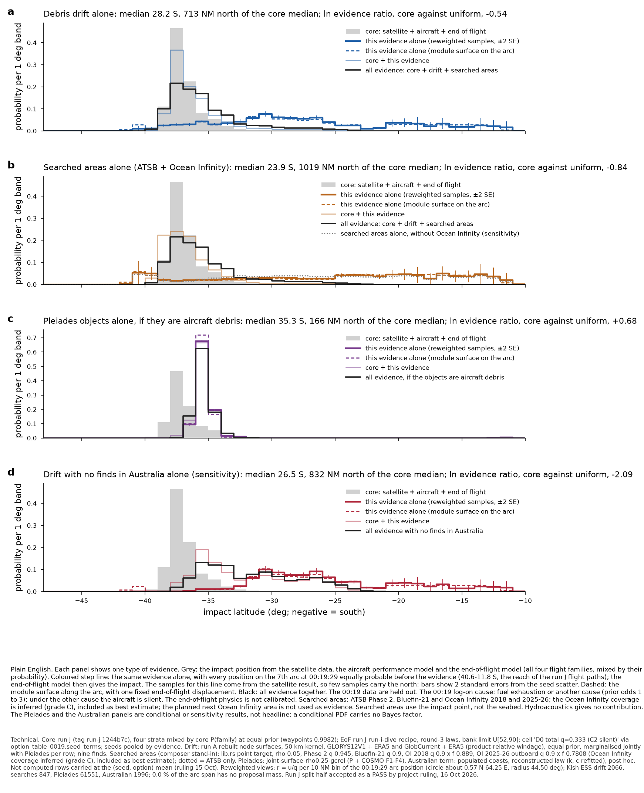
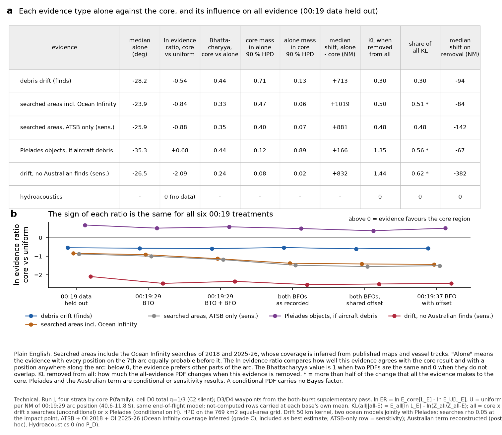
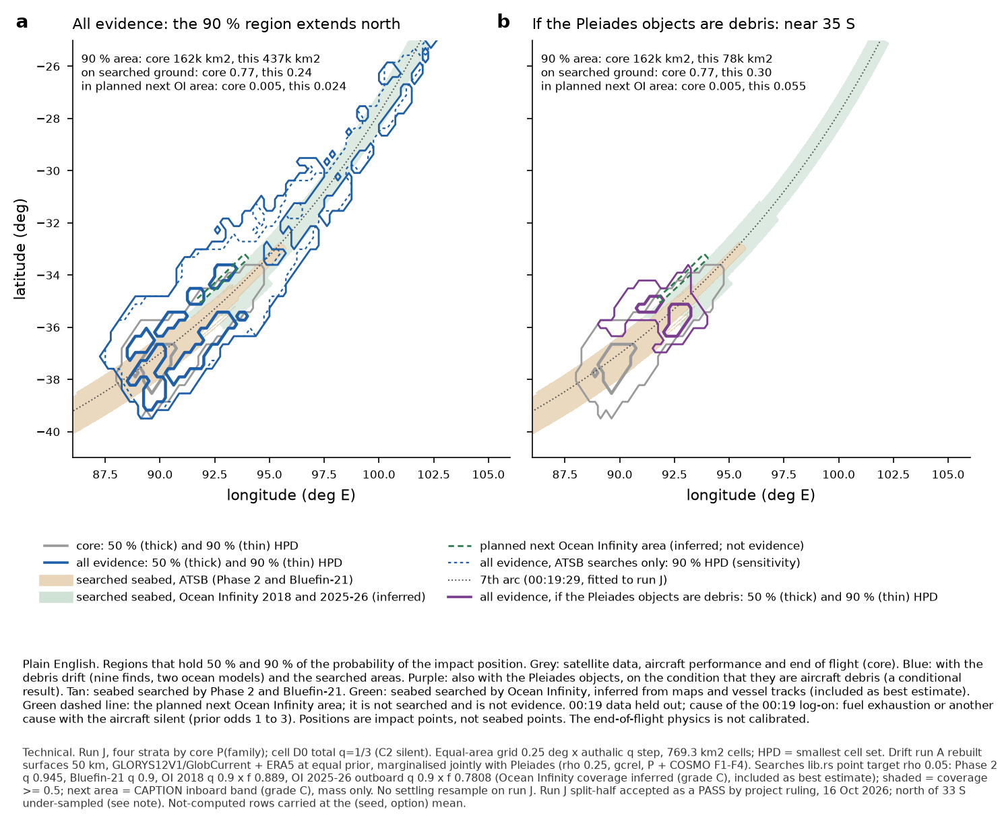

# Composer §0 views on run J — evidence alone, core + E, leave-one-out, all; disagreement; influence; whole-arc outputs

**Version 2, 18 October 2026: searched areas now include Ocean Infinity (base).** Version 1 (17 Oct, commit 554e09e) used the
ATSB-only search layers; that case is now the labelled sensitivity "without Ocean Infinity" and its numbers are reproduced exactly
here. Composer sub-agent of the coordinating session; numpy (as passes 2/2b); scripts in `results/composer-views-run-j/`; data in
`mh370-exchange/composer/run-j-views/` (version 1 tables kept in `excl-oi-v1/`).

**Labels on every number.** Core run J (tag run-j 1244b7c), split-half **accepted as a PASS by project ruling, 16 Oct 2026** (thin
northern detail = stated tail-shape limitation); end of flight run J (run-i-dive recipe, round-3 laws, bank limit U[52, 90]);
uncontrolled-arm physics not calibrated; cause model **competing causes, q = 1/3, other cause silent** (EoF headline).
**Searched areas: ATSB Phase 2 + Bluefin-21 + Ocean Infinity 2018 + Ocean Infinity 2025-26 — "Ocean Infinity coverage inferred
(grade C), included as best estimate"** (Pete, 13 Oct 2026; restated 17 Oct). This is a **composer stand-in** for the searched-areas
module's own run J columns, applied at the **impact point** (no run J settling resample). The planned next Ocean Infinity area is
**not** evidence: it is a map layer, with the probability mass inside it reported. Hydroacoustics contributes nothing (0 by ruling,
no P_D). Pléiades results are **conditional on H** and carry no Bayes factor for H. The Australian non-recovery term is a **labelled
sensitivity**.

## Lead

1. **Reproduced first, both checks pass.**
   - (a) My searched-areas formula reproduces the module's own Ocean Infinity variant columns on run D-he (`searched-areas/next-run-d-he-oi2018`,
     `-oi2025`, and the ATSB base) from their raw per-row coverage columns: max |Δ ln L| 2.6e-7 over 51.2 M rows each (2.46 M rows inside
     OI 2018 coverage, 0.43 M inside OI 2025). My decoded Ocean Infinity rasters give the documented areas, 126,009.3 km² (2018) and
     9,697.0 km² against 9,696.9 km² (2025-26 outboard band).
   - (b) As in version 1: EoF waypoints D0' ln Z −7.5246, ESS 1,941,487, latitude 5/50/95 % −38.40/−37.12/−33.87; drift stand-in, all six
     options (D0' −38.20/−36.86/−30.78, ESS 941.1k, +0.70°); Pléiades test 2 +0.495 / +0.811 (published +0.49 / +0.81). The
     without-OI products reproduce version 1 exactly (e.g. all without OI 35.66 S, 437k km², 0.190 north of 33 S).
2. **All evidence (core × drift × searched areas incl. Ocean Infinity), 00:19 data held out (D0'), four-stratum mixture.**
   Median **36.07 S** (seed SE 0.09°). 50/90/95 % HPD **75k / 437k / 607k km²** (core 19k / 162k / 262k). Mass north of 33 S
   **0.152 ± 0.008** (core 0.032). On searched ground **0.239** (ATSB ground alone 0.177; core 0.771 / 0.724). Inside the planned next
   Ocean Infinity area **0.024** (core 0.005). Label: **north of 33 S under-sampled (effective sample 287; core 121)**.
3. **Difference from the case without Ocean Infinity** (version 1). Including Ocean Infinity moves the all-evidence median **0.41° south**
   (35.66 → 36.07 S) and lowers the mass north of 33 S from 0.190 to 0.152. The 90 % area is unchanged (437k km²) and the 50 % area falls
   from 87k to 75k km². The mass on searched ground falls from 0.344 to 0.239. Ocean Infinity covered the 25–36 S part of the arc that
   the ATSB did not, so it takes probability away from the northern band and returns it, relatively, to 37–38 S. The same direction
   holds in all six 00:19 options: north of 33 S 0.086–0.152 with OI against 0.130–0.240 without.
4. **Each evidence type alone** (7th arc uniform at 00:19:29 over 40.6–11.8 S, same EoF model; reweighted samples / sampling-free
   surface):

   | evidence | median alone | ln evidence ratio, core vs uniform |
   |---|---|---|
   | debris drift | 28.2 / 28.5 S | −0.54 / −0.57 |
   | searched areas incl. Ocean Infinity | **23.9 / 23.4 S** | **−0.84 / −0.75** |
   | searched areas, ATSB only (sens.) | 25.9 / 26.0 S | −0.88 / −0.85 |
   | Australian non-recovery (sens.) | 26.5 / 26.7 S | −2.09 / −2.13 |
   | Pléiades (conditional on H) | 35.3 / 35.4 S | +0.68 / +0.67 |

   Ocean Infinity moves the searches-alone view further north (its searches cover more of the arc). The disagreement with the core
   keeps its sign in every 00:19 option.
5. **Influence.** KL(all ‖ core) = 0.974 nat. **Searched areas now carry 0.51 of it: FLAG (> 0.5)**; drift 0.30. Removing the searches
   moves the median 84 NM south and shrinks the 90 % area by 168k km²; removing drift 94 NM and 151k km². Other flags: Pléiades 0.56 of
   all given H; Australian term 0.62 of its product; **model dominance**: waypoints stratum ≥ 0.996 of every product; core and all given H
   are single-mode (0.984, 0.998).
6. **ρ (probability the wreck could not be found where searched), all evidence, D0':**

   | ρ | median | 90 % area | north of 33 S | on searched ground |
   |---|---|---|---|---|
   | 0 | 35.97 S | 449k km² | 0.162 | 0.167 |
   | 0.05 (reference) | 36.07 S | 437k km² | 0.152 | 0.239 |
   | 0.25 | 36.44 S | 386k km² | 0.124 | 0.434 |
   | 0.5 | 36.69 S | 337k km² | 0.105 | 0.569 |

   ρ moves the median by 0.7° and the northern mass by a factor of 1.5 across its range; it is a first-order uncertainty.
7. **Conditional and sensitivity products.** All given H: 35.45 S, 90 % area 78k km², and 0.055 inside the planned next Ocean Infinity
   area. P(H | D) is not estimable (no identity likelihood). The non-imagery evidence (drift + searches incl. OI) changes the odds of H by
   **+0.42 nat** (D0'; 0.42–0.81 over the six options; without OI +0.53). With the Australian term: 32.19 S, 593k km², north of 33 S 0.548.
8. **Coverage.** The alone views remain under-sampled north of 33 S: effective sample 72 (searches incl. OI), 456 (drift), 10 (Pléiades),
   1,837 (Australian); per 5° band 4–90 for searches alone. The §0.4 arc-wide sample set is still required.

## Deviations (also in the submission)

- Searched areas: composer stand-in (lib.rs point-target formula transcribed; formula and rasters checked against the module's run D-he
  OI columns and documented areas). Raster lookup is the pass-1 function validated against `mh370 evaluate` for the ATSB layers; there
  are no run J columns from the module and no D-he impact positions on the exchange for an end-to-end OI lookup check. Impact point, not seabed.
- Ocean Infinity layers as committed in `coverage/` (grade C): 2018 outline less Phase 2 ground, coverage fraction 0.889; 2025-26 outboard
  band only, coverage fraction 0.7808; detection probability 0.9 for both. Inferred next area = `oi2024_proposed_inboard_northwest` from the frozen
  snapshot's `search_footprints.geojson` (≈ 6,072 km²), not the CAPTION OI2025B layer (6,388 km²); mass only.
- "On searched ground" = Σ w × [1 − Π_k (1 − f_k c_k)] (coverage-fraction-weighted union); ATSB-only value beside it.
- Searched-areas model-error sensitivity is now the ρ sweep 0 / 0.25 / 0.5; the ρ 0.10 product of version 1 is not recomputed.
- As version 1: no settling; drift for non-waypoints strata from my transcription of the export lookup (7.6e-6 agreement on waypoints);
  D3/D4 waypoints from the both-burst supplementary set; arc-uniform views exclude rows with no 00:19:29 crossing (0.47 % of D0'/D1 core
  weight); arc span = reach of run J crossings; one pooled displacement for view (a)(i); family B = codes 3 + 6; Pléiades not-computed cells
  carried at the mean; 400-draw seed bootstrap; KL for the leave-one-out of searches from "all given H without OI" not computed (pair not accumulated).

## 1. Method (changes from version 1 in bold)

- Row mass: end of flight's `option_table_0019.seed_terms` unchanged; seeds pooled by evidence; strata by core P(family) (waypoints 0.9982).
- Factors per row: drift (two ocean models, 50 km), Pléiades (rho 0.25 gcrel), Australian term (refitted law, identical constants);
  ocean model marginalised jointly Λ = ½(D_G P_G + D_C P_C). **Searched areas: L = ρ + (1 − ρ) Π_k (1 − c_k(y) q_k f_k)** over Phase 2
  (q 0.945, f 1), Bluefin-21 (0.9, 1), **OI 2018 (0.9, 0.889), OI 2025-26 outboard band (0.9, 0.7808)**, ρ ∈ {0, **0.05**, 0.25, 0.5};
  sensitivity: ATSB only, ρ 0.05.
- Not-computed rows carried at the mean under each product's own base (ruling of 15 Oct).
- View (a)(ii): r = u/q per 10 NM bin of the 00:19:29 arc position (small circle, centre 0.570 N 64.252 E, radius 44.501°; **the official
  ATSB 7th arc at FL400 lies within −10 to +7 km of it, mean +2.4 km, over 44 S–45 N**). View (a)(i): module surfaces at every arc bin
  convolved with one displacement distribution.
- Equal-area grid 769.31 km² cells; disagreement, influence and effective-sample definitions as version 1.

## 2. Views, disagreement and influence — D0', four-stratum mixture

Full tables for all six options, families, strata, modes, ρ sweep, sensitivities, not-computed shares and coverage: **Appendix A**.
Per-row CSVs: `products.csv` (now with `p_on_searched_ground_incl_OI`, `p_on_atsb_ground`, `p_in_next_oi_area_not_evidence`),
`bands-1deg-mixture.csv`, `disagreement-influence.csv`, `modes.csv`, `coverage-ess.csv`, `not-computed.csv`, `pleiades-odds-factors.csv`.

Readings:
1. **Triangulation.** Drift and searched areas each say "not 37–39 S" on their own; with Ocean Infinity the searches also say
   "not 25–36 S along the arc", so the searches-alone view moves to 23.9 S. Together with the core they move the all-evidence median
   1.1° north of the core (99 NM along the arc: core 1,239 NM, all 1,338 NM from the southern tip) and widen the 90 % region 2.7 times.
2. **What Ocean Infinity changes.** It takes mass from the 34–36 S band that the core and drift favour (the all-evidence mode near 34 S falls
   from 0.194 to 0.145) and from the north (north of 33 S 0.190 → 0.152). The 37.2 S mode rises from 0.280 to 0.336.
3. **Searches now carry over half of the change from the core** (0.51 of KL). With the grade-C Ocean Infinity geometry in the base,
   the result depends on the inferred coverage fractions (0.889, 0.7808) and on ρ (6 above) more than on any other single input except the
   Australian sensitivity.

## 3. Whole-arc outputs (§0.7)

Mass per 1° band with seed-bootstrap Monte Carlo error, every mode, HPD 50/90/95 % areas, mass on searched ground (incl. OI and ATSB
only) and inside the planned next Ocean Infinity area: CSVs above and Appendix A. Planned next area, all evidence: D0' 0.024, D1 0.009,
D2 0.011, D3 0.003, D4 0.005, D5 0.008; all given H, D0' 0.055.

## 4. Model error declared per module (§0.5)

| module | declared model error (source) | sensitivity here |
|---|---|---|
| satcom + flight core | BTO/BFO noise, BFO bias drift inside the filter | not available (requested of core) |
| end of flight | uncalibrated uncontrolled arm (labelled) | none supplied |
| drift | transport MC noise, two ocean products, ocean-error OU, windage priors, 50 km kernel | kernel 100 km: D0' all 36.39 S, 402k km², N33 0.124; GLORYS12 only 35.81 S / 485k / 0.200; GlobCurrent only 36.34 S / 352k / 0.103 |
| searched areas | ρ (no published value), q 0.945 / 0.9 / 0.9 / 0.9, OI coverage fractions 0.889 / 0.7808 (grade C) | ρ 0 / 0.25 / 0.5 (lead item 6); without Ocean Infinity (lead item 3) |
| Pléiades | object-position OU variances, rho 0.25, two ocean models | none supplied |
| Australian term | law residual 0.19 / 0.14 nat, split-half SD 0.50 nat | is itself a sensitivity |

## 5. Shared inputs (§0.6)

As version 1: ocean model declared and jointly marginalised; ocean realisation and windage between drift and Pléiades are **dependence
gaps**; impact versus seabed position a gap (no settling); end-of-flight family and 00:19 option declared. **New:** Phase 2 and Ocean
Infinity 2018 overlap is removed in the 2018 layer itself (outline less Phase 2 ground), so the two campaigns are not double-counted.

## 6. COVERAGE

**(a) Feasible set / (b) model's reach:** as version 1 (arc span reached by run J crossings 40.6 S 82.8 E – 11.8 S 107.3 E; impacts
46.6–10.4 S; drift grid 41.2–21.2 S; Pléiades 45–5 S; search layers: Phase 2 40.2 S north, Bluefin-21 near 21 S, OI 2018 35.8–24.6 S,
OI 2025-26 outboard band near 34–36 S). **(c) Proposal coverage:** Kish ESS of all 289k (D0'); effective sample north of 33 S: core 121,
all 287, all without OI 345, all given H 218; view (a): searches incl. OI 72, without OI 97, drift 456, Pléiades 10, Australian 1,837.
Per 5° band (Appendix A): all 727 / 364 / 353 in 40–35 / 35–30 / 30–25 S; searches alone 4–90. No band of the drift, searches or
Australian view (a) reaches 1,000. D3/D4: 7.7 % / 6.8 % of the arc span has no proposal mass. **Gaps:** arc-wide sample set (§0.4);
settling on run J (G12); module-published run J searched-areas columns; Ocean Infinity swath geometry (grade C outlines only); drift–Pléiades
realisation and windage dependence. **Not-computed share** (core weight): drift ≤ 1.8e-4, Pléiades ≤ 5.3e-6, searches 0, hydro 0.

## 7. Tests 8 and 9: all pass (unchanged; `tests-8-9.json`)

## 8. Open questions for Pete

1. How the planned next Ocean Infinity area is used (layer only here; probability of success if searched; or a labelled what-if
   "searched and nothing found"). Under the base it holds 0.024 of the all-evidence mass (0.055 if the Pléiades objects are debris).
2. The Australian detection level (still a sensitivity; largest disagreement with the core, ln ER −2.09; 0.62 of its product's KL).
3. P(H | D) for Pléiades (prior on H + identity likelihood, or only the odds factor +0.42 nat).
4. The arc span for "uniform along the arc" (reach of run J crossings used, or from the core prior).
5. The 0.47 % of D0'/D1 core weight with no 00:19:29 crossing (EoF to label).
6. With searches now carrying more than half of the KL and resting on grade-C Ocean Infinity coverage fractions, should the coverage
   fractions (0.889, 0.7808) be swept as well as ρ?

-- Composer

## Appendix A — generated tables (all options; searches incl. Ocean Infinity unless labelled)

#### D0' 00:19 data held out — four-stratum mixture, cause model q = 1/3 (other cause silent)

| evidence E | view | median lat | median along arc (NM from S tip) | 50 % / 90 % HPD km² | mass N of 33 S | effective sample N of 33 S | Kish ESS | on searched ground incl. OI (ATSB only) | in inferred next OI area |
|---|---|---|---|---|---|---|---|---|---|
| core (satcom + flight + EoF) | = view (a) for the core | -37.13 | 1239 | 19k / 162k | 0.032 | 121 | 1.95e+06 | 0.77 (0.72) | 0.0048 |
| debris drift (finds) | (a)(i) module surface on the arc | -28.52 | 1961 | – | 0.765 | (no sampling) | – | – | – |
| | (a)(ii) alone, reweighted run J | -28.18 | 1953 | 191k / 720k | 0.786 | 456 | 2.07e+03 | 0.33 (0.11) | 0.0036 |
| | (b) core + E | -36.86 | 1255 | 38k / 269k | 0.085 | 229 | 9.42e+05 | 0.71 (0.62) | 0.0088 |
| | (c) all except E | -36.98 | 1244 | 45k / 286k | 0.068 | 161 | 8.64e+05 | 0.28 (0.24) | 0.0156 |
| | all | -36.07 | 1338 | 75k / 437k | 0.152 | 287 | 2.89e+05 | 0.24 (0.18) | 0.0238 |
| searched areas incl. Ocean Infinity (base) | (a)(i) module surface on the arc | -23.39 | 2323 | – | 0.771 | (no sampling) | – | – | – |
| | (a)(ii) alone, reweighted run J | -23.88 | 2258 | 161k / 848k | 0.771 | 72 | 847 | 0.08 (0.03) | 0.0046 |
| | (b) core + E | -36.98 | 1244 | 45k / 286k | 0.068 | 161 | 8.64e+05 | 0.28 (0.24) | 0.0156 |
| | (c) all except E | -36.86 | 1255 | 38k / 269k | 0.085 | 229 | 9.42e+05 | 0.71 (0.62) | 0.0088 |
| | all | -36.07 | 1338 | 75k / 437k | 0.152 | 287 | 2.89e+05 | 0.24 (0.18) | 0.0238 |
| searched areas WITHOUT Ocean Infinity (SENSITIVITY) | (a)(i) module surface on the arc | -25.98 | 2146 | – | 0.787 | (no sampling) | – | – | – |
| | (a)(ii) alone, reweighted run J | -25.88 | 2121 | 188k / 793k | 0.776 | 97 | 1.17e+03 | 0.20 (0.02) | 0.0039 |
| | (b) core + E | -36.71 | 1252 | 57k / 319k | 0.091 | 180 | 7.91e+05 | 0.35 (0.22) | 0.0138 |
| | (c) all except E | -36.86 | 1255 | 38k / 269k | 0.085 | 229 | 9.42e+05 | 0.71 (0.62) | 0.0088 |
| | all without OI | -35.66 | 1397 | 87k / 437k | 0.190 | 345 | 3.09e+05 | 0.34 (0.15) | 0.0198 |
| Pléiades (conditional on H) | (a)(i) module surface on the arc | -35.41 | 1407 | – | 0.003 | (no sampling) | – | – | – |
| | (a)(ii) alone, reweighted run J | -35.35 | 1405 | 13k / 60k | 0.016 | 10 | 6.16e+04 | 0.75 (0.61) | 0.0191 |
| | (b) core + E | -35.39 | 1405 | 13k / 67k | 0.002 | 211 | 1.41e+05 | 0.76 (0.63) | 0.0170 |
| | (c) all except E | -36.07 | 1338 | 75k / 437k | 0.152 | 287 | 2.89e+05 | 0.24 (0.18) | 0.0238 |
| | all | H | -35.45 | 1405 | 16k / 78k | 0.006 | 218 | 6.23e+04 | 0.30 (0.20) | 0.0548 |
| drift + Australian non-recovery (SENSITIVITY) | (a)(i) module surface on the arc | -26.67 | 2093 | – | 0.931 | (no sampling) | – | – | – |
| | (a)(ii) alone, reweighted run J | -26.50 | 2071 | 135k / 562k | 0.959 | 1837 | 2e+03 | 0.27 (0.02) | 0.0016 |
| | (b) core + E | -33.47 | 1530 | 140k / 515k | 0.469 | 1130 | 9.61e+04 | 0.49 (0.23) | 0.0185 |
| | (c) all except E | -36.98 | 1244 | 45k / 286k | 0.068 | 161 | 8.64e+05 | 0.28 (0.24) | 0.0156 |
| | all (with Australian term) | -32.19 | 1626 | 172k / 593k | 0.548 | 1293 | 4.51e+04 | 0.16 (0.04) | 0.0322 |
| hydroacoustics | all views | contributes nothing (0 by ruling, no P_D) | | | | | | | |

| E | ln ER (a) vs core, (ii) / (i) | 90 % HPD: core mass in (a) / (a) mass in core | Bhattacharyya (a) vs core | median shift (a) − core, NM | ln E[L_E given all others] (c→all) | Bhattacharyya (c) vs all | KL(all ‖ all−E) nats / share of KL(all ‖ core) | Δ median, Δ 90 % area on removal |
|---|---|---|---|---|---|---|---|---|
| debris drift (finds) | -0.54 / -0.57 | 0.71 / 0.13 | 0.44 | 713 | -2.82 (-0.36 vs uniform) | 0.93 | 0.30 / 0.30 | -94 NM, -151k km² |
| searched areas incl. Ocean Infinity (base) | -0.84 / -0.75 | 0.47 / 0.06 | 0.33 | 1019 | -0.99 (-0.66 vs uniform) | 0.89 | 0.50 / 0.51 **>0.5** | -84 NM, -168k km² |
| searched areas WITHOUT Ocean Infinity (SENSITIVITY) | -0.88 / -0.85 | 0.40 / 0.07 | 0.35 | 881 | -0.81 (-0.64 vs uniform) | 0.89 | 0.48 / 0.48 | -142 NM, -168k km² |
| Pléiades (conditional on H) | +0.68 / +0.67 | 0.12 / 0.89 | 0.44 | 166 | -2.52 (+1.10 vs uniform) | 0.61 | 1.35 / 0.56 **>0.5** | -67 NM, +359k km² |
| drift + Australian non-recovery (SENSITIVITY) | -2.09 / -2.13 | 0.08 / 0.02 | 0.24 | 832 | -4.51 (-1.48 vs uniform) | 0.63 | 1.44 / 0.62 **>0.5** | -382 NM, -307k km² |

#### D1 00:19:29 BTO — four-stratum mixture, cause model q = 1/3 (other cause silent)

| evidence E | view | median lat | median along arc (NM from S tip) | 50 % / 90 % HPD km² | mass N of 33 S | effective sample N of 33 S | Kish ESS | on searched ground incl. OI (ATSB only) | in inferred next OI area |
|---|---|---|---|---|---|---|---|---|---|
| core (satcom + flight + EoF) | = view (a) for the core | -37.21 | 1238 | 15k / 116k | 0.018 | 81 | 2.15e+06 | 0.81 (0.77) | 0.0013 |
| debris drift (finds) | (a)(i) module surface on the arc | -28.52 | 1961 | – | 0.765 | (no sampling) | – | – | – |
| | (a)(ii) alone, reweighted run J | -28.34 | 1946 | 145k / 552k | 0.771 | 342 | 2.17e+03 | 0.39 (0.13) | 0.0012 |
| | (b) core + E | -37.07 | 1243 | 27k / 158k | 0.049 | 139 | 1.31e+06 | 0.77 (0.70) | 0.0026 |
| | (c) all except E | -37.41 | 1238 | 30k / 198k | 0.037 | 112 | 1.18e+06 | 0.33 (0.30) | 0.0049 |
| | all | -36.88 | 1268 | 42k / 281k | 0.086 | 177 | 4.9e+05 | 0.30 (0.24) | 0.0085 |
| searched areas incl. Ocean Infinity (base) | (a)(i) module surface on the arc | -23.39 | 2323 | – | 0.771 | (no sampling) | – | – | – |
| | (a)(ii) alone, reweighted run J | -23.37 | 2294 | 128k / 652k | 0.769 | 66 | 780 | 0.09 (0.03) | 0.0016 |
| | (b) core + E | -37.41 | 1238 | 30k / 198k | 0.037 | 112 | 1.18e+06 | 0.33 (0.30) | 0.0049 |
| | (c) all except E | -37.07 | 1243 | 27k / 158k | 0.049 | 139 | 1.31e+06 | 0.77 (0.70) | 0.0026 |
| | all | -36.88 | 1268 | 42k / 281k | 0.086 | 177 | 4.9e+05 | 0.30 (0.24) | 0.0085 |
| searched areas WITHOUT Ocean Infinity (SENSITIVITY) | (a)(i) module surface on the arc | -25.98 | 2146 | – | 0.787 | (no sampling) | – | – | – |
| | (a)(ii) alone, reweighted run J | -25.70 | 2136 | 152k / 612k | 0.779 | 93 | 1.14e+03 | 0.23 (0.03) | 0.0013 |
| | (b) core + E | -37.22 | 1240 | 38k / 225k | 0.059 | 106 | 1.09e+06 | 0.38 (0.27) | 0.0044 |
| | (c) all except E | -37.07 | 1243 | 27k / 158k | 0.049 | 139 | 1.31e+06 | 0.77 (0.70) | 0.0026 |
| | all without OI | -36.35 | 1335 | 52k / 306k | 0.130 | 170 | 4.74e+05 | 0.39 (0.20) | 0.0071 |
| Pléiades (conditional on H) | (a)(i) module surface on the arc | -35.41 | 1407 | – | 0.003 | (no sampling) | – | – | – |
| | (a)(ii) alone, reweighted run J | -35.43 | 1406 | 10k / 44k | 0.005 | 2 | 1.01e+05 | 0.83 (0.71) | 0.0067 |
| | (b) core + E | -35.46 | 1406 | 10k / 53k | 0.000 | 40 | 1.91e+05 | 0.83 (0.72) | 0.0058 |
| | (c) all except E | -36.88 | 1268 | 42k / 281k | 0.086 | 177 | 4.9e+05 | 0.30 (0.24) | 0.0085 |
| | all | H | -35.65 | 1409 | 9k / 55k | 0.001 | 47 | 6.79e+04 | 0.38 (0.26) | 0.0218 |
| drift + Australian non-recovery (SENSITIVITY) | (a)(i) module surface on the arc | -26.67 | 2093 | – | 0.931 | (no sampling) | – | – | – |
| | (a)(ii) alone, reweighted run J | -26.55 | 2073 | 100k / 409k | 0.961 | 1920 | 2.08e+03 | 0.33 (0.02) | 0.0006 |
| | (b) core + E | -34.47 | 1486 | 88k / 354k | 0.402 | 549 | 1.74e+05 | 0.63 (0.34) | 0.0080 |
| | (c) all except E | -37.41 | 1238 | 30k / 198k | 0.037 | 112 | 1.18e+06 | 0.33 (0.30) | 0.0049 |
| | all (with Australian term) | -32.48 | 1654 | 121k / 467k | 0.520 | 783 | 7.3e+04 | 0.25 (0.08) | 0.0178 |
| hydroacoustics | all views | contributes nothing (0 by ruling, no P_D) | | | | | | | |

| E | ln ER (a) vs core, (ii) / (i) | 90 % HPD: core mass in (a) / (a) mass in core | Bhattacharyya (a) vs core | median shift (a) − core, NM | ln E[L_E given all others] (c→all) | Bhattacharyya (c) vs all | KL(all ‖ all−E) nats / share of KL(all ‖ core) | Δ median, Δ 90 % area on removal |
|---|---|---|---|---|---|---|---|---|
| debris drift (finds) | -0.57 / -0.65 | 0.72 / 0.12 | 0.40 | 709 | -2.96 (-0.45 vs uniform) | 0.93 | 0.31 / 0.32 | -30 NM, -83k km² |
| searched areas incl. Ocean Infinity (base) | -0.91 / -0.87 | 0.45 / 0.05 | 0.30 | 1056 | -1.17 (-0.79 vs uniform) | 0.89 | 0.54 / 0.56 **>0.5** | -25 NM, -122k km² |
| searched areas WITHOUT Ocean Infinity (SENSITIVITY) | -1.00 / -0.99 | 0.32 / 0.05 | 0.31 | 899 | -0.99 (-0.80 vs uniform) | 0.88 | 0.54 / 0.52 **>0.5** | -92 NM, -148k km² |
| Pléiades (conditional on H) | +0.52 / +0.47 | 0.09 / 0.84 | 0.40 | 169 | -2.61 (+1.03 vs uniform) | 0.58 | 1.44 / 0.54 **>0.5** | -142 NM, +226k km² |
| drift + Australian non-recovery (SENSITIVITY) | -2.46 / -2.57 | 0.06 / 0.02 | 0.20 | 836 | -5.08 (-1.97 vs uniform) | 0.59 | 1.70 / 0.67 **>0.5** | -416 NM, -269k km² |

#### D2 00:19:29 BTO + BFO — four-stratum mixture, cause model q = 1/3 (other cause silent)

| evidence E | view | median lat | median along arc (NM from S tip) | 50 % / 90 % HPD km² | mass N of 33 S | effective sample N of 33 S | Kish ESS | on searched ground incl. OI (ATSB only) | in inferred next OI area |
|---|---|---|---|---|---|---|---|---|---|
| core (satcom + flight + EoF) | = view (a) for the core | -37.13 | 1238 | 12k / 103k | 0.024 | 90 | 9.22e+04 | 0.88 (0.84) | 0.0014 |
| debris drift (finds) | (a)(i) module surface on the arc | -28.52 | 1961 | – | 0.765 | (no sampling) | – | – | – |
| | (a)(ii) alone, reweighted run J | -28.31 | 1954 | 108k / 399k | 0.776 | 277 | 1.06e+03 | 0.41 (0.14) | 0.0012 |
| | (b) core + E | -36.99 | 1245 | 24k / 149k | 0.061 | 132 | 5.91e+04 | 0.83 (0.75) | 0.0027 |
| | (c) all except E | -37.07 | 1239 | 35k / 224k | 0.061 | 144 | 3.51e+04 | 0.47 (0.41) | 0.0066 |
| | all | -36.42 | 1312 | 48k / 297k | 0.126 | 184 | 2.08e+04 | 0.40 (0.31) | 0.0106 |
| searched areas incl. Ocean Infinity (base) | (a)(i) module surface on the arc | -23.39 | 2323 | – | 0.771 | (no sampling) | – | – | – |
| | (a)(ii) alone, reweighted run J | -22.92 | 2327 | 65k / 428k | 0.795 | 59 | 384 | 0.10 (0.04) | 0.0016 |
| | (b) core + E | -37.07 | 1239 | 35k / 224k | 0.061 | 144 | 3.51e+04 | 0.47 (0.41) | 0.0066 |
| | (c) all except E | -36.99 | 1245 | 24k / 149k | 0.061 | 132 | 5.91e+04 | 0.83 (0.75) | 0.0027 |
| | all | -36.42 | 1312 | 48k / 297k | 0.126 | 184 | 2.08e+04 | 0.40 (0.31) | 0.0106 |
| searched areas WITHOUT Ocean Infinity (SENSITIVITY) | (a)(i) module surface on the arc | -25.98 | 2146 | – | 0.787 | (no sampling) | – | – | – |
| | (a)(ii) alone, reweighted run J | -25.49 | 2158 | 93k / 399k | 0.799 | 86 | 576 | 0.25 (0.03) | 0.0013 |
| | (b) core + E | -36.87 | 1249 | 45k / 250k | 0.093 | 126 | 3.46e+04 | 0.52 (0.36) | 0.0056 |
| | (c) all except E | -36.99 | 1245 | 24k / 149k | 0.061 | 132 | 5.91e+04 | 0.83 (0.75) | 0.0027 |
| | all without OI | -35.82 | 1400 | 59k / 300k | 0.182 | 186 | 1.86e+04 | 0.50 (0.24) | 0.0082 |
| Pléiades (conditional on H) | (a)(i) module surface on the arc | -35.41 | 1407 | – | 0.003 | (no sampling) | – | – | – |
| | (a)(ii) alone, reweighted run J | -35.42 | 1405 | 9k / 38k | 0.003 | 2 | 9.31e+03 | 0.85 (0.73) | 0.0060 |
| | (b) core + E | -35.45 | 1405 | 10k / 45k | 0.000 | 19 | 9.95e+03 | 0.85 (0.74) | 0.0054 |
| | (c) all except E | -36.42 | 1312 | 48k / 297k | 0.126 | 184 | 2.08e+04 | 0.40 (0.31) | 0.0106 |
| | all | H | -35.63 | 1409 | 8k / 47k | 0.000 | 24 | 4.3e+03 | 0.42 (0.30) | 0.0220 |
| drift + Australian non-recovery (SENSITIVITY) | (a)(i) module surface on the arc | -26.67 | 2093 | – | 0.931 | (no sampling) | – | – | – |
| | (a)(ii) alone, reweighted run J | -26.51 | 2080 | 79k / 298k | 0.961 | 890 | 963 | 0.34 (0.02) | 0.0005 |
| | (b) core + E | -34.11 | 1509 | 75k / 302k | 0.443 | 479 | 8.68e+03 | 0.66 (0.34) | 0.0072 |
| | (c) all except E | -37.07 | 1239 | 35k / 224k | 0.061 | 144 | 3.51e+04 | 0.47 (0.41) | 0.0066 |
| | all (with Australian term) | -30.97 | 1790 | 95k / 396k | 0.593 | 578 | 3.29e+03 | 0.28 (0.09) | 0.0168 |
| hydroacoustics | all views | contributes nothing (0 by ruling, no P_D) | | | | | | | |

| E | ln ER (a) vs core, (ii) / (i) | 90 % HPD: core mass in (a) / (a) mass in core | Bhattacharyya (a) vs core | median shift (a) − core, NM | ln E[L_E given all others] (c→all) | Bhattacharyya (c) vs all | KL(all ‖ all−E) nats / share of KL(all ‖ core) | Δ median, Δ 90 % area on removal |
|---|---|---|---|---|---|---|---|---|
| debris drift (finds) | -0.58 / -0.64 | 0.68 / 0.12 | 0.41 | 717 | -2.88 (-0.39 vs uniform) | 0.94 | 0.28 / 0.28 | -73 NM, -73k km² |
| searched areas incl. Ocean Infinity (base) | -1.13 / -1.14 | 0.34 / 0.04 | 0.29 | 1089 | -1.36 (-0.94 vs uniform) | 0.89 | 0.53 / 0.53 **>0.5** | -67 NM, -148k km² |
| searched areas WITHOUT Ocean Infinity (SENSITIVITY) | -1.18 / -1.20 | 0.27 / 0.05 | 0.31 | 920 | -1.11 (-0.90 vs uniform) | 0.88 | 0.57 / 0.51 **>0.5** | -155 NM, -151k km² |
| Pléiades (conditional on H) | +0.59 / +0.60 | 0.10 / 0.87 | 0.42 | 168 | -2.37 (+1.22 vs uniform) | 0.61 | 1.30 / 0.49 | -97 NM, +250k km² |
| drift + Australian non-recovery (SENSITIVITY) | -2.35 / -2.44 | 0.06 / 0.02 | 0.22 | 842 | -4.73 (-1.65 vs uniform) | 0.63 | 1.53 / 0.59 **>0.5** | -550 NM, -172k km² |

#### D3 both BFOs as recorded — four-stratum mixture, cause model q = 1/3 (other cause silent)

| evidence E | view | median lat | median along arc (NM from S tip) | 50 % / 90 % HPD km² | mass N of 33 S | effective sample N of 33 S | Kish ESS | on searched ground incl. OI (ATSB only) | in inferred next OI area |
|---|---|---|---|---|---|---|---|---|---|
| core (satcom + flight + EoF) | = view (a) for the core | -37.31 | 1236 | 6k / 57k | 0.015 | 36 | 6.35e+03 | 0.95 (0.92) | 0.0003 |
| debris drift (finds) | (a)(i) module surface on the arc | -28.52 | 1961 | – | 0.765 | (no sampling) | – | – | – |
| | (a)(ii) alone, reweighted run J | -28.94 | 1905 | 65k / 221k | 0.755 | 289 | 489 | 0.52 (0.18) | 0.0004 |
| | (b) core + E | -37.24 | 1238 | 11k / 77k | 0.040 | 58 | 4.35e+03 | 0.91 (0.85) | 0.0006 |
| | (c) all except E | -37.22 | 1238 | 15k / 96k | 0.044 | 39 | 1.34e+03 | 0.68 (0.63) | 0.0022 |
| | all | -36.64 | 1316 | 18k / 128k | 0.095 | 60 | 508 | 0.57 (0.48) | 0.0033 |
| searched areas incl. Ocean Infinity (base) | (a)(i) module surface on the arc | -23.39 | 2323 | – | 0.771 | (no sampling) | – | – | – |
| | (a)(ii) alone, reweighted run J | -22.94 | 2325 | 41k / 176k | 0.797 | 99 | 212 | 0.13 (0.04) | 0.0006 |
| | (b) core + E | -37.22 | 1238 | 15k / 96k | 0.044 | 39 | 1.34e+03 | 0.68 (0.63) | 0.0022 |
| | (c) all except E | -37.24 | 1238 | 11k / 77k | 0.040 | 58 | 4.35e+03 | 0.91 (0.85) | 0.0006 |
| | all | -36.64 | 1316 | 18k / 128k | 0.095 | 60 | 508 | 0.57 (0.48) | 0.0033 |
| searched areas WITHOUT Ocean Infinity (SENSITIVITY) | (a)(i) module surface on the arc | -25.98 | 2146 | – | 0.787 | (no sampling) | – | – | – |
| | (a)(ii) alone, reweighted run J | -25.75 | 2138 | 56k / 187k | 0.814 | 158 | 323 | 0.31 (0.03) | 0.0005 |
| | (b) core + E | -37.04 | 1244 | 21k / 122k | 0.082 | 46 | 1.4e+03 | 0.71 (0.54) | 0.0019 |
| | (c) all except E | -37.24 | 1238 | 11k / 77k | 0.040 | 58 | 4.35e+03 | 0.91 (0.85) | 0.0006 |
| | all without OI | -36.06 | 1394 | 25k / 150k | 0.165 | 87 | 627 | 0.64 (0.38) | 0.0025 |
| Pléiades (conditional on H) | (a)(i) module surface on the arc | -35.41 | 1407 | – | 0.003 | (no sampling) | – | – | – |
| | (a)(ii) alone, reweighted run J | -35.43 | 1412 | 7k / 27k | 0.000 | 16 | 633 | 0.90 (0.82) | 0.0016 |
| | (b) core + E | -35.45 | 1413 | 6k / 28k | 0.000 | 18 | 621 | 0.90 (0.83) | 0.0013 |
| | (c) all except E | -36.64 | 1316 | 18k / 128k | 0.095 | 60 | 508 | 0.57 (0.48) | 0.0033 |
| | all | H | -35.63 | 1415 | 5k / 25k | 0.000 | 29 | 154 | 0.49 (0.39) | 0.0052 |
| drift + Australian non-recovery (SENSITIVITY) | (a)(i) module surface on the arc | -26.67 | 2093 | – | 0.931 | (no sampling) | – | – | – |
| | (a)(ii) alone, reweighted run J | -27.14 | 2040 | 43k / 143k | 0.959 | 294 | 319 | 0.46 (0.03) | 0.0002 |
| | (b) core + E | -34.77 | 1470 | 32k / 155k | 0.393 | 144 | 706 | 0.77 (0.44) | 0.0021 |
| | (c) all except E | -37.22 | 1238 | 15k / 96k | 0.044 | 39 | 1.34e+03 | 0.68 (0.63) | 0.0022 |
| | all (with Australian term) | -31.18 | 1778 | 35k / 175k | 0.553 | 146 | 343 | 0.40 (0.15) | 0.0064 |
| hydroacoustics | all views | contributes nothing (0 by ruling, no P_D) | | | | | | | |

| E | ln ER (a) vs core, (ii) / (i) | 90 % HPD: core mass in (a) / (a) mass in core | Bhattacharyya (a) vs core | median shift (a) − core, NM | ln E[L_E given all others] (c→all) | Bhattacharyya (c) vs all | KL(all ‖ all−E) nats / share of KL(all ‖ core) | Δ median, Δ 90 % area on removal |
|---|---|---|---|---|---|---|---|---|
| debris drift (finds) | -0.53 / -0.64 | 0.53 / 0.11 | 0.40 | 670 | -2.87 (-0.33 vs uniform) | 0.94 | 0.25 / 0.27 | -78 NM, -32k km² |
| searched areas incl. Ocean Infinity (base) | -1.38 / -1.47 | 0.06 / 0.03 | 0.25 | 1089 | -1.69 (-1.18 vs uniform) | 0.92 | 0.47 / 0.51 **>0.5** | -78 NM, -52k km² |
| searched areas WITHOUT Ocean Infinity (SENSITIVITY) | -1.48 / -1.53 | 0.05 / 0.03 | 0.26 | 903 | -1.44 (-1.19 vs uniform) | 0.88 | 0.59 / 0.53 **>0.5** | -156 NM, -73k km² |
| Pléiades (conditional on H) | +0.49 / +0.62 | 0.10 / 0.78 | 0.40 | 176 | -2.17 (+1.30 vs uniform) | 0.63 | 1.17 / 0.43 | -99 NM, +104k km² |
| drift + Australian non-recovery (SENSITIVITY) | -2.53 / -2.65 | 0.03 / 0.02 | 0.19 | 805 | -4.88 (-1.76 vs uniform) | 0.63 | 1.57 / 0.57 **>0.5** | -540 NM, -78k km² |

#### D4 both BFOs, shared start-up offset — four-stratum mixture, cause model q = 1/3 (other cause silent)

| evidence E | view | median lat | median along arc (NM from S tip) | 50 % / 90 % HPD km² | mass N of 33 S | effective sample N of 33 S | Kish ESS | on searched ground incl. OI (ATSB only) | in inferred next OI area |
|---|---|---|---|---|---|---|---|---|---|
| core (satcom + flight + EoF) | = view (a) for the core | -37.24 | 1236 | 5k / 51k | 0.019 | 17 | 4.44e+04 | 0.96 (0.93) | 0.0004 |
| debris drift (finds) | (a)(i) module surface on the arc | -28.52 | 1961 | – | 0.765 | (no sampling) | – | – | – |
| | (a)(ii) alone, reweighted run J | -28.81 | 1918 | 69k / 246k | 0.766 | 465 | 769 | 0.56 (0.18) | 0.0004 |
| | (b) core + E | -37.16 | 1238 | 8k / 78k | 0.053 | 28 | 2.91e+04 | 0.94 (0.87) | 0.0008 |
| | (c) all except E | -37.17 | 1238 | 11k / 104k | 0.057 | 18 | 2.46e+04 | 0.76 (0.71) | 0.0031 |
| | all | -36.74 | 1294 | 20k / 155k | 0.127 | 36 | 9.13e+03 | 0.66 (0.56) | 0.0050 |
| searched areas incl. Ocean Infinity (base) | (a)(i) module surface on the arc | -23.39 | 2323 | – | 0.771 | (no sampling) | – | – | – |
| | (a)(ii) alone, reweighted run J | -22.67 | 2354 | 39k / 230k | 0.817 | 77 | 238 | 0.15 (0.05) | 0.0006 |
| | (b) core + E | -37.17 | 1238 | 11k / 104k | 0.057 | 18 | 2.46e+04 | 0.76 (0.71) | 0.0031 |
| | (c) all except E | -37.16 | 1238 | 8k / 78k | 0.053 | 28 | 2.91e+04 | 0.94 (0.87) | 0.0008 |
| | all | -36.74 | 1294 | 20k / 155k | 0.127 | 36 | 9.13e+03 | 0.66 (0.56) | 0.0050 |
| searched areas WITHOUT Ocean Infinity (SENSITIVITY) | (a)(i) module surface on the arc | -25.98 | 2146 | – | 0.787 | (no sampling) | – | – | – |
| | (a)(ii) alone, reweighted run J | -25.58 | 2151 | 56k / 225k | 0.839 | 127 | 403 | 0.34 (0.04) | 0.0005 |
| | (b) core + E | -37.05 | 1243 | 18k / 136k | 0.115 | 27 | 1.15e+04 | 0.78 (0.60) | 0.0026 |
| | (c) all except E | -37.16 | 1238 | 8k / 78k | 0.053 | 28 | 2.91e+04 | 0.94 (0.87) | 0.0008 |
| | all without OI | -35.79 | 1411 | 30k / 176k | 0.240 | 57 | 3.4e+03 | 0.72 (0.42) | 0.0037 |
| Pléiades (conditional on H) | (a)(i) module surface on the arc | -35.41 | 1407 | – | 0.003 | (no sampling) | – | – | – |
| | (a)(ii) alone, reweighted run J | -35.43 | 1408 | 6k / 26k | 0.000 | 87 | 4.05e+03 | 0.93 (0.86) | 0.0020 |
| | (b) core + E | -35.40 | 1413 | 5k / 28k | 0.000 | 72 | 3.98e+03 | 0.93 (0.87) | 0.0018 |
| | (c) all except E | -36.74 | 1294 | 20k / 155k | 0.127 | 36 | 9.13e+03 | 0.66 (0.56) | 0.0050 |
| | all | H | -35.58 | 1416 | 5k / 28k | 0.000 | 47 | 3.28e+03 | 0.57 (0.47) | 0.0098 |
| drift + Australian non-recovery (SENSITIVITY) | (a)(i) module surface on the arc | -26.67 | 2093 | – | 0.931 | (no sampling) | – | – | – |
| | (a)(ii) alone, reweighted run J | -27.10 | 2046 | 48k / 171k | 0.959 | 542 | 588 | 0.51 (0.03) | 0.0002 |
| | (b) core + E | -34.20 | 1510 | 33k / 167k | 0.457 | 121 | 1.37e+03 | 0.80 (0.43) | 0.0026 |
| | (c) all except E | -37.17 | 1238 | 11k / 104k | 0.057 | 18 | 2.46e+04 | 0.76 (0.71) | 0.0031 |
| | all (with Australian term) | -30.09 | 1829 | 41k / 211k | 0.634 | 169 | 851 | 0.46 (0.16) | 0.0086 |
| hydroacoustics | all views | contributes nothing (0 by ruling, no P_D) | | | | | | | |

| E | ln ER (a) vs core, (ii) / (i) | 90 % HPD: core mass in (a) / (a) mass in core | Bhattacharyya (a) vs core | median shift (a) − core, NM | ln E[L_E given all others] (c→all) | Bhattacharyya (c) vs all | KL(all ‖ all−E) nats / share of KL(all ‖ core) | Δ median, Δ 90 % area on removal |
|---|---|---|---|---|---|---|---|---|
| debris drift (finds) | -0.60 / -0.69 | 0.65 / 0.10 | 0.39 | 681 | -2.95 (-0.43 vs uniform) | 0.95 | 0.24 / 0.30 | -56 NM, -51k km² |
| searched areas incl. Ocean Infinity (base) | -1.41 / -1.57 | 0.41 / 0.03 | 0.25 | 1118 | -1.82 (-1.24 vs uniform) | 0.93 | 0.39 / 0.49 | -56 NM, -76k km² |
| searched areas WITHOUT Ocean Infinity (SENSITIVITY) | -1.55 / -1.63 | 0.04 / 0.02 | 0.26 | 914 | -1.53 (-1.25 vs uniform) | 0.89 | 0.58 / 0.52 **>0.5** | -173 NM, -98k km² |
| Pléiades (conditional on H) | +0.38 / +0.56 | 0.08 / 0.75 | 0.38 | 171 | -2.24 (+1.18 vs uniform) | 0.60 | 1.33 / 0.47 | -122 NM, +126k km² |
| drift + Australian non-recovery (SENSITIVITY) | -2.49 / -2.61 | 0.05 / 0.02 | 0.20 | 809 | -4.83 (-1.71 vs uniform) | 0.61 | 1.67 / 0.59 **>0.5** | -591 NM, -107k km² |

#### D5 00:19:37 BFO with start-up offset — four-stratum mixture, cause model q = 1/3 (other cause silent)

| evidence E | view | median lat | median along arc (NM from S tip) | 50 % / 90 % HPD km² | mass N of 33 S | effective sample N of 33 S | Kish ESS | on searched ground incl. OI (ATSB only) | in inferred next OI area |
|---|---|---|---|---|---|---|---|---|---|
| core (satcom + flight + EoF) | = view (a) for the core | -37.28 | 1237 | 7k / 59k | 0.020 | 75 | 2.59e+04 | 0.96 (0.92) | 0.0007 |
| debris drift (finds) | (a)(i) module surface on the arc | -28.52 | 1961 | – | 0.765 | (no sampling) | – | – | – |
| | (a)(ii) alone, reweighted run J | -28.34 | 1952 | 72k / 238k | 0.778 | 407 | 657 | 0.49 (0.17) | 0.0005 |
| | (b) core + E | -37.21 | 1239 | 12k / 88k | 0.054 | 115 | 1.59e+04 | 0.92 (0.85) | 0.0013 |
| | (c) all except E | -37.19 | 1240 | 15k / 116k | 0.061 | 177 | 9.21e+03 | 0.73 (0.67) | 0.0047 |
| | all | -36.57 | 1315 | 25k / 164k | 0.129 | 241 | 3.5e+03 | 0.62 (0.51) | 0.0075 |
| searched areas incl. Ocean Infinity (base) | (a)(i) module surface on the arc | -23.39 | 2323 | – | 0.771 | (no sampling) | – | – | – |
| | (a)(ii) alone, reweighted run J | -22.07 | 2381 | 45k / 199k | 0.811 | 56 | 246 | 0.13 (0.05) | 0.0008 |
| | (b) core + E | -37.19 | 1240 | 15k / 116k | 0.061 | 177 | 9.21e+03 | 0.73 (0.67) | 0.0047 |
| | (c) all except E | -37.21 | 1239 | 12k / 88k | 0.054 | 115 | 1.59e+04 | 0.92 (0.85) | 0.0013 |
| | all | -36.57 | 1315 | 25k / 164k | 0.129 | 241 | 3.5e+03 | 0.62 (0.51) | 0.0075 |
| searched areas WITHOUT Ocean Infinity (SENSITIVITY) | (a)(i) module surface on the arc | -25.98 | 2146 | – | 0.787 | (no sampling) | – | – | – |
| | (a)(ii) alone, reweighted run J | -25.09 | 2189 | 61k / 206k | 0.827 | 87 | 387 | 0.30 (0.04) | 0.0006 |
| | (b) core + E | -36.99 | 1254 | 23k / 145k | 0.113 | 125 | 6.88e+03 | 0.75 (0.55) | 0.0039 |
| | (c) all except E | -37.21 | 1239 | 12k / 88k | 0.054 | 115 | 1.59e+04 | 0.92 (0.85) | 0.0013 |
| | all without OI | -35.71 | 1415 | 35k / 180k | 0.224 | 180 | 3.13e+03 | 0.68 (0.38) | 0.0056 |
| Pléiades (conditional on H) | (a)(i) module surface on the arc | -35.41 | 1407 | – | 0.003 | (no sampling) | – | – | – |
| | (a)(ii) alone, reweighted run J | -35.45 | 1409 | 6k / 27k | 0.006 | 1 | 2.68e+03 | 0.91 (0.83) | 0.0045 |
| | (b) core + E | -35.44 | 1411 | 6k / 29k | 0.000 | 6 | 2.52e+03 | 0.91 (0.84) | 0.0045 |
| | (c) all except E | -36.57 | 1315 | 25k / 164k | 0.129 | 241 | 3.5e+03 | 0.62 (0.51) | 0.0075 |
| | all | H | -35.59 | 1415 | 5k / 27k | 0.000 | 5 | 855 | 0.53 (0.42) | 0.0248 |
| drift + Australian non-recovery (SENSITIVITY) | (a)(i) module surface on the arc | -26.67 | 2093 | – | 0.931 | (no sampling) | – | – | – |
| | (a)(ii) alone, reweighted run J | -26.55 | 2079 | 52k / 159k | 0.965 | 440 | 473 | 0.44 (0.03) | 0.0002 |
| | (b) core + E | -34.22 | 1514 | 41k / 175k | 0.445 | 309 | 1.57e+03 | 0.78 (0.42) | 0.0038 |
| | (c) all except E | -37.19 | 1240 | 15k / 116k | 0.061 | 177 | 9.21e+03 | 0.73 (0.67) | 0.0047 |
| | all (with Australian term) | -30.89 | 1793 | 49k / 204k | 0.616 | 335 | 802 | 0.42 (0.14) | 0.0119 |
| hydroacoustics | all views | contributes nothing (0 by ruling, no P_D) | | | | | | | |

| E | ln ER (a) vs core, (ii) / (i) | 90 % HPD: core mass in (a) / (a) mass in core | Bhattacharyya (a) vs core | median shift (a) − core, NM | ln E[L_E given all others] (c→all) | Bhattacharyya (c) vs all | KL(all ‖ all−E) nats / share of KL(all ‖ core) | Δ median, Δ 90 % area on removal |
|---|---|---|---|---|---|---|---|---|
| debris drift (finds) | -0.57 / -0.65 | 0.58 / 0.11 | 0.39 | 714 | -2.90 (-0.38 vs uniform) | 0.95 | 0.24 / 0.28 | -75 NM, -48k km² |
| searched areas incl. Ocean Infinity (base) | -1.44 / -1.52 | 0.07 / 0.03 | 0.25 | 1143 | -1.75 (-1.25 vs uniform) | 0.93 | 0.43 / 0.50 | -76 NM, -76k km² |
| searched areas WITHOUT Ocean Infinity (SENSITIVITY) | -1.51 / -1.56 | 0.05 / 0.03 | 0.26 | 952 | -1.45 (-1.20 vs uniform) | 0.88 | 0.59 / 0.52 **>0.5** | -175 NM, -92k km² |
| Pléiades (conditional on H) | +0.51 / +0.60 | 0.09 / 0.80 | 0.40 | 172 | -2.22 (+1.29 vs uniform) | 0.60 | 1.30 / 0.46 | -99 NM, +137k km² |
| drift + Australian non-recovery (SENSITIVITY) | -2.46 / -2.57 | 0.03 / 0.02 | 0.20 | 842 | -4.77 (-1.66 vs uniform) | 0.63 | 1.59 / 0.57 **>0.5** | -553 NM, -88k km² |

#### Headline products across the six 00:19 options (mixture)

| option | product | median lat (± seed SE) | 5 / 95 % lat | 50 / 90 / 95 % HPD km² | N of 33 S (± SE) | effective sample N of 33 S | ESS | on searched ground incl. OI (ATSB only) | in inferred next OI area | waypoints share | A1 / A2 / B |
|---|---|---|---|---|---|---|---|---|---|---|---|
| D0 | core | -37.13 ± 0.02 | -38.41 / -33.87 | 19k / 162k / 262k | 0.032 ± 0.003 | 121 | 1.95e+06 | 0.771 (0.724) | 0.0048 | 0.9987 | 0.17 / 0.34 / 0.49 |
| D0 | ALL (base, incl. OI) | -36.07 ± 0.09 | -38.54 / -28.47 | 75k / 437k / 607k | 0.152 ± 0.008 | 287 | 2.89e+05 | 0.239 (0.177) | 0.0238 | 0.9978 | 0.07 / 0.36 / 0.57 |
| D0 | ALL without OI (sensitivity) | -35.66 ± 0.07 | -38.46 / -27.68 | 87k / 437k / 581k | 0.190 ± 0.009 | 345 | 3.09e+05 | 0.344 (0.148) | 0.0198 | 0.9977 | 0.07 / 0.35 / 0.58 |
| D0 | ALL given H (conditional) | -35.45 ± 0.01 | -36.36 / -34.14 | 16k / 78k / 110k | 0.006 ± 0.000 | 218 | 6.23e+04 | 0.304 (0.195) | 0.0548 | 0.9965 | 0.06 / 0.31 / 0.63 |
| D0 | ALL given H without OI | -35.40 ± 0.01 | -36.27 / -34.25 | 15k / 70k / 101k | 0.004 ± 0.000 | 219 | 6.53e+04 | 0.445 (0.149) | 0.0408 | 0.9966 | 0.06 / 0.31 / 0.63 |
| D0 | ALL + Australian term (sensitivity) | -32.19 ± 0.16 | -36.37 / -25.15 | 172k / 593k / 736k | 0.548 ± 0.010 | 1293 | 4.51e+04 | 0.158 (0.044) | 0.0322 | 0.9971 | 0.08 / 0.33 / 0.59 |
| D1 | core | -37.21 ± 0.02 | -38.48 / -34.58 | 15k / 116k / 182k | 0.018 ± 0.002 | 81 | 2.15e+06 | 0.810 (0.774) | 0.0013 | 0.9989 | 0.20 / 0.35 / 0.45 |
| D1 | ALL (base, incl. OI) | -36.88 ± 0.07 | -38.69 / -29.50 | 42k / 281k / 415k | 0.086 ± 0.006 | 177 | 4.9e+05 | 0.302 (0.240) | 0.0085 | 0.9982 | 0.06 / 0.40 / 0.54 |
| D1 | ALL without OI (sensitivity) | -36.35 ± 0.13 | -38.63 / -27.86 | 52k / 306k / 416k | 0.130 ± 0.009 | 170 | 4.74e+05 | 0.393 (0.202) | 0.0071 | 0.9981 | 0.07 / 0.38 / 0.55 |
| D1 | ALL given H (conditional) | -35.65 ± 0.01 | -36.49 / -34.81 | 9k / 55k / 82k | 0.001 ± 0.000 | 47 | 6.79e+04 | 0.381 (0.265) | 0.0218 | 0.9971 | 0.06 / 0.33 / 0.61 |
| D1 | ALL given H without OI | -35.56 ± 0.00 | -36.38 / -34.67 | 9k / 49k / 75k | 0.001 ± 0.000 | 32 | 7.14e+04 | 0.504 (0.199) | 0.0160 | 0.9971 | 0.05 / 0.33 / 0.62 |
| D1 | ALL + Australian term (sensitivity) | -32.48 ± 0.36 | -36.93 / -24.56 | 121k / 467k / 587k | 0.520 ± 0.013 | 783 | 7.3e+04 | 0.248 (0.085) | 0.0178 | 0.9973 | 0.06 / 0.36 / 0.58 |
| D2 | core | -37.13 ± 0.02 | -38.17 / -34.34 | 12k / 103k / 168k | 0.024 ± 0.002 | 90 | 9.22e+04 | 0.881 (0.839) | 0.0014 | 0.9988 | 0.24 / 0.23 / 0.53 |
| D2 | ALL (base, incl. OI) | -36.42 ± 0.11 | -38.35 / -27.08 | 48k / 297k / 420k | 0.126 ± 0.009 | 184 | 2.08e+04 | 0.397 (0.310) | 0.0106 | 0.9980 | 0.08 / 0.30 / 0.61 |
| D2 | ALL without OI (sensitivity) | -35.82 ± 0.08 | -38.21 / -26.59 | 59k / 300k / 405k | 0.182 ± 0.012 | 186 | 1.86e+04 | 0.499 (0.243) | 0.0082 | 0.9979 | 0.08 / 0.31 / 0.61 |
| D2 | ALL given H (conditional) | -35.63 ± 0.01 | -36.38 / -34.81 | 8k / 47k / 71k | 0.000 ± 0.000 | 24 | 4.3e+03 | 0.421 (0.296) | 0.0220 | 0.9969 | 0.07 / 0.30 / 0.64 |
| D2 | ALL given H without OI | -35.54 ± 0.01 | -36.27 / -34.65 | 8k / 42k / 64k | 0.000 ± 0.000 | 19 | 3.91e+03 | 0.541 (0.218) | 0.0159 | 0.9970 | 0.05 / 0.31 / 0.64 |
| D2 | ALL + Australian term (sensitivity) | -30.97 ± 0.18 | -36.64 / -24.27 | 95k / 396k / 509k | 0.593 ± 0.016 | 578 | 3.29e+03 | 0.277 (0.090) | 0.0168 | 0.9974 | 0.05 / 0.34 / 0.61 |
| D3 | core | -37.31 ± 0.02 | -38.03 / -34.74 | 6k / 57k / 84k | 0.015 ± 0.002 | 36 | 6.35e+03 | 0.947 (0.917) | 0.0003 | 0.9989 | 0.08 / 0.37 / 0.55 |
| D3 | ALL (base, incl. OI) | -36.64 ± 0.16 | -37.96 / -28.05 | 18k / 128k / 187k | 0.095 ± 0.012 | 60 | 508 | 0.572 (0.484) | 0.0033 | 0.9980 | 0.04 / 0.34 / 0.62 |
| D3 | ALL without OI (sensitivity) | -36.06 ± 0.19 | -37.89 / -26.78 | 25k / 150k / 204k | 0.165 ± 0.016 | 87 | 627 | 0.637 (0.377) | 0.0025 | 0.9979 | 0.04 / 0.34 / 0.62 |
| D3 | ALL given H (conditional) | -35.63 ± 0.04 | -36.33 / -34.96 | 5k / 25k / 39k | 0.000 ± 0.000 | 29 | 154 | 0.493 (0.392) | 0.0052 | 0.9975 | 0.03 / 0.30 / 0.67 |
| D3 | ALL given H without OI | -35.56 ± 0.03 | -36.32 / -34.86 | 6k / 26k / 39k | 0.000 ± 0.000 | 29 | 168 | 0.574 (0.304) | 0.0040 | 0.9976 | 0.02 / 0.31 / 0.67 |
| D3 | ALL + Australian term (sensitivity) | -31.18 ± 0.70 | -36.82 / -24.24 | 35k / 175k / 229k | 0.553 ± 0.029 | 146 | 343 | 0.402 (0.149) | 0.0064 | 0.9970 | 0.04 / 0.36 / 0.59 |
| D4 | core | -37.24 ± 0.03 | -37.99 / -34.67 | 5k / 51k / 83k | 0.019 ± 0.005 | 17 | 4.44e+04 | 0.963 (0.935) | 0.0004 | 0.9989 | 0.25 / 0.32 / 0.43 |
| D4 | ALL (base, incl. OI) | -36.74 ± 0.30 | -37.94 / -26.54 | 20k / 155k / 223k | 0.127 ± 0.020 | 36 | 9.13e+03 | 0.664 (0.561) | 0.0050 | 0.9979 | 0.16 / 0.32 / 0.52 |
| D4 | ALL without OI (sensitivity) | -35.79 ± 0.26 | -37.86 / -26.20 | 30k / 176k / 235k | 0.240 ± 0.028 | 57 | 3.4e+03 | 0.716 (0.419) | 0.0037 | 0.9975 | 0.20 / 0.31 / 0.50 |
| D4 | ALL given H (conditional) | -35.58 ± 0.01 | -36.28 / -34.93 | 5k / 28k / 44k | 0.000 ± 0.000 | 47 | 3.28e+03 | 0.571 (0.474) | 0.0098 | 0.9972 | 0.09 / 0.31 / 0.60 |
| D4 | ALL given H without OI | -35.51 ± 0.01 | -36.21 / -34.84 | 6k / 29k / 44k | 0.000 ± 0.000 | 53 | 3e+03 | 0.634 (0.370) | 0.0075 | 0.9972 | 0.07 / 0.33 / 0.60 |
| D4 | ALL + Australian term (sensitivity) | -30.09 ± 0.94 | -36.67 / -24.36 | 41k / 211k / 271k | 0.634 ± 0.029 | 169 | 851 | 0.458 (0.156) | 0.0086 | 0.9964 | 0.24 / 0.29 / 0.47 |
| D5 | core | -37.28 ± 0.02 | -38.00 / -34.48 | 7k / 59k / 92k | 0.020 ± 0.002 | 75 | 2.59e+04 | 0.955 (0.921) | 0.0007 | 0.9989 | 0.06 / 0.42 / 0.52 |
| D5 | ALL (base, incl. OI) | -36.57 ± 0.14 | -37.94 / -27.19 | 25k / 164k / 226k | 0.129 ± 0.008 | 241 | 3.5e+03 | 0.620 (0.514) | 0.0075 | 0.9981 | 0.03 / 0.38 / 0.58 |
| D5 | ALL without OI (sensitivity) | -35.71 ± 0.07 | -37.86 / -26.24 | 35k / 180k / 235k | 0.224 ± 0.015 | 180 | 3.13e+03 | 0.684 (0.382) | 0.0056 | 0.9980 | 0.04 / 0.38 / 0.59 |
| D5 | ALL given H (conditional) | -35.59 ± 0.02 | -36.29 / -34.93 | 5k / 27k / 42k | 0.000 ± 0.000 | 5 | 855 | 0.532 (0.421) | 0.0248 | 0.9972 | 0.02 / 0.34 / 0.64 |
| D5 | ALL given H without OI | -35.53 ± 0.01 | -36.21 / -34.72 | 6k / 28k / 42k | 0.000 ± 0.000 | 6 | 708 | 0.613 (0.317) | 0.0184 | 0.9973 | 0.01 / 0.33 / 0.65 |
| D5 | ALL + Australian term (sensitivity) | -30.89 ± 0.30 | -36.62 / -24.20 | 49k / 204k / 260k | 0.616 ± 0.018 | 335 | 802 | 0.421 (0.144) | 0.0119 | 0.9975 | 0.04 / 0.36 / 0.60 |

#### Per end-of-flight family (D0' and D4), before the mixture

| option | family | product | median lat | 90 % HPD km² | N of 33 S | ESS | (a)(ii) drift alone median | (a)(ii) searches alone median |
|---|---|---|---|---|---|---|---|---|
| D0 | A1 | core | -37.04 | 31k | 0.026 | 9.99e+05 | -29.06 | -24.01 |
| D0 | A1 | ALL (base, incl. OI) | -35.76 | 272k | 0.241 | 3.89e+04 | -29.06 | -24.01 |
| D0 | A1 | ALL without OI (sensitivity) | -34.49 | 262k | 0.368 | 4.18e+04 | -29.06 | -24.01 |
| D0 | A1 | ALL given H (conditional) | -35.19 | 54k | 0.007 | 1.03e+04 | -29.06 | -24.01 |
| D0 | A2 | core | -37.28 | 157k | 0.029 | 7.44e+05 | -29.22 | -26.69 |
| D0 | A2 | ALL (base, incl. OI) | -36.47 | 415k | 0.138 | 1.21e+05 | -29.22 | -26.69 |
| D0 | A2 | ALL without OI (sensitivity) | -36.00 | 431k | 0.168 | 1.27e+05 | -29.22 | -26.69 |
| D0 | A2 | ALL given H (conditional) | -35.50 | 82k | 0.005 | 2.19e+04 | -29.22 | -26.69 |
| D0 | B | core | -37.15 | 187k | 0.037 | 7.22e+05 | -27.27 | -22.88 |
| D0 | B | ALL (base, incl. OI) | -35.89 | 429k | 0.150 | 1.44e+05 | -27.27 | -22.88 |
| D0 | B | ALL without OI (sensitivity) | -35.57 | 436k | 0.180 | 1.55e+05 | -27.27 | -22.88 |
| D0 | B | ALL given H (conditional) | -35.47 | 76k | 0.006 | 3.49e+04 | -27.27 | -22.88 |
| D4 | A1 | core | -37.05 | 17k | 0.031 | 4.59e+03 | -29.71 | -26.65 |
| D4 | A1 | ALL (base, incl. OI) | -36.95 | 42k | 0.246 | 807 | -29.71 | -26.65 |
| D4 | A1 | ALL without OI (sensitivity) | -32.34 | 47k | 0.522 | 173 | -29.71 | -26.65 |
| D4 | A1 | ALL given H (conditional) | -35.22 | 12k | 0.000 | 238 | -29.71 | -26.65 |
| D4 | A2 | core | -37.32 | 51k | 0.014 | 4.27e+04 | -29.07 | -21.40 |
| D4 | A2 | ALL (base, incl. OI) | -36.82 | 157k | 0.107 | 6.03e+03 | -29.07 | -21.40 |
| D4 | A2 | ALL without OI (sensitivity) | -35.98 | 183k | 0.180 | 5.91e+03 | -29.07 | -21.40 |
| D4 | A2 | ALL given H (conditional) | -35.58 | 29k | 0.000 | 1.52e+03 | -29.07 | -21.40 |
| D4 | B | core | -37.38 | 56k | 0.016 | 2.82e+04 | -28.38 | -21.98 |
| D4 | B | ALL (base, incl. OI) | -36.55 | 140k | 0.102 | 4.43e+03 | -28.38 | -21.98 |
| D4 | B | ALL without OI (sensitivity) | -35.86 | 163k | 0.166 | 4.35e+03 | -28.38 | -21.98 |
| D4 | B | ALL given H (conditional) | -35.61 | 26k | 0.000 | 1.72e+03 | -28.38 | -21.98 |

#### Per flight family (core stratum), D0'

| stratum | core median | ALL median | ALL 90 % HPD km² | ALL N of 33 S | ALL ESS | share of ALL |
|---|---|---|---|---|---|---|
| run-j-waypoints | -37.13 | -36.07 | 436k | 0.152 | 2.87e+05 | 0.9978 |
| run-j-free | -36.42 | -35.60 | 484k | 0.188 | 9.01e+04 | 0.0015 |
| run-j-repro-radar | -36.45 | -35.53 | 510k | 0.246 | 7.68e+04 | 0.0004 |
| run-j-descent-climb | -36.98 | -35.87 | 444k | 0.150 | 7.13e+04 | 0.0003 |

#### Modes along the arc (impact latitude; D0', mixture; basins of the 0.15 deg-smoothed PDF with mass ≥ 0.001)

| product | modes: peak latitude (mass) |
|---|---|
| core | -37.14 (0.984); -29.48 (0.002); -28.93 (0.002); -27.48 (0.003); -26.76 (0.002); -26.20 (0.006) |
| ALL (base, incl. OI) | -38.47 (0.095); -37.16 (0.336); -35.75 (0.308); -34.02 (0.145); -30.88 (0.042); -29.70 (0.017); -28.74 (0.008); -27.80 (0.017); -26.98 (0.006); -26.18 (0.017); -24.88 (0.010) |
| ALL without OI (sensitivity) | -38.47 (0.079); -37.16 (0.280); -35.67 (0.305); -34.28 (0.194); -30.95 (0.051); -29.70 (0.017); -28.76 (0.013); -27.80 (0.021); -26.20 (0.040) |
| ALL given H (conditional) | -35.58 (0.998); -32.34 (0.002) |
| ALL + Australian term (sensitivity) | -35.69 (0.196); -34.89 (0.053); -33.88 (0.230); -30.76 (0.190); -29.70 (0.075); -28.80 (0.029); -27.76 (0.062); -26.95 (0.029); -26.18 (0.085); -24.88 (0.051) |

#### Labelled sensitivities on ALL (mixture)

| option | variant | median lat | 90 % HPD km² | N of 33 S | on searched ground incl. OI | in inferred next OI area |
|---|---|---|---|---|---|---|
| D0 | headline ALL (searches incl. OI, rho 0.05) | -36.07 | 437k | 0.152 | 0.239 | 0.0238 |
| D0 | rho 0 | -35.97 | 449k | 0.162 | 0.167 | 0.0261 |
| D0 | rho 0.25 | -36.44 | 386k | 0.124 | 0.434 | 0.0175 |
| D0 | rho 0.5 | -36.69 | 337k | 0.105 | 0.569 | 0.0132 |
| D0 | without Ocean Infinity (ATSB only, rho 0.05) | -35.66 | 437k | 0.190 | 0.344 | 0.0198 |
| D0 | drift model error doubled (kernel 50 → 100 km) | -36.39 | 402k | 0.124 | 0.273 | 0.0200 |
| D0 | drift GLORYS12 only | -35.81 | 485k | 0.200 | 0.225 | 0.0290 |
| D0 | drift GlobCurrent only | -36.34 | 352k | 0.103 | 0.254 | 0.0185 |
| D0 | Australian populated-coast non-recovery added | -32.19 | 593k | 0.548 | 0.158 | 0.0322 |
| D1 | headline ALL (searches incl. OI, rho 0.05) | -36.88 | 281k | 0.086 | 0.302 | 0.0085 |
| D1 | rho 0 | -36.80 | 295k | 0.094 | 0.211 | 0.0096 |
| D1 | rho 0.25 | -37.00 | 235k | 0.069 | 0.520 | 0.0058 |
| D1 | rho 0.5 | -37.04 | 197k | 0.059 | 0.652 | 0.0041 |
| D1 | without Ocean Infinity (ATSB only, rho 0.05) | -36.35 | 306k | 0.130 | 0.393 | 0.0071 |
| D1 | drift model error doubled (kernel 50 → 100 km) | -37.04 | 254k | 0.069 | 0.339 | 0.0069 |
| D1 | drift GLORYS12 only | -36.74 | 331k | 0.124 | 0.299 | 0.0109 |
| D1 | drift GlobCurrent only | -36.95 | 215k | 0.053 | 0.304 | 0.0063 |
| D1 | Australian populated-coast non-recovery added | -32.48 | 467k | 0.520 | 0.248 | 0.0178 |
| D2 | headline ALL (searches incl. OI, rho 0.05) | -36.42 | 297k | 0.126 | 0.397 | 0.0106 |
| D2 | rho 0 | -36.21 | 317k | 0.142 | 0.292 | 0.0125 |
| D2 | rho 0.25 | -36.81 | 237k | 0.093 | 0.619 | 0.0066 |
| D2 | rho 0.5 | -36.93 | 195k | 0.075 | 0.736 | 0.0044 |
| D2 | without Ocean Infinity (ATSB only, rho 0.05) | -35.82 | 300k | 0.182 | 0.499 | 0.0082 |
| D2 | drift model error doubled (kernel 50 → 100 km) | -36.75 | 272k | 0.101 | 0.450 | 0.0087 |
| D2 | drift GLORYS12 only | -36.16 | 344k | 0.180 | 0.395 | 0.0137 |
| D2 | drift GlobCurrent only | -36.63 | 226k | 0.079 | 0.399 | 0.0078 |
| D2 | Australian populated-coast non-recovery added | -30.97 | 396k | 0.593 | 0.277 | 0.0168 |
| D3 | headline ALL (searches incl. OI, rho 0.05) | -36.64 | 128k | 0.095 | 0.572 | 0.0033 |
| D3 | rho 0 | -36.32 | 140k | 0.115 | 0.445 | 0.0043 |
| D3 | rho 0.25 | -37.07 | 102k | 0.062 | 0.773 | 0.0017 |
| D3 | rho 0.5 | -37.19 | 88k | 0.049 | 0.854 | 0.0011 |
| D3 | without Ocean Infinity (ATSB only, rho 0.05) | -36.06 | 150k | 0.165 | 0.637 | 0.0025 |
| D3 | drift model error doubled (kernel 50 → 100 km) | -37.00 | 116k | 0.073 | 0.635 | 0.0027 |
| D3 | drift GLORYS12 only | -36.63 | 142k | 0.133 | 0.610 | 0.0040 |
| D3 | drift GlobCurrent only | -36.64 | 108k | 0.060 | 0.537 | 0.0026 |
| D3 | Australian populated-coast non-recovery added | -31.18 | 175k | 0.553 | 0.402 | 0.0064 |
| D4 | headline ALL (searches incl. OI, rho 0.05) | -36.74 | 155k | 0.127 | 0.664 | 0.0050 |
| D4 | rho 0 | -36.21 | 175k | 0.160 | 0.542 | 0.0069 |
| D4 | rho 0.25 | -37.08 | 112k | 0.081 | 0.834 | 0.0024 |
| D4 | rho 0.5 | -37.13 | 94k | 0.064 | 0.895 | 0.0014 |
| D4 | without Ocean Infinity (ATSB only, rho 0.05) | -35.79 | 176k | 0.240 | 0.716 | 0.0037 |
| D4 | drift model error doubled (kernel 50 → 100 km) | -37.05 | 134k | 0.094 | 0.719 | 0.0040 |
| D4 | drift GLORYS12 only | -36.61 | 172k | 0.177 | 0.679 | 0.0059 |
| D4 | drift GlobCurrent only | -36.84 | 125k | 0.080 | 0.650 | 0.0041 |
| D4 | Australian populated-coast non-recovery added | -30.09 | 211k | 0.634 | 0.458 | 0.0086 |
| D5 | headline ALL (searches incl. OI, rho 0.05) | -36.57 | 164k | 0.129 | 0.620 | 0.0075 |
| D5 | rho 0 | -36.10 | 178k | 0.160 | 0.498 | 0.0100 |
| D5 | rho 0.25 | -37.07 | 125k | 0.084 | 0.804 | 0.0038 |
| D5 | rho 0.5 | -37.16 | 105k | 0.067 | 0.875 | 0.0023 |
| D5 | without Ocean Infinity (ATSB only, rho 0.05) | -35.71 | 180k | 0.224 | 0.684 | 0.0056 |
| D5 | drift model error doubled (kernel 50 → 100 km) | -36.98 | 147k | 0.098 | 0.680 | 0.0064 |
| D5 | drift GLORYS12 only | -36.45 | 177k | 0.177 | 0.639 | 0.0097 |
| D5 | drift GlobCurrent only | -36.67 | 134k | 0.085 | 0.603 | 0.0055 |
| D5 | Australian populated-coast non-recovery added | -30.89 | 204k | 0.616 | 0.421 | 0.0119 |
| D3 | core: production 24 seeds only (headline uses the both-burst supplementary waypoints) | -37.29 (headline -37.31) | 61k (57k) | 0.021 (0.015) | 0.948 | 0.0002 |
| D3 | ALL (base, incl. OI): production 24 seeds only (headline uses the both-burst supplementary waypoints) | -36.48 (headline -36.64) | 145k (128k) | 0.134 (0.095) | 0.612 | 0.0028 |
| D4 | core: production 24 seeds only (headline uses the both-burst supplementary waypoints) | -37.21 (headline -37.24) | 58k (51k) | 0.025 (0.019) | 0.962 | 0.0004 |
| D4 | ALL (base, incl. OI): production 24 seeds only (headline uses the both-burst supplementary waypoints) | -36.54 (headline -36.74) | 173k (155k) | 0.164 (0.127) | 0.668 | 0.0045 |

#### Not-computed share of the core weight, per factor column and 00:19 option

| option | PC | PG | h100C | h100G | h50C | h50G | no 00:19:29 crossing (weight 0 in arc-uniform views) | popC | popG |
|---|---|---|---|---|---|---|---|---|---|
| D0 | 5.29e-06 | 1.31e-06 | 1.67e-04 | 1.67e-04 | 1.67e-04 | 1.69e-04 | 4.70e-03 | 1.67e-04 | 1.69e-04 |
| D1 | 2.59e-10 | 3.20e-10 | 1.07e-04 | 1.07e-04 | 1.07e-04 | 1.09e-04 | 4.92e-03 | 1.07e-04 | 1.09e-04 |
| D2 | 6.82e-14 | 1.80e-12 | 1.76e-04 | 1.76e-04 | 1.76e-04 | 1.76e-04 | 6.21e-08 | 1.76e-04 | 1.76e-04 |
| D3 | 1.60e-66 | 5.31e-11 | 1.00e-05 | 1.00e-05 | 1.00e-05 | 1.00e-05 | 0.00e+00 | 1.00e-05 | 1.00e-05 |
| D4 | 1.14e-107 | 8.52e-16 | 7.46e-05 | 7.46e-05 | 7.46e-05 | 7.46e-05 | 0.00e+00 | 7.46e-05 | 7.46e-05 |
| D5 | 9.96e-35 | 2.39e-13 | 1.45e-04 | 1.45e-04 | 1.45e-04 | 1.45e-04 | 1.15e-286 | 1.45e-04 | 1.45e-04 |

#### Effective sample per 5° latitude band (D0', mixture): min(seed-scatter implied × band mass, Kish within band)

| product | -50…-45 | -45…-40 | -40…-35 | -35…-30 | -30…-25 | -25…-20 | -20…-15 | -15…-10 | -10…-5 |
|---|---|---|---|---|---|---|---|---|---|
| core | – | – | 1183 (m 0.89) | 145 (m 0.09) | 149 (m 0.01) | – | – | – | – |
| DS | – | – | 727 (m 0.68) | 364 (m 0.24) | 353 (m 0.06) | – | – | – | – |
| DSX | – | – | 668 (m 0.61) | 414 (m 0.29) | 479 (m 0.08) | – | – | – | – |
| DSP | – | – | 9900 (m 0.78) | 2769 (m 0.22) | – | – | – | – | – |
| AS | – | – | 652 (m 0.21) | 1997 (m 0.46) | 1344 (m 0.28) | 356 (m 0.04) | – | – | – |
| a_D | – | 3 (m 0.01) | 136 (m 0.14) | 189 (m 0.24) | 212 (m 0.27) | 104 (m 0.11) | 19 (m 0.14) | 5 (m 0.08) | – |
| a_S | – | 4 (m 0.06) | 43 (m 0.13) | 79 (m 0.13) | 90 (m 0.14) | 61 (m 0.21) | 20 (m 0.20) | 7 (m 0.14) | – |
| a_SX | – | 4 (m 0.05) | 49 (m 0.12) | 89 (m 0.17) | 118 (m 0.20) | 72 (m 0.18) | 20 (m 0.17) | 7 (m 0.12) | – |
| a_P | – | – | 4389 (m 0.77) | 2340 (m 0.22) | – | – | – | – | – |
| a_A | – | – | 192 (m 0.02) | 200 (m 0.21) | 163 (m 0.39) | 159 (m 0.16) | 18 (m 0.15) | 4 (m 0.08) | – |