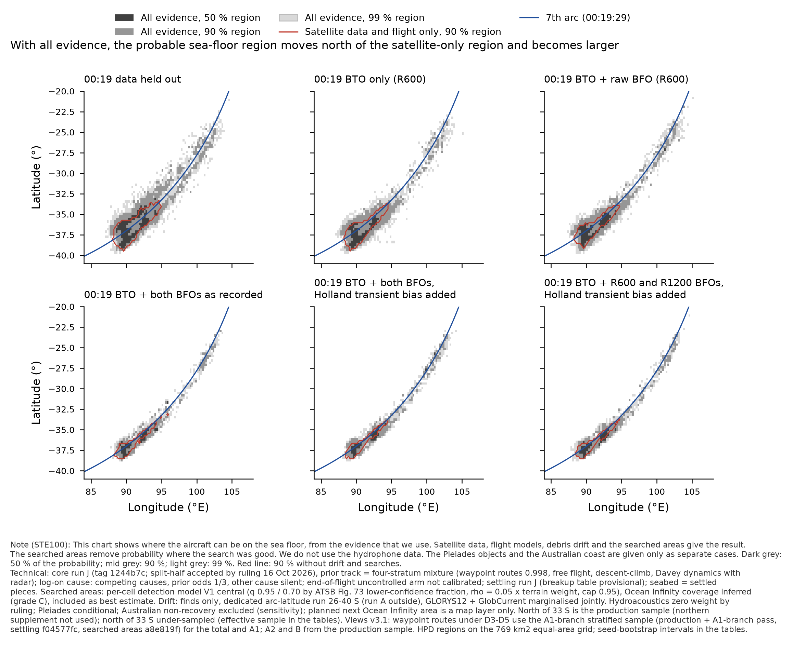
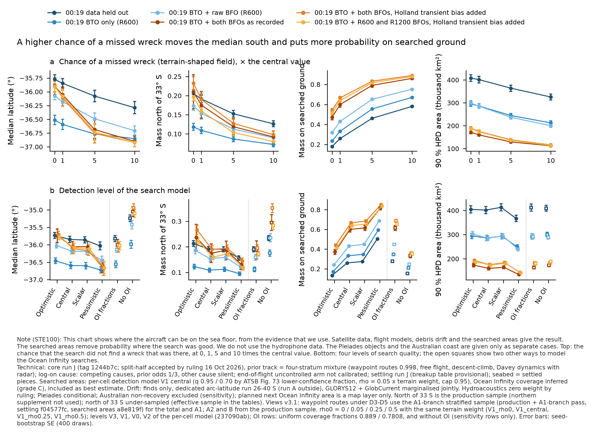
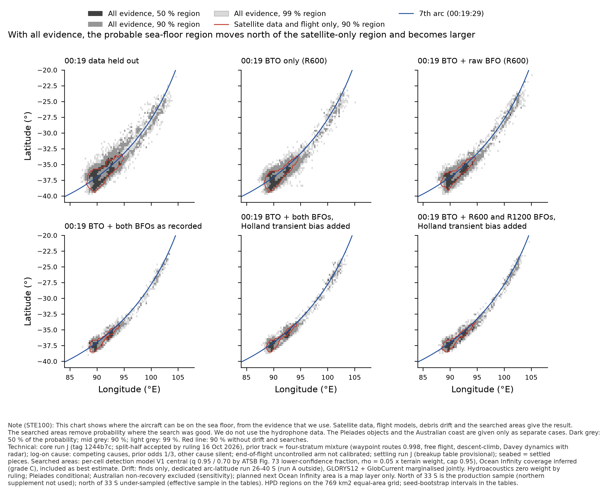
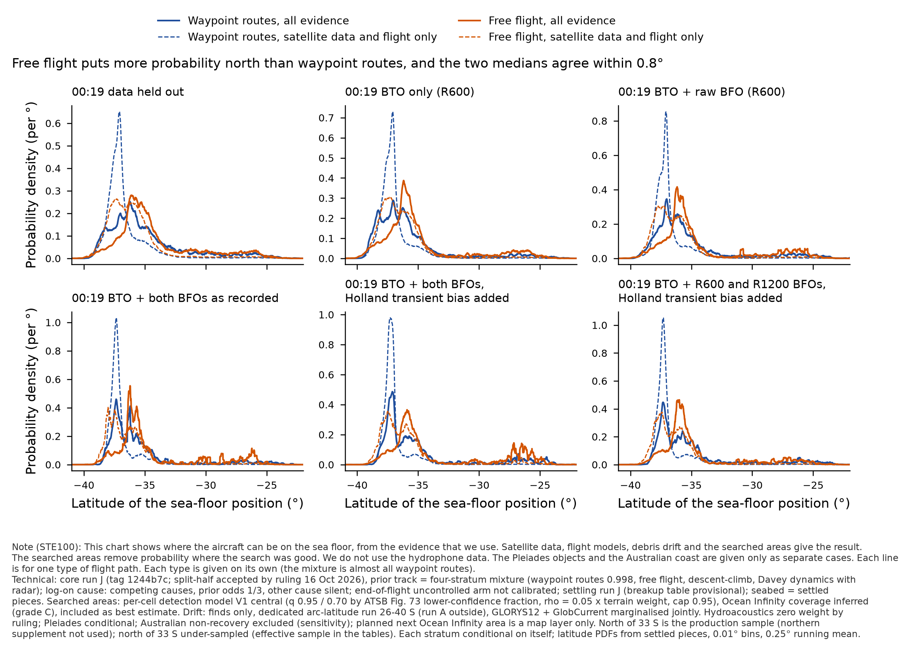
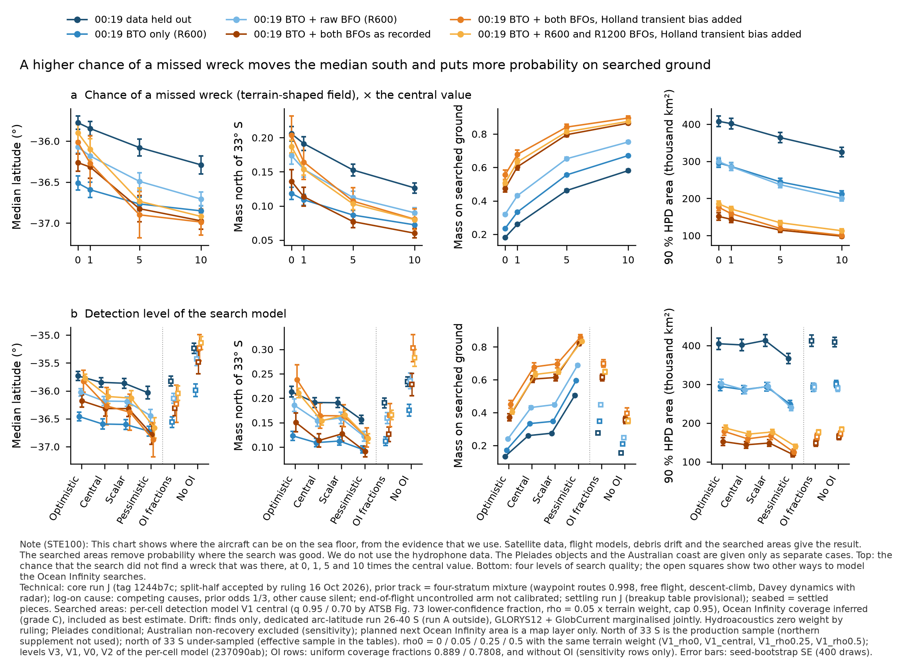
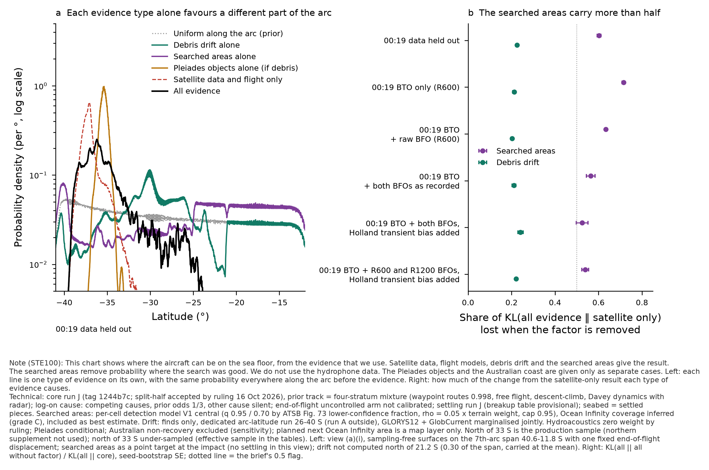

# Composer views v3.1 on run J — A1-branch stratum added for waypoint routes under D3–D5 (19 Oct 2026)

**What changed from v3 (order C step 4, coordination follow-up).** Settling B1 (f04577fc, `settling/run-j-a1branch/`) and searched areas B3
(a8e819f, `searched-areas/run-j-a1branch/`) are READY. For waypoint routes under D3, D4 and D5 the total and the A1 product now come from
settling's A1-branch stratified sample (production rows + A1-branch pass rows, one measure, SCALE 0.141); A2 and B come from the production
waypoints products with their stratified shares (`rja1_pass0.json`). Source and seed from `rja1_source.npy` (seeds keyed 1–24 production,
101–108 pass; the seed bootstrap resamples within each source). D0'–D2 and the other strata are unchanged (max |Δ| 0.0 against v3).
Scripts: the same files, run with `V31=1` (`compose_v3.py`) and the A1-branch folder in `build_outcomes_v3.py`; tables and figures
`results/composer-views-v3-run-j/v3.1/`; data `mh370-exchange/composer/run-j-views-v3.1/`.

**Checks.** Searched-areas Z of all 12 A1-branch products (V0, V1, V2, V3, ρ0 0.5) reproduced exactly from my per-outcome recomputation
(max |Δ| 0.0 against B3's `settled_summary.json`); Pléiades cells equal the module's columns on all 287,137 outcomes (production and pass);
end-of-flight latitude equal for both sources.

**Gates.** D3 × A1 is now **above the gate**: settling row ESS 5,283 before the searches; B3 gives 4,260 distinct rows after the searches
at the settled positions (500 and 1,000 met). Remaining open cell: **D3 × B** — 773 after the searches on production (meets 500, not 1,000).
**Under H (Pléiades) A1 stays below 1,000** (Pléiades B2: D3 472, D4 815, D5 239): the all-given-H A1 cells under D3–D5 are labelled
below the gate.

**What moved (all evidence, four-stratum mixture):**

| 00:19 treatment | v3 (both-burst waypoints) median / 90 % / N of 33 S / on searched ground | v3 check, production waypoints | **v3.1** (A1-branch stratified) | A1 share core → all, v3 → v3.1 |
|---|---|---|---|---|
| D3 both BFOs as recorded | 36.32 S / 144k / 0.113 / 0.604 | 36.06 S / 157k / 0.170 / 0.598 | **36.05 S ± 0.15 / 160k / 0.175 ± 0.036 / 0.599** | 0.080 → 0.057 ; 0.086 → 0.054 |
| D4 both BFOs, Holland transient bias added | 36.27 S / 159k / 0.164 / 0.678 | 36.13 S / 172k / 0.192 / 0.682 | **36.11 S ± 0.14 / 175k / 0.190 ± 0.015 / 0.665** | 0.248 → 0.223 ; 0.258 → 0.230 |
| D5 R600 + R1200 BFOs, Holland transient bias added | 36.10 S / 172k / 0.154 / 0.633 | (= v3) | **36.08 S ± 0.13 / 174k / 0.160 ± 0.009 / 0.639** | 0.060 → 0.041 ; 0.055 → 0.038 |

1. **The A1 stratum itself changes the totals very little.** Against the production-waypoints check that v3 already reported, v3.1 moves
   the D3 / D4 all-evidence medians by ≤ 0.02° and north of 33 S by ≤ 0.005. D5 (production in v3 too) moves 0.02° and +0.006.
2. **Most of the move at D3 and D4 comes from the sample set.** v3 used the both-burst supplementary set for waypoints under D3 / D4.
   The stratified sample is built on production, so v3.1 inherits production's values. Going from both-burst to production moves the D3
   median 0.26° north and north of 33 S from 0.113 to 0.170 (D4 0.14°, 0.164 → 0.192). For D3 that is about 1.5–2 seed SE; for D4 it is within 1 SE.
   **The D3 northern mass is therefore not stable between two core sample sets.** v3.1 D3 north of 33 S is 0.175 ± 0.036 with effective sample **20**:
   **provisional**. The northern supplement (order A) is still the fix.
3. **The A1 cell under D3 is now estimable.** All evidence, A1 only: median 36.95 S, 90 % area 40k km² (v3 production 25k, below the
   gate), north of 33 S 0.110, on searched ground 0.95. Under D4: median 35.88 S (v3 36.62 S), 90 % 50k km², north of 33 S 0.320. A1 sits
   on searched ground under every treatment, so the searches lower its share (D3 0.086 → 0.054; D4 0.258 → 0.230).
4. **Unchanged conclusions.** Searched areas still carry more than half of KL(all ‖ core) under D3–D5 (0.54 / 0.52 / 0.53; drift
   0.23 / 0.24 / 0.23); the search-level sweeps keep the same order and size (fig. 3). The family B share under D3 (0.60) still rests on the
   773-row cell.

v3.1 versions of figures 2 and 4 and all tables: `composer-views-v3-run-j/v3.1/` (`note-tables-v3.md`, `products-v3.csv`,
`compare-v3-v3.1.csv`). **Deviations added in v3.1:** (i) for D3 / D4 waypoints the both-burst set is no longer in the headline; v3's
both-burst values are kept as the comparison above. (ii) The stratum mixture weights per treatment are those of settling run J, not
recomputed for the stratified Z (waypoints ≥ 0.9989 of the mixture either way). (iii) A2 / B shares under D3–D5 are the stratified shares
from `rja1_pass0.json`, applied to the production A2 / B products. Disk added 0.13 GB (order total 0.77 GB, cap 5 GB); 4 processes.

---

# Composer views v3 on run J — settled seabed, per-cell searched-areas field, dedicated drift run

**Version 3, 19 October 2026 (overnight order C, `threads/work-orders/overnight-2026-10-19.md`).** Composer module (sub-agent of the
coordination session ac78e73d). numpy, as v2. Scripts and tables: `results/composer-views-v3-run-j/`; data:
`mh370-exchange/composer/run-j-views-v3/`. Views v2 (`results/composer-views-run-j.md`) is unchanged and is the comparison.

**Labels on every number.** Core run J (tag 1244b7c), split-half accepted as a pass by project ruling, 16 Oct 2026. End of flight run J
(round-3 laws), uncontrolled arm not calibrated. Log-on cause: competing causes, prior odds q = 1/3, other cause silent. Seabed = settling
run J settled pieces (breakup table PROVISIONAL; breakup rows settled from the intact impact point, gap G-bf). **Searched areas: per-cell
detection model V1 central (commit 237090ab) on the settled field; Ocean Infinity coverage inferred (grade C), included as best estimate.**
Drift: finds only, dedicated arc-latitude run (15ab7c9), both ocean models, marginalised jointly with Pléiades. Hydroacoustics: zero weight by
ruling (no column). Pléiades: conditional on H, reported both ways. Australian non-recovery: labelled sensitivity. Planned next Ocean Infinity
area: map layer only. **North of 33 S is still the production sample: the run J northern supplement (order A) is not used.** Every composed
result carries "north of 33 S under-sampled (effective sample n)", with n in Table 1.

## Deviations, cuts and substitutions (declared)

1. **Base sample = settling run J's resampled outcomes, not all end-of-flight rows.** Per 00:19 treatment: 40,000 outcomes per stratum for the
   total, 10,000 per flight-end family (settling's products), so a composed product has at most 160,000 outcomes and an outcome Kish ESS of
   7,500–10,800 for all evidence. This is what "on settled seabed positions" requires (the per-cell search factor exists only for settled
   outcomes). Consequence: effective sample north of 33 S is 34–297 for all evidence (Table 1); D4 and D3 north-of-33 S numbers are
   provisional (both-burst set, 8 seeds; the production-set check moves D3 north of 33 S from 0.113 to 0.170).
2. **Drift factor outside 26–40 S.** The dedicated run covers 26–40 S (66 points). Outside it: run A node surface + a per-model offset
   (dedicated − run A over the 66 points: GLORYS12 −0.673, GlobCurrent −0.881 ln units). Inside: linear interpolation on the Delaunay
   triangulation of the points in (arc position, cross-arc offset) — the "perpendicular" triplets are skewed by up to 60 NM along the arc in
   the south — and nearest point outside the triangulation. 98.8–99.6 % of outcomes are inside the span. North of 21.2 S (run A grid edge)
   drift is not computed and is carried at the mean (outcome share ≤ 2.0e-4; 0.30 of the arc span in view (a)(i)).
3. **Reading of "option B primary".** Base drift = finds only. Option B (pre-registered primary Australian level) is the primary setting
   *inside* the labelled Australian sensitivity; C and populated-coast-only are labelled settings. Outside 26–40 S the Australian increment
   is held at the end latitude's value. Kernel 100 km sensitivity = finds-only + (h100 − h50) under level B (the run gives h100 only under B).
4. **Pléiades** by cell lookup on `pleiades/run-j/surfaces/joint-surface-rho0.25-gcrel` (= run I surfaces). Identical to the module's
   per-impact column cells on every waypoints and both-burst outcome (0 mismatches of 589,966); free / descent-climb / repro-radar have no
   column files (deferred for disk by the module), so lookup is the only route there. The v2 path `pleiades/run-i/` no longer exists.
5. **View (a)(ii)** (settled outcomes reweighted to a uniform-along-arc prior) cannot reach 23.6 % of the arc span (no outcome there), so its
   medians are biased south. **View (a)(i)** (sampling-free surfaces on the arc with the v2 displacement distribution) reaches the whole span
   and is the one to quote; in (a)(i) searched areas are a point target at the impact point (no settling). View (a) only for the four-stratum
   mixture, not per stratum or family.
6. **"On searched ground"** = mass-weighted searched fraction of the settled pieces (coverage before detection), per variant's own coverage
   definition (V0 / OI-fraction / without-OI rows use theirs; the ρ and q variants of V1 share V1's).
7. Single-cause products (C1, C2 silent) not composed; headline cause model only. Next OI area as v2 (`oi2024_proposed_inboard_northwest`).
8. **D3 × A1:** the A1-branch stratum for searched areas (order B3) and settling (B1) was not READY at the final check (19 Oct, before
   commit); Pléiades B2 (A1-branch under H) has landed but cannot be composed on settled seabed without B1/B3. **D3 × A1 is below the
   gate** (settling row ESS 409 on the both-burst set, against 500).
9. Not done: Student-t / heavy-tailed sensitivities (no module supplies one); core BTO/BFO noise sensitivities (core's); NaN-drop
   sensitivity (not-computed shares ≤ 2e-4, so not material). Disk: 0.63 GB on the exchange (cap 5 GB); at most 4 processes.

## Checks (all pass)

- Searched-areas module Z per product (V0, V1, V2, V3, ρ0 0.5) reproduced from my per-outcome recomputation in all five folders:
  max |Δ| 0.0. Settling `source.npy` latitude equals end-of-flight latitude exactly. Pléiades cells: above.
- Core D0' on settled seabed: median 37.11 S, 90 % HPD 159k km² (settling: 160.2k; v2 impact point: 37.13 S, 162k).
- Core + drift (dedicated run), D0': median 36.60 S; the drift thread's own histogram-level composition gives 36.57 S.
- Core + searched areas V1, D0': ln Z = −1.187 (Z 0.305, module 0.3051); on searched ground after 0.287 (module 0.287).

## Lead

1. **All evidence (core × drift × searched areas), D0', four-stratum mixture, settled seabed:** median **35.85 S** (seed SE 0.09°);
   50 / 90 / 95 % HPD **87k / 402k / 526k km²**; mass north of 33 S **0.191 ± 0.010** (effective sample 297); on searched ground
   **0.260 ± 0.005**; inside the planned next OI area 0.029. Over the six 00:19 treatments: median 35.85–36.59 S, 90 % area 144k–402k km²,
   north of 33 S 0.11–0.19, on searched ground 0.26–0.68.
2. **Against v2: the median moves 0.22–0.47° north in every treatment.** The cause is the drift factor, not the search model: core + drift
   moves 0.13–0.26° north (dedicated run, Monte Carlo noise 0.15–0.28 per point against 1.3–1.5 for run A pilot nodes), while core + searched
   areas moves ≤ 0.04°. The per-cell search model and settling together change the search-only product by less than its seed SE.
3. **The level of the search model, not its shape, is the first-order search uncertainty.** ρ field ×0 → ×10 (D0'): median 35.78 → 36.29 S,
   north of 33 S 0.206 → 0.126, on searched ground 0.18 → 0.58, 90 % area 408k → 325k km². Under D3 the on-searched-ground mass runs
   0.48 → 0.87. q levels V3 → V2 (D0'): median 35.73 → 36.03 S, on searched ground 0.13 → 0.51. Shape changes (ρ flat, lower-confidence from
   terrain) move the median by ≤ 0.09°. OI as uniform fractions: ≤ 0.07°. Without OI: 0.6–1.0° further north (sensitivity row).
4. **Influence.** KL(all ‖ core) 0.77–0.86 nat. **Searched areas carry 0.52–0.72 of it in every treatment: FLAG (> 0.5).** Drift 0.20–0.24.
   Pléiades given H: 0.45–0.56 of KL(all|H ‖ core), flag in D0'–D2. Model dominance: waypoint routes ≥ 0.998 of every product.
5. **Waypoints against free flight** (each conditional on itself): free-flight medians lie 0.4–0.8° north of waypoints, with north-of-33 S
   mass 0.17–0.30 against 0.11–0.19. The mixture is unchanged by this (free flight 0.0009 → 0.0015 of the mass).
6. **Families.** All evidence lowers the A1 share in every treatment (D0' 0.175 → 0.081; D2 0.239 → 0.107), because A1 impacts sit on
   searched ground (A1 on searched ground after the evidence 0.60–0.95). B gains (D0' 0.48 → 0.57).
7. **Each evidence type alone** (view (a)(i), D0'): searched areas 23.2 S, drift 28.3 S, Pléiades 35.4 S, uniform 28.7 S. ln evidence ratio,
   core vs uniform (ii / i): drift −0.71 / −0.77, searches −0.74 / −0.75, Pléiades +0.42 / +0.67, drift + Australian B −2.20 / −2.32.
8. **Pléiades both ways.** All given H: 35.37–35.61 S, 90 % area 27k–72k km². The non-imagery evidence raises the odds of H by +0.59 to
   +1.01 nat (v2 +0.42 to +0.81); with the imagery's own identity likelihood ratio taken as 1, P(H | D) = 0.38–0.48 at prior 0.25
   (Table 7 for priors 0.1 and 0.5). P(H | D) proper still needs an identity likelihood.
9. **Australian non-recovery (sensitivity):** option B moves all evidence to 27.7–30.7 S with 0.57–0.69 north of 33 S; options C and
   populated coast only to 33.7–35.2 S (the two agree within 0.05°, as the drift thread found).

## Method (changes from v2)

- Row mass: settling's resample of end of flight's `option_table_0019` two-factor table; strata by settling's `stratum-mixture-weights.json`
  (core share × Z_s per 00:19 treatment), families × share_of_option. A composed product multiplies each outcome by its factors and
  renormalises across strata (stratum weights become core share × Z_s × mean_s(factor)).
- Searched areas per outcome: P(no find | settled field) = ρ̄ + (1 − ρ̄) Π_k (1 − d̄_k), mass-weighted over the settled pieces, computed with
  the module's own `score_spatial_run_j.py` Lookup / variant_P (unchanged). ρ field scale 0 / 1 / 5 / 10 × = ρ0 0 / 0.05 / 0.25 / 0.5
  with the same terrain weight (cap 0.95 per piece).
- Ocean model shared by drift, the Australian term and Pléiades: Λ = ½(D_G P_G + D_C P_C), absolute ln L on one reference per factor.
- Seabed maps and latitude PDFs from the settled pieces (mass fractions per 769 km² equal-area cell and per 0.01° latitude bin).
- Seed bootstrap within each stratum folder, 400 draws, for median, HPD areas, north of 33 S, on searched ground, band masses, KL.
  Effective sample north of 33 S = p²(1 − p)/SE² (v2 definition); the label n is the smaller of this and the outcome Kish ESS there.

## COVERAGE

- **(a) Feasible set / (b) model's reach:** as end of flight's run J note and settling run J; search model reaches every Phase 2, Bluefin-21
  and OI layer cell (ln L = 0 off the layers); drift dedicated run 26–40 S, run A 41.2–21.2 S, not computed north of 21.2 S; Pléiades 45–5 S.
- **(c) Proposal coverage:** settling outcomes, 40,000 per stratum and treatment. Effective sample north of 33 S (all evidence): D0' 297,
  D1 157, D2 159, D3 61, D4 34, D5 264 — under-sampled; the northern supplement (order A) is the fix and is not yet used. View (a)(ii)
  unreachable share of the arc span 0.236. Families: D3 × A1 below the gate (row ESS 409 < 500; A1-branch searched areas / settling not
  landed); in free flight, descent-climb and repro-radar A1 under D3–D5 is below 1,000 (settling note), with ≤ 0.002 of the mixture.
- **Gaps:** northern sample (§0.4; order A); D3 × A1 (order B); drift north of 21.2 S; drift–Pléiades shared ocean realisation and windage
  (dependence gap, as v2); seabed displacement shared by settling and searches (carried jointly here, since the search factor is on the
  settled field); ρ level has no measurement (the dominant search uncertainty, item 3).

## Next

- Compose the northern supplement when order A lands (replaces the production north; the effective sample north of 33 S is the target).
- Add the A1-branch stratum for D3 × A1 when B1 and B3 are READY.
- For the November block table: rank on the ρ-field sweep (×0 to ×10) and the q levels, per 00:19 treatment (Table 4), not on V1 alone.

-- Composer

## Appendix — generated tables (`composer-views-v3-run-j/note-tables-v3.md`)

### Table 1. Headline per 00:19 treatment: core, all evidence, all given H, all with the Australian term (four-stratum mixture, settled seabed)

| 00:19 treatment | product | median lat (± seed SE) | 50 / 90 / 95 % HPD, thousand km² (90 % ± SE) | mass N of 33 S (± SE) | Kish ESS N of 33 S (outcomes) / effective sample N of 33 S from seed scatter, p²(1−p)/SE² | on searched ground (± SE) | in planned next OI area (not evidence) | Kish ESS |
|---|---|---|---|---|---|---|---|---|
| D0' 00:19 data held out (transmission imposed) | satcom + flight + end of flight (core), settled seabed | -37.11 ± 0.02 | 18 / 159 ± 8 / 258 | 0.033 ± 0.003 | 1323 / 145 | 0.776 ± 0.006 | 0.0050 | 40106 |
| D0' 00:19 data held out (transmission imposed) | ALL: core + drift + searched areas | -35.85 ± 0.09 | 87 / 402 ± 14 / 526 | 0.191 ± 0.010 | 881 / 297 | 0.260 ± 0.005 | 0.0286 | 10240 |
| D0' 00:19 data held out (transmission imposed) | all, conditional on H (Pleiades objects are debris) | -35.37 ± 0.02 | 17 / 72 ± 2 / 103 | 0.007 ± 0.001 | 103 / 72 | 0.368 ± 0.011 | 0.0574 | 2375 |
| D0' 00:19 data held out (transmission imposed) | all with Australian non-recovery, option B (sensitivity) | -30.51 ± 0.14 | 106 / 385 ± 14 / 479 | 0.659 ± 0.012 | 596 / 961 | 0.175 ± 0.006 | 0.0339 | 1304 |
| D1 R600 BTO only | satcom + flight + end of flight (core), settled seabed | -37.20 ± 0.02 | 15 / 116 ± 5 / 182 | 0.019 ± 0.002 | 752 / 96 | 0.810 ± 0.003 | 0.0013 | 40089 |
| D1 R600 BTO only | ALL: core + drift + searched areas | -36.59 ± 0.09 | 53 / 286 ± 11 / 387 | 0.109 ± 0.008 | 435 / 157 | 0.333 ± 0.004 | 0.0094 | 10758 |
| D1 R600 BTO only | all, conditional on H (Pleiades objects are debris) | -35.61 ± 0.01 | 12 / 54 ± 2 / 78 | 0.000 ± 0.000 | 8 / 11 | 0.455 ± 0.010 | 0.0200 | 1961 |
| D1 R600 BTO only | all with Australian non-recovery, option B (sensitivity) | -30.23 ± 0.21 | 76 / 286 ± 12 / 357 | 0.620 ± 0.018 | 330 / 441 | 0.273 ± 0.011 | 0.0167 | 825 |
| D2 R600 BTO + raw BFO | satcom + flight + end of flight (core), settled seabed | -37.12 ± 0.02 | 12 / 102 ± 5 / 168 | 0.024 ± 0.003 | 963 / 83 | 0.883 ± 0.004 | 0.0015 | 40093 |
| D2 R600 BTO + raw BFO | ALL: core + drift + searched areas | -36.18 ± 0.08 | 58 / 285 ± 10 / 379 | 0.154 ± 0.011 | 548 / 159 | 0.431 ± 0.008 | 0.0132 | 8770 |
| D2 R600 BTO + raw BFO | all, conditional on H (Pleiades objects are debris) | -35.58 ± 0.01 | 10 / 46 ± 2 / 68 | 0.000 ± 0.000 | 7 / 9 | 0.486 ± 0.011 | 0.0251 | 2042 |
| D2 R600 BTO + raw BFO | all with Australian non-recovery, option B (sensitivity) | -29.60 ± 0.36 | 66 / 274 ± 11 / 340 | 0.653 ± 0.019 | 433 / 419 | 0.294 ± 0.012 | 0.0182 | 974 |
| D3 R600 BTO + both BFOs as recorded | satcom + flight + end of flight (core), settled seabed | -37.31 ± 0.02 | 7 / 57 ± 3 / 85 | 0.015 ± 0.002 | 611 / 39 | 0.950 ± 0.002 | 0.0003 | 40088 |
| D3 R600 BTO + both BFOs as recorded | ALL: core + drift + searched areas | -36.32 ± 0.14 | 25 / 144 ± 8 / 194 | 0.113 ± 0.014 | 326 / 61 | 0.604 ± 0.020 | 0.0033 | 7652 |
| D3 R600 BTO + both BFOs as recorded | all, conditional on H (Pleiades objects are debris) | -35.61 ± 0.05 | 6 / 27 ± 2 / 39 | 0.000 ± 0.000 | 33 / 13 | 0.584 ± 0.046 | 0.0047 | 2157 |
| D3 R600 BTO + both BFOs as recorded | all with Australian non-recovery, option B (sensitivity) | -30.68 ± 0.63 | 34 / 145 ± 10 / 190 | 0.572 ± 0.030 | 274 / 157 | 0.434 ± 0.023 | 0.0048 | 793 |
| D4 R600 BTO + both BFOs, Holland transient bias added | satcom + flight + end of flight (core), settled seabed | -37.23 ± 0.03 | 5 / 52 ± 6 / 83 | 0.019 ± 0.004 | 765 / 20 | 0.964 ± 0.005 | 0.0005 | 40087 |
| D4 R600 BTO + both BFOs, Holland transient bias added | ALL: core + drift + searched areas | -36.27 ± 0.33 | 25 / 159 ± 9 / 216 | 0.164 ± 0.026 | 436 / 34 | 0.678 ± 0.026 | 0.0075 | 7500 |
| D4 R600 BTO + both BFOs, Holland transient bias added | all, conditional on H (Pleiades objects are debris) | -35.47 ± 0.04 | 7 / 30 ± 2 / 43 | 0.000 ± 0.000 | 7 / 11 | 0.673 ± 0.013 | 0.0146 | 1847 |
| D4 R600 BTO + both BFOs, Holland transient bias added | all with Australian non-recovery, option B (sensitivity) | -27.70 ± 1.04 | 31 / 155 ± 10 / 202 | 0.694 ± 0.034 | 371 / 125 | 0.453 ± 0.022 | 0.0102 | 750 |
| D5 R600 BTO + R600 BFO + R1200 BFO, Holland transient bias added | satcom + flight + end of flight (core), settled seabed | -37.28 ± 0.02 | 7 / 59 ± 4 / 92 | 0.020 ± 0.002 | 814 / 67 | 0.957 ± 0.003 | 0.0008 | 40088 |
| D5 R600 BTO + R600 BFO + R1200 BFO, Holland transient bias added | ALL: core + drift + searched areas | -36.10 ± 0.13 | 32 / 172 ± 7 / 228 | 0.154 ± 0.009 | 438 / 264 | 0.633 ± 0.016 | 0.0112 | 7476 |
| D5 R600 BTO + R600 BFO + R1200 BFO, Holland transient bias added | all, conditional on H (Pleiades objects are debris) | -35.53 ± 0.02 | 8 / 28 ± 1 / 42 | 0.000 ± 0.000 | 11 / 2 | 0.618 ± 0.023 | 0.0298 | 1874 |
| D5 R600 BTO + R600 BFO + R1200 BFO, Holland transient bias added | all with Australian non-recovery, option B (sensitivity) | -30.27 ± 0.36 | 44 / 168 ± 7 / 215 | 0.634 ± 0.016 | 364 / 581 | 0.435 ± 0.022 | 0.0168 | 864 |

### Table 2. Waypoints against free flight (each CONDITIONAL on its stratum), settled seabed

| 00:19 treatment | stratum | core median / 90 % area (k km²) / N of 33 S | all evidence median / 90 % area / N of 33 S / on searched ground | Kish ESS all | stratum share in the mixture, core → all |
|---|---|---|---|---|---|
| D0' 00:19 data held out (transmission imposed) | waypoints | -37.12 / 159 / 0.033 | -35.85 / 402 / 0.191 / 0.260 | 10197 | 0.9987 → 0.9979 |
| D0' 00:19 data held out (transmission imposed) | free | -36.42 / 266 / 0.061 | -35.25 / 470 / 0.225 / 0.223 | 13537 | 0.0009 → 0.0015 |
| D0' 00:19 data held out (transmission imposed) | descent-climb | -36.97 / 215 / 0.040 | -35.59 / 435 / 0.184 / 0.229 | 12044 | 0.0002 → 0.0002 |
| D0' 00:19 data held out (transmission imposed) | repro-radar | -36.45 / 290 / 0.082 | -35.06 / 499 / 0.300 / 0.205 | 12779 | 0.0002 → 0.0004 |
| D1 R600 BTO only | waypoints | -37.20 / 116 / 0.019 | -36.60 / 286 / 0.109 / 0.333 | 10721 | 0.9989 → 0.9983 |
| D1 R600 BTO only | free | -36.83 / 185 / 0.039 | -35.91 / 341 / 0.173 / 0.303 | 12356 | 0.0008 → 0.0012 |
| D1 R600 BTO only | descent-climb | -37.19 / 154 / 0.027 | -36.16 / 312 / 0.145 / 0.304 | 11197 | 0.0001 → 0.0002 |
| D1 R600 BTO only | repro-radar | -36.85 / 192 / 0.059 | -35.89 / 376 / 0.256 / 0.292 | 11144 | 0.0002 → 0.0003 |
| D2 R600 BTO + raw BFO | waypoints | -37.12 / 102 / 0.024 | -36.18 / 285 / 0.154 / 0.431 | 8737 | 0.9988 → 0.9981 |
| D2 R600 BTO + raw BFO | free | -36.73 / 158 / 0.046 | -35.70 / 298 / 0.215 / 0.365 | 10771 | 0.0008 → 0.0014 |
| D2 R600 BTO + raw BFO | descent-climb | -37.13 / 132 / 0.031 | -35.97 / 290 / 0.178 / 0.376 | 9689 | 0.0001 → 0.0002 |
| D2 R600 BTO + raw BFO | repro-radar | -36.75 / 158 / 0.059 | -35.72 / 331 / 0.273 / 0.369 | 9741 | 0.0002 → 0.0003 |
| D3 R600 BTO + both BFOs as recorded | waypoints | -37.31 / 57 / 0.015 | -36.32 / 143 / 0.113 / 0.604 | 7623 | 0.9989 → 0.9981 |
| D3 R600 BTO + both BFOs as recorded | free | -36.80 / 95 / 0.044 | -35.71 / 149 / 0.226 / 0.495 | 9118 | 0.0008 → 0.0014 |
| D3 R600 BTO + both BFOs as recorded | descent-climb | -37.25 / 76 / 0.032 | -35.91 / 138 / 0.191 / 0.544 | 8277 | 0.0001 → 0.0002 |
| D3 R600 BTO + both BFOs as recorded | repro-radar | -36.75 / 95 / 0.054 | -35.78 / 168 / 0.247 / 0.500 | 8639 | 0.0002 → 0.0003 |
| D4 R600 BTO + both BFOs, Holland transient bias added | waypoints | -37.23 / 52 / 0.019 | -36.27 / 158 / 0.164 / 0.678 | 7470 | 0.9989 → 0.9980 |
| D4 R600 BTO + both BFOs, Holland transient bias added | free | -36.68 / 104 / 0.066 | -35.47 / 190 / 0.302 / 0.561 | 8878 | 0.0008 → 0.0015 |
| D4 R600 BTO + both BFOs, Holland transient bias added | descent-climb | -37.18 / 81 / 0.039 | -35.63 / 168 / 0.267 / 0.570 | 7646 | 0.0001 → 0.0002 |
| D4 R600 BTO + both BFOs, Holland transient bias added | repro-radar | -36.68 / 100 / 0.079 | -35.48 / 208 / 0.362 / 0.558 | 8339 | 0.0002 → 0.0003 |
| D5 R600 BTO + R600 BFO + R1200 BFO, Holland transient bias added | waypoints | -37.28 / 59 / 0.020 | -36.10 / 171 / 0.154 / 0.633 | 7450 | 0.9989 → 0.9982 |
| D5 R600 BTO + R600 BFO + R1200 BFO, Holland transient bias added | free | -36.77 / 97 / 0.038 | -35.72 / 181 / 0.189 / 0.551 | 9164 | 0.0008 → 0.0013 |
| D5 R600 BTO + R600 BFO + R1200 BFO, Holland transient bias added | descent-climb | -37.26 / 78 / 0.026 | -35.92 / 157 / 0.149 / 0.577 | 8264 | 0.0001 → 0.0002 |
| D5 R600 BTO + R600 BFO + R1200 BFO, Holland transient bias added | repro-radar | -36.78 / 95 / 0.058 | -35.71 / 189 / 0.319 / 0.515 | 7405 | 0.0002 → 0.0003 |

### Table 3. Per flight-end family (A1 = cruise to fuel exhaustion then no control; A2 = cruise to fuel exhaustion then controlled descent; B = planned descent with ditching approach begun before fuel exhaustion), four-stratum mixture of the family products

| 00:19 treatment | family | share core → all | all evidence median / 90 % area (k km²) / N of 33 S / on searched ground | Kish ESS all (core) | settling row ESS of the waypoints product | gate |
|---|---|---|---|---|---|---|
| D0' 00:19 data held out (transmission imposed) | A1 | 0.175 → 0.081 | -35.37 / 167 / 0.275 / 0.601 | 1410 (10018) | 997405 (waypoints) | pass |
| D0' 00:19 data held out (transmission imposed) | A2 | 0.341 → 0.351 | -36.20 / 298 / 0.155 / 0.233 | 2777 (10023) | 742682 (waypoints) | pass |
| D0' 00:19 data held out (transmission imposed) | B | 0.484 → 0.568 | -35.77 / 329 / 0.173 / 0.222 | 2953 (10032) | 716892 (waypoints) | pass |
| D1 R600 BTO only | A1 | 0.201 → 0.082 | -36.92 / 60 / 0.136 / 0.893 | 2749 (10015) | 1244077 (waypoints) | pass |
| D1 R600 BTO only | A2 | 0.347 → 0.388 | -36.75 / 224 / 0.104 / 0.273 | 2908 (10019) | 879548 (waypoints) | pass |
| D1 R600 BTO only | B | 0.453 → 0.530 | -36.31 / 237 / 0.107 / 0.288 | 2922 (10028) | 688706 (waypoints) | pass |
| D2 R600 BTO + raw BFO | A1 | 0.239 → 0.107 | -36.94 / 39 / 0.106 / 0.950 | 3394 (10016) | 48477 (waypoints) | pass |
| D2 R600 BTO + raw BFO | A2 | 0.234 → 0.299 | -35.96 / 259 / 0.198 / 0.357 | 2337 (10026) | 27700 (waypoints) | pass |
| D2 R600 BTO + raw BFO | B | 0.527 → 0.595 | -36.14 / 232 / 0.147 / 0.375 | 2342 (10026) | 35949 (waypoints) | pass |
| D3 R600 BTO + both BFOs as recorded | A1 | 0.080 → 0.057 | -36.90 / 23 / 0.158 / 0.923 | 2595 (10019) | 409 (both-burst-waypoints) | below the gate (row ESS < 500); A1-branch stratum not landed |
| D3 R600 BTO + both BFOs as recorded | A2 | 0.370 → 0.338 | -36.54 / 127 / 0.131 / 0.631 | 1961 (10020) | 5302 (both-burst-waypoints) | pass |
| D3 R600 BTO + both BFOs as recorded | B | 0.551 → 0.605 | -36.31 / 112 / 0.106 / 0.560 | 1854 (10024) | 2595 (both-burst-waypoints) | pass |
| D4 R600 BTO + both BFOs, Holland transient bias added | A1 | 0.248 → 0.223 | -36.62 / 41 / 0.286 / 0.859 | 2004 (10019) | 4584 (both-burst-waypoints) | pass |
| D4 R600 BTO + both BFOs, Holland transient bias added | A2 | 0.320 → 0.310 | -36.37 / 132 / 0.138 / 0.641 | 1796 (10020) | 42580 (both-burst-waypoints) | pass |
| D4 R600 BTO + both BFOs, Holland transient bias added | B | 0.432 → 0.467 | -36.08 / 135 / 0.130 / 0.604 | 1816 (10025) | 28109 (both-burst-waypoints) | pass |
| D5 R600 BTO + R600 BFO + R1200 BFO, Holland transient bias added | A1 | 0.060 → 0.041 | -36.92 / 32 / 0.182 / 0.933 | 2765 (10014) | 2178 (waypoints) | pass |
| D5 R600 BTO + R600 BFO + R1200 BFO, Holland transient bias added | A2 | 0.422 → 0.388 | -36.50 / 127 / 0.132 / 0.680 | 2009 (10018) | 20864 (waypoints) | pass |
| D5 R600 BTO + R600 BFO + R1200 BFO, Holland transient bias added | B | 0.518 → 0.571 | -36.01 / 142 / 0.148 / 0.599 | 1907 (10026) | 9401 (waypoints) | pass |

### Table 4. Sensitivity of ALL evidence (core + drift + searched areas) to the search-model level and to other inputs, per 00:19 treatment (median lat / 90 % area k km² / N of 33 S / on searched ground)

| setting | D0 | D1 | D2 | D3 | D4 | D5 |
|---|---|---|---|---|---|---|
| base: V1 central, rho field 1x | -35.85 / 402 / 0.191 / 0.260 | -36.59 / 286 / 0.109 / 0.333 | -36.18 / 285 / 0.154 / 0.431 | -36.32 / 144 / 0.113 / 0.604 | -36.27 / 159 / 0.164 / 0.678 | -36.10 / 172 / 0.154 / 0.633 |
| rho field 0x | -35.78 / 408 / 0.206 / 0.181 | -36.51 / 295 / 0.118 / 0.235 | -36.07 / 299 / 0.174 / 0.319 | -36.26 / 152 / 0.136 / 0.475 | -36.01 / 176 / 0.204 / 0.556 | -35.90 / 185 / 0.187 / 0.507 |
| rho field 5x | -36.08 / 364 / 0.153 / 0.462 | -36.77 / 245 / 0.087 / 0.555 | -36.49 / 237 / 0.112 / 0.652 | -36.82 / 115 / 0.077 / 0.796 | -36.90 / 119 / 0.107 / 0.841 | -36.73 / 135 / 0.103 / 0.813 |
| rho field 10x | -36.29 / 325 / 0.126 / 0.581 | -36.85 / 212 / 0.072 / 0.671 | -36.71 / 200 / 0.090 / 0.752 | -36.97 / 98 / 0.060 / 0.865 | -36.99 / 101 / 0.081 / 0.895 | -36.92 / 113 / 0.080 / 0.876 |
| q level V0 (scalar) | -35.86 / 413 / 0.191 / 0.274 | -36.60 / 294 / 0.112 / 0.347 | -36.19 / 295 / 0.160 / 0.449 | -36.32 / 148 / 0.127 / 0.614 | -36.38 / 167 / 0.164 / 0.697 | -36.13 / 177 / 0.166 / 0.649 |
| q level V2 (pessimistic) | -36.03 / 367 / 0.157 / 0.505 | -36.72 / 249 / 0.095 / 0.595 | -36.44 / 240 / 0.122 / 0.688 | -36.78 / 119 / 0.091 / 0.819 | -36.87 / 125 / 0.120 / 0.859 | -36.66 / 140 / 0.117 / 0.834 |
| q level V3 (optimistic) | -35.73 / 405 / 0.213 / 0.134 | -36.46 / 295 / 0.123 / 0.172 | -36.02 / 302 / 0.186 / 0.240 | -36.18 / 152 / 0.151 / 0.371 | -35.83 / 178 / 0.238 / 0.450 | -35.77 / 187 / 0.211 / 0.406 |
| rho flat | -35.87 / 403 / 0.192 / 0.258 | -36.62 / 287 / 0.109 / 0.332 | -36.21 / 288 / 0.154 / 0.431 | -36.32 / 144 / 0.114 / 0.602 | -36.36 / 162 / 0.163 / 0.676 | -36.16 / 172 / 0.154 / 0.631 |
| lower-confidence from terrain | -35.85 / 402 / 0.191 / 0.259 | -36.59 / 286 / 0.109 / 0.333 | -36.18 / 285 / 0.154 / 0.430 | -36.32 / 143 / 0.113 / 0.604 | -36.27 / 159 / 0.165 / 0.677 | -36.10 / 171 / 0.153 / 0.634 |
| OI coverage fractions (sensitivity row) | -35.83 / 412 / 0.190 / 0.276 | -36.56 / 292 / 0.112 / 0.347 | -36.13 / 292 / 0.159 / 0.448 | -36.31 / 148 / 0.126 / 0.614 | -36.23 / 164 / 0.165 / 0.699 | -36.04 / 176 / 0.166 / 0.648 |
| without OI (sensitivity row) | -35.24 / 409 / 0.234 / 0.153 | -35.99 / 301 / 0.175 / 0.210 | -35.42 / 289 / 0.235 / 0.247 | -35.49 / 165 / 0.228 / 0.354 | -35.23 / 172 / 0.303 / 0.395 | -35.14 / 184 / 0.283 / 0.351 |
| drift kernel 100 km | -35.97 / 397 / 0.178 / 0.270 | -36.76 / 279 / 0.101 / 0.343 | -36.34 / 281 / 0.144 / 0.446 | -36.52 / 141 / 0.109 / 0.627 | -36.63 / 155 / 0.151 / 0.702 | -36.35 / 167 / 0.143 / 0.656 |
| GLORYS12 only | -35.83 / 414 / 0.215 / 0.252 | -36.49 / 298 / 0.123 / 0.323 | -36.11 / 295 / 0.171 / 0.415 | -36.31 / 146 / 0.125 / 0.585 | -36.12 / 163 / 0.185 / 0.657 | -36.01 / 177 / 0.174 / 0.612 |
| GlobCurrent only | -35.88 / 369 / 0.159 / 0.270 | -36.76 / 258 / 0.090 / 0.346 | -36.27 / 260 / 0.131 / 0.453 | -36.46 / 134 / 0.097 / 0.629 | -36.55 / 148 / 0.137 / 0.707 | -36.30 / 157 / 0.126 / 0.660 |
| Australian option B (sens.) | -30.51 / 385 / 0.659 / 0.175 | -30.23 / 286 / 0.620 / 0.273 | -29.60 / 274 / 0.653 / 0.294 | -30.68 / 145 / 0.572 / 0.434 | -27.70 / 155 / 0.694 / 0.453 | -30.27 / 168 / 0.634 / 0.435 |
| Australian option C (setting) | -33.70 / 426 / 0.454 / 0.214 | -34.92 / 322 / 0.367 / 0.326 | -34.51 / 307 / 0.416 / 0.359 | -35.22 / 165 / 0.329 / 0.494 | -34.46 / 182 / 0.449 / 0.536 | -34.72 / 190 / 0.400 / 0.506 |
| Australian populated only (setting) | -33.67 / 428 / 0.459 / 0.210 | -34.94 / 325 / 0.371 / 0.320 | -34.52 / 309 / 0.421 / 0.355 | -35.22 / 165 / 0.337 / 0.494 | -34.44 / 180 / 0.456 / 0.536 | -34.72 / 189 / 0.406 / 0.506 |

### Table 5. Influence by factor (KL divergence, nats, with seed-bootstrap SE); leave-one-out on ALL and on all given H

| 00:19 treatment | KL(all ‖ core) | searched areas: KL(all ‖ all without it), share | drift: KL, share | removing searched areas: Δ median (NM), Δ 90 % area (k km²) | removing drift: Δ median (NM), Δ 90 % | given H: Pléiades KL(all|H ‖ all), share of KL(all|H ‖ core) | flags |
|---|---|---|---|---|---|---|---|
| D0' 00:19 data held out (transmission imposed) | 0.859 ± 0.008 | 0.517 ± 0.007, 0.60 | 0.193 ± 0.003, 0.22 | -102, -128 | -123, -118 | 1.307 ± 0.024, 0.56 | KL > half: searched areas, Pléiades given H; model dominance (> 0.95): run-j-waypoints 0.998 |
| D1 R600 BTO only | 0.778 ± 0.007 | 0.556 ± 0.005, 0.72 | 0.165 ± 0.005, 0.21 | -15, -109 | -25, -95 | 1.417 ± 0.047, 0.56 | KL > half: searched areas, Pléiades given H; model dominance (> 0.95): run-j-waypoints 0.998 |
| D2 R600 BTO + raw BFO | 0.860 ± 0.009 | 0.545 ± 0.004, 0.63 | 0.174 ± 0.005, 0.20 | -90, -122 | -102, -73 | 1.276 ± 0.039, 0.51 | KL > half: searched areas, Pléiades given H; model dominance (> 0.95): run-j-waypoints 0.998 |
| D3 R600 BTO + both BFOs as recorded | 0.821 ± 0.031 | 0.463 ± 0.016, 0.56 | 0.173 ± 0.007, 0.21 | -117, -57 | -123, -49 | 1.134 ± 0.076, 0.45 | KL > half: searched areas; model dominance (> 0.95): run-j-waypoints 0.998 |
| D4 R600 BTO + both BFOs, Holland transient bias added | 0.772 ± 0.046 | 0.405 ± 0.020, 0.52 | 0.186 ± 0.009, 0.24 | -99, -70 | -105, -58 | 1.306 ± 0.100, 0.49 | KL > half: searched areas; model dominance (> 0.95): run-j-waypoints 0.998 |
| D5 R600 BTO + R600 BFO + R1200 BFO, Holland transient bias added | 0.819 ± 0.021 | 0.442 ± 0.013, 0.54 | 0.182 ± 0.004, 0.22 | -124, -72 | -136, -57 | 1.238 ± 0.053, 0.48 | KL > half: searched areas; model dominance (> 0.95): run-j-waypoints 0.998 |

### Table 6. Each evidence type alone (prior uniform along the 7th arc, 40.6–11.8 S, same end-of-flight model), D0'

| evidence | (i) sampling-free surface: median lat / N of 33 S | (ii) settled outcome sample reweighted: median lat / N of 33 S / Kish ESS / unreachable share of the arc span | ln evidence ratio core vs uniform (ii) / (i) | 90 % HPD overlap with core: mass of core in (ii) region, Bhattacharyya |
|---|---|---|---|---|
| debris drift (finds only) | -28.35 / 0.801 | -29.62 / 0.776 / 1067 / 0.236 | -0.71 / -0.77 | 0.56, 0.46 |
| searched areas V1 central | -23.23 / 0.770 | -26.90 / 0.752 / 329 / 0.236 | -0.74 / -0.75 | 0.38, 0.40 |
| searched areas V0 | -23.39 / 0.771 | -27.09 / 0.751 / 330 / 0.236 | -0.73 / -0.76 | 0.36, 0.40 |
| searched areas V2 | -25.25 / 0.732 | -28.31 / 0.702 / 457 / 0.236 | -0.45 / -0.45 | 0.79, 0.48 |
| searched areas V3 | -22.75 / 0.786 | -26.44 / 0.771 / 299 / 0.236 | -0.89 / -0.90 | 0.18, 0.35 |
| searched areas rho 0x | -22.93 / 0.780 | -26.70 / 0.765 / 309 / 0.236 | -0.83 / -0.85 | 0.20, 0.37 |
| searched areas rho 10x | -25.74 / 0.697 | -28.92 / 0.661 / 479 / 0.236 | -0.26 / -0.25 | 0.84, 0.51 |
| Pléiades (conditional on H) | -35.41 / 0.003 | -35.34 / 0.010 / 3700 / 0.236 | +0.42 / +0.67 | 0.11, 0.45 |
| drift + Australian option B (sens.) | -27.20 / 0.943 | -28.59 / 0.963 / 688 / 0.236 | -2.20 / -2.32 | 0.03, 0.25 |

Uniform base (i): median -28.74, N of 33 S 0.649. Drift (i) not computed share (north of run A grid, 21.2 S; carried at the mean): 0.298.

### Table 7. Pléiades: both ways, and the change in the odds of H from the evidence other than the imagery

| 00:19 treatment | all: median / 90 % (k km²) | all given H: median / 90 % | ln odds factor of H from drift + searches, ln[Z(all|H) Z(core) / (Z(core+P) Z(all))] | P(H | D) for prior P(H) 0.1 / 0.25 / 0.5 (identity likelihood ratio of the imagery taken as 1) |
|---|---|---|---|---|
| D0' 00:19 data held out (transmission imposed) | -35.85 / 402 | -35.37 / 72 | +0.59 | 0.168 / 0.377 / 0.644 |
| D1 R600 BTO only | -36.59 / 286 | -35.61 / 54 | +0.71 | 0.185 / 0.404 / 0.671 |
| D2 R600 BTO + raw BFO | -36.18 / 285 | -35.58 / 46 | +0.81 | 0.200 / 0.428 / 0.692 |
| D3 R600 BTO + both BFOs as recorded | -36.32 / 144 | -35.61 / 27 | +1.01 | 0.234 / 0.478 / 0.733 |
| D4 R600 BTO + both BFOs, Holland transient bias added | -36.27 / 159 | -35.47 / 30 | +0.98 | 0.229 / 0.471 / 0.727 |
| D5 R600 BTO + R600 BFO + R1200 BFO, Holland transient bias added | -36.10 / 172 | -35.53 / 28 | +0.97 | 0.227 / 0.468 / 0.725 |

### Table 8. Views v3 (settled seabed, per-cell search model, dedicated drift run) against views v2 (impact point, scalar search model, run A drift)

| 00:19 treatment | product | v2 median / 90 % (k km²) / N of 33 S / on searched ground | v3 median / 90 % / N of 33 S / on searched ground | Δ median (deg, + = north) |
|---|---|---|---|---|
| D0' 00:19 data held out (transmission imposed) | satcom + flight + end of flight (core), settled seabed | -37.13 / 162 / 0.032 / 0.771 | -37.11 / 159 / 0.033 / 0.776 | +0.01 |
| D0' 00:19 data held out (transmission imposed) | core + debris drift (finds only, dedicated arc-latitude run) | -36.86 / 269 / 0.085 / 0.705 | -36.60 / 274 / 0.106 / 0.726 | +0.26 |
| D0' 00:19 data held out (transmission imposed) | core + searched areas (per-cell model V1 central, settled field) | -36.98 / 286 / 0.068 / 0.284 | -36.95 / 284 / 0.072 / 0.287 | +0.04 |
| D0' 00:19 data held out (transmission imposed) | ALL: core + drift + searched areas | -36.07 / 437 / 0.152 / 0.239 | -35.85 / 402 / 0.191 / 0.260 | +0.22 |
| D0' 00:19 data held out (transmission imposed) | all, conditional on H (Pleiades objects are debris) | -35.45 / 78 / 0.006 / 0.304 | -35.37 / 72 / 0.007 / 0.368 | +0.09 |
| D1 R600 BTO only | satcom + flight + end of flight (core), settled seabed | -37.21 / 116 / 0.018 / 0.810 | -37.20 / 116 / 0.019 / 0.810 | +0.01 |
| D1 R600 BTO only | core + debris drift (finds only, dedicated arc-latitude run) | -37.07 / 158 / 0.049 / 0.773 | -36.92 / 177 / 0.066 / 0.797 | +0.14 |
| D1 R600 BTO only | core + searched areas (per-cell model V1 central, settled field) | -37.41 / 198 / 0.037 / 0.329 | -37.41 / 192 / 0.035 / 0.325 | +0.00 |
| D1 R600 BTO only | ALL: core + drift + searched areas | -36.88 / 281 / 0.086 / 0.302 | -36.59 / 286 / 0.109 / 0.333 | +0.29 |
| D1 R600 BTO only | all, conditional on H (Pleiades objects are debris) | -35.65 / 55 / 0.001 / 0.381 | -35.61 / 54 / 0.000 / 0.455 | +0.04 |
| D2 R600 BTO + raw BFO | satcom + flight + end of flight (core), settled seabed | -37.13 / 103 / 0.024 / 0.881 | -37.12 / 102 / 0.024 / 0.883 | +0.01 |
| D2 R600 BTO + raw BFO | core + debris drift (finds only, dedicated arc-latitude run) | -36.99 / 149 / 0.061 / 0.833 | -36.85 / 164 / 0.079 / 0.853 | +0.15 |
| D2 R600 BTO + raw BFO | core + searched areas (per-cell model V1 central, settled field) | -37.07 / 224 / 0.061 / 0.467 | -37.05 / 212 / 0.059 / 0.465 | +0.02 |
| D2 R600 BTO + raw BFO | ALL: core + drift + searched areas | -36.42 / 297 / 0.126 / 0.397 | -36.18 / 285 / 0.154 / 0.431 | +0.24 |
| D2 R600 BTO + raw BFO | all, conditional on H (Pleiades objects are debris) | -35.63 / 47 / 0.000 / 0.421 | -35.58 / 46 / 0.000 / 0.486 | +0.05 |
| D3 R600 BTO + both BFOs as recorded | satcom + flight + end of flight (core), settled seabed | -37.31 / 57 / 0.015 / 0.947 | -37.31 / 57 / 0.015 / 0.950 | +0.00 |
| D3 R600 BTO + both BFOs as recorded | core + debris drift (finds only, dedicated arc-latitude run) | -37.24 / 77 / 0.040 / 0.912 | -37.06 / 87 / 0.059 / 0.923 | +0.18 |
| D3 R600 BTO + both BFOs as recorded | core + searched areas (per-cell model V1 central, settled field) | -37.22 / 96 / 0.044 / 0.685 | -37.22 / 95 / 0.040 / 0.689 | +0.01 |
| D3 R600 BTO + both BFOs as recorded | ALL: core + drift + searched areas | -36.64 / 128 / 0.095 / 0.572 | -36.32 / 144 / 0.113 / 0.604 | +0.32 |
| D3 R600 BTO + both BFOs as recorded | all, conditional on H (Pleiades objects are debris) | -35.63 / 25 / 0.000 / 0.493 | -35.61 / 27 / 0.000 / 0.584 | +0.02 |
| D4 R600 BTO + both BFOs, Holland transient bias added | satcom + flight + end of flight (core), settled seabed | -37.24 / 51 / 0.019 / 0.963 | -37.23 / 52 / 0.019 / 0.964 | +0.01 |
| D4 R600 BTO + both BFOs, Holland transient bias added | core + debris drift (finds only, dedicated arc-latitude run) | -37.16 / 78 / 0.053 / 0.937 | -37.03 / 89 / 0.072 / 0.940 | +0.13 |
| D4 R600 BTO + both BFOs, Holland transient bias added | core + searched areas (per-cell model V1 central, settled field) | -37.17 / 104 / 0.057 / 0.761 | -37.15 / 102 / 0.058 / 0.760 | +0.02 |
| D4 R600 BTO + both BFOs, Holland transient bias added | ALL: core + drift + searched areas | -36.74 / 155 / 0.127 / 0.664 | -36.27 / 159 / 0.164 / 0.678 | +0.46 |
| D4 R600 BTO + both BFOs, Holland transient bias added | all, conditional on H (Pleiades objects are debris) | -35.58 / 28 / 0.000 / 0.571 | -35.47 / 30 / 0.000 / 0.673 | +0.11 |
| D5 R600 BTO + R600 BFO + R1200 BFO, Holland transient bias added | satcom + flight + end of flight (core), settled seabed | -37.28 / 59 / 0.020 / 0.955 | -37.28 / 59 / 0.020 / 0.957 | +0.00 |
| D5 R600 BTO + R600 BFO + R1200 BFO, Holland transient bias added | core + debris drift (finds only, dedicated arc-latitude run) | -37.21 / 88 / 0.054 / 0.924 | -37.02 / 99 / 0.074 / 0.929 | +0.19 |
| D5 R600 BTO + R600 BFO + R1200 BFO, Holland transient bias added | core + searched areas (per-cell model V1 central, settled field) | -37.19 / 116 / 0.061 / 0.727 | -37.17 / 115 / 0.058 / 0.723 | +0.02 |
| D5 R600 BTO + R600 BFO + R1200 BFO, Holland transient bias added | ALL: core + drift + searched areas | -36.57 / 164 / 0.129 / 0.620 | -36.10 / 172 / 0.154 / 0.633 | +0.47 |
| D5 R600 BTO + R600 BFO + R1200 BFO, Holland transient bias added | all, conditional on H (Pleiades objects are debris) | -35.59 / 27 / 0.000 / 0.532 | -35.53 / 28 / 0.000 / 0.618 | +0.07 |

### Checks

- run-j-waypoints: outcomes used 360,671 of 541,543; module Z reproduced, max |Δ| 0.0e+00; end-of-flight latitude max |Δ| 0.0e+00; Pléiades cell mismatches 0 of 360,671; carried outcomes 0; drift inside the dedicated-run span 0.995 of outcomes
- run-j-free: outcomes used 331,485 of 489,327; module Z reproduced, max |Δ| 0.0e+00; end-of-flight latitude max |Δ| 0.0e+00; Pléiades cell mismatches 0 of 0; carried outcomes 0; drift inside the dedicated-run span 0.988 of outcomes
- run-j-descent-climb: outcomes used 331,786 of 489,010; module Z reproduced, max |Δ| 0.0e+00; end-of-flight latitude max |Δ| 0.0e+00; Pléiades cell mismatches 0 of 0; carried outcomes 0; drift inside the dedicated-run span 0.992 of outcomes
- run-j-repro-radar: outcomes used 327,266 of 482,710; module Z reproduced, max |Δ| 0.0e+00; end-of-flight latitude max |Δ| 0.0e+00; Pléiades cell mismatches 0 of 0; carried outcomes 0; drift inside the dedicated-run span 0.989 of outcomes
- run-j-both-burst-waypoints: outcomes used 229,295 of 336,684; module Z reproduced, max |Δ| 0.0e+00; end-of-flight latitude max |Δ| 0.0e+00; Pléiades cell mismatches 0 of 229,295; carried outcomes 0; drift inside the dedicated-run span 0.996 of outcomes
- Not-computed share of base weight (max over D, per stratum block): drift|off|G|run-j-waypoints 2.0e-04; drift|off|C|run-j-waypoints 2.0e-04; pleiades|G|run-j-waypoints 0.0e+00; pleiades|C|run-j-waypoints 0.0e+00; drift|off|G|run-j-free 1.9e-07; drift|off|C|run-j-free 1.6e-07; pleiades|G|run-j-free 0.0e+00; pleiades|C|run-j-free 0.0e+00; drift|off|G|run-j-descent-climb 3.4e-08; drift|off|C|run-j-descent-climb 3.4e-08; pleiades|G|run-j-descent-climb 0.0e+00; pleiades|C|run-j-descent-climb 0.0e+00; drift|off|G|run-j-repro-radar 2.0e-07; drift|off|C|run-j-repro-radar 2.0e-07; pleiades|G|run-j-repro-radar 0.0e+00; pleiades|C|run-j-repro-radar 0.0e+00
- D3 waypoints from production instead of both-burst (check): all evidence median -36.06 (head -36.32), 90 % 157k (head 144k), N of 33 S 0.170 (head 0.113)
- D4 waypoints from production instead of both-burst (check): all evidence median -36.13 (head -36.27), 90 % 172k (head 159k), N of 33 S 0.192 (head 0.164)
