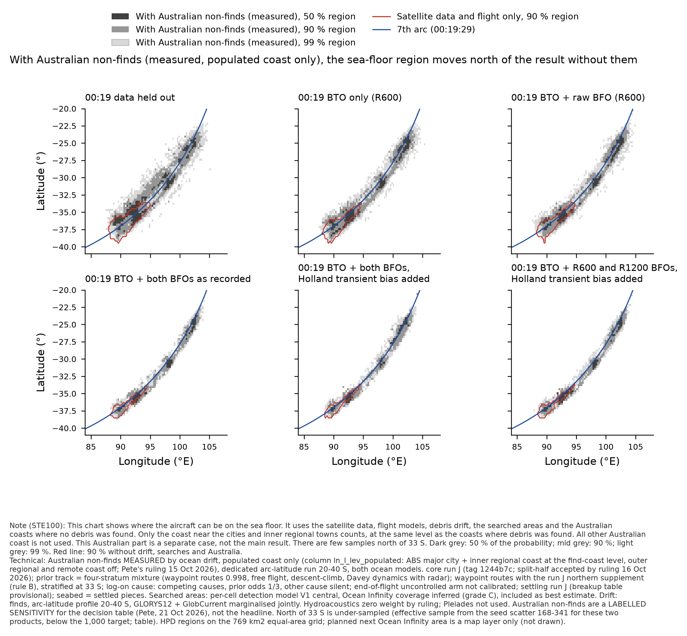
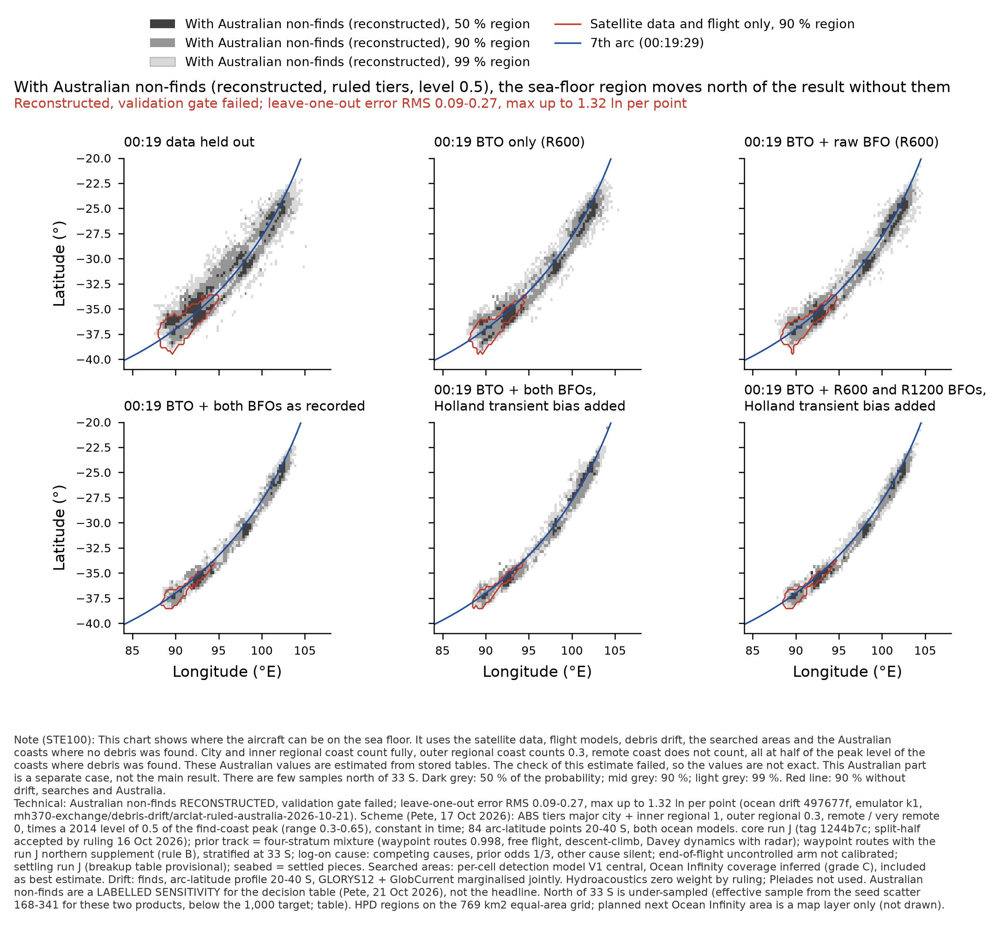

# Composer views v3.2 — sea-floor chart with the Australian non-finds term (21 Oct 2026)

Coordination task (Pete, 21 Oct ~01:20Z). Base: views v3.2 unchanged (supplement in, drift 20–40 S). No new drift run. Composition rerun
with `compose_v3.py` (`V32=1 DEXT=1 RULED=1`); its products without the Australian term equal v3.2 exactly (max |Δ| 0 for every product
and statistic checked). Figures and tables: `australia_v32.py`. Data: `mh370-exchange/composer/run-j-views-v3.2-australia/` (READY).

**Australian non-finds are a labelled sensitivity for the decision table (Pete, 21 Oct 2026), not the headline.**

- **(a) MEASURED** — populated coast only: ocean drift's measured column `ln_l_lev_populated` on the 84-point arc-latitude profile
  (ABS major city + inner regional coast at the find-coast level; outer regional and remote coast off; Pete's ruling 15 Oct). Product ApopS.
- **(b) RECONSTRUCTED** — Pete's 17 Oct scheme: ABS tiers major city + inner regional 1, outer regional 0.3, remote / very remote 0, times
  a 2014 level of **0.5** of the find-coast peak (range 0.3–0.65), constant in time. From ocean drift's per-node reconstruction (emulator
  k1, `arclat-ruled-australia-RECONSTRUCTED-gate-failed.csv`, commit 497677f). **Reconstructed, validation gate failed; leave-one-out error
  RMS 0.09–0.27, max up to 1.32 ln per point.** Drift's STOPPED file says not to use it for the sea-floor chart without Pete's decision;
  this chart is drawn on Pete's request of 21 Oct, with that label. Product Ar05S; levels 0.3 / 0.65 in the table only (Ar03S, Ar065S).
- Outside the profile's arc span (north of about 19.9 S, south of 40.25 S) the Australian increment is held at the end point's value, as for
  every Australian setting since v3.

## Headline rows (four-stratum mixture, settled seabed, 400 seed-bootstrap draws)

| 00:19 treatment | product | median (95 % seed interval) | 50 / 90 / 95 % HPD, k km² | mass N of 33 S (95 % interval) | effective sample N of 33 S: seed scatter / outcome Kish | on searched ground (± SE) |
|---|---|---|---|---|---|---|
| 00:19 data held out | All evidence without Australian non-finds (base) | 35.79 S (35.59–35.98) | 88 / 435 / 583 | 0.195 (0.169–0.219) | 178 / 6577 | 0.255 ± 0.004 |
| 00:19 data held out | With Australian non-finds, MEASURED (populated coast only) | 33.27 S (32.59–33.78) | 141 / 516 / 654 | 0.487 (0.449–0.523) | 323 / 5606 | 0.205 ± 0.004 |
| 00:19 data held out | With Australian non-finds, RECONSTRUCTED, level 0.5 | 32.97 S (32.28–33.62) | 142 / 511 / 648 | 0.502 (0.464–0.537) | 341 / 5631 | 0.205 ± 0.004 |
| 00:19 data held out | With Australian non-finds, RECONSTRUCTED, level 0.3 | 34.04 S (33.69–34.42) | 134 / 502 / 639 | 0.417 (0.380–0.451) | 287 / 5951 | 0.222 ± 0.004 |
| 00:19 data held out | With Australian non-finds, RECONSTRUCTED, level 0.65 | 31.93 S (31.39–32.76) | 143 / 512 / 650 | 0.553 (0.515–0.588) | 382 / 5426 | 0.195 ± 0.004 |
| 00:19 BTO only (R600) | All evidence without Australian non-finds (base) | 36.52 S (36.34–36.72) | 56 / 315 / 435 | 0.131 (0.110–0.155) | 92 / 5942 | 0.332 ± 0.004 |
| 00:19 BTO only (R600) | With Australian non-finds, MEASURED (populated coast only) | 34.07 S (32.60–34.71) | 101 / 396 / 504 | 0.460 (0.412–0.511) | 168 / 5311 | 0.296 ± 0.005 |
| 00:19 BTO only (R600) | With Australian non-finds, RECONSTRUCTED, level 0.5 | 33.67 S (31.97–34.53) | 100 / 392 / 498 | 0.477 (0.427–0.528) | 174 / 5334 | 0.296 ± 0.005 |
| 00:19 BTO only (R600) | With Australian non-finds, RECONSTRUCTED, level 0.3 | 34.97 S (34.58–35.24) | 97 / 386 / 492 | 0.372 (0.327–0.420) | 142 / 5523 | 0.321 ± 0.005 |
| 00:19 BTO only (R600) | With Australian non-finds, RECONSTRUCTED, level 0.65 | 31.68 S (30.99–33.29) | 98 / 392 / 499 | 0.541 (0.490–0.592) | 201 / 5215 | 0.280 ± 0.005 |
| 00:19 BTO + raw BFO (R600) | All evidence without Australian non-finds (base) | 36.13 S (35.95–36.28) | 63 / 321 / 432 | 0.177 (0.147–0.203) | 119 / 5898 | 0.422 ± 0.007 |
| 00:19 BTO + raw BFO (R600) | With Australian non-finds, MEASURED (populated coast only) | 32.42 S (31.26–33.99) | 90 / 362 / 465 | 0.516 (0.468–0.557) | 222 / 5302 | 0.318 ± 0.006 |
| 00:19 BTO + raw BFO (R600) | With Australian non-finds, RECONSTRUCTED, level 0.5 | 31.94 S (31.09–33.67) | 90 / 359 / 459 | 0.530 (0.482–0.571) | 229 / 5333 | 0.317 ± 0.006 |
| 00:19 BTO + raw BFO (R600) | With Australian non-finds, RECONSTRUCTED, level 0.3 | 34.48 S (33.80–34.91) | 91 / 356 / 458 | 0.427 (0.380–0.468) | 187 / 5503 | 0.351 ± 0.007 |
| 00:19 BTO + raw BFO (R600) | With Australian non-finds, RECONSTRUCTED, level 0.65 | 30.79 S (30.40–31.57) | 87 / 357 / 458 | 0.591 (0.544–0.631) | 265 / 5226 | 0.297 ± 0.006 |
| 00:19 BTO + both BFOs as recorded | All evidence without Australian non-finds (base) | 36.05 S (35.92–36.23) | 35 / 200 / 267 | 0.182 (0.153–0.212) | 114 / 3216 | 0.593 ± 0.013 |
| 00:19 BTO + both BFOs as recorded | With Australian non-finds, MEASURED (populated coast only) | 32.18 S (31.14–34.10) | 55 / 237 / 302 | 0.520 (0.468–0.567) | 189 / 2889 | 0.425 ± 0.013 |
| 00:19 BTO + both BFOs as recorded | With Australian non-finds, RECONSTRUCTED, level 0.5 | 31.72 S (31.07–33.67) | 55 / 236 / 300 | 0.531 (0.479–0.577) | 194 / 2954 | 0.422 ± 0.013 |
| 00:19 BTO + both BFOs as recorded | With Australian non-finds, RECONSTRUCTED, level 0.3 | 34.63 S (33.91–34.97) | 55 / 235 / 299 | 0.427 (0.376–0.473) | 161 / 3092 | 0.470 ± 0.014 |
| 00:19 BTO + both BFOs as recorded | With Australian non-finds, RECONSTRUCTED, level 0.65 | 30.85 S (30.57–31.61) | 53 / 234 / 298 | 0.593 (0.542–0.636) | 221 / 2857 | 0.394 ± 0.012 |
| 00:19 BTO + both BFOs, Holland transient bias added | All evidence without Australian non-finds (base) | 35.97 S (35.71–36.33) | 33 / 198 / 265 | 0.234 (0.199–0.270) | 124 / 803 | 0.656 ± 0.017 |
| 00:19 BTO + both BFOs, Holland transient bias added | With Australian non-finds, MEASURED (populated coast only) | 30.35 S (29.90–30.81) | 46 / 231 / 302 | 0.611 (0.562–0.649) | 292 / 705 | 0.465 ± 0.015 |
| 00:19 BTO + both BFOs, Holland transient bias added | With Australian non-finds, RECONSTRUCTED, level 0.5 | 30.28 S (29.69–30.64) | 46 / 231 / 301 | 0.624 (0.578–0.661) | 305 / 710 | 0.462 ± 0.015 |
| 00:19 BTO + both BFOs, Holland transient bias added | With Australian non-finds, RECONSTRUCTED, level 0.3 | 32.13 S (31.03–34.21) | 47 / 232 / 300 | 0.519 (0.470–0.559) | 236 / 736 | 0.511 ± 0.015 |
| 00:19 BTO + both BFOs, Holland transient bias added | With Australian non-finds, RECONSTRUCTED, level 0.65 | 29.63 S (27.77–30.20) | 45 / 227 / 298 | 0.683 (0.640–0.717) | 361 / 693 | 0.435 ± 0.015 |
| 00:19 BTO + R600 and R1200 BFOs, Holland transient bias added | All evidence without Australian non-finds (base) | 36.04 S (35.86–36.28) | 34 / 192 / 257 | 0.179 (0.149–0.208) | 119 / 3742 | 0.626 ± 0.014 |
| 00:19 BTO + R600 and R1200 BFOs, Holland transient bias added | With Australian non-finds, MEASURED (populated coast only) | 32.42 S (31.16–34.38) | 55 / 230 / 293 | 0.514 (0.461–0.559) | 188 / 3061 | 0.453 ± 0.012 |
| 00:19 BTO + R600 and R1200 BFOs, Holland transient bias added | With Australian non-finds, RECONSTRUCTED, level 0.5 | 32.03 S (31.09–34.22) | 55 / 229 / 293 | 0.525 (0.472–0.571) | 192 / 3147 | 0.451 ± 0.012 |
| 00:19 BTO + R600 and R1200 BFOs, Holland transient bias added | With Australian non-finds, RECONSTRUCTED, level 0.3 | 34.58 S (34.13–34.95) | 52 / 228 / 289 | 0.421 (0.370–0.464) | 160 / 3336 | 0.499 ± 0.013 |
| 00:19 BTO + R600 and R1200 BFOs, Holland transient bias added | With Australian non-finds, RECONSTRUCTED, level 0.65 | 30.93 S (30.62–31.72) | 55 / 227 / 291 | 0.588 (0.534–0.632) | 219 / 3027 | 0.422 ± 0.011 |

Readings:
1. With Australian non-finds (measured), medians move 2.4–5.6° north of the base (D0' 35.79 → 33.27 S; D4 35.97 → 30.35 S), and the mass
   north of 33 S rises from 0.13–0.23 to 0.46–0.61. The 90 % area grows by 33k–82k km². The mass on searched ground falls (D0' 0.255 → 0.205).
2. Reconstructed at level 0.5 lies within 0.5° of measured in every treatment (0.07–0.49° further north; north of 33 S +0.011 to +0.017). This
   agrees with drift's statement that the populated-only column does not overstate the ruled scheme at 0.5. Level 0.3 is 1.1–2.9° south of
   level 0.5, and level 0.65 is 0.7–2.0° north of it.
3. Effective sample north of 33 S (seed scatter) 168–341 for (a) and (b): north of 33 S remains under-sampled (target 1,000).

Files: `headline-australia-v3.2.csv / .md`, `maps-australia-v3.2.npz` (equal-area cell masses for core, base, measured, reconstructed
0.3 / 0.5 / 0.65 per treatment; v2 grid), figures PNG + PDF. Footnotes on each chart: STE100 + technical, with the scheme, level, label and
sensitivity status. — Composer
