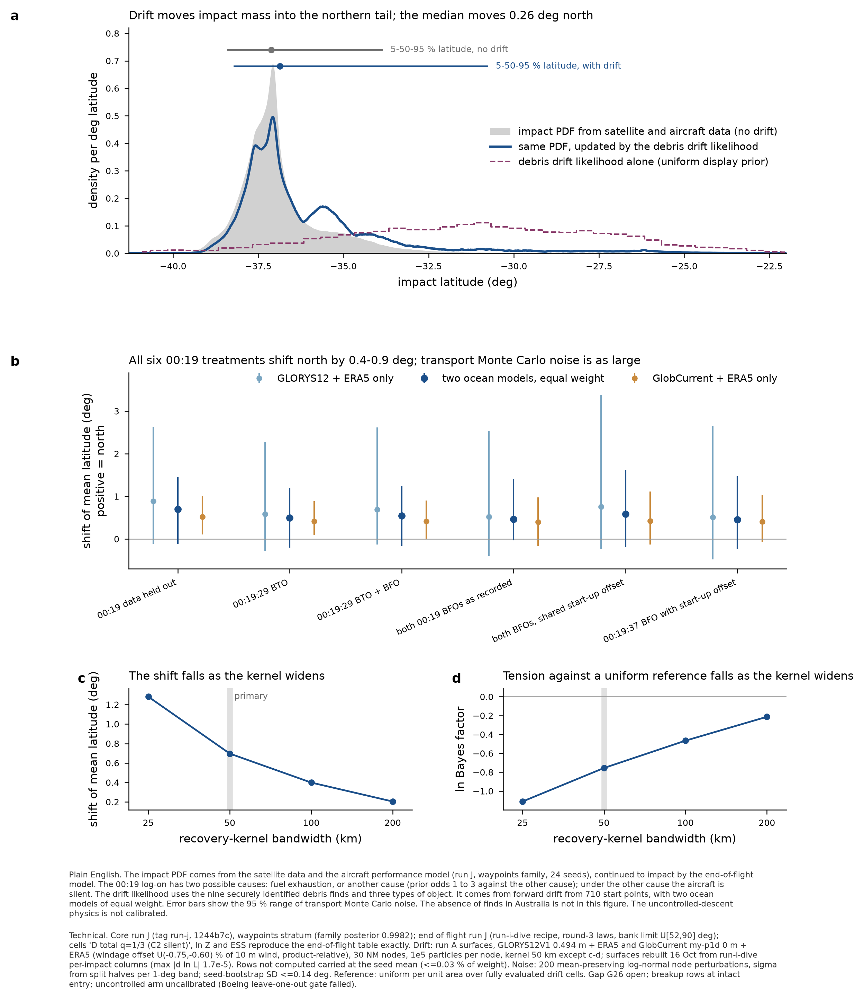
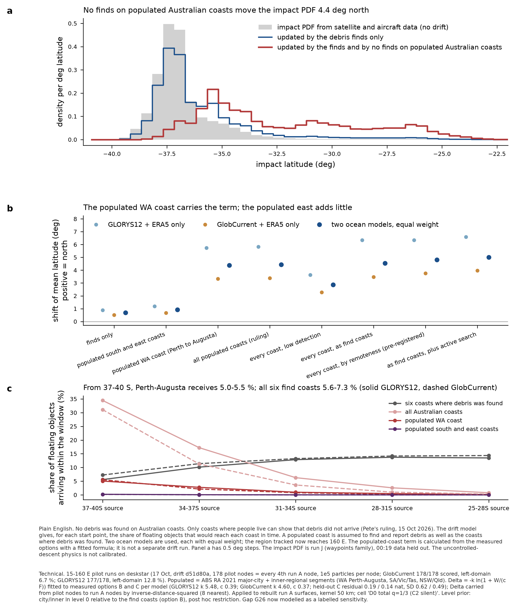

# Debris drift on core run J / end-of-flight run J (waypoints stratum) — no new drift transport, 17 Oct 2026

Architecture stand-in session (frame 0082820d), Pete's GO 16 Oct 2026 ("run them here as a stand-in"; overnight, no waiting).
**Status: drift-only composition COMPLETE for the waypoints stratum (24 seeds); four-stratum mixture waits for end of flight's free,
descent-climb and repro strata. Australian non-recovery on 15-160 E: both ocean models run on deskstar and applied (section 6).** Not the full composer pass:
the searched-areas, Pléiades and hydroacoustic modules have no run J columns yet.

## 1. What was done
1. **Surfaces rebuilt** (`../debris-drift-runA-rebuilt/README.md`): the run A drift surfaces had been lost with the drift thread's workspace.
2. **Scoring**: drift's own `export_per_impact.py` (unchanged) on the rebuilt surfaces against `end-of-flight/run-j/run-j-waypoints/`
   (24 seeds, 153.6 M impacts) -> `mh370-exchange/debris-drift/run-j/run-j-waypoints/seed-k/drift-lnL.npy` (9.2 GB).
3. **Composition** (`compose_drift_runj.py`): weights are end of flight's two-factor cells built by `option_table_0019.seed_terms` UNCHANGED
   (only its final reduction replaced), headline cells 'D total q=1/3 (C2 silent)'; seeds pooled by evidence as that script.
   **Check: ln Z, ESS and the 5/50/95 % latitudes reproduce `end-of-flight/run-j/summary/table-0019-run-j-waypoints.json` exactly in all six treatments**
   (e.g. D0' ln Z -7.5246, ESS 1,941,487, -38.40/-37.12/-33.87). Rows the drift term does not compute are carried at the seed's weighted mean
   likelihood ratio (ruling of 15 Oct) and never excluded.
4. **Tension statistics and uncertainty** (`analyze_runj.py`): seed bootstrap (1,000 draws over 24 seeds) and transport-noise replicates
   (200; each node's ln L perturbed by N(-s^2/2, s), mean-preserving in L, s = RMS(half_a - half_b)/2 per 1-deg band from the committed split halves;
   the posterior is linear in the node likelihoods, so no impact is rescored; linear path checked against the direct path to 3e-5 deg).
   Uniform reference for the Bayes factor: uniform per unit area over drift-grid cells whose four corners are evaluated.

## 2. Result: the drift update on the run J impact PDF (50 km kernel)

| 00:19 treatment | latitude 5/50/95 %, no drift | with drift (two models) | shift of mean latitude, two models [95 % transport noise] | GLORYS12 only | GlobCurrent only | ln BF against uniform, two models [95 %] | ESS, no drift -> with drift |
|---|---|---|---|---|---|---|---|
| 00:19 data held out (D0') | -38.40/-37.12/-33.87 | -38.20/-36.86/-30.78 | +0.70 [-0.12, +1.45] | +0.89 | +0.52 | -0.76 [-1.18, -0.30] | 1,941.5k -> 941.1k |
| 00:19:29 BTO (D1) | -38.48/-37.21/-34.57 | -38.28/-37.06/-33.06 | +0.50 [-0.20, +1.20] | +0.59 | +0.42 | -0.83 [-1.34, -0.22] | 2,140.2k -> 1,309.8k |
| 00:19:29 BTO + BFO (D2) | -38.16/-37.12/-34.34 | -38.07/-36.99/-32.30 | +0.54 [-0.16, +1.24] | +0.69 | +0.42 | -0.82 [-1.32, -0.08] | 92.0k -> 58.9k |
| both BFOs as recorded (D3) | -38.04/-37.29/-34.42 | -38.01/-37.20/-32.69 | +0.46 [-0.03, +1.41] | +0.52 | +0.40 | -0.83 [-1.55, -0.40] | 4.7k -> 3.8k |
| both BFOs, shared start-up offset (D4) | -37.98/-37.21/-34.39 | -37.98/-37.11/-30.10 | +0.59 [-0.18, +1.61] | +0.76 | +0.42 | -0.84 [-1.43, -0.10] | 21.2k -> 3.2k |
| 00:19:37 BFO with start-up offset (D5) | -37.99/-37.27/-34.47 | -37.98/-37.21/-32.75 | +0.46 [-0.23, +1.47] | +0.51 | +0.41 | -0.84 [-1.58, 0.22] | 25.9k -> 15.9k |

| 00:19 treatment | drift-only mass inside the 90 % region of the impact PDF | impact-PDF mass inside the 90 % region of the drift-only density | mode displacement (NM) | families A1/A2/B, no drift -> with drift | not computed share |
|---|---|---|---|---|---|
| 00:19 data held out (D0') | 0.055 | 0.216 | 506 | 0.17/0.34/0.48 -> 0.14/0.34/0.52 | 0.033 % |
| 00:19:29 BTO (D1) | 0.039 | 0.172 | 506 | 0.20/0.35/0.45 -> 0.16/0.35/0.48 | 0.016 % |
| 00:19:29 BTO + BFO (D2) | 0.035 | 0.173 | 506 | 0.24/0.23/0.53 -> 0.19/0.26/0.55 | 0.023 % |
| both BFOs as recorded (D3) | 0.022 | 0.156 | 547 | 0.09/0.41/0.50 -> 0.08/0.40/0.53 | 0.008 % |
| both BFOs, shared start-up offset (D4) | 0.019 | 0.144 | 547 | 0.25/0.35/0.40 -> 0.23/0.34/0.42 | 0.009 % |
| 00:19:37 BFO with start-up offset (D5) | 0.019 | 0.146 | 547 | 0.06/0.42/0.52 -> 0.05/0.40/0.54 | 0.017 % |

**Reading.**
1. **Drift moves impact mass north in every 00:19 treatment, by +0.46 to +0.70 deg of mean latitude on the two-model mixture.** The 95 % transport-noise
   interval includes zero or nearly so in every treatment (lower bounds -0.23 to -0.03 deg). Transport Monte Carlo noise, not seed noise (bootstrap SD
   <= 0.14 deg), sets the uncertainty; it is largest on GLORYS12 south of 37 S (s = 1.2-4.3 ln per node).
2. **The median moves little (0.06-0.26 deg); the northern tail moves a lot** (95 % latitude -33.9 -> -30.8 under D0'). This is the brief's
   pre-registered prediction: the drift likelihood is broad compared with the impact PDF, so it acts on the shoulder and the tail, not the mode.
3. **The tension is mild as a Bayes factor and large as a geometry.** ln BF of the impact PDF against the uniform reference is -0.76 to -0.84 (two models;
   GLORYS12 -1.0 to -1.1, GlobCurrent -0.4 to -0.55): a factor of about 2. But only 2-6 % of the drift-only density lies inside the impact PDF's 90 % region,
   and the modes are 500-550 NM apart (GlobCurrent alone 306-341 NM). The drift likelihood is flat enough across 37-38 S that the satellite data dominate.
4. **Families**: drift lowers A1 (D0' 0.17 -> 0.14) and raises B (0.48 -> 0.52), through the latitude dependence of the families.
5. **Kernel bandwidth is a first-order lever** (D0', two models):

| bandwidth | shift of mean latitude | ln BF against uniform | latitude 5/50/95 % with drift | ESS ratio | not computed |
|---|---|---|---|---|---|
| 25 km | +1.28 | -1.11 | -38.24/-35.96/-29.38 | 0.25 | 1.175 % |
| 50 km | +0.70 | -0.76 | -38.20/-36.86/-30.78 | 0.48 | 0.033 % |
| 100 km | +0.40 | -0.47 | -38.24/-37.01/-32.24 | 0.70 | 0.031 % |
| 200 km | +0.20 | -0.21 | -38.28/-37.07/-33.15 | 0.82 | 0.031 % |

   The shift falls by a factor of 6 from 25 to 200 km. 50 km is the drift module's primary; this table must accompany any quoted shift.
6. **Grid spacing** (`thin-grid-check.json`, every other node, 60 NM): GLORYS12 +0.89 -> +1.19, GlobCurrent +0.52 -> +0.30, two models +0.70 -> +0.66 deg.
   Interpolation error per model is about 0.3 deg, below its transport noise; the mixture is stable.

## 3. Answer to Pete's question (16 Oct): is a new drift run needed for run J?
**No new transport run was needed for the drift term itself.** The run A surfaces score run J's impacts with a not-computed share of at most 0.033 %
(50 km), far below the 10 % rule. What limits the result is the surfaces' own transport Monte Carlo noise in the south and the kernel bandwidth, not
the change of core run. A targeted southern refinement (more particles at the 34-41 S nodes) would narrow the transport-noise interval; it is not run.

## 4. COVERAGE
- **(a) Feasible set.** Start points: every run J waypoints impact, all six 00:19 treatments and all families. Object response: CSIRO flaperon trials and
  1.2 % / 3 % classes. Ocean: the true 2014-16 currents, represented by two reanalysis products.
- **(b) Model's reach.** 710 nodes at 30 NM on the reference-289 extent (40.7-22.2 S); object classes and windage priors as run A (provisional bounds);
  K log-uniform 100-1000 m2/s (provisional); ocean-error length 100 km (assumed); find coasts in 15-120 E. Australian non-recovery NOT in sections 2-3; modelled in section 6 as a labelled sensitivity. Breakup rows at the intact-entry approximation.
- **(c) Proposal coverage.** Not computed 0.008-0.033 % of weight (50 km), up to 1.4 % at 25 km. ESS with drift: D0' 941k, D1 1.31M, D2 58.9k, D3 3.8k, D4 3.2k
  (GLORYS12 alone 1.5k), D5 15.9k. **D4 under drift on GLORYS12 is thin** (ESS ratio 0.07); D3 inherits end of flight's own thin A1 cell (A1 ESS 368).
- **Gaps and status.** G26 Australian non-recovery: open, runs in progress. Strata free / descent-climb / repro: not assessed at this depth (end of flight
  has not produced them; waypoints carries 0.998 of the run I posterior). Rebuilt surfaces carry split halves only on 518 of 710 nodes: transport noise
  for the rest is band-pooled. Uncontrolled-arm dynamics uncalibrated: 'The uncontrolled-arm dynamics are not calibrated: the Boeing leave-one-out gate
  failed in all three rounds. Impact energy, attitude, flight-path angle and energy-transfer duration from this arm are a labelled sensitivity on
  uncalibrated dynamics, not a physical prediction.'

## 5. Files
`fig-drift-runj-waypoints.png/.pdf`, `analysis-runj-waypoints.json` (every statistic, bootstrap and noise intervals), `thin-grid-check.json`,
`compose_drift_runj.py`, `analyze_runj.py`, `compose_thin.py`. Per-impact columns: `mh370-exchange/debris-drift/run-j/run-j-waypoints/` (9.2 GB, Mac only).

## 6. Australian non-recovery on 15-160 E (both ocean models, 17 Oct)

Both 15-160 E Australian pilot runs were run on deskstar on 17 Oct (Pete's GO 16 Oct), from drift's own d51d80a and its committed
`australia-pilot-glorys12.toml` with only: domain 15-160 E, the joined 15-160 E manifests, 88 threads, output folder, and for GlobCurrent its
production ocean-error (sigma 0.0869 m/s, T 10 d) and product-relative windage. Configs, scripts, node tables and logs: `australia-160E/`.
GlobCurrent 00:38-02:45Z, 178/178 nodes, left-domain 6.7 %; GLORYS12 02:46-04:46Z, 177/178, left-domain 12.8 % (the 120 E pilot lost 21 % overall,
42 % from 37-42 S). Peak memory 10.1 / 17.7 GB, no OOM. Forcing uploaded from the Mac and checked file by file against SHA-256 (27 + 21 files).

**Method.** Delta(option) = ln L(option) - ln L(off) per pilot node, measured for B, A, C, searcher. Pete's ruling (only populated coast carries evidence)
has no stored column, so it is RECONSTRUCTED with the drift module's law Delta = -k ln(1 + W/(c F)), refitted per model to that model's measured B and C
(GLORYS12 k 5.47, c 0.388, held-out C residual +0.19 nat, SD 0.62; GlobCurrent k 4.60, c 0.366, +0.14, SD 0.49;
the same code reproduces the drift module's 120 E fit, k 3.503 / c 0.204, exactly). Populated = ABS RA 2021 major-city + inner-regional segments, at the
find coasts' level (option B's city level). Split-half SD of measured Delta_B per node: 0.50 / 0.49 nat. Delta is carried to every run A node by
inverse-distance-squared over the 8 nearest pilot nodes and applied as L' = L exp(Delta) on the rebuilt run A surfaces (linear path, no impact rescored).

**Arrival shares within the window, mean over the three object classes** (transport only, independent of any detection assumption):

| source band | Perth-Augusta (GLORYS12 / GlobCurrent) | populated south and east | all Australian coasts | six find coasts | left 15-160 E domain |
|---|---|---|---|---|---|
| 37-40S | 5.04 / 5.52 % | 0.21 / 0.18 % | 34.45 / 31.08 % | 5.57 / 7.25 % | 15.35 / 8.21 % |
| 34-37S | 2.76 / 2.14 % | 0.06 / 0.04 % | 17.22 / 11.27 % | 10.12 / 11.39 % | 10.61 / 5.21 % |
| 31-34S | 0.97 / 0.79 % | 0.01 / 0.01 % | 6.28 / 3.60 % | 12.85 / 13.23 % | 9.56 / 4.52 % |
| 28-31S | 0.46 / 0.21 % | 0.00 / 0.00 % | 2.57 / 1.00 % | 13.72 / 14.18 % | 10.63 / 5.28 % |
| 25-28S | 0.13 / 0.07 % | 0.00 / 0.00 % | 0.78 / 0.30 % | 13.48 / 14.35 % | 12.85 / 6.88 % |

**Effect on the run J impact PDF (00:19 data held out; latitudes at 0.5 deg resolution, which reproduces the exact no-drift quantiles to 0.07 deg):**

| Australian term (00:19 data held out) | shift of mean latitude: GLORYS12 / GlobCurrent / two models | ln BF against uniform, two models | 5/50/95 % latitude, two models |
|---|---|---|---|
| finds only (no Australian term) | +0.89 / +0.52 / +0.70 | -0.76 | -38.22/-36.81/-30.79 |
| populated south and east coasts only | +1.19 / +0.67 / +0.91 | -0.87 | - |
| populated WA coast only (Perth-Augusta) | +5.75 / +3.33 / +4.38 | -2.28 | -36.97/-33.55/-25.71 |
| **all populated coasts (Pete's ruling; reconstructed)** | +5.82 / +3.38 / +4.44 | -2.30 | -36.93/-33.46/-25.70 |
| every coast, low detection (C) | +3.63 / +2.27 / +2.87 | -1.84 | - |
| every coast at find-coast levels (A) | +6.35 / +3.47 / +4.55 | -2.31 | - |
| every coast by remoteness (B, pre-registered) | +6.34 / +3.75 / +4.81 | -2.42 | -36.79/-33.09/-25.17 |
| A plus active search (searcher) | +6.60 / +3.97 / +5.02 | -2.41 | - |

**By 00:19 treatment:**

| 00:19 treatment | shift, populated coasts, two models | ln BF, populated coasts, two models | shift, finds only |
|---|---|---|---|
| 00:19 data held out (D0') | +4.44 | -2.30 | +0.70 |
| 00:19:29 BTO (D1) | +4.31 | -2.74 | +0.50 |
| 00:19:29 BTO + BFO (D2) | +4.60 | -2.60 | +0.54 |
| both BFOs as recorded (D3) | +4.48 | -2.73 | +0.46 |
| both BFOs, shared start-up offset (D4) | +5.17 | -2.53 | +0.59 |
| 00:19:37 BFO with start-up offset (D5) | +4.58 | -2.74 | +0.46 |

**Reading.**
1. **The no-finds-in-Australia evidence, restricted to populated coasts, moves the impact PDF 4.4 deg north on the two-model mixture**
   (GLORYS12 5.8, GlobCurrent 3.4), ln BF -2.30 against the uniform reference (finds only -0.76). The median moves from -37.11 to -33.46.
   This is the term that makes the drift-against-satellite tension large; the finds alone are mild.
2. **Pete's proxy question (16 Oct): the populated WA coast carries the term; the populated south and east coasts add almost nothing.** From 37-40 S the
   model puts 5.0-5.5 % of floating objects on Perth-Augusta and 0.18-0.21 % on the populated south and east coasts within the window. Most debris that used to
   leave the 120 E domain strands on the remote WA south coast and the Bight, which carry no weight under the ruling. WA only gives +4.38 deg against +4.44.
   The 15 Oct drifter check (6.1 % of undrogued drifters crossing 120 E reached the populated south-east) is not contradicted: few model particles cross
   120 E south of Australia within the window, so 6 % of a small number is small.
3. **The 120 E reach limit did not bias the populated term**: the dry run on the old 120 E GLORYS12 pilot gave +5.72 deg; the 160 E run gives +5.82.
4. **The ocean model changes the effect by a factor of 1.7** (GLORYS12 against GlobCurrent), more than any level option except 'low detection'.
5. **Assumptions that carry the result, for Pete:** (i) a populated Australian coast finds and reports MH370 debris at the same mean rate as the western Indian
   Ocean coasts where debris was found (option C, lower detection on every coast, gives +2.87 deg, 0.65 of the populated-coast shift); (ii) the restriction to populated coasts was defined after the
   120 E pilot was seen (post hoc); (iii) the populated variant comes from the fitted law, not a stored column; (iv) one transport realisation per model: no
   transport-noise replicates for Delta yet (split-half SD about 0.5 nat per node, against Delta of -5 to -7 at 37-40 S).

**Status.** G26 is now MODELLED as a labelled sensitivity ('populated-coast non-recovery, reconstructed, 15-160 E, two ocean models'). It is not in any
headline until Pete rules on assumption (i). Not composed with searched areas, Pleiades or hydroacoustics.
