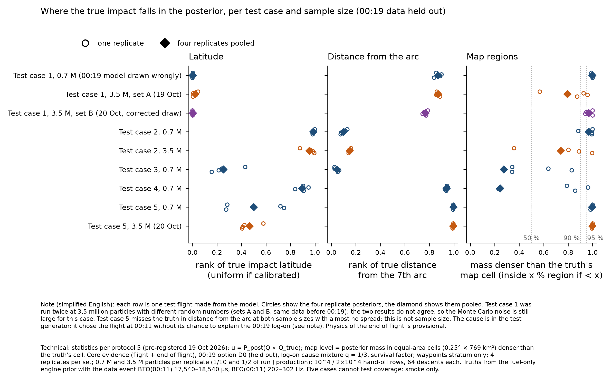
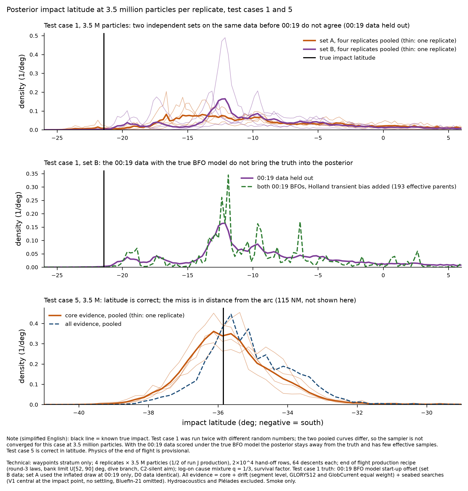
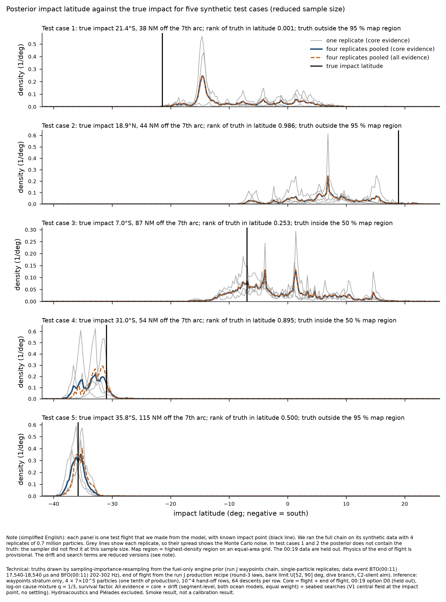

# End-to-end calibration: 5-case smoke at reduced scale — 19 Oct 2026

Overnight work order E item 2 (`threads/work-orders/overnight-2026-10-19.md`), composer / architecture role. Protocol pre-registered and
committed BEFORE any case ran: `threads/work-orders/e2e-calibration-protocol-2026-10-19.md` (commit 3010631c, 04:12Z). **The full run was
not started**; it waits for Pete's review of this smoke. **Five cases cannot test coverage. Every statistic below is a smoke value, not a
calibration result, and every count is "not assessed at this depth".**

## Update 20 Oct 2026 (overnight order D): test cases 5 and 1 at 4 × 3.5 M

Order: `threads/work-orders/overnight-2026-10-20.md` §D. deskstar, `flock ~/.mh370-heavy.lock`, 40 threads; one core process per replicate,
pruned at once; replicates of test case 1 scored as soon as each end-of-flight pass finished. **Full run not started; amendments A1–A5 stay
proposed.** Added cuts and events, declared:
- **Disk:** the 8 GB deskstar cap was exceeded by about 0.2 GB for about 5 min during test case 5. At that point the four end-of-flight impact
  files (1.5 GB each, larger than I estimated) existed together with the 2.0 GB base. Test case 1 then ran with per-replicate scoring and peaked
  at about 3.9 GB. Nothing outside my own smoke files was deleted; the earlier cases' row files (statistics already committed) were removed.
- Test case 1 set B uses new replicate seeds. Its data before 00:19 are identical to set A; its 00:19 bursts come from the corrected
  draw (start-up offset; valid options D0, D1, D4, D5). Its ocean-model draw changed to GlobCurrent; drift is not computed for this truth.
- Same reduced drift and search terms, waypoints stratum only, no settling (as in the table below).

| run | true impact | particles | median lat | latitude rank (SD over replicates) | distance-from-arc rank | map level at truth (replicates) | P(true cause) | effective parents |
|---|---|---|---|---|---|---|---|---|
| case 5, 19 Oct | 35.8 S, 115 NM off arc; A1, C2 | 0.7 M | 35.85 S | 0.500 (0.262) | 0.996 | 0.994 (0.98–1.0) | 0.020 | 2,088 |
| **case 5, 20 Oct** | same | 3.5 M | 35.75 S | **0.466 (0.083)** | **0.995** (0.991–0.997) | **0.997** (0.995–1.0) | **0.021** (0.011–0.033) | 4,511 |
| case 1, set A (19 Oct) | 21.4 S, 38 NM; A1, C1 | 3.5 M | 10.95 S | 0.021 (0.020) | 0.871 | 0.794 (0.57–0.96) | 0.994 | 6,085 |
| **case 1, set B (20 Oct)** | same; 00:19 model start-up offset | 3.5 M | 10.76 S | **0.002 (0.005)** | 0.767 | **0.967** (0.97–1.0) | 0.994 | 6,463 |

00:19 data held out, core evidence. Case 1 set B with 00:19 data (true model): D4 (both BFOs, Holland transient bias added) map level 0.990,
193 effective parents; D5 1.000, 249; D1 0.977, 5,163. D4 and D5 are **not estimable at this depth** (below 1,000 parents). Case 5 with 00:19
data (true model no offset, so D2/D3 valid): D3 map level 0.921, P(C2) 0.22, 1,282 parents; D2 0.965, 1,272.

**Case 5 (fault F5) — not sample size, and not the estimator: a defect in my smoke truth generator (S2).**
- The miss does not change with 5× particles (map level 0.994 → 0.997), and the replicates agree closely (0.995–1.0; distance-from-arc
  rank 0.991–0.997; P(C2) 0.011–0.033). This is not Monte Carlo noise. The latitude rank improved as expected (replicate SD 0.26 → 0.08).
- The truth's 00:11 flight explains the 00:19 log-on time poorly. Its marginal log-on likelihood is ln Z(parent) = −10.49 with P(C1 | parent) = 0.47
  (`scripts/parent_check.py`). For comparison, a flight whose fuel runs out at the most likely lag gives about −5.1, and test case 1's truth
  parent gives −6.30 with P(C1) = 1.00.
- The smoke generator picked the 00:11 flight by its fuel-only weight and only then picked a descent by the log-on likelihood. That leaves out
  the factor Z(parent), because the second stage normalises within the flight. So flights that explain the 00:19 log-on poorly are over-drawn,
  here by roughly e^4–e^5. The inference correctly gives such flights about 2 %.
- Fix for the full run (implementation, allowed by protocol §0): fly the end-of-flight stage for every accepted candidate flight and draw
  (flight, descent) jointly ∝ fuel-only weight × Z(parent) × within-flight descent weight. This costs seconds per case. Every smoke truth was drawn
  with the defect (case 1's parent is typical, case 5's is not), so the smoke ranks are not SBC draws in any case.

**Case 1 — sample size.** The two independent 4-replicate sets on identical data before 00:19 give map levels 0.794 and 0.967 and medians
10.95 S and 10.76 S. Both put almost no mass at the truth's latitude (rank 0.021 and 0.002). At 3.5 M the posterior for this truth is still
Monte Carlo limited. Pooling the 8 replicates or using 7 M is needed; 3.5 M is not enough for every truth. This strengthens amendment A3.

**Wall time (20 Oct, one core process per replicate):** core 725–997 s per replicate, end of flight 85–123 s per replicate, scoring about 160 s;
case totals 4,017 s (case 5) and 3,710 s (case 1). This agrees with the 19 Oct figures (≈ 62–67 min per case at 3.5 M). The cost estimate below
is unchanged, except that the case 1 evidence points to 7 M rather than 3.5 M (≈ 340 h on one lane, about 8 days at 88 threads).

---

## Declared reductions, substitutions and cuts (read first)

| item | protocol | smoke | magnitude |
|---|---|---|---|
| route families | all four strata, drawn by prior share | **waypoints stratum only**, truths and inference | other three strata not run (waypoints holds ≥ 0.996 of run J products) |
| particles per replicate | scale set by the smoke (§8) | **0.7 M** (1/10 of run J's 7 M) for 5 cases; **3.5 M** (1/2) for cases 1–2 | 4 replicates each |
| hand-off rows | production 100,000 | 10,000 (0.7 M), 20,000 (3.5 M) | 64 descents per row (production recipe) |
| truth draw | exact prior draw | sampling-importance-resampling (SIR) over ≈2,400 surviving single-particle prior paths per case | accepted ESS 3.0–9.4 per case (coarse) |
| truth population | prior | prior **conditioned on a data event** BTO(00:11) 17,540–18,540 µs and BFO(00:11) 202–302 Hz (valid for SBC: a function of the data only) | weighted acceptance 1.1–4.9 %; **not in the pre-registration: proposed amendment A1 below** |
| 00:19 BFO model of case 1 | drawn 1/3 each | "inflated" for case 1 by a defect in my smoke script (S1 below); cases 2–5 redrawn after the fix | case 1 scores D0/D1 only |
| settling | settled seabed position | **not run**: impact point used for the search term | — |
| searched areas | module scorer, V1 central | **re-implementation** of V1 central from `fields.npz` (Phase 2 coverage × q from the Figure 73 overlay, terrain ρ, Ocean Infinity 2018/2025–26 density, q_OI 0.9); **Bluefin-21 layer omitted** (not in the field file) | all 5 truths fell on unsearched ground (P(no find) = 1), so no truth exercised a detection draw |
| drift | the module, synthetic find list, both ocean models | **segment-level reduced model**: each of the 9 identified items (`debris-evidence-audit.csv`) beaches in one of 16 segments or none, with the module's own per-node probabilities from the arc-latitude scan (`~/mh370/drift/arclat`, 25 000 particles per class); nearest node by latitude; both ocean models, equal weight; a 1e-12 probability floor (smoke only) | node set covers 40.25–25.5 S only (fault F3) |
| along-arc position at 00:19 (statistic 1) | rank of truth | **not assessed**: `impacts.npy` carries no 00:19 position | impact latitude, impact time and cross-arc distance are reported |
| equal-area grid | authalic latitude | spherical sin(latitude) steps, 0.25° × 769.3 km² | < 0.2 % in cell area |
| binary | production `mh370-eof-rj1` (Mac, aarch64) | rebuilt from the same commit 16f2eb1 on deskstar (x86_64, sha256 7b3afffe…); EoF overlays from the working branch as used by run J production | no byte-identity gate run |
| tiers 1b, 2, 3 | designed | not run | — |

## What ran (deskstar, `~/mh370/e2e`, under `flock ~/.mh370-heavy.lock`, 40 threads)

1. **Truth, flight (§3.1).** 3,000 single-particle replicates per case of the run J waypoints chain with the fuel-only case
   (`use_bto = use_bfo = false`), tempering off, one particle per stratum, residual snapshots on, and dummy epochs 1 s before and after every
   cruise-BFO burst (vertical rate). The candidate weight is the stratum's `log_evidence_by_mode` (carries the fuel record and every proposal
   correction). BTO predicted = table value − engine residual (numpy port agrees to 0.002 µs); BFO predicted by a numpy port of
   `satcom::bfo_without_bias_hz`, **checked against the engine on 900 bursts: max 1.2e-5 Hz in level flight, 0.029 Hz in climbs/descents**.
2. **Truth, end of flight (§3.2).** The production recipe on the truth's 00:11 row, 1,024 descents; one descent drawn ∝ prior weight × the
   log-on-time likelihood (q = 1/3, C2 silent) × survival (ESS 12–86); cause drawn from its conditional; 00:19 BTO/BFO from the descent's
   residual columns. Synthetic 00:19 BFO model, search outcome, ocean model and finds as in the table above.
3. **Inference (§4)** on the synthetic observation table: core chain → m0011 hand-off → end of flight (production overlays, children 16) →
   D0–D5 × cause columns by the algebra of `option_table_0019.py` → drift and search terms → stacks core, core + drift, core + searches, all.
4. **Statistics (§5)** per replicate and pooled by evidence (`case-stats/case-*/case-stats.json`; table `smoke-cases-700k.csv`).

## Results (00:19 data held out, core evidence; pooled over 4 replicates)

| case | true impact | family, cause, 00:19 model | particles | posterior median lat | rank of truth (lat) | map level at truth | SD over replicates: rank / median lat | ESS rows / parents |
|---|---|---|---|---|---|---|---|---|
| 1 | 21.4 S, 104.6 E, 38 NM off arc | A1, C1, inflated | 0.7 M | 11.0 S | 0.001 | 0.998 (outside 95 %) | 0.002 / 7.0° | 15,227 / 3,172 |
| 1 | same | same | 3.5 M | 11.0 S | 0.021 | 0.794 (inside 90 %) | 0.020 / 2.4° | 30,670 / 6,085 |
| 2 | 18.9 N, 104.7 E, 44 NM | B, C1, inflated | 0.7 M | 6.8 N | 0.986 | 0.967 (outside 95 %) | 0.008 / 4.3° | 12,101 / 2,328 |
| 2 | same | same | 3.5 M | 10.0 N | 0.954 | 0.740 (inside 90 %) | 0.053 / 1.8° | 19,719 / 4,957 |
| 3 | 7.0 S, 106.7 E, 87 NM | B, C1, no offset | 0.7 M | 3.3 S | 0.253 | 0.273 (inside 50 %) | 0.118 / 3.5° | 7,590 / 2,033 |
| 4 | 31.0 S, 98.6 E, 54 NM | B, C1, start-up offset | 0.7 M | 33.2 S | 0.895 | 0.244 (inside 50 %) | 0.045 / 1.6° | 13,712 / 2,267 |
| 5 | 35.8 S, 95.1 E, 115 NM | A1, C2, no offset | 0.7 M | 35.8 S | 0.500 | 0.994 (outside 95 %) | 0.262 / 0.7° | 7,857 / 2,088 |

Family codes: A1 = cruise to fuel exhaustion then no control; A2 = cruise to fuel exhaustion then controlled descent; B = planned descent
with ditching approach begun before fuel exhaustion. C1 = fuel exhaustion and APU start; C2 = other cause.

Other values (pooled, D0 core): P(true family) 0.14, 0.51, 0.56, 0.49, 0.11; P(true cause) 0.99, 0.99, 0.99, 1.00, 0.02. Cross-arc rank of
the truth 0.87, 0.10, 0.04, 0.94, 0.996. With the 00:19 data, matched-model cells: case 3 D3 (both BFOs as recorded) map level 0.30, case 4
D4 (both BFOs, Holland transient bias added) 0.44, case 5 D3 0.91 — but these matched-model cells have only 71–603 effective rows and 67–295
effective parents, below the 1,000 floor. The crossed cell (case 4, start-up-offset truth scored as D3) collapses to ESS 1 with the truth outside the 99 % region: the free tier 2
check detects a wrong 00:19 model, as designed. Drift and searches moved the D0 median by 0.56° (case 4) and 0.44° (case 5) and nothing in cases 1–3
(no node or field coverage).

## Pipeline faults and design findings

- **F1 (production scorer, end of flight).** `smoke/option_table_0019.py` computes D5 in closed form with the 00:19 BFO SDs read from
  `data/satcom-observations.csv` (7 Hz), while run J's engine columns use `satcom-observations-bfo432.csv` (4.3177 Hz). Verified on run J
  waypoints seed 1: the closed form reproduces the stored D2 column to 3e-3 nat at 4.3177 Hz and misses it by a median 73 nat at 7 Hz. Effect on
  the run J D5 column on seed 1: ln Z −22.224 → −22.263, median latitude 37.268 → 37.262 S (immaterial on this seed; provisional, one seed).
  Fix: read the SDs from the run's own `[inputs] observations`. Owner: end of flight.
- **F2 (sampler scale, core).** At 1/10 of production particles the core does not recover two of five prior-drawn truths (cases 1–2: truth
  outside the 95 % map region; replicate medians of the 00:11 hand-off latitude differ by up to 11.7° in case 1). At 1/2 of production both truths move inside the 90 % region and the
  replicate spread of the median falls from 7.0° to 2.4° and from 4.3° to 1.8°. The limitation is Monte Carlo, not a model error, but the
  full calibration needs at least 3.5 M per replicate and probably the production 7 M. Stratum-level hand-off ESS fell to 1–4 in one autopilot
  mode of case 1 (MagneticTrack) at both scales.
- **F3 (coverage, drift).** The arc-latitude drift nodes span 40.25–25.5 S. Three of five truths and all their posterior mass fall outside, so
  the drift factor is "not computed" there (NaN mass 1.0). Composition rule 5 requires accuracy over the whole prior span; for calibration
  the node set must cover the truths' span or the drift stack must be restricted by a data-only rule (amendment A4).
- **F4 (truth population).** Truths drawn from the prior, even after the 00:11 data event, land mostly away from the region that the paper
  is about (5 truths: 18.9 N to 35.8 S; 2 of 5 between 40 and 25 S). The event keeps 1.1–4.9 % of the weighted prior and leaves an accepted
  ESS of 3–9 from 2,400 candidates, so the SIR truth draw is coarse. Amendments A1–A2.
- **F5 (case 5; resolved 20 Oct as smoke defect S2, see the update above).** An A1 truth with cause C2, 115 NM off the arc: latitude rank 0.50 but cross-arc rank 0.996, map
  level 0.994 and P(C2) = 0.02. One case cannot separate a tail event (p ≈ 0.01) from under-sampling of far-off-arc C2 descents. Watch item for
  the full run.
- **S1 (my smoke script, fixed).** The 00:19 BFO model was drawn as the third draw of a per-case generator; for seeds 9001–9005 it returned
  "inflated" every time. Fixed with an independent stream; cases 2–5 were redrawn before inference; case 1 kept its draw (declared).
- Checks that passed: the numpy BFO port (above); truth log-likelihood under its own synthetic data −65.7 against an expected −64.7 (case 1);
  `family4_code` 6 (planned descent with ditching, onset before exhaustion) carries 0.09 % of prior weight and is counted with B here;
  no OOM kill (`memory.events` oom_kill 0); peak disk per case 4.3 GB (0.7 M) and 6.4 GB (3.5 M, with pruning), under the 10 GB cap.

## Wall time per case (deskstar, 40 threads) and cost of the full run

| stage | 0.7 M × 4 (cases 1–5) | 3.5 M × 4 (cases 1–2) | 7 M × 4, 100k rows (projected, linear) |
|---|---|---|---|
| truth (pool 3,000 replicates, EoF 1,024 descents, synthetic data) | 142–153 s | (reused) | shared pool, see below |
| core | 617–719 s | 2,949–3,493 s | ≈ 6,400 s |
| end of flight (4 replicates) | 162–185 s | 297–311 s | ≈ 1,500 s |
| scoring | 64–81 s | 160–162 s | ≈ 800 s |
| **total per case** | **≈ 18 min** | **≈ 60–68 min** | **≈ 2.4 h** |

**Cost of 100 + 40 cases** (tiers 1a + 1b), deskstar alone:
- at 3.5 M × 4 (minimum the smoke supports): 140 × ≈ 1.1 h ≈ **150 h on one 40-thread lane, ≈ 3–3.5 days on two 44-thread lanes**
  (RSS 11.3 GB per lane at 3.5 M; two lanes fit the 36 GiB cap);
- at 7 M × 4 (production particles): 140 × ≈ 2.4 h ≈ **340 h on one lane, ≈ 8 days at 88 threads** (one lane only: ≈ 20 GB RSS, projected);
- truth pool shared across cases: ≈ 300,000 single-particle replicates (≈ 3 h at 32 threads) compacted on the fly to ≈ 3 GB, giving an
  accepted ESS ≥ 100 per case (the smoke's per-case pools gave 3–9);
- D3/D4/D5 statistics need ≥ 1,000 effective parents per cell; the smoke gives 24–600 at both scales, so those cells need end of flight's
  both-burst aimed pass per case (about 4× the EoF cost) or must be reported "not estimable";
- the ESS floor of 1,000 parents is met for D0/D1 at both scales (1,409–6,195);
- Mac: not needed (light only).

## Proposed amendments (NOT adopted — Pete's decision; logged in protocol §12)

- **A1 Truth population.** Keep tier 1a strictly from the prior for the **core stack only** (where the engine covers the support), and add
  tier 1a′, posterior-predictive SBC conditional on data similar to the real data (truths from the prior, accepted by a data-only event on the
  00:11 and 22:41 BTO/BFO), for every stack. Both remain valid SBC; 1a′ tests calibration where the paper's claims are.
- **A2 Truth pool.** One shared compacted pool of ≥ 300,000 single-particle replicates; each case draws without replacement; accepted ESS
  per case ≥ 100.
- **A3 Scale.** 4 replicates × 3.5 M minimum; run the first 10 cases at 7 M and keep 7 M if the replicate SD of any rank exceeds 0.05
  (smoke: 0.020 and 0.053 at 3.5 M; 0.002–0.262 at 0.7 M).
- **A4 Drift domain.** Extend the arc-latitude node scan to the truths' span, or restrict drift stacks to cases whose core posterior mass is
  ≥ 0.99 inside the node span (a data-only rule).
- **A5 Statistic 1.** Ask end of flight for a 00:19 position prediction column so the along-arc rank at 00:19 can be computed.

## COVERAGE
- (a) Feasible set: the 777-200ER flight envelope as in run J (no change). (b) Model reach: run J waypoints chain + EoF production recipe.
  (c) Proposal coverage in the smoke: 0.7 M particles per replicate do not reach two of five prior truths (F2); drift nodes reach 40.25–25.5 S
  only (F3); search fields 40.2–24.5 S, 85–103 E (outside = unsearched, correct).
- ESS (effective parents, core): D0 2,033–3,172 and D1 1,409–4,536 at 0.7 M; D0 4,957–6,085 at 3.5 M; matched-model D3/D4 cells 67–295 (gap, declared).
- Families and modes: waypoints only; strata other than waypoints not sampled (gap, declared); one autopilot stratum degenerate (F2).

## Notes for charts
STE100: we made five test flights from the model with known end points and ran the full chain on their synthetic data. The test shows faults
and cost; it does not show calibration. Technical: run J waypoints chain at tag-era commit 16f2eb1, 4 replicates of 0.7 M (3.5 M for cases 1–2)
particles, end of flight production recipe (round-3 laws, bank limit U[52, 90] deg, dive branch, C2-silent aim), 00:19 options D0–D5 with
cause mixture q = 1/3 and survival, drift segment-level (GLORYS12 and GlobCurrent, equal weight), searches V1 central at the impact point (no
settling, Bluefin-21 omitted), hydroacoustics and Pléiades excluded; physics PROVISIONAL.

Files: `smoke-cases-700k.csv`; `fig3-cases-1-and-5-at-3.5M.*` (20 Oct); `case-stats/case-*/` (`case-19005` = case 5 at 3.5 M, `case-29001` = case 1 set B, 20 Oct); (truth, statistics per replicate and pooled, wall times; `case-19001`, `case-19002` = cases
1–2 at 3.5 M); `scripts/` (deskstar pipeline); `deskstar-timeline.txt`; `BIN.sha256`. Deskstar: `~/mh370/e2e/` (3.3 GB; nothing deleted
outside my own smoke files).
