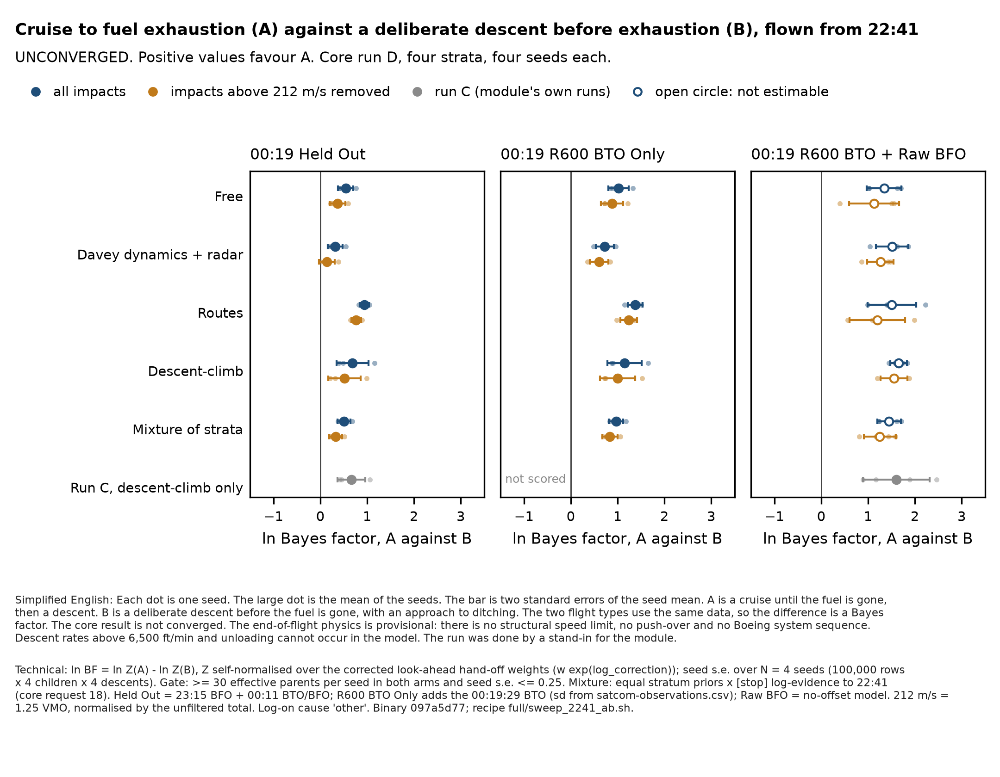

# End of flight, 22:41 A-against-B on core run D — STAND-IN replay (architecture, 11 Oct 2026, 07:45–10:56 UTC)

**UNCONVERGED.** Core run D is not converged (split-half below the 4-seed floor in three strata; routes above it only on an incomplete
exploration — route 8 not found). **End-of-flight physics PROVISIONAL**: no structural limit (G13), push-over and the Boeing system sequence
not yet in (plan accepted 5e8f13ea, not built). **Rapid descents above 6,500 ft/min and unloading not reachable by the model.** Family
shares within each arm are mostly prior. Run by architecture as a stand-in for the end-of-flight module (ruling 5e8f13ea item 1),
replaying the module's own recipe; **for the module's review.**

Figure: `eof-a-vs-b-2241-run-d-standin.png` (this folder). Data: `eof-a-vs-b-2241-run-d-standin/` (aggregate, per-seed JSON, stand-in scripts).

## 1. What was run

- **Recipe:** end of flight's `full/sweep_2241_ab.sh` (22:41 hand-off; arms A = `smoke/arm-v1.toml`, B = `full/arm-b-deliberate.toml`; common
  `snapshot-m2241`, `terminal`, `options-m2241`, `children-4`; module overlays `descent-idle-floor`, `v2-broad`, `family-b-ditching`,
  `residual-bank-boeing`; `full/seed-k.toml`). Configs read from the module's workspace at its head ec1e8bf; sha256 of the arm and option
  files equal to the commit, mtimes before the run.
- **Only the input changed:** core run D (`mh370-exchange/core/next-run-d/`, build abd15b6), m2241 look-ahead hand-offs, 4 strata × seeds
  1–4, 100,000 rows × 4 children × 4 descents per arm. Each hand-off's sha256 checked against core's COMPACT.txt (16/16 match).
- **Binary:** the run C binary `/tmp/mh370-eof-runc5` (code 097a5d77), copied. **No rebuild was needed**: its terminal stage already reads
  hand-offs with `handoff::read_corrected` (weight × exp(log_correction); in since core 826f731), and it reads run D's request-18 `[stop]`
  fields (optional). The module's physics files at ec1e8bf differ from 9da3258 by one comment line; the binary records revision 097a5d77, the module's merge used for all of run C.
- **Reproduction check (passed):** run C descent-climb seed 1 re-run with this setup reproduces the module's own numbers exactly
  (00:11: ln Z A −16.455, B −17.174, ln BF +0.72; +R600 inflated: −28.034 / −29.148, ln BF +1.11).
- **Compute:** outside the heavy lock at RAYON_NUM_THREADS = 8 (ruling); 2–7 min per arm at Mac load 16–35; 3 h 11 min in total.
- **Evidence:** the module's `smoke/ab_evidence.py`, unchanged, per stratum-seed. Stand-in companion `standin_ab_summary.py` adds three
  things from the same impacts: R600 BTO Only, the `~v212` version and family shares (section 6, deviations 2–4).

## 2. Result: ln BF (A against B), seed mean ± seed s.e., N = 4 seeds

Positive = favours A (cruise to fuel exhaustion, then A1/A2). Bold = passes the module's gate (≥ 30 effective parents per seed in both
arms) and seed agreement (stand-in definition: seed s.e. ≤ 0.25 nat). n.e. = not estimable (minimum effective parents A/B shown).
Every option includes the 23:15 BFO and the 00:11 BTO + BFO, scored in-stage. Mixture ([stop] evidence) = equal stratum priors × the
evidence to 22:41 from each hand-off's `[stop]` block (core request 18), per seed index. Mixture (README P) = run D's final P(family)
(0.594 / 0.235 / 0.019 / 0.153) as fixed weights, a sensitivity only.

| 00:19 option (with 23:15 + 00:11) | Free | Davey dynamics + radar | Routes | Descent-climb | mixture ([stop] evidence) | mixture (README P) |
|---|---|---|---|---|---|---|
| Held Out | **+0.54 ± 0.08** | **+0.32 ± 0.08** | **+0.94 ± 0.05** | **+0.69 ± 0.17** | **+0.51 ± 0.07** | **+0.56 ± 0.08** |
| Held Out ~v212 | **+0.37 ± 0.09** | **+0.14 ± 0.08** | **+0.77 ± 0.05** | **+0.52 ± 0.17** | **+0.33 ± 0.07** | **+0.39 ± 0.08** |
| R600 BTO Only | **+1.02 ± 0.11** | **+0.73 ± 0.10** | **+1.38 ± 0.08** | **+1.15 ± 0.18** | **+0.97 ± 0.08** | **+1.04 ± 0.08** |
| R600 BTO Only ~v212 | **+0.88 ± 0.12** | **+0.60 ± 0.10** | **+1.24 ± 0.09** | **+1.00 ± 0.19** | **+0.84 ± 0.08** | **+0.90 ± 0.08** |
| R600 BTO + Raw BFO | +1.34 ± 0.19 (n.e.; par 22/11) | +1.52 ± 0.17 (n.e.; par 4/10) | +1.51 ± 0.26 (n.e.; par 21/6) | +1.65 ± 0.09 (n.e.; par 30/9) | +1.45 ± 0.13 (n.e.) | +1.51 ± 0.09 (n.e.) |
| R600 BTO + Raw BFO ~v212 | +1.13 ± 0.27 (n.e.; par 21/8) | +1.26 ± 0.14 (n.e.; par 15/7) | +1.20 ± 0.29 (n.e.; par 15/6) | +1.56 ± 0.14 (n.e.; par 21/9) | +1.25 ± 0.17 (n.e.) | +1.34 ± 0.16 (n.e.) |
| R600 BTO + BFO, inflated noise | **+0.82 ± 0.08** | **+0.57 ± 0.12** | **+1.16 ± 0.08** | **+1.03 ± 0.20** | **+0.80 ± 0.06** | **+0.89 ± 0.07** |
| R600 BTO + BFO, inflated noise ~v212 | **+0.73 ± 0.09** | **+0.52 ± 0.12** | **+1.07 ± 0.09** | **+0.94 ± 0.20** | **+0.72 ± 0.07** | **+0.80 ± 0.07** |
| R600 BTO + BFO, start-up offset | +1.20 ± 0.31 (n.e.; par 50/2) | +1.82 ± 0.55 (n.e.; par 6/2) | +2.18 ± 0.18 (n.e.; par 13/7) | +2.14 ± 0.30 (n.e.; par 9/3) | +1.41 ± 0.13 (n.e.) | +1.54 ± 0.10 (n.e.) |
| R600 BTO + BFO, start-up offset ~v212 | +0.67 ± 0.30 (n.e.; par 20/1) | +1.18 ± 0.60 (n.e.; par 5/2) | +1.35 ± 0.24 (n.e.; par 7/6) | +1.51 ± 0.40 (n.e.; par 4/2) | +0.84 ± 0.26 (n.e.) | +0.93 ± 0.16 (n.e.) |
| both bursts, raw BFO (H1/H2 data) | -0.49 ± 3.32 (n.e.; par 1/1) | -0.36 ± 3.47 (n.e.; par 1/1) | -6.10 ± 4.66 (n.e.; par 1/1) | -3.78 ± 3.09 (n.e.; par 1/1) | +1.22 ± 0.97 (n.e.) | +1.05 ± 0.94 (n.e.) |
| both bursts, raw BFO (H1/H2 data) ~v212 | -7.36 ± 4.82 (n.e.; par 1/1) | +2.36 ± 3.49 (n.e.; par 1/1) | -11.53 ± 6.93 (n.e.; par 1/1) | -3.45 ± 3.23 (n.e.; par 1/1) | +1.31 ± 0.97 (n.e.) | +1.08 ± 0.93 (n.e.) |
| both bursts, inflated | +1.75 ± 0.55 (n.e.; par 3/2) | +1.72 ± 0.44 (n.e.; par 3/3) | +1.65 ± 0.41 (n.e.; par 8/3) | +1.52 ± 1.19 (n.e.; par 4/2) | +1.59 ± 0.58 (n.e.) | +1.62 ± 0.74 (n.e.) |
| both bursts, inflated ~v212 | +1.42 ± 0.51 (n.e.; par 1/2) | +1.29 ± 0.54 (n.e.; par 4/2) | +0.85 ± 0.48 (n.e.; par 3/2) | +0.35 ± 1.23 (n.e.; par 9/1) | +1.10 ± 0.67 (n.e.) | +0.92 ± 0.85 (n.e.) |
| both bursts, start-up offset | +2.28 ± 1.99 (n.e.; par 1/1) | -1.57 ± 1.39 (n.e.; par 1/1) | +0.75 ± 2.29 (n.e.; par 2/1) | -3.26 ± 3.74 (n.e.; par 1/1) | -0.32 ± 1.05 (n.e.) | -0.12 ± 1.37 (n.e.) |
| both bursts, start-up offset ~v212 | -1.14 ± 5.03 (n.e.; par 1/1) | -3.78 ± 2.97 (n.e.; par 1/1) | -0.55 ± 3.79 (n.e.; par 1/1) | -4.43 ± 4.71 (n.e.; par 1/1) | +0.13 ± 2.47 (n.e.) | +0.19 ± 2.53 (n.e.) |
| (part) 23:15 BFO only | **+0.42 ± 0.01** | **+0.34 ± 0.01** | **+0.20 ± 0.01** | **+0.30 ± 0.01** | **+0.38 ± 0.01** | **+0.37 ± 0.01** |
| (part) 23:15 BFO only ~v212 | **+0.35 ± 0.01** | **+0.27 ± 0.01** | **+0.13 ± 0.01** | **+0.24 ± 0.01** | **+0.31 ± 0.01** | **+0.31 ± 0.01** |
| (part) 00:11 BTO only | **+0.26 ± 0.06** | **+0.10 ± 0.06** | **+0.74 ± 0.04** | **+0.33 ± 0.12** | **+0.23 ± 0.05** | **+0.27 ± 0.05** |
| (part) 00:11 BTO only ~v212 | **+0.10 ± 0.05** | **-0.06 ± 0.07** | **+0.59 ± 0.04** | **+0.19 ± 0.13** | **+0.08 ± 0.05** | **+0.11 ± 0.05** |
| (part) 23:15 + 00:11 BFO | **+1.59 ± 0.03** | **+1.56 ± 0.08** | **+1.51 ± 0.02** | **+1.51 ± 0.05** | **+1.57 ± 0.01** | **+1.56 ± 0.02** |
| (part) 23:15 + 00:11 BFO ~v212 | **+1.44 ± 0.03** | **+1.42 ± 0.08** | **+1.36 ± 0.02** | **+1.36 ± 0.05** | **+1.42 ± 0.01** | **+1.41 ± 0.02** |

**Reading.**
1. **Held Out:** ln BF +0.51 ± 0.07 (mixture), +0.33 ± 0.07 with impacts above 212 m/s removed. Positive in all 16 stratum-seeds (+0.20 to +1.16; ~v212 +0.01 to +0.99).
   On the usual scales (Jeffreys; Kass and Raftery) this is weak evidence for A: a Bayes factor of about 1.7, "not worth more than a bare mention".
2. **R600 BTO Only:** +0.97 ± 0.08 (+0.84 ± 0.08 ~v212). The 00:19:29 BTO adds about +0.45 nat for A.
3. **R600 BTO + Raw BFO: not estimable** (B has 6–11 effective parents per seed). Its means (+1.3 to +1.7) are not evidence.
   With inflated BFO noise (34 Hz) the row is estimable: +0.80 ± 0.06.
4. **H1/H2 (both 00:19 bursts, R1200 BFO): not estimable** — 1–9 effective parents in both arms, all three BFO models. Coverage gap G-f.
5. **What drives it:** the BFOs. 23:15 + 00:11 BFOs alone give +1.57 ± 0.01, the 23:15 BFO alone +0.38 ± 0.01, the 00:11 BTO alone
   +0.23 ± 0.05. The parts are not additive.
6. **Speed cap:** removing impacts above 212 m/s lowers ln BF by 0.13–0.18 nat (Held Out and R600 BTO Only), because about 20 % of A's posterior weight (Held Out)
   against 4–5 % of B's is above 1.25 VMO. The sign does not change.
7. **Strata agree in sign;** routes gives the largest A preference (+0.94 Held Out), Davey dynamics + radar the smallest (+0.32). The mixture
   is dominated by free (0.57–0.61) and Davey dynamics + radar (0.32–0.36) at 22:41.

## 3. Comparison with the module's run C (descent-climb seeds 1–4)

| option | run C descent-climb, module's runs, per seed (1-4) | mean ± s.e. | run D descent-climb, stand-in (mean ± s.e.) |
|---|---|---|---|
| Held Out | +0.72, +1.06, +0.46, +0.42 | +0.66 ± 0.15 | +0.69 ± 0.17 |
| R600 BTO + Raw BFO | +1.89, +2.46, +1.17, +0.89 | +1.60 ± 0.36 | +1.65 ± 0.09 |
| R600 BTO + BFO, inflated noise | +1.11, +1.63, +0.56, +0.62 | +0.98 ± 0.25 | +1.03 ± 0.20 |
| R600 BTO + BFO, start-up offset | +1.84, +2.91, +1.64, +0.73 | +1.78 ± 0.45 | +2.14 ± 0.30 |
| (part) 23:15 BFO only | +0.27, +0.31, +0.27, +0.33 | +0.30 ± 0.01 | +0.30 ± 0.01 |
| (part) 00:11 BTO only | +0.31, +0.59, +0.14, +0.12 | +0.29 ± 0.11 | +0.33 ± 0.12 |
| (part) 23:15 + 00:11 BFO | +1.51, +1.61, +1.36, +1.59 | +1.52 ± 0.06 | +1.51 ± 0.05 |

**Reproduction direction: same sign and size.** Run D descent-climb Held Out +0.69 ± 0.17 against run C +0.66 ± 0.15 (the +0.72 quoted
in the brief is run C seed 1 only; the 4-seed mean is +0.66). Run C's R600 BTO Only cannot be compared: its impacts were slimmed without the
BTO residual column.

## 4. Effective sample sizes, posterior medians, speed-cap removal (per arm; minimum over the 4 seeds)

| stratum | option | eff. parents A (min / mean over seeds) | eff. parents B | eff. impacts A (min) | eff. impacts B (min) | median impact lat A / B | v212 weight removed A / B |
|---|---|---|---|---|---|---|---|
| Free | Held Out | 230 | 256 | 1373 | 315 | -37.24 / -35.58 | 19.8 % / 4.5 % |
| Free | R600 BTO Only | 232 | 132 | 974 | 163 | -37.96 / -36.23 | 16.6 % / 4.6 % |
| Free | R600 BTO + Raw BFO | 22 | 11 | 24 | 11 | -37.14 / -36.84 | 35.5 % / 20.1 % |
| Free | R600 BTO + BFO, inflated noise | 111 | 82 | 530 | 84 | -37.75 / -36.17 | 15.1 % / 7.5 % |
| Free | R600 BTO + BFO, start-up offset | 50 | 2 | 53 | 2 | -36.93 / -34.61 | 55.5 % / 20.4 % |
| Davey dynamics + radar | Held Out | 220 | 345 | 1037 | 426 | -36.94 / -35.47 | 19.8 % / 4.6 % |
| Davey dynamics + radar | R600 BTO Only | 173 | 173 | 699 | 204 | -37.60 / -36.00 | 16.1 % / 4.9 % |
| Davey dynamics + radar | R600 BTO + Raw BFO | 4 | 10 | 4 | 11 | -36.37 / -36.81 | 42.2 % / 27.6 % |
| Davey dynamics + radar | R600 BTO + BFO, inflated noise | 90 | 62 | 226 | 95 | -37.31 / -36.07 | 14.2 % / 9.8 % |
| Davey dynamics + radar | R600 BTO + BFO, start-up offset | 6 | 2 | 7 | 2 | -36.69 / -36.49 | 51.4 % / 9.9 % |
| Routes | Held Out | 409 | 205 | 2175 | 412 | -37.52 / -35.27 | 19.8 % / 4.4 % |
| Routes | R600 BTO Only | 407 | 52 | 1856 | 142 | -38.18 / -36.11 | 16.6 % / 4.2 % |
| Routes | R600 BTO + Raw BFO | 21 | 6 | 46 | 6 | -37.14 / -37.85 | 31.2 % / 6.1 % |
| Routes | R600 BTO + BFO, inflated noise | 245 | 51 | 1124 | 70 | -37.85 / -36.24 | 13.8 % / 6.5 % |
| Routes | R600 BTO + BFO, start-up offset | 13 | 7 | 15 | 7 | -36.99 / -37.27 | 61.1 % / 13.9 % |
| Descent-climb | Held Out | 465 | 593 | 2736 | 770 | -37.57 / -35.74 | 19.8 % / 4.8 % |
| Descent-climb | R600 BTO Only | 542 | 310 | 2271 | 420 | -38.14 / -36.31 | 18.0 % / 5.0 % |
| Descent-climb | R600 BTO + Raw BFO | 30 | 9 | 53 | 9 | -37.29 / -36.53 | 28.9 % / 21.6 % |
| Descent-climb | R600 BTO + BFO, inflated noise | 307 | 118 | 1101 | 230 | -37.87 / -36.33 | 16.0 % / 7.8 % |
| Descent-climb | R600 BTO + BFO, start-up offset | 9 | 3 | 21 | 3 | -37.09 / -37.10 | 55.6 % / 17.4 % |

Posterior shapes need ≥ 1,000 effective impacts (module rule). **B's impact medians are not estimable as shapes** (eff. impacts 142–770); A's
Held Out medians are estimable in every stratum (1,037–2,736 effective impacts); A's R600 BTO Only medians only in routes and descent-climb. B's impacts lie about 1.5–2.3° north of A's (provisional).

**Look-ahead and this stage.** The corrected hand-off weights have an ESS of about 20,200 of 100,000 rows in every stratum-seed (20 %; core's
README quotes 0.80 for "look-ahead rows" — a different denominator, for core to confirm). After 23:15 + 00:11 are scored in-stage, run D gives
205–593 effective parents per arm (minimum over seeds), which is **not more** than run C descent-climb with uniform rows (877 / 2,058 at seed 1).
Repeated filter particles do not inflate these counts: effective distinct particles are ≥ 98 % of effective parents.

| stratum | seed | stratum weight at 22:41 (equal priors × [stop] evidence) | hand-off rows: ESS of corrected weights / distinct filter particles |
|---|---|---|---|
| Free | 1 | 0.588 | 20218 / 51279 |
| Davey dynamics + radar | 1 | 0.337 | 20168 / 37709 |
| Routes | 1 | 0.020 | 20465 / 48348 |
| Descent-climb | 1 | 0.054 | 20342 / 50391 |
| Free | 2 | 0.572 | 20062 / 50361 |
| Davey dynamics + radar | 2 | 0.363 | 20185 / 36658 |
| Routes | 2 | 0.020 | 20426 / 50322 |
| Descent-climb | 2 | 0.045 | 20418 / 54643 |
| Free | 3 | 0.592 | 20236 / 54294 |
| Davey dynamics + radar | 3 | 0.326 | 20127 / 39219 |
| Routes | 3 | 0.024 | 20334 / 49725 |
| Descent-climb | 3 | 0.057 | 20363 / 49509 |
| Free | 4 | 0.609 | 20177 / 45500 |
| Davey dynamics + radar | 4 | 0.316 | 20174 / 38157 |
| Routes | 4 | 0.020 | 20434 / 52287 |
| Descent-climb | 4 | 0.055 | 20186 / 44692 |

## 5. Family shares within each arm (mean over seeds) and effective parents per family cell (minimum over seeds)

| stratum | arm | family | prior share | posterior share, Held Out | posterior share, R600 BTO Only |
|---|---|---|---|---|---|
| Free | A | A1 | 0.250 | 0.252 | 0.213 |
| Free | A | A2 | 0.469 | 0.454 | 0.471 |
| Free | A | A, controlled then lost | 0.281 | 0.294 | 0.316 |
| Free | B | B, ditching approach | 0.500 | 0.582 | 0.639 |
| Free | B | B, control lost en route | 0.498 | 0.416 | 0.358 |
| Free | B | outside B | 0.002 | 0.002 | 0.003 |
| Davey dynamics + radar | A | A1 | 0.249 | 0.258 | 0.215 |
| Davey dynamics + radar | A | A2 | 0.469 | 0.450 | 0.465 |
| Davey dynamics + radar | A | A, controlled then lost | 0.282 | 0.293 | 0.320 |
| Davey dynamics + radar | B | B, ditching approach | 0.500 | 0.573 | 0.635 |
| Davey dynamics + radar | B | B, control lost en route | 0.498 | 0.425 | 0.363 |
| Davey dynamics + radar | B | outside B | 0.002 | 0.002 | 0.002 |
| Routes | A | A1 | 0.250 | 0.245 | 0.211 |
| Routes | A | A2 | 0.468 | 0.457 | 0.465 |
| Routes | A | A, controlled then lost | 0.283 | 0.298 | 0.323 |
| Routes | B | B, ditching approach | 0.500 | 0.562 | 0.586 |
| Routes | B | B, control lost en route | 0.498 | 0.434 | 0.410 |
| Routes | B | outside B | 0.002 | 0.004 | 0.004 |
| Descent-climb | A | A1 | 0.250 | 0.244 | 0.220 |
| Descent-climb | A | A2 | 0.465 | 0.451 | 0.456 |
| Descent-climb | A | A, controlled then lost | 0.285 | 0.304 | 0.324 |
| Descent-climb | B | B, ditching approach | 0.500 | 0.594 | 0.630 |
| Descent-climb | B | B, control lost en route | 0.498 | 0.401 | 0.365 |
| Descent-climb | B | outside B | 0.002 | 0.005 | 0.005 |

| stratum | family cell | prior (no data) | Held Out | R600 BTO Only | R600 BTO + BFO, inflated |
|---|---|---|---|---|---|
| Free | A1 | 16949 | 112 | 144 | 143 |
| Free | A2 | 18709 | 192 | 177 | 86 |
| Free | A, controlled then lost | 17235 | 173 | 154 | 65 |
| Free | B, ditching approach | 18857 | 150 | 89 | 51 |
| Free | B, control lost en route | 18837 | 134 | 58 | 30 |
| Davey dynamics + radar | A1 | 16887 | 120 | 72 | 12 |
| Davey dynamics + radar | A2 | 18742 | 180 | 144 | 92 |
| Davey dynamics + radar | A, controlled then lost | 17241 | 139 | 156 | 62 |
| Davey dynamics + radar | B, ditching approach | 18912 | 201 | 119 | 49 |
| Davey dynamics + radar | B, control lost en route | 18902 | 155 | 56 | 17 |
| Routes | A1 | 17156 | 190 | 93 | 80 |
| Routes | A2 | 18905 | 318 | 362 | 173 |
| Routes | A, controlled then lost | 17450 | 331 | 448 | 167 |
| Routes | B, ditching approach | 19099 | 180 | 58 | 26 |
| Routes | B, control lost en route | 19069 | 124 | 35 | 28 |
| Descent-climb | A1 | 16992 | 330 | 249 | 146 |
| Descent-climb | A2 | 18777 | 365 | 474 | 272 |
| Descent-climb | A, controlled then lost | 17355 | 320 | 330 | 159 |
| Descent-climb | B, ditching approach | 18947 | 414 | 243 | 106 |
| Descent-climb | B, control lost en route | 18927 | 277 | 133 | 67 |

**Family shares are mostly prior.** Within A the data move A1/A2/A-then-lost by ≤ 0.04. Within B the data favour the ditching approach
over control lost en route (0.50 → 0.56–0.64). These shares are not an A-against-B test; the Bayes factors in section 2 are.

## COVERAGE

**(a) Feasible set (the 777-200ER from 22:41).** Cruise to fuel exhaustion followed by any end state (uncontrolled spiral dive, glide,
controlled ditching, controlled then lost — A1, A2, A-lost); a deliberate descent begun at any time before exhaustion, including before
22:41, at any rate within the aircraft's limits (beyond 6,500 ft/min to the dive limits; unloading and push-over to the structural limits),
with an approach to ditching or lost en route (B, B-lost); powered or unpowered. Sources: the module's feasible-set notes
(`eof-rapid-descent-oct10`, `eof-same-data-bf-oct10` COVERAGE).

**(b) Model reach (this recipe).** A: onset only at flame-out (`arm-v1`: anticipatory support [0, 0], mechanism weights [0, 0, 1]), so no
descent before exhaustion. B: anticipatory onset with lead U[0, 5,760 s] before predicted exhaustion, or fuel cue (`arm-b-deliberate`
[1, 1, 0]); control 0.5 ditching approach / 0.5 maintained-then-lost (`family-b-ditching`, ruled 15:45 −0600). Commanded descent rates
capped at 6,500 ft/min; free flight cannot unload; no push-over; no Boeing system sequence; no structural speed limit.

**(c) Proposal coverage.** One proposal (the module's) for both arms; ESS per option and arm in section 4, per family cell in section 5.
No declared regions in this test (impact positions not retained after the disk cut, deviation 3).

**Gaps and status.**

| gap | kind | status in this note |
|---|---|---|
| G-a rapid descents above 6,500 ft/min | reach | OPEN; in every label. Module switch exists (default off), not in the recipe |
| G-b unloading / push-over (0.6 g) | reach | OPEN; push-over plan item 4 accepted 5e8f13ea, not built |
| G-c Boeing system sequence on the point mass | reach | OPEN; plan item 2 |
| G13 no structural limit (impacts above 212 m/s) | reach (over-reach) | DECLARED; `~v212` version beside every row |
| G-d B onset before 22:41 | reach | DECLARED CONDITIONAL: B begins after the 22:41 hand-off in this test; earlier altitude changes only via core's descent-climb stratum |
| G-e A cannot descend before exhaustion; outside-B prior 0.002 | definition | by ruling (90ee3eb5, 15:45 −0600) |
| G-f both 00:19 bursts (H1/H2) | proposal | OPEN, not estimable (1–9 eff. parents). Fix: within-parent targeted sampler (core request 9) after items 2/4 and Pete's go |
| G-g R600 Raw BFO and start-up-offset rows in B | proposal | OPEN, not estimable (2–11 eff. parents in B). Fix proposed: more descents per parent in B, or a descent-rate proposal aimed at 00:19:29 with the proposal correction in the weights |
| G-h core not converged | upstream | OPEN; label on every row |
| G-i B control mix 0.5 / 0.5 | prior | declared sensitivity (module); per-cell shares in section 5 |
| G-j log-on cause | model | only cause `other` (as the module's 22:41 recipe); fuel-exhaustion lag not scored here |

**Parameter bounds with sources.** Anticipatory lead [0, 96 min] (module, `arm-b-deliberate.toml`; it spans the 22:41 hand-off to the
predicted exhaustion about 99.5 min later, so it is set by the hand-off, not by physics — see G-d); descent idle floor, ICAO EEDB Trent 892
(module, `descent-idle-floor.toml`); broadened descent envelope (`v2-broad.toml`, PROVISIONAL-OVERNIGHT); residual bank P(left) = 0.8
(Boeing, PROVISIONAL); 212 m/s = 1.25 VMO (ruling 1(C), 20:35 −0600 10 Oct); commanded rate cap 6,500 ft/min — **unsourced as a feasible
bound; it is a reach gap (G-a)**.

## 6. Deviations (stand-in, for the module to review)

1. **No rebuild.** The brief allowed a build from the module branch merged with core; the run C binary already reads corrected rows, so it was
   used unchanged, which keeps physics identical to run C. Verified by the exact run C reproduction.
2. **R600 BTO Only is derived, not scored in-stage.** `options-m2241.toml` has no such option. It is `loglik:m0011` plus the core's Gaussian
   BTO term at m0019a, computed with the module's own `derived_logliks` (`smoke/displacement_hist.py`, imported read-only; sd from
   `data/satcom-observations.csv`). The module checked on 9 Oct that `r600/no-offset` decomposes exactly into this BTO term plus a BFO term.
3. **Disk.** The module's `slim.npz` (192 MB per arm) was replaced by a stand-in `mini.npz` (log-weight, parent, contact speed, family code,
   four option log-likelihoods; ≈ 46 MB per arm), and `impacts.npy` deleted after each seed's JSON was written. **Impact positions were not
   retained**: maps or region ESS need a re-run (about 3 h). Total new data 1.4 GB.
4. **Seed agreement** for 4 seeds was defined by the stand-in as seed s.e. ≤ 0.25 nat (the module's 2-seed rule was agreement to ≤ 0.21).
5. **`~v212`** follows Pléiades' `branch_eof289.py`: rows with |v| > 212 m/s removed, normalised by the unfiltered total, so ln Z includes the
   feasibility conditioning.
6. Peak memory was not measured (the sandbox refuses `/usr/bin/time -l`); no run failed.
7. Run C comparison uses the module's own per-seed JSON for seeds 1–4; only seed 1 was re-run.

## 7. For the module

- Review sections 2–6 and the stand-in scripts in `eof-a-vs-b-2241-run-d-standin/`; adopt, correct or supersede.
- The gap that blocks the Raw-BFO and H1/H2 rows is proposal coverage in B and two-burst coverage (G-f, G-g), not the hand-off ESS.

- Modular Architecture (stand-in for end of flight)
