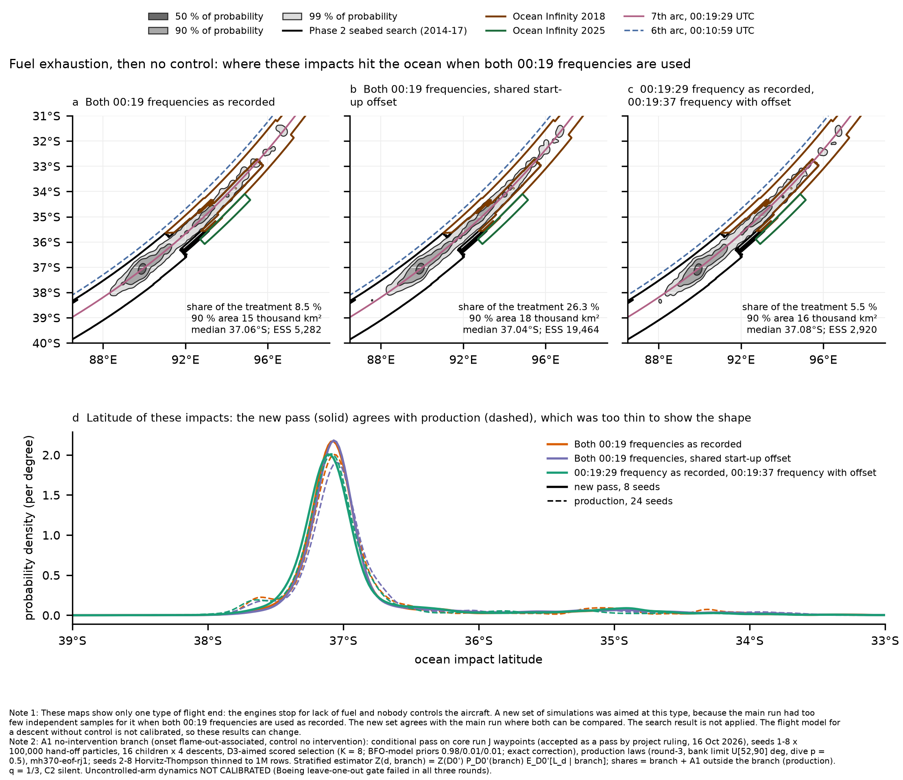

# Coverage gap closed: fuel exhaustion then no control (A1) under the both-frequency 00:19 treatments (18 Oct 2026)

End of Flight Module, 18 Oct 2026, 04:00Z. This closes the declared coverage gap "A1 under D3 not estimable" (production ESS 369;
`results/eof-run-j-maps-oct17` §3, `results/eof-run-j-waypoints-oct16` §3c). Core run J is accepted as a pass by project ruling,
16 Oct 2026.

**Caveat (verbatim).** The uncontrolled-arm dynamics are not calibrated: the Boeing leave-one-out gate failed in all three rounds.
Impact energy, attitude, flight-path angle and energy-transfer duration from this arm are a labelled sensitivity on uncalibrated
dynamics, not a physical prediction.

## 1. Diagnosis

On run J waypoints seeds 1-2, D3's A1 mass is 100 % in one branch: onset flame-out-associated and control "no intervention". None of
it comes from undemonstrated recoveries. The production ESS of that branch under D3 is 4-7 per seed, although about 30,000 distinct
parents are present. The limit is therefore **descent diversity**, not parents: the raw two-BFO likelihood is so sharp in descent
dynamics that a handful of descents carry the weight.

## 2. Method: a conditional pass plus a stratified estimator

- **Pass** (`engine/hypotheses/end-of-flight/smoke/a1-branch.toml`):
  - The production recipe (round-3 laws, bank limit U[52, 90] deg, dive p = 0.5, C2-silent aim, children 16 x 4, binary
    mh370-eof-rj1), with the prior conditioned on the branch: `control_weights = [0, 0, 1, 0]`,
    `onset.mechanism_weights = [0, 0, 1]`.
  - Plus the D3-aimed scored selection (`smoke/score-select-0019-raw.toml`: K = 8, BFO-model priors 0.98 / 0.01 / 0.01, exact
    selection correction).
  - Run J waypoints seeds 1-8 x 100,000 hand-off particles.
  - Seeds 2-8 were Horvitz-Thompson thinned to 1M rows over the cells none / R600 / D3 / D4 (`both_burst_thin.py`, new `THIN_CELLS`
    override). Thinning changed the no-data ln Z by -0.002 nat on seed 2.
  - Output: `mh370-exchange/end-of-flight/run-j-a1branch/run-j-waypoints/`.
- **Estimator** (`smoke/a1_branch_estimate.py`, `smoke/a1_branch_combine.py`):

      Z(d, branch) = Z(D0') x P_D0'(branch) x E_D0'[L_d | branch]

  - P_D0'(branch) = 0.0935 comes from production (24 seeds).
  - E_D0'[L_d | branch] comes from the pass.
  - The A1 share is the branch share plus production's A1 rows outside the branch. The other families are rescaled to sum to 1.

## 3. Validation: the pass against production on the branch (8 seeds each)

| Quantity | Production branch rows | Branch pass |
|---|---|---|
| D0' latitude 5 / 50 / 95 % | -37.40 / -37.05 / -34.21 | -37.42 / -37.05 / -34.22 |
| ln E[L_D2 given branch] | -11.280 (ESS 5,093) | -11.299 (ESS 15,102) |
| ln E[L_D4 given branch] | -20.212 (ESS 612) | -20.210 (ESS 19,464) |
| ln E[L_D5 given branch] | -22.244 (ESS 579) | -22.179 (ESS 2,920) |
| ln E[L_D3 given branch] | -21.000 (**ESS 89**) | -21.151 (**ESS 5,282**) |

Every comparable quantity agrees within Monte Carlo noise. The D3 difference (0.15 nat) is about 1.4 standard errors of production's
ESS-89 estimate.

## 4. Result

| Treatment | A1 share, production | A1 share, stratified | A2 / B, stratified | Branch ESS, rows / parents | A1 latitude 5 / 50 / 95 % | A1 90 % area (thousand km2) |
|---|---|---|---|---|---|---|
| D3 both BFOs as recorded | 0.095 (ESS 369, **not estimable**) | **0.085** | 0.410 / 0.505 | 5,282 / 4,807 | -37.36 / -37.06 / -34.85 | 15 |
| D4 both BFOs, shared start-up offset | 0.250 | 0.263 | 0.343 / 0.394 | 19,464 / 12,534 | -37.34 / -37.04 / -34.35 | 18 |
| D5 R600 raw, R1200 with offset | 0.060 | 0.055 | 0.425 / 0.520 | 2,920 / 2,797 | -37.40 / -37.08 / -34.87 | 16 |
| D2 R600 BTO + BFO | 0.238 | 0.235 | 0.235 / 0.531 | 15,102 / 10,489 | (not the gap) | |

- **D3 is estimable.** A1 under D3 now has an ESS of 5,282, against the 1,000 gate. Its share is 0.085, which confirms production's
  0.095 within production's noise.
- **Location.** In every both-frequency treatment, A1 impacts lie in a narrow band along the 7th arc. The peak is about 37.06 S and
  the 90 % area is 15-18 thousand km2, with a thin northern tail. Production's dashed curves show the same peak; their secondary
  bump near 37.6 S was ESS-89 noise and is gone in the pass.
- **D4.** The A1 share rises slightly (0.250 to 0.263) once the branch is well sampled.
- **Figure.** `a1-branch-both-frequencies.png` replaces the "Not estimable" panel (d) of `run-j-impact-maps-by-family`.

## 5. COVERAGE

- **(a) Feasible set.** Fuel exhaustion with no pilot input, all descent dynamics the 777 can show (spiral up to 90 deg bank, phugoid,
  steep dive).
- **(b) Model's reach.**
  - Production uncontrolled arm: round-3 laws, bank limit U[52, 90] deg.
  - Undemonstrated recoveries (A1 outside the branch) come from production; they carry 0.000 of A1 under D3 and D5, and 0.060 under
    D4.
- **(c) Proposal's coverage.** Branch ESS per treatment as in the table. Every both-frequency cell is above 1,000.
- **Gaps.**
  1. Waypoints stratum only (core P(family) 0.9982). The other strata change the shares by less than 0.002.
  2. The northern tail of A1 (north of 35 S) is thin in every pass; see the band ESS in `results/eof-run-j-maps-oct17` §2b.
  3. The uncalibrated arm (caveat).
- **Status of the gap "A1 under D3 not estimable": CLOSED** (ESS 5,282).
- **Bounds and sources.** As production (bank limit U[52, 90] deg, Pete 16 Oct; p = 0.5, Decision 4; q = 1/3, C2 silent). The
  selection's BFO-model priors are a proposal setting only: the stored log-likelihoods are per model, and the correction is exact.

-- End of Flight Module
