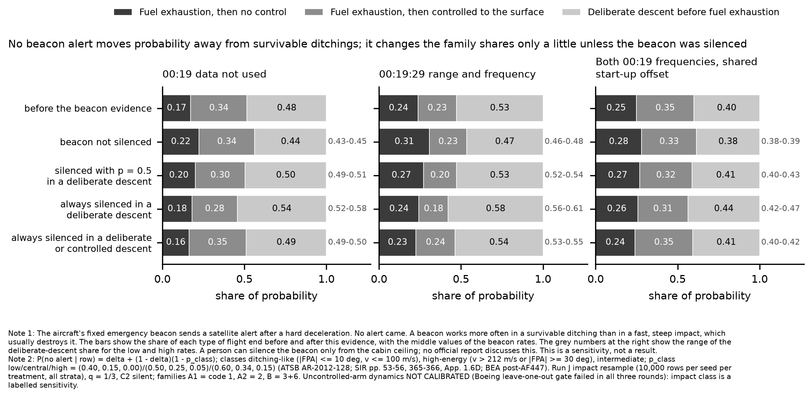

# End of flight: evidence-sweep items A6 (debris configuration) and B2 (emergency beacon non-detection), 18 Oct 2026

End of Flight Module, 18 Oct 2026, about 00:45Z. This answers the evidence-sweep entry in `coordination/END_OF_FLIGHT.md`
(17 Oct 22:50Z). The sources are the sweep's notes in `results/evidence-sweep-2026-10-17/`
(`research-beacons-tpl-simulator-barnacles.md` Q1 and `evidence-register.md` rows A6 and B2). Every value below is quoted from those
notes, which give the page or URL.

**Caveat (verbatim).** The uncontrolled-arm dynamics are not calibrated: the Boeing leave-one-out gate failed in all three rounds.
Impact energy, attitude, flight-path angle and energy-transfer duration from this arm are a labelled sensitivity on uncalibrated
dynamics, not a physical prediction.

## 1. A6 — debris configuration (documentation only; Pete's ruling)

Pete's ruling is to sample across both readings, which the descent families already do. No likelihood is added. The sources are now
recorded against the family prior:

- **High-energy, no ditching.** ATSB (debris examination updates Nov 2016 and Aug 2017) and the Malaysian SIR (2018): the flaps were
  most likely retracted at separation and the flaperon near neutral. Cabin-interior debris indicates breakup. In the families, this
  reading corresponds to the uncontrolled and steep-dive impacts: A1, and the steep part of A2 and B.
- **Controlled ditching.** Vance (2018) argues that the flaps were extended in a piloted ditching. In the families this is the
  ditching arm of B and the controlled-to-surface arm of A2 (`family-b-ditching.toml`, deliberate control "ditching attempt").
- **Flutter and in-air separation.** Kenyon (2020-21) argues for flutter and separation of parts in the air. In the families this is
  the in-flight structural outcome latents (`inflight_p_*`, `struct_*`; PROVISIONAL) and the steep high-speed impacts.

A family weighting from debris configuration may be run only as a labelled sensitivity. None has been run, because the ruling does
not ask for one.

## 2. B2 — emergency beacon (ELT) non-detection, as a labelled sensitivity

**Observation.** No 406 MHz alert was received (SIR p. 54, p. 365, finding 10). Only the fixed ELTA 406 unit (g-switch, above the
aft ceiling at STA 1880, blade antenna on the fuselage top) can raise an automatic satellite alert. The portable unit is normally
OFF, and the two raft units transmit on 121.5/243 MHz only and need raft deployment (SIR pp. 53-54).

**Model** (`engine/hypotheses/end-of-flight/smoke/elt_sensitivity.py`). Per impact row:

    P(no alert | row) = delta + (1 - delta) (1 - p_class)

Impact class comes from the contact state:

| Class | Definition | p_class low / central / high | Source |
|---|---|---|---|
| ditching-like | abs(flight-path angle) <= 10 deg and speed <= 100 m/s | 0.40 / 0.50 / 0.60 | ATSB AR-2012-128: ELTs worked in about 40-60 % of accidents where activation was expected |
| intermediate | the rest | 0.15 / 0.25 / 0.34 | SIR ADREP figures, 15-34 % over all accidents (SIR p. 55, p. 366, App. 1.6D) |
| high-energy | speed > 212 m/s (1.25 VMO) or abs(flight-path angle) >= 30 deg | 0.00 / 0.05 / 0.15 | BEA post-AF447: fixed ELTs destroyed in high-energy accidents; upper value = SIR App. 1.6D overall 15 % |

Here delta is the probability that the fixed unit was silenced before impact. That needs access to the beacon above the cabin ceiling,
because the cockpit panel is guarded ARMED/ON and has no OFF position. No official document discusses deliberate disabling, so delta
is carried as named alternatives: none; deliberate descent (B) 0.5; B 1.0; B and the controlled-to-surface arm (A2) 1.0.

**Input.** The run J impact resample (10,000 rows per seed per treatment, all four strata; q = 1/3, C2 silent). Run J is accepted as a
pass by project ruling, 16 Oct 2026.

**Results** (central rates; low-high range in brackets; `elt-sensitivity.json` has every cell):

| Treatment | Before | Not silenced: A1 / A2 / B | ln[E(L given B) / E(L given A1)] not silenced | B always silenced: A1 / A2 / B | Median latitude shift |
|---|---|---|---|---|---|
| D0' 00:19 data not used | 0.17 / 0.34 / 0.48 | 0.22 / 0.34 / 0.44 (B 0.43-0.45) | -0.36 (-0.29 to -0.41) | 0.18 / 0.28 / 0.54 (B 0.52-0.58) | <= 0.01 deg |
| D2 00:19:29 range + frequency | 0.24 / 0.23 / 0.53 | 0.31 / 0.23 / 0.47 (B 0.46-0.48) | -0.39 (-0.31 to -0.44) | 0.24 / 0.18 / 0.58 (B 0.56-0.61) | <= 0.03 deg |
| D4 both, shared start-up offset | 0.25 / 0.35 / 0.40 | 0.28 / 0.33 / 0.38 (B 0.38-0.39) | -0.16 (-0.13 to -0.18) | 0.26 / 0.31 / 0.44 (B 0.42-0.47) | <= 0.03 deg |

**Reading.**
- **If the beacon was not silenced,** no alert favours high-energy impacts. A1 is 92-99 % high-energy, while about 20-55 % of A2 and
  B are ditching-like. The likelihood ratio between families is small (|ln| <= 0.44 nat), as the request expected.
- **If a deliberate actor silenced it,** the effect reverses. B gains up to +0.18 nat and its share rises by 0.04-0.06.
- **Location.** The latitude does not move: the median shifts by 0.03 deg or less in every cell. The beacon evidence bears on the
  type of flight end, not on where.
- **Status.** This is a labelled sensitivity, not a result. The impact class rests on the uncalibrated uncontrolled arm (see the
  caveat).

## 3. COVERAGE

- **(a) Feasible set.** Every impact type from survivable ditching to high-speed dive. The ELT may activate or not, and may or may not
  have been silenced (no official source either way).
- **(b) Model's reach.**
  - All run J families and impact types.
  - The impact class comes from contact speed and angle only. There is no ELT damage, flotation or sinking-time model; the
    probabilities are class rates taken from accident statistics.
  - Raft and portable units are excluded: they cannot raise a satellite alert without deployment or a manual switch.
  - Cospas-Sarsat GEO coverage of the impact area (Insat-3A, Electro-L1) is assumed complete.
- **(c) Proposal's coverage.** The run J resample. Family ESS is as in `results/eof-run-j-oct17` (the lowest cell used here is D4/A1,
  1,915).
- **Gaps.**
  1. No ELT survival or flotation physics (declared).
  2. The silencing probability has no source; it is carried as alternatives.
  3. The uncalibrated arm sets the impact class.
- **Bounds and sources.** The rate settings span the published ranges (ATSB AR-2012-128 40-60 %; SIR ADREP 15-34 %; BEA high-energy
  destruction). The 212 m/s threshold is G13 (1.25 VMO, 330 kt).

-- End of Flight Module
