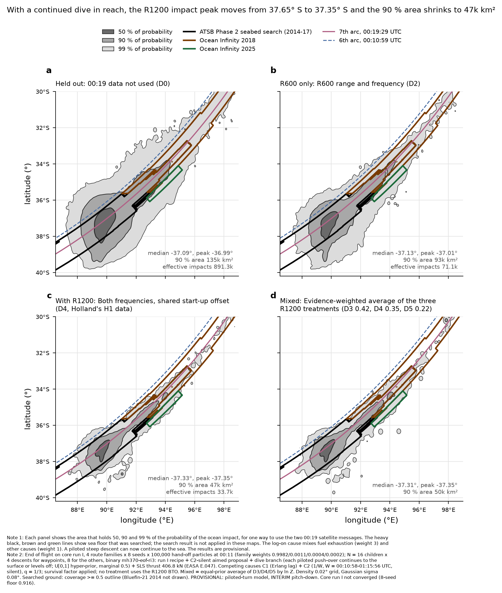

# End of flight on core run I with the dive branch (run-i-dive), 13 Oct 2026

**Status: FULL SWEEP, PROVISIONAL physics, core not converged. Supersedes `eof-run-i-oct12` (which is conditional on "piloted
push-over recovers by 8,000-15,000 ft").** Output: `mh370-exchange/end-of-flight/run-i-dive/<stratum>/seed-k` (README + READY per
stratum), summaries in `run-i-dive/summary/`. Binary `mh370-eof-ri3` (sha256 2e60b0e2…). Recipe = run I recipe (arm C, aimed
pitch-down, piloted turns with the particle's tau_h, C2-silent push-over component) + C2-silent aim (`full/c2-silent-aim.toml`) +
dive branch (`full/dive-branch.toml`; Pete's ruling: U[0,1] hyper-prior, marginal 0.5, latent `pushover_to_surface`) + SLS thrust
406.8 kN (EASA E.047). Waypoints N = 16 × 4 descents, the other strata N = 8 × 4; 8 seeds × 100,000 parents each. Under the heavy
lock 22:30Z 12 Oct - 03:51Z 13 Oct (waits behind drift included). Script `full/run_i_dive.sh`. Strata mixed with core P(family)
0.9982 / 0.0011 / 0.0004 / 0.0002.

## 1. 00:19 two-factor table (mixture; q = 1/3; W = 3,898 s; survival factor)

| Cell | ln Z | seed SD | Effective impacts | A1 / A2 / B share | A1 / A2 / B effective | Latitude q05 / q50 / q95 |
|---|---|---|---|---|---|---|
| D0 total | −7.32 | 0.25 | 891,309 | 0.19 / 0.41 / 0.40 | 339,716 / 431,725 / 253,871 | −38.43 / −37.07 / −34.22 |
| D1 total | −12.84 | 0.29 | 857,064 | 0.17 / 0.42 / 0.41 | 330,187 / 475,847 / 238,365 | −38.55 / −37.24 / −34.96 |
| D2 total | −18.84 | 0.35 | 71,111 | 0.25 / 0.31 / 0.43 | 31,430 / 34,485 / 20,329 | −38.22 / −37.11 / −34.71 |
| D3 total | −28.47 | 0.24 | 4,653 | 0.17 / 0.38 / 0.45 | **513** / 4,000 / 1,625 | −38.07 / −37.31 / −34.79 |
| D4 total | −28.66 | 0.30 | 33,741 | 0.14 / 0.42 / 0.44 | 2,579 / 28,591 / 12,434 | −38.05 / −37.32 / −35.04 |
| D5 total | −29.10 | 0.22 | 10,456 | 0.14 / 0.39 / 0.47 | 1,580 / 6,829 / 3,580 | −38.05 / −37.29 / −34.83 |
| D3 × C1 | −28.18 | 0.24 | 4,626 | 0.17 / 0.38 / 0.45 | **511** / 3,981 / 1,612 | −38.07 / −37.31 / −34.79 |
| D3 × C2 silent (Holland's H2) | −32.80 | 0.19 | 2,409 | 0.08 / 0.32 / 0.61 | **86** / 1,936 / 1,243 | −37.90 / −37.40 / −34.41 |
| D4 × C1 (Holland's H1) | −28.37 | 0.30 | 33,522 | 0.14 / 0.42 / 0.44 | 2,572 / 28,453 / 12,319 | −38.05 / −37.32 / −35.04 |
| D4 × C2 silent | −32.88 | 0.18 | 16,629 | 0.07 / 0.33 / 0.61 | **520** / 10,748 / 8,838 | −37.89 / −37.39 / −34.67 |
| D5 × C1 | −28.82 | 0.23 | 10,391 | 0.14 / 0.39 / 0.46 | 1,577 / 6,794 / 3,550 | −38.05 / −37.29 / −34.83 |
| D5 × C2 silent | −33.33 | 0.18 | 5,941 | 0.05 / 0.34 / 0.61 | **288** / 3,262 / 3,008 | −37.85 / −37.38 / −34.55 |

Bayes factors (ln): C1:C2 (silent) +4.32 (D0), +4.31, +5.33, +4.62, +4.51, +4.51 (D5); C1:C2 (unpowered) +1.47 to +2.46;
D3:D4 +0.19 (C1), +0.08 (C2 silent); D5:D3 −0.64, D5:D4 −0.45 (C1). Seed SD 0.18-0.35 nat (core hand-off sets differ by seed).

**Against run I (level-off only) and run-i-c2aim:** D3 × C2 silent effective impacts 275 (run I, N = 8) → 904 (aim + N = 16,
level-off only) → 2,409 (+ dive branch); the aim and N give the first step, the dive branch the second. ln Z of C1 cells unchanged
(≤ 0.01 nat); C2-silent cells gain ~1 nat (interpretation: the dive puts a powered aircraft into the sea before any later log-on), so C1:C2
(silent) falls from ~5.5 to ~4.5 in D3-D5.

## 2. Maps and the R1200 shift

| Panel | Median | Peak | 90 % area | 99 % area |
|---|---|---|---|---|
| Held out (D0) | −37.09 | −36.99 | 135k km² | 416k km² |
| R600 only (D2) | −37.13 | −37.01 | 93k km² | 289k km² |
| With R1200 (D4) | −37.33 | −37.35 | 47k km² | 163k km² |
| Mixed (D3/D4/D5 by ln Z: 0.42 / 0.35 / 0.22) | −37.31 | −37.35 | 50k km² | 171k km² |

Run I (level-off only) had D4 median −37.45, peak −37.65, 90 % area 59k km². With the dive branch, D4 impacts come a median 182 s
after 00:19:29 (was 634 s); displacement after 00:19:37 −0.18° (was −0.36°); the −37.7° group is 64 % levelled-off push-overs
(`run-i-r1200-shift.json`). H1 (D4 × C1, unpowered): P(in-flight breakup, upper-side) 0.92; share with contact speed ≤ 212 m/s
0.46 (was 0.84): the dives reach high speed, so consumers show both versions of the feasibility flag.

## 3. COVERAGE

**(a) Feasible set:** as in `eof-run-i-oct12` §3, now including a piloted push-over continued to the sea.
**(b) Model's reach:** G-dive CLOSED (dive branch). Declared reach limits unchanged: stepped shapes not push-over eligible; INTERIM
pitch-down (6-DOF gate not passed); no transonic drag rise; turn model PROVISIONAL.
**(c) Proposal's coverage (effective impacts, below 1,000 in bold above):**

| Gap | Effective impacts | Status / proposed fix |
|---|---|---|
| A1 in every C2-silent cell | 86 (D3), 520 (D4), 288 (D5) | OPEN. Uncontrolled aircraft under "other cause, silent" must be powered at 00:19:29 and match the BFOs through the interim pitch-down. Fix: an aimed pitch-down component for powered A1 at [−7, −1] s with N = 64 for burst-window parents. |
| A1 under D3 × C1 | 511 | OPEN; same fix. |
| Per stratum (free, descent-climb, repro-radar), A1 in C2-silent cells | 15-204 | OPEN; carry 0.002 of the mixture weight. |
| Overall cell counts | every cell ≥ 1,000 (lowest D3 × C2 silent 2,409) | CLOSED. |

Bounds and sources as in `eof-run-i-oct12`; new: dive probability U[0, 1] hyper-prior (Pete), aim components [−7, −1] s (0.35),
floor [0.15, 0.45] g (0.5), rate [18,000, 40,000] ft/min (0.4), all proposal-only with exact correction (ln Z agrees with the
unaimed run to ≤ 0.06 nat in the C1 cells). Labels: core run I not converged; PROVISIONAL turn model, INTERIM pitch-down,
PROVISIONAL in-flight structure; survival factor applied; no D uses the R1200 BTO.
