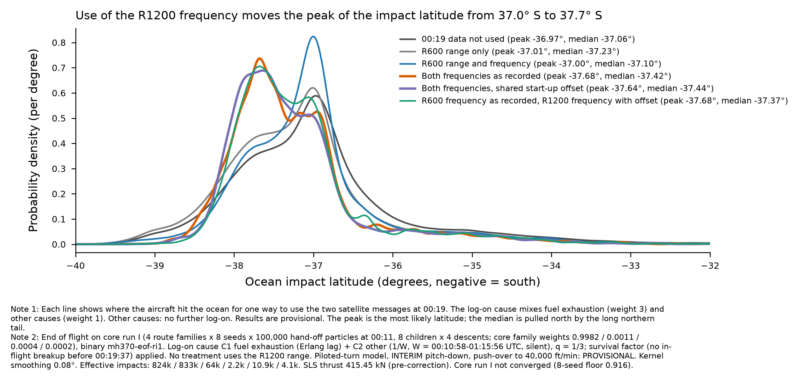

# End of flight on core run I — 00:19 two-factor table, H1/H2 and coverage (12 Oct 2026)

**Status: FULL SWEEP, PROVISIONAL physics, core not converged.** Core run I (`mh370-exchange/core/run-i/`), 4 strata × 8 seeds ×
100,000 m0011 hand-off rows (look-ahead weight × exp(log_correction)), N = 8 children × 4 descents (102.4 M descents). Binary
`end-of-flight/bin/mh370-eof-ri1` (sha256 aa79d44ef23fe18d…), script `hypotheses/end-of-flight/full/sweep_run_i.sh`, summaries
`full/post_run_i.sh`. Run under the heavy lock at 12 threads, 16:28-18:40Z. Output 42 GB compact float32 on the exchange
(`end-of-flight/run-i/<stratum>/seed-k`, README and READY per stratum; summaries in `run-i/summary/`, copied here).
Strata mixed with core's run I P(family): waypoints 0.9982, free 0.0011, repro-radar 0.0004, descent-climb 0.0002.

Recipe: arm C / holland-estimable (targeted burst proposal 0.8 in [−15, +6] s of 00:19:29; piloted push-over to 40,000 ft/min, VMO
330 KCAS, load-factor ceiling U[1.5, 5.0] g; INTERIM parametric pitch-down), aimed pitch-down for A1 ([−150, −40] s and [−15, +6] s),
piloted-turn model (G-turn fix), and two run I items: the Davey turns use each particle's own `tau_h` (hand-off column 5; checked
equal to 6e-8 relative), and the C2-silent push-over component (powered profiles with fuel past 00:19:29.4 + 120 s propose the
push-over at 0.8; exact correction; unit test and smoke weighted rate 0.503).

## 1. 00:19 two-factor table (core-weighted mixture; survival factor applied; q = 1/3, W = 3,898 s)

| Cell | ln Z | seed SD | Effective impacts | A1 / A2 / B share | A1 / A2 / B effective | Latitude q05 / q50 / q95 |
|---|---|---|---|---|---|---|
| D0 × C1 | −7.04 | 0.25 | 817,767 | 0.19 / 0.41 / 0.40 | 168,733 / 444,006 / 252,521 | −38.45 / −37.06 / −34.22 |
| D0 × C2 silent | −11.57 | 0.21 | 343,057 | 0.32 / 0.10 / 0.58 | 165,924 / 38,434 / 164,097 | −38.61 / −37.14 / −33.52 |
| D1 × C1 | −12.55 | 0.29 | 827,660 | 0.17 / 0.42 / 0.41 | 162,876 / 498,697 / 249,661 | −38.56 / −37.23 / −34.96 |
| D1 × C2 silent | −17.13 | 0.23 | 350,356 | 0.38 / 0.11 / 0.51 | 205,778 / 44,043 / 137,656 | −38.75 / −37.35 / −34.36 |
| D2 × C1 | −18.56 | 0.35 | 63,592 | 0.25 / 0.32 / 0.43 | 15,681 / 31,931 / 21,694 | −38.25 / −37.10 / −34.66 |
| D2 × C2 silent | −23.92 | 0.19 | 10,251 | 0.43 / 0.08 / 0.49 | 4,781 / 2,521 / 4,245 | −38.21 / −37.11 / −34.06 |
| D3 × C1 | −28.22 | 0.25 | 2,171 | 0.16 / 0.40 / 0.43 | **352** / 1,395 / **697** | −38.24 / −37.42 / −35.14 |
| D3 × C2 silent (Holland's Hypothesis 2) | −33.75 | 0.32 | **275** | 0.18 / 0.22 / 0.59 | **34 / 86 / 170** | −38.24 / −37.40 / −34.10 |
| D3 × C2 unpowered | −30.61 | 0.08 | 1,516 | 0.14 / 0.36 / 0.51 | **408** / 2,605 / **454** | −38.28 / −37.42 / −34.87 |
| D4 × C1 (Holland's Hypothesis 1) | −28.38 | 0.30 | 10,845 | 0.15 / 0.41 / 0.44 | 1,363 / 6,907 / 3,729 | −38.17 / −37.44 / −35.08 |
| D4 × C2 silent | −33.88 | 0.26 | 1,426 | 0.20 / 0.22 / 0.58 | **219 / 544 / 780** | −38.18 / −37.41 / −34.49 |
| D4 × C2 unpowered | −30.81 | 0.12 | 18,651 | 0.12 / 0.36 / 0.51 | 1,395 / 7,963 / 10,032 | −38.22 / −37.42 / −34.90 |
| D5 × C1 | −28.83 | 0.25 | 4,060 | 0.15 / 0.39 / 0.47 | **253** / 3,180 / 1,887 | −38.14 / −37.37 / −35.01 |
| D5 × C2 silent | −34.42 | 0.23 | **833** | 0.16 / 0.22 / 0.62 | **137 / 266 / 460** | −38.18 / −37.44 / −34.51 |
| D5 × C2 unpowered | −31.22 | 0.13 | 12,103 | 0.11 / 0.37 / 0.52 | 1,090 / 6,368 / 5,420 | −38.19 / −37.39 / −34.92 |

Competing-causes totals (q = 1/3, C2 silent): ln Z D0 −7.32, D1 −12.84, D2 −18.85, D3 −28.51, D4 −28.67, D5 −29.11; latitude q50
−37.06, −37.23, −37.10, −37.42, −37.44, −37.37. Bold: below the 1,000 gate. Seed SD is the waypoints stratum's SD of per-seed ln Z
(8 seeds); the standard error of the pooled value is about SD/√8 ≈ 0.1 nat. The seed spread comes mainly from the different
core hand-off sets per seed (core not converged), not from the end-of-flight children.

**Bayes factors (ln):** C1:C2 (C2 silent) +4.53 (D0), +4.57, +5.36, +5.53, +5.50, +5.59 (D5); C1:C2 (C2 unpowered) +1.47 to +2.43.
D3:D4 +0.16 (C1), +0.13 (C2 silent), +0.21 (C2 unpowered). D5:D3 −0.61, D5:D4 −0.45 (C1). These agree with run D-he (12 Oct
note `eof-0019-two-factor-oct12`) to within about 0.3 nat. Differences of less than about 0.3 nat are not resolved (seed SD).

**Impact latitude.** Treatments that use the R1200 frequency (D3, D4, D5) put the mode near −37.7°; D0-D2 put it near −37.0°
(figure). With the turn model, the ~1° southward displacement after 00:19:37 on run H (reach gap G-turn) is gone: the D0 median is
−37.06 against core's waypoints 00:19 median −37.15.

## 2. H1/H2 summary (holland_sweep_summary.py; constraint unpowered, C2 without 1/W, as on run D-he)

| Option | ln Z | Effective impacts | A1 / A2 / B effective | P(in-flight breakup, upper-side) | Latitude q50 |
|---|---|---|---|---|---|
| Held Out | −0.24 | 7,150,422 | 995,097 / 3,285,125 / 3,177,647 | 0.24 | −37.15 |
| R600 BTO Only | −5.84 | 6,800,355 | 1,123,267 / 3,343,129 / 2,805,467 | 0.28 | −37.48 |
| R600 BTO + Raw BFO | −12.62 | 193,236 | 38,215 / 75,916 / 89,978 | 0.28 | −37.21 |
| Holland H1 | −28.38 | 10,845 | 1,363 / 6,907 / 3,729 | 0.92 | −37.44 |
| Holland H2 | −22.34 | 1,516 | **408** / 2,605 / **454** | 0.87 | −37.42 |

The breakup probability is the PROVISIONAL in-flight structure model (VD/MD, no transonic drag rise: an upper-side figure).

## 3. COVERAGE

**(a) Feasible set.** 777-200ER after the 00:11 hand-off: one or two engines thrusting or none; uncontrolled (A1) or piloted after
fuel exhaustion (A2) or a deliberate descent and ditching approach (B); piloted descents from idle to 40,000 ft/min with unloading
to −1.0 g, VMO 330 KCAS / MMO; turns at any time (Davey's manoeuvre process, then sweeps, orbits and a ditching circuit); impact
anywhere reachable in the remaining fuel and glide (sources as in the brief, section 8, and SIR App. 1.6E).
**(b) Model's reach.** All three families, every 00:19 option and both causes are produced. Declared reach limits: stepped
descent shapes are not push-over eligible; pitch-down in free flight is the INTERIM parametric model (6-DOF gate not passed);
no transonic drag rise; turn model PROVISIONAL (into-wind uses the wind at the aircraft's altitude).
**(c) Proposal's coverage.** Effective impacts per cell and family in section 1. Every D × C cell and every family is estimable at
some level; the cells below the 1,000 gate are coverage gaps:

| Gap | Effective impacts | Status / proposed fix |
|---|---|---|
| D3 × C2 silent (Holland's Hypothesis 2), all families | 275 (A1 34, A2 86, B 170) | OPEN. The C2-silent push-over component did not lift it (run D-he 233). The limit is the joint match of both BFOs by a powered descent at the burst time, not the push-over draw. Fix: a C2-silent aimed proposal on the powered push-over start time (window [−15, +6] s of 00:19:29, as for flame-out) plus N = 64 on the parents that reach it. |
| D5 × C2 silent | 833 (A1 137, A2 266, B 460) | OPEN, same fix. |
| D4 × C2 silent, per family | 1,426 overall; A1 219, A2 544, B 780 | OPEN per family, same fix. |
| A1 under D3 / D5 × C1 | 352 / 253 | OPEN. Aimed pitch-down lifts A1 but not to the gate; fix: N = 64 children for A1 parents in the burst window. |
| B under D3 × C1 and D3 × C2 unpowered | 697 / 454 | OPEN; the C2-silent fix also feeds B. |
| D3 × C2 unpowered, A1 | 408 | OPEN. |

Parameter bounds and sources: as listed in the per-stratum README (push-over rate to 40,000 ft/min, load factor U[1.5, 5.0] g,
burst-window proposal [−15, +6] s, turn bank 10-30°, terminal window 25 min, sweep 1-3 orbits, circuit downwind U[60, 300] s and base
U[30, 120] s, Davey τ from the hand-off). The proposal choices (0.8 burst weight, 0.8 fuelled push-over, 5,764 kg/h) carry exact
corrections and change no prior.

**Labels to carry:** core run I not converged (8-seed floor 0.916); PROVISIONAL turn model, INTERIM pitch-down, PROVISIONAL
in-flight structure; survival factor applied; no D uses the R1200 BTO.

**Correction label (19:15Z).** This sweep used a per-engine SLS thrust of 415,450 N; the type certificate (EASA E.047 Issue 04,
§6) gives 406.8 kN take-off net for the Trent 892-17 / 892B-17. The module default is now 406,800 N. Effect on these results not
measured (expected small: it scales maximum and idle thrust of powered profiles only).

## 4. Reach gap G-dive (found 12 Oct 20:00Z) and the follow-up runs

**Finding.** Every piloted push-over levelled off at `transition_altitude_ft` U[8,000, 15,000] ft (no source): a deliberate dive
continued to the sea was outside the model's reach. Sections 1-3 are therefore **CONDITIONAL on "piloted push-over recovers by
8,000-15,000 ft"**. The R1200 southward shift on this sweep is a consequence: 00:19:37 positions differ by 0.08° between D0 and D4,
but the displacement after 00:19:37 is −0.09° (D0) against −0.36° (D4); the −37.7° peak is 98 % piloted descents that level off
and fly ~0.5° south (`run-i-r1200-shift.json`; maps `run-i-impact-maps.pdf`).
**Closure** (Pete, "Dive branch, U[0,1]"): binary ri3, overlay `full/dive-branch.toml`, latent `pushover_to_surface`.
**Runs.** `run-i-c2aim` (level-off only, C2-silent aim, N = 16, waypoints): the labelled conditional arm. `run-i-dive` (dive branch +
aim; waypoints N = 16, the others N = 8): supersedes this sweep. Waypoints results (`table-0019-dive-next-i-waypoints.json`,
`dive-impact-maps-waypoints.pdf`): D4 total median −37.33, peak −37.35, 90 % area 47k km²; C2-silent cells +1 nat; ESS D3 × C2
silent 2,403. Gap still open: A1 in every C2-silent cell (86-518 effective impacts).
