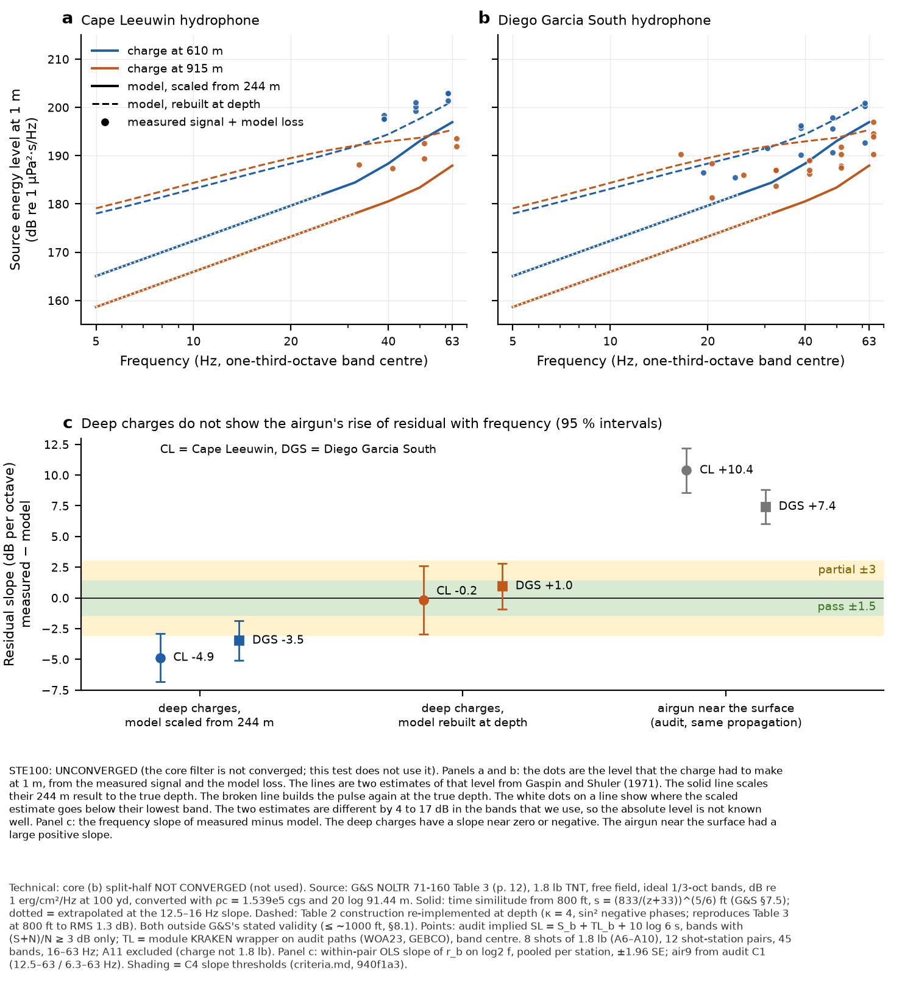

# Hydroacoustics audit, C4 absolute: SUS 2003 against Gaspin & Shuler (1971)

**Labels: UNCONVERGED** (core (b) split-half not converged; this test uses no core output, the label is carried by
rule). **Source model outside its stated validity** (G&S ≤ ~1,000 ft; SUS at 2,000 and 3,000 ft). **Predictive
audit, not a likelihood.** Architecture stand-in for hydroacoustics, 11 Oct 2026, read-only on module code. The
criteria are pre-registered in `hydroacoustics-audit/criteria.md` (940f1a3); none was changed.

## Verdict

**C4 absolute is scored, but it cannot settle the deep-source absolute level.** G&S's tabulated SUS spectra reach
only 800 ft. At the 2003 depths (610 and 915 m), 16–63 Hz is far below the bubble frequency (108 and 151 Hz). In that
sub-bubble tail, the two declared ways of carrying G&S to depth differ by 4.3 to 17.1 dB (median 7.4 dB). That spread
is larger than the C4 level tolerance.

| source route | pooled LEVEL | pooled SLOPE | pooled SHAPE | pooled C4 | pairs PASS / PARTIAL / FAIL |
|---|---|---|---|---|---|
| A, time similitude from 800 ft | +6.7 dB (PARTIAL) | −4.2 ± 0.9 dB/oct (FAIL) | 3.1 dB (PARTIAL) | FAIL | 0 / 2 / 8 |
| B, Table 2 construction at depth | −1.8 dB (PASS) | +1.0 ± 1.0 dB/oct (PASS) | 3.5 dB (PARTIAL) | PARTIAL | 1 / 3 / 6 |

- Pooled over 12 shot-station pairs and 45 bands. In addition to the 10 graded pairs, 2 pairs have fewer than 3 bands.
- The pooled SLOPE in this table is an ordinary-least-squares fit across all points. The within-pair slopes in the
  next list and in panel c remove each pair's own level first.
- **Detection consistency: PASS under both routes.** 1 of 16 pairs is inconsistent under route A (A9sus3 at Cape
  Leeuwin: reported as detected, predicted ≤ −6 dB in every band; the largest predicted S/N is −6.2 dB). Under route B,
  0 of 16 pairs are inconsistent. The rule has little power here: only one reported non-detection, and it is
  questioned ("ND", time "4416?").
- **Frequency extent validated (observed (S+N)/N ≥ 3 dB):**
  - Diego Garcia South: 16–63 Hz, but 16–25 Hz on only 3 pairs (A10sus3 from 16 Hz; A7sus3 and A8sus2b from 20 Hz).
  - Cape Leeuwin: 31.5–63 Hz (A10sus3), otherwise 40–63 Hz.
  - **Nothing below 16 Hz.** The impact-marker bands below 12.5 Hz are **not calibrated** by SUS.
- **The robust result is the slope comparison, not the level.**
  - Under both routes, the deep-charge residual slope (within-pair, pooled per station) is −4.9 to +1.0 dB per octave.
  - The airgun under the same propagation gave +10.4 (Cape Leeuwin) and +7.4 (Diego Garcia South) dB per octave.
  - The source-free implied SUS spectrum rises +6.0 ± 0.8 dB per octave. For deep propagation to carry the airgun's
    tilt, the SUS source would have to **fall** at −1.4 to −4.4 dB per octave at f/f_b ≈ 0.1–0.6.
  - Every source description in hand rises there: G&S 800-ft tail +11.5 dB per octave; route A +11 to +13; route B
    +3.5 to +10.5; and the f² floor of a zero-net-impulse pulse, +6.
  - **The +7–10 dB per octave tilt is not a deep-path propagation error.** It belongs to the near-surface end. See
    "What this calibrates" for which part of the near-surface end.
- **A level verdict needs a deep-SUS source spectrum measured below the bubble frequency** (for example Chapman 1988,
  JASA, not in hand), or a near-source recording. The 2003 near-source hydrophone was overwhelmed (Blackman et al. 2004, printed p. 4).



Chart: `hydroacoustics-audit/hydroacoustics-audit-sus-absolute.{png,pdf}`. Both footnote versions (STE100 and
technical) are on the image, in the bottom 25 %.

## Deviations and declared choices (read first)

1. **Source depth outside G&S's validity.** G&S state ≤ ~1,000 ft (§8.1, printed p. 22). The 2003 SUS are at 2,001
   and 3,002 ft. Both routes extrapolate, and neither is a G&S result at these depths. The pre-registered ±3 dB
   source uncertainty (criteria C4) is **not** supported; the route spread is reported instead.
2. **Route B uses inputs that are not in G&S.**
   - The shapes between Table 2 points (G&S drew them by hand) are declared options. One option (κ = 4, sin²) was
     chosen by reproduction of G&S Table 3 at 800 ft only.
   - Arons' TNT shock-impulse coefficients (1.46, 0.89) are quoted from the secondary literature, not from Arons 1954.
   - At the SUS depths the shock tail collapses to zero, because the Fig. 23 impulse is already used by the
     exponential to 2θ.
3. **Route A extrapolates below G&S's lowest band.** Where f·s < 11 Hz, route A uses the 12.5–16 Hz slope
   (+7.3 dB/oct); this applies at ≤ 25 Hz at 610 m and ≤ 31.5 Hz at 915 m. Scored bands affected: 610 m 20 and 25 Hz;
   915 m 16–31.5 Hz (marked * in the table). Variants at 6 and 12 dB/oct are in the CSV.
4. **Charge and explosive.** Blackman Table 5 gives 1.8 lb (except A11). TNT is assumed, as for G&S's Mk 57/61/82
   SUS (§6.1, p. 10). Blackman does not name the SUS mark.
5. **A11 excluded** (charge weight not 1.8 lb, Blackman Table 5; and no model TL to H08S).
6. **Partial-fire shots** A9suspuf and A10suspuf are excluded: the source is unknown.
7. **A8sus2b depth.** Blackman Table 5 gives 610 m; the Fig. B8 caption says 915 m. The base uses 610 m, as the audit
   did. With 915 m, pooled level/slope is +7.3 / −4.4 (route A, FAIL) and −1.9 / +1.9 (route B, PARTIAL). The
   verdicts do not change.
8. **Detection-consistency inputs.**
   - Reported status read from Blackman App. B Figs. B6–B10 (printed pp. 28–31); "ND" with a questioned time is taken
     as non-detection.
   - Two panels were not traced by the audit (A6sus3 at Cape Leeuwin, A7sus2 at Diego Garcia South). For those, the
     noise of the sibling shot at the same station 5–7 min apart was substituted, for detection consistency only.
   - Predicted S/N is signal-to-noise (S/N), not (S+N)/N.
9. **Scope.** The audit's SUS paths cover sites A6–A11 and stations H01W, H08S only. Sites A1–A5 (B1–B5) and H08N are
   not scored. Building new paths was outside the stand-in's replay scope.
10. **Pooled statistics** (per station, per depth, all) are this stand-in's addition. C4 itself is per shot and
    station. Per-pair slopes span ≤ 0.65 octave on 3 bands and are poorly determined.
11. **Residual definition.** r_b = implied SL − predicted SL, with implied SL = S_b + TL_b + 10 log10(6 s) taken
    unchanged from the audit's `sus_bands.csv`. This keeps the audit's declared 6 s signal-window assumption.

## What this calibrates and what it does not

- **Does:** absolute deep point-source propagation (source at 610–915 m, near the sound-channel axis), 16–63 Hz,
  over 1,500–4,300 km, at the two stations. This holds only to within the source-route spread. In level, route B
  (≈ −2 dB) and route A (≈ +7 dB) bracket the truth only if the truth lies between them; nothing shows that it does.
  In slope, both routes put the deep path within about ±5 dB per octave of flat, and route B within PASS.
- **Does not:**
  - Coupling of a **near-surface** source into the channel (airgun at 9–12 m, aircraft impact at the surface).
    SUS detonate at depth.
  - Any band below 16 Hz.
  - Island or ridge blockage (A11→H08S).
  - The impact source term (η).
- **Comparison with the airgun (C1/C3).** The SUS do **not** show the airgun's +7–10 dB per octave tilt.
  - This places the tilt at the near-surface end: either the airgun's own source spectrum and directivity (audit M3
    removed about two thirds of it) or the module's modelling of near-surface excitation.
  - SUS **supports** the airgun-source explanation over a deep-path error. It **cannot separate** airgun directivity
    from near-surface coupling physics, which an aircraft impact would share.
  - So the result is consistent with the directivity explanation, and does not establish it.
  - The decisive test remains a near-surface source with a known spectrum: an F-35A-type event, or a shallow SUS
    (Mk 61 at 60 ft is inside G&S's validity).

## Per pair (C4 per shot × station; LEVEL ±4/±7, SLOPE ±1.5/±3, SHAPE 3/5)

Level / slope ± SE / shape, dB and dB per octave. "scaled" = route A, "rebuilt" = route B.

| shot | station | n bands | span Hz | scaled: level / slope / shape | verdict | rebuilt: level / slope / shape | verdict |
|---|---|---|---|---|---|---|---|
| A10sus3 | H01W | 4 | 31.5–63 | +8.0 / -3.4 ± 2.4 / 1.2 | FAIL | -2.8 / +3.3 ± 2.4 / 1.3 | FAIL |
| A10sus3 | H08S | 7 | 16–63 | +8.9 / -6.2 ± 1.3 / 1.9 | FAIL | -1.9 / -1.5 ± 1.7 / 2.5 | PASS |
| A6sus2 | H08S | 3 | 40–63 | -2.4 / -9.2 ± 2.2 / 0.6 | FAIL | -7.0 / -6.6 ± 1.2 / 0.3 | FAIL |
| A6sus3 | H08S | 2 | 50–63 | +3.4 / – / – | not graded (< 3 bands) | -5.4 / – / – | not graded (< 3 bands) |
| A7sus2 | H01W | 3 | 40–63 | +6.2 / -8.4 ± 2.0 / 0.5 | FAIL | +1.5 / -5.7 ± 1.0 / 0.3 | FAIL |
| A7sus3 | H01W | 2 | 50–63 | +5.0 / – / – | not graded (< 3 bands) | -3.9 / – / – | not graded (< 3 bands) |
| A7sus3 | H08S | 5 | 20–63 | +5.7 / -1.3 ± 1.1 / 1.1 | PARTIAL | -6.7 / +4.0 ± 1.7 / 1.6 | FAIL |
| A8sus2 | H01W | 3 | 40–63 | +7.1 / -4.8 ± 0.9 / 0.2 | FAIL | +2.5 / -2.1 ± 0.1 / 0.0 | PARTIAL |
| A8sus2 | H08S | 3 | 40–63 | +3.3 / -6.0 ± 4.9 / 1.3 | FAIL | -1.0 / -3.4 ± 3.8 / 1.0 | FAIL |
| A8sus2b | H01W | 3 | 40–63 | +8.0 / -5.1 ± 0.7 / 0.2 | FAIL | +3.2 / -2.4 ± 1.7 / 0.5 | PARTIAL |
| A8sus2b | H08S | 6 | 20–63 | +5.8 / -0.8 ± 1.4 / 1.6 | PARTIAL | -0.3 / +2.0 ± 1.4 / 1.6 | PARTIAL |
| A9sus3 | H08S | 4 | 31.5–63 | +8.7 / -0.4 ± 1.6 / 0.8 | FAIL | -3.7 / +6.2 ± 2.2 / 1.1 | FAIL |

## Detection consistency (both stations, 8 shots of 1.8 lb; rule: reported non-detection with predicted S/N ≥ +6 dB in any band, or reported detection with ≤ −6 dB in every band, 5–63 Hz)

| shot | station | reported (App. B) | max predicted S/N, scaled | inconsistent? | max predicted S/N, rebuilt | inconsistent? | noise from |
|---|---|---|---|---|---|---|---|
| A10sus3 | H01W | D | +6.3 dB | no | +13.6 dB | no | same shot |
| A10sus3 | H08S | D | +5.7 dB | no | +13.1 dB | no | same shot |
| A6sus2 | H01W | ND? | -3.5 dB | no | +0.9 dB | no | same shot |
| A6sus2 | H08S | D | +12.9 dB | no | +17.2 dB | no | same shot |
| A6sus3 | H01W | D | +1.9 dB | no | +9.3 dB | no | sibling shot (panel not traced) |
| A6sus3 | H08S | D | +8.2 dB | no | +15.6 dB | no | same shot |
| A7sus2 | H01W | D | +1.9 dB | no | +6.3 dB | no | same shot |
| A7sus2 | H08S | D | +19.0 dB | no | +23.3 dB | no | sibling shot (panel not traced) |
| A7sus3 | H01W | D | -1.3 dB | no | +6.1 dB | no | same shot |
| A7sus3 | H08S | D | +12.7 dB | no | +20.0 dB | no | same shot |
| A8sus2 | H01W | D | +4.4 dB | no | +8.7 dB | no | same shot |
| A8sus2 | H08S | D | +13.2 dB | no | +17.5 dB | no | same shot |
| A8sus2b | H01W | D | +4.5 dB | no | +8.9 dB | no | same shot |
| A8sus2b | H08S | D | +17.3 dB | no | +21.6 dB | no | same shot |
| A9sus3 | H01W | D | -6.2 dB | yes | +2.7 dB | no | same shot |
| A9sus3 | H08S | D | +7.2 dB | no | +14.6 dB | no | same shot |

## Per shot × station × band (45 scored bands; SL in dB re 1 µPa²·s/Hz at 1 m; * = route A extrapolated below G&S's lowest band)

| shot | depth m | station | band Hz | obs (S+N)/N dB | model TL dB | implied SL | pred SL scaled | r scaled | pred SL rebuilt | r rebuilt |
|---|---|---|---|---|---|---|---|---|---|---|
| A10sus3 | 915 | H01W | 31.5 | 4.6 | 98.2 | 188.1 | 178.0* | +10.1 | 192.1 | -3.9 |
| A10sus3 | 915 | H01W | 40 | 5.1 | 98.8 | 187.4 | 180.5 | +6.9 | 193.0 | -5.5 |
| A10sus3 | 915 | H01W | 50 | 9.7 | 99.1 | 192.6 | 183.4 | +9.2 | 193.7 | -1.2 |
| A10sus3 | 915 | H01W | 63 | 12.2 | 99.9 | 193.6 | 187.9 | +5.7 | 195.3 | -1.7 |
| A10sus3 | 915 | H08S | 16 | 4.8 | 97.7 | 190.3 | 170.9* | +19.4 | 187.9 | +2.4 |
| A10sus3 | 915 | H08S | 20 | 3.8 | 97.8 | 188.4 | 173.2* | +15.2 | 189.5 | -1.1 |
| A10sus3 | 915 | H08S | 25 | 3.1 | 97.7 | 186.0 | 175.6* | +10.4 | 190.9 | -4.9 |
| A10sus3 | 915 | H08S | 31.5 | 3.3 | 97.9 | 187.0 | 178.0* | +8.9 | 192.1 | -5.1 |
| A10sus3 | 915 | H08S | 40 | 3.8 | 98.2 | 187.0 | 180.5 | +6.4 | 193.0 | -6.0 |
| A10sus3 | 915 | H08S | 50 | 7.3 | 98.9 | 191.8 | 183.4 | +8.4 | 193.7 | -1.9 |
| A10sus3 | 915 | H08S | 63 | 12.0 | 99.5 | 194.0 | 187.9 | +6.1 | 195.3 | -1.3 |
| A6sus2 | 610 | H08S | 40 | 4.1 | 100.9 | 190.2 | 188.4 | +1.8 | 194.4 | -4.2 |
| A6sus2 | 610 | H08S | 50 | 6.7 | 100.8 | 190.7 | 193.0 | -2.4 | 197.7 | -7.0 |
| A6sus2 | 610 | H08S | 63 | 9.2 | 100.9 | 192.7 | 196.9 | -4.2 | 201.3 | -8.5 |
| A6sus3 | 915 | H08S | 50 | 6.5 | 97.5 | 187.9 | 183.4 | +4.5 | 193.7 | -5.8 |
| A6sus3 | 915 | H08S | 63 | 10.9 | 98.1 | 190.3 | 187.9 | +2.4 | 195.3 | -5.0 |
| A7sus2 | 610 | H01W | 40 | 4.0 | 109.2 | 198.4 | 188.4 | +10.0 | 194.4 | +3.9 |
| A7sus2 | 610 | H01W | 50 | 5.5 | 109.6 | 199.2 | 193.0 | +6.2 | 197.7 | +1.5 |
| A7sus2 | 610 | H01W | 63 | 7.4 | 110.3 | 201.5 | 196.9 | +4.5 | 201.3 | +0.2 |
| A7sus3 | 915 | H01W | 50 | 3.2 | 101.8 | 189.4 | 183.4 | +6.0 | 193.7 | -4.3 |
| A7sus3 | 915 | H01W | 63 | 4.5 | 102.3 | 191.9 | 187.9 | +4.0 | 195.3 | -3.4 |
| A7sus3 | 915 | H08S | 20 | 4.0 | 96.0 | 181.3 | 173.2* | +8.0 | 189.5 | -8.2 |
| A7sus3 | 915 | H08S | 31.5 | 6.5 | 96.2 | 183.7 | 178.0* | +5.7 | 192.1 | -8.4 |
| A7sus3 | 915 | H08S | 40 | 10.2 | 96.4 | 186.3 | 180.5 | +5.7 | 193.0 | -6.7 |
| A7sus3 | 915 | H08S | 50 | 13.1 | 96.7 | 187.6 | 183.4 | +4.1 | 193.7 | -6.2 |
| A7sus3 | 915 | H08S | 63 | 19.4 | 96.8 | 194.6 | 187.9 | +6.7 | 195.3 | -0.7 |
| A8sus2 | 610 | H01W | 40 | 4.4 | 105.8 | 197.6 | 188.4 | +9.2 | 194.4 | +3.1 |
| A8sus2 | 610 | H01W | 50 | 7.9 | 106.3 | 200.2 | 193.0 | +7.1 | 197.7 | +2.5 |
| A8sus2 | 610 | H01W | 63 | 10.8 | 107.0 | 203.0 | 196.9 | +6.1 | 201.3 | +1.8 |
| A8sus2 | 610 | H08S | 40 | 6.4 | 99.0 | 195.7 | 188.4 | +7.3 | 194.4 | +1.2 |
| A8sus2 | 610 | H08S | 50 | 7.7 | 99.1 | 195.6 | 193.0 | +2.6 | 197.7 | -2.0 |
| A8sus2 | 610 | H08S | 63 | 16.6 | 99.3 | 200.3 | 196.9 | +3.3 | 201.3 | -1.0 |
| A8sus2b | 610 | H01W | 40 | 5.3 | 105.8 | 197.6 | 188.4 | +9.2 | 194.4 | +3.2 |
| A8sus2b | 610 | H01W | 50 | 8.6 | 106.3 | 201.1 | 193.0 | +8.0 | 197.7 | +3.4 |
| A8sus2b | 610 | H01W | 63 | 10.8 | 107.0 | 202.9 | 196.9 | +5.9 | 201.3 | +1.6 |
| A8sus2b | 610 | H08S | 20 | 4.6 | 98.7 | 186.5 | 179.6* | +6.9 | 188.4 | -1.8 |
| A8sus2b | 610 | H08S | 25 | 3.6 | 98.6 | 185.4 | 182.0* | +3.4 | 190.0 | -4.6 |
| A8sus2b | 610 | H08S | 31.5 | 6.1 | 98.9 | 191.6 | 184.4 | +7.2 | 191.9 | -0.3 |
| A8sus2b | 610 | H08S | 40 | 11.8 | 99.0 | 196.3 | 188.4 | +7.9 | 194.4 | +1.8 |
| A8sus2b | 610 | H08S | 50 | 16.1 | 99.1 | 197.8 | 193.0 | +4.8 | 197.7 | +0.2 |
| A8sus2b | 610 | H08S | 63 | 21.3 | 99.3 | 200.9 | 196.9 | +4.0 | 201.3 | -0.3 |
| A9sus3 | 915 | H08S | 31.5 | 7.5 | 98.5 | 186.9 | 178.0* | +8.9 | 192.1 | -5.1 |
| A9sus3 | 915 | H08S | 40 | 7.2 | 99.0 | 189.0 | 180.5 | +8.5 | 193.0 | -4.0 |
| A9sus3 | 915 | H08S | 50 | 8.4 | 99.6 | 190.3 | 183.4 | +6.9 | 193.7 | -3.4 |
| A9sus3 | 915 | H08S | 63 | 16.3 | 100.0 | 196.9 | 187.9 | +9.0 | 195.3 | +1.6 |

## COVERAGE

The architecture rule applies in this form to a calibration test: the three sets concern sources, depths, bands and
paths, not trajectories.

**(a) Feasible set: what the hydro likelihood needs to have calibrated.**
- Near-surface impact sources (0–10 m) at the MH370 impact region, bands 5–63 Hz, at H01W (Cape Leeuwin) and H08S
  (Diego Garcia South).
- The impact markers stand highest below 12.5 Hz (audit Findings).
- The paths: about 2,000 km to H01W and 3,700 km to H08S, great circle from 35.9° S 92.4° E, with approximate
  station positions.

**(b) Reach of this test.**
- Deep explosive point sources (610 and 915 m) at sites A6–A10 (1.8 lb), paths 1,500–4,300 km. The source model is
  G&S extrapolated outside its validity (≤ ~1,000 ft).
- No near-surface source. No coupling term. No site in the MH370 impact region: the A6–A10 sites lie at 12–22° S, 72–97° E, well north
  of the 33–39° S search region.

**(c) Coverage actually reached.**
- 12 shot-station pairs with signal, 10 graded, 45 bands.
- By station: Cape Leeuwin 5 pairs, 31.5–63 Hz; Diego Garcia South 7 pairs, 16–63 Hz.
- By depth: 610 m 6 pairs, 21 bands; 915 m 6 pairs, 24 bands.
- Bands below 31.5 Hz appear on only 3 pairs, all at Diego Garcia South.

**Gaps (recorded for ARCHITECTURE.md):**
- **G-SUS1 (reach): the deep-SUS source spectrum below the bubble frequency is not known to better than 4–17 dB.**
  - Declared as a conditional: every C4-absolute number above carries "conditional on source route A or B".
  - Fix: a published deep-SUS spectrum below f_b (Chapman 1988) or a measured near-source pulse.
- **G-SUS2 (coverage): no band below 16 Hz is calibrated by any deep source,** and nothing below 31.5 Hz at Cape
  Leeuwin. These are the bands where the impact markers stand highest. Open.
- **G-SUS3 (coverage): sites A1–A5 and H08N are not scored** (no audit paths). A11 is not scorable absolutely
  (charge size unknown). Fix: build A1–A5 paths with `scripts/paths.py`; a module task, not a stand-in task.
- **G-SUS4 (reach): no near-surface calibration source.** The SUS slope result places the tilt at the near-surface
  end but cannot split airgun directivity from coupling physics. Open; it is the C6 condition (2).

ESS per region does not apply: this test samples nothing.

## Reproduction

```
cd "Claude Science Project Sep 29/results/hydroacoustics-audit"
python scripts/sus_absolute.py . gaspin-shuler data        # writes data/sus_absolute_{bands.csv,summary.json}
python scripts/sus_absolute_chart.py data                  # chart; then move to this folder
```
Inputs: `data/sus_bands.csv`, `data/sus_tl.csv` (audit, unchanged); `gaspin-shuler/*.csv` (this extraction);
helpers `scripts/air9_audit.py` (`stats`, `grade`, unchanged). Light compute: under 1 min and under 0.3 GB, no
KRAKEN runs (TL reused from the audit's module-wrapper runs).

Files:
- `hydroacoustics-audit/gaspin-shuler-extraction.md`: extraction with printed-page citations.
- `hydroacoustics-audit/gaspin-shuler/`: Tables 2, 3 and 5 as CSV; Figs. 21 and 23 DIGITISED; `gs_reconstruct.py`
  and its reproduction tests.
- `hydroacoustics-audit/data/sus_absolute_bands.csv`: every shot × station × band, both routes, the extrapolation
  variants and predicted S/N.
- `hydroacoustics-audit/data/sus_absolute_summary.json`.
- `hydroacoustics-audit/scripts/sus_absolute.py`, `sus_absolute_chart.py`.

*Architecture stand-in for hydroacoustics, 11 Oct 2026. Please review: the hydroacoustics module owns the decision on
whether either route is admissible for its own SUS use.*
