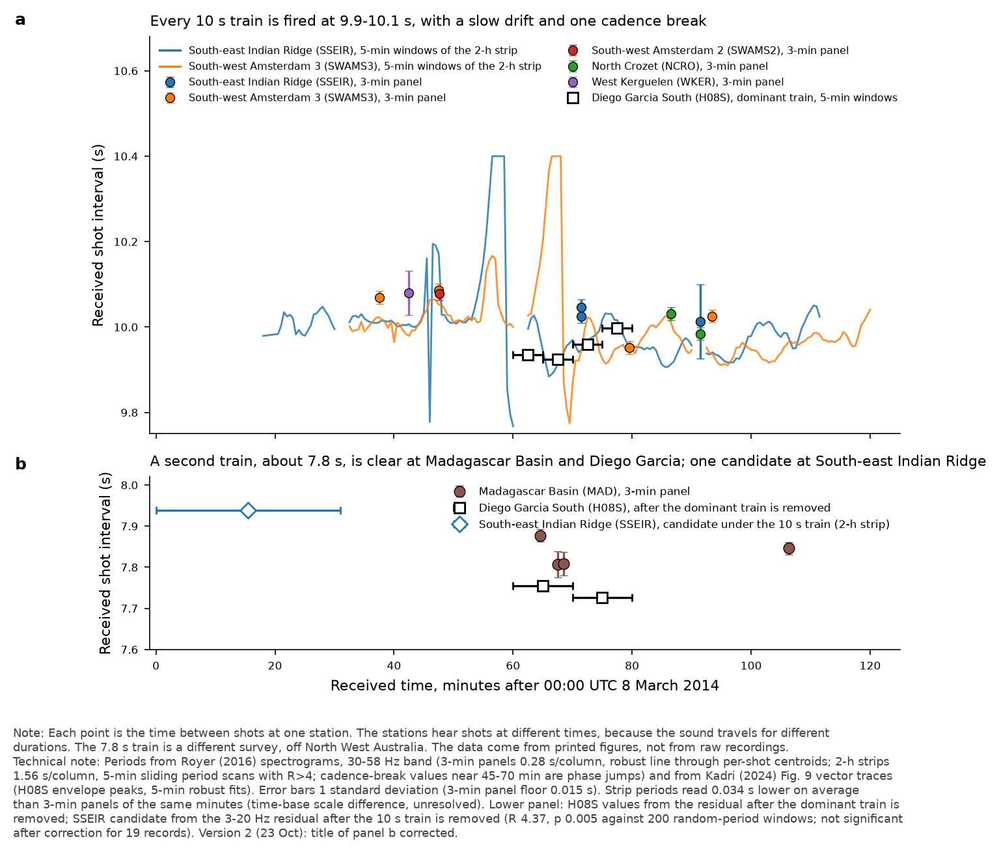
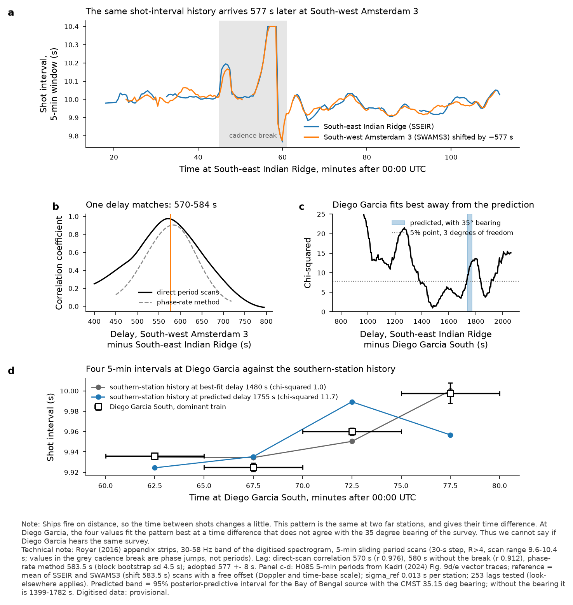
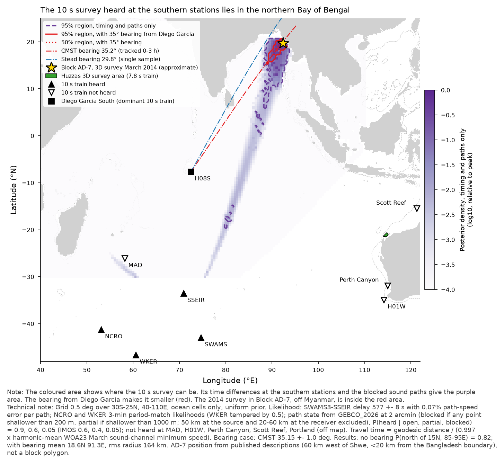
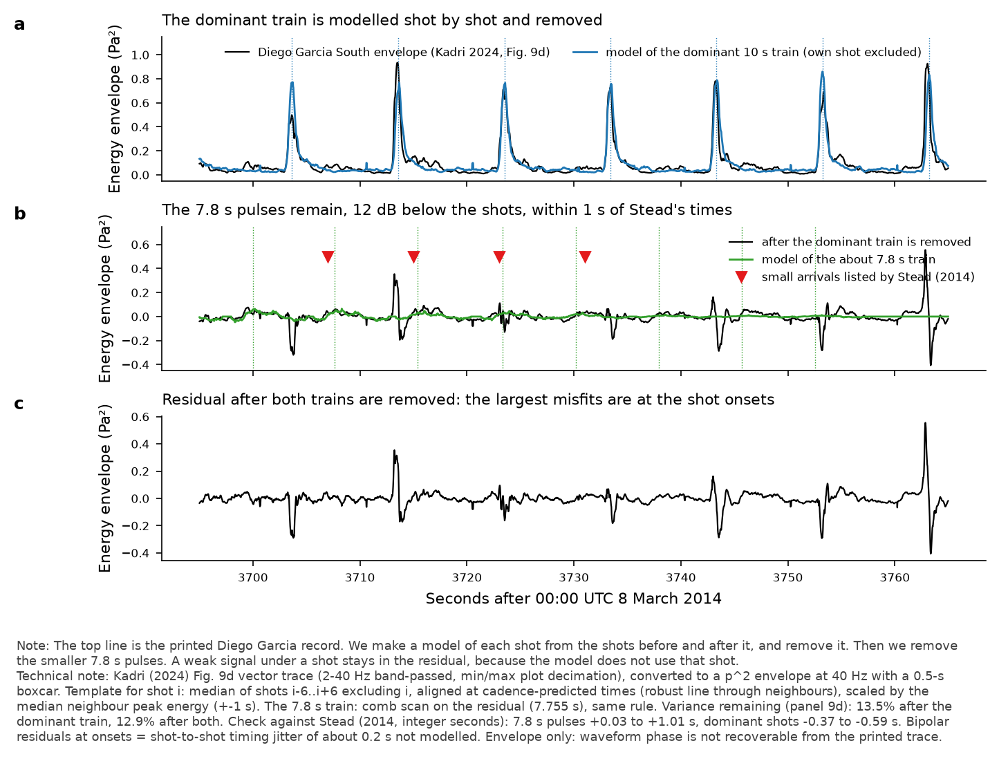
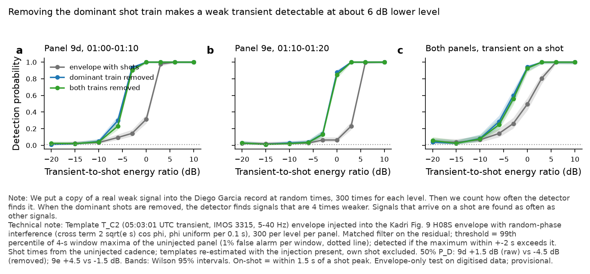
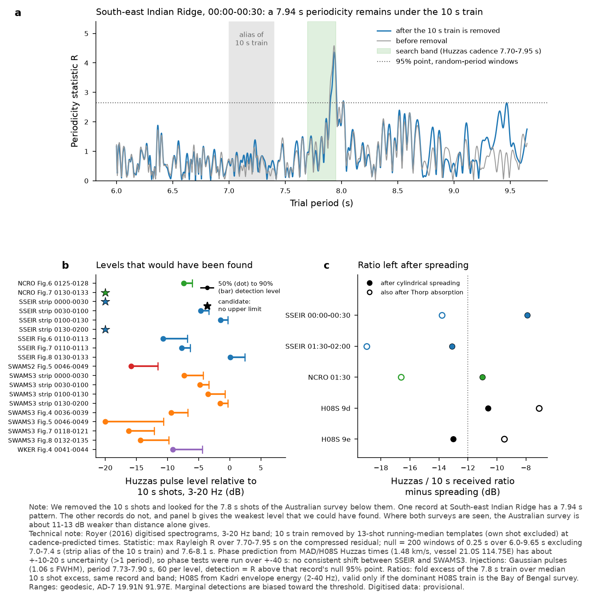

# Seismic airgun surveys heard on 8 March 2014: identification, location and removal

Hydroacoustics module, back-to-basics track, 23 October 2026. Branch claude-science-sep29.
Status: **predictive and diagnostic, not a likelihood.** All Diego Garcia (H08S), Cape Leeuwin (H01W) and OHASISBIO inputs are digitised from published figures. Every number that rests on them is **provisional**.

## 1. Summary of findings

1. **There are at least two airgun surveys, and possibly three, not one.**
   * **Survey A (10 s, northern Bay of Bengal).** This is heard at SSEIR, SWAMS-2/3, NCRO and WKER. SSEIR and SWAMS-3 carry the same shot-interval history, offset by **577 ± 8 s** (correlation 0.976 for direct period scans; 0.904 for the phase-rate method). The history includes a cadence break at about 00:45–01:00 (SSEIR time).
   * **Survey C (about 7.8 s, North West Shelf of Australia).** This is the TGS/Searcher Huzzas 3D survey (M/V Geo Caspian; 2 × 3,366 cu in flip-flop source; 18.75 m shot interval; Barrow Sub-basin). It is heard at MAD in all four panels (7.81–7.88 s). It is also heard at H08S under the dominant train: after that train is removed, the residual gives 7.755 s and 7.727 s, 12–14 dB below the dominant shots. Its pulse times at H08S agree with Stead's (2014) "8-second" arrivals to within 1 s. CMST (2014-30) confirmed this survey from operator navigation data at a bearing of 113.0–113.6° from H08S.
   * **The dominant 10 s train in Kadri's H08S panels (01:00–01:20).** Whether this is survey A is **unresolved**; see §4. If it is not A, it is a third survey (B) on a bearing of about 30–35° from H08S.
2. **Location of survey A** (Bayesian grid, [fig3_survey_location_posterior.png](fig3_survey_location_posterior.png)):
   * Timing and path blockage only: P(north of 15° N, 85–95° E) = 0.82; mean 16.2° N 90.8° E; rms radius 726 km, with a long southern tail.
   * With CMST's tracked H08S bearing (35.15 ± 1.0°): mean **18.6° N 91.3° E**, rms radius 164 km; 95 % region 15.5–20.5° N, 89.0–93.0° E.
   * Online records give a match. The Daewoo/Woodside **Block AD-7 3D survey (1,349 km², acquired March 2014, northern Rakhine Basin, off Myanmar near the Bangladesh boundary)** lies inside the 62 % region (CMST-bearing case). It predicts a SWAMS-3 − SSEIR delay of 576.5 s, against 577 s measured. Its bearing from H08S is 35.5°, against CMST's 34.9–35.4°. This agrees with Royer (2016, p. 4), who places the survey "in the Bay of Bengal, off the coast of Myanmar" from shot interruptions. The AD-7 position is read from published descriptions, not from a block polygon.
3. **Separation at H08S** ([fig4_template_subtraction_example.png](fig4_template_subtraction_example.png), [fig5_detection_probability_gain.png](fig5_detection_probability_gain.png)). Removing the dominant train shot by shot gains about **6 dB** in detectability for a T_C2-like transient. The 50 % detection level moves from +1.5 to −4.5 dB (panel 9d) and from +4.5 to −1.5 dB (panel 9e), as transient-to-shot energy ratio at 1 % false alarm per 4 s window. Also removing the Huzzas train adds nothing at this resolution. Transients that fall on a shot are detected at least as often as transients between shots, which supports Pete's rule that coincidence with a shot is a label, not an exclusion.
4. **Withdrawn during the session.** An intermediate result said that "the dominant H08S train is inconsistent with survey A at every delay (χ² ≥ 37)". It came from a phase-rate period reference that fails inside the cadence break. With direct 5-min period scans it does not hold. It must not be quoted.

## 2. Data and timing resolution

| Source | What it gives | Time resolution | Absolute-time accuracy |
|---|---|---|---|
| Royer 2016 3-min event panels (Figs 4–8; MAD, H01W-2, WKER, SWAMS-2/3, NCRO, SSEIR) | shot times, period, spectrum | 0.277 s per column; per-shot rms 0.09–0.25 s (good panels) | ±0.28 s frame; the same SSEIR minutes in Figs 6 and 7 agree to 0.17 ± 0.24 s |
| Royer 2016 appendix strips 00:00–02:00 (H01W-2, SSEIR, SWAMS-3) | 2-h shot-interval history | 1.56 s per column (last SSEIR strip 1.16 s) | strip-to-strip offsets 0.5–0.7 s (overlap test); strip periods read 0.034 s lower than the 3-min panels of the same minutes (time-base scale difference, unresolved) |
| Royer Fig. 2 (H01W-2, 4.15 s per column) | not used for timing | too coarse for a 10 s train | — |
| Kadri 2024 Fig. 9 vector traces (H01W a–c 00:27–00:57; H08S d–e 01:00–01:20) | H08S shot times, both trains; H01W checks | vertex spacing 0.05 s; envelope 0.025 s grid with 0.5 s smoothing; per-shot rms 0.16–0.37 s | panel axis widths differ in the published raster (306.3 vs 304.0 px), so per-panel calibration is correct; agrees with Stead (2014) to within 1 s |
| IMOS raw records 8 March (3315, 3376, 3250, 3274, 3275) | cadence scan only | 6 kHz raw; 0.25 s envelope used | hex filename = start time |
| Stead 2014 (LA-UR-14-24972), CMST 2014-30 | bearings, sample arrival times | integer seconds (Stead) | — |

Royer's 3-min panels carry plotted gridlines at every 10 s tick. These were masked: left in, they bias every period toward exactly 10.000 s.

## 3. Step 1: the pulse train at each station ([fig1_period_per_station.png](fig1_period_per_station.png), [period_per_station.csv](period_per_station.csv), [shot_times_per_station.csv](shot_times_per_station.csv))

* **SSEIR, SWAMS-3**: 10 s train through 00:00–02:00 (strip R statistic 9–20; weak at SWAMS-3 before 00:30). The 5-min periods are 9.90–10.06 s outside the cadence break. The two stations' histories agree to a robust SD of 0.019 s at the 577 s delay ([fig2_cadence_alignment.png](fig2_cadence_alignment.png)).
* **SWAMS-2** 10.078 s (00:46), **NCRO** 10.031 / 9.985 s (01:25 / 01:30), **WKER** 10.08 s (weak, R 5.3, per-shot rms 1.1 s).
* **Spectrum**: survey A pulses are broadband. Folded contrast rises with frequency to 35–80 Hz (up to 14 dB at SWAMS-3) and extends to about 90 Hz in the 0–120 Hz panels. The Huzzas train at MAD is strongest at 3–8 Hz (3–4 dB) and is absent above 58 Hz.
* **MAD**: no 10 s train (R 1–2), but the about 7.8 s Huzzas train is present in all four panels (R 9–10).
* **H01W-2 / H01W**: no 10 s or 7.8 s train (Royer strips R ≤ 2.2; Kadri traces below each panel's 99th percentile). This agrees with Royer and with blocked paths.
* **IMOS**: no coherent train at either period in 24–36 records per logger (start times 00:00–06:00 UTC; [imos_cadence_scan.csv](imos_cadence_scan.csv)). Scott Reef has raised but non-periodic envelope modulation (best period wanders across the search band). **Provisional.**
* **Cadence fingerprints** (survey A): a phase jump at about 00:47 and a period excursion at about 00:55–01:00 (SSEIR time), repeated at SWAMS-3 577 s later. Shot-to-shot jitter of about 0.3 s is reproducible across Royer's two renderings of the same minutes (residual correlation 0.80). The 10 s ambiguity is resolved by the interval history, not by phase. In the SWAMS-3 3-min panels at 01:18 and 01:32 the phase is consistent with the 584 s comb tooth.

## 4. Is the dominant H08S train survey A?

Evidence on the data held ([fig2_cadence_alignment.png](fig2_cadence_alignment.png) c–d, [lags_and_identity_tests.csv](lags_and_identity_tests.csv)):

| Evidence | Points to |
|---|---|
| CMST tracked a 35° line for 0–3 h, and the bearing to AD-7 is 35.5° | same survey |
| Royer (who had the H08S records) located the survey from interruptions "on several hydrophones" | same survey (indirect) |
| Phase-rate local-period cross-correlation peaks at 1,773–1,779 s, close to the predicted 1,738–1,773 s (p = 0.003 in window; 0.10 over all delays) | same survey; but this method is biased in cadence breaks |
| Direct 5-min period history at H08S (9.936, 9.925, 9.960, 9.998 s) fits poorly at the predicted delay (χ² 9.5–13.3, 3 dof, p 0.005–0.024; Bayes factor about 0.08 against an unrelated train, about 0.56 without the bearing) | different survey |
| Stead's DOA 29.8° for the 10 s train (his Huzzas DOA is 117° against CMST's 113°, so his DOAs carry errors of several degrees) | weakly different, or uninformative |

**Verdict: unresolved.** A decisive test needs H08S data that cover survey A's cadence break, which is predicted at H08S at about 00:18–00:33 UTC. Kadri's panels start at 01:00. The required data must not be requested (project rule), so the test stays open unless a published H08S figure covering that window is found. Note that CMST Fig. 7 (bearing against time, 0–3 h) is held locally and could show interruptions; it has not been digitised yet.

## 5. Step 2: location, shot times, source level

* **Model**: 0.5° grid (30° S–25° N, 40–110° E), uniform prior over ocean cells. The likelihood terms are:
  * the SWAMS-3 − SSEIR delay, 577 ± 8 s, plus a 0.07 % per-path speed error;
  * NCRO and WKER period-match likelihoods (WKER tempered by 0.5);
  * detection and non-detection by GEBCO_2026 path state: P(heard) = 0.9 open, 0.6 partial, 0.05 blocked (IMOS 0.6, 0.4, 0.05);
  * optionally, the CMST bearing.

  Travel time is geodesic distance / (0.997 × harmonic-mean WOA23 March sound-channel minimum speed). Grid output: [survey_A_location_posterior_grid.csv](survey_A_location_posterior_grid.csv).
* **Doppler** could not be used. The predicted SSEIR/SWAMS-3 differential is below about 2 × 10⁻⁴, inside the Royer time-base uncertainty (0.34 % between figure types).
* **Shot emission times** (survey A, from SSEIR strip arrivals): 23:06 (7 March) to 00:44 UTC, ±103 s from location uncertainty ([survey_A_emission_times_from_SSEIR.csv](survey_A_emission_times_from_SSEIR.csv)).
* **Source level**: received pulse-peak band levels (5–58 Hz) are at least 103–115 dB re 1 µPa. These are lower bounds, because the Royer colour scale saturates at 100 dB re 1 µPa²/Hz (up to 27 % of pixels saturated). Simple spreading over about 6,200 km gives a source level of at least about 222 dB re 1 µPa at 1 m. This is consistent with a commercial array, but the module's transmission-loss chain is not calibrated in slope, so it is an order-of-magnitude check only.
* **Survey C (Huzzas)**: position known (NOPSEMA polygon). [Corrected in §10: from the vessel's 8 March position the open-ocean paths to SSEIR, NCRO, WKER, MAD and H08S are open; SWAMS has one ~15 km section at 850 m; H01W, Perth Canyon, Scott Reef, H08N and Portland are blocked.]

## 6. Step 3: online records

* **Royer 2016 p. 4**: shots "10s apart", located off Myanmar from shot interruptions; H01W shielded.
* **Stead 2014** (OSTI 1136454): two repeating trains at H08S, about 10 s (DOA 29.8°) and about 8 s (DOA about 117°).
* **CMST 2014-30**: H08S lines at 34.9–35.4° ("off Sri Lanka or in the Bay of Bengal", 0–3 h) and 113.0–113.6° (TGS Huzzas, confirmed with navigation data; Woodside Centaurus 3D not detected).
* **Huzzas 3D**: Searcher/TGS project pages, vessel and source parameters as above.
* **Block AD-7 3D survey, March 2014**: GeoExpro exploration update; position from the Woodside Thalin-1A releases (60 km west of Shwe, 836 m water depth, less than 20 km from the Bangladesh boundary).
* No dated record was found for a separate survey off Sri Lanka or eastern India on 8 March 2014.

## 7. Step 4: separation

* **Method**: the template for each shot is the median of the 12 neighbouring shots (own shot excluded), aligned at cadence-predicted times and scaled by the neighbours' median energy. The Huzzas pulses are then picked from the residual with the same rule.
* **Variance remaining**: 13.5 % (9d) and 21.8 % (9e) after the dominant train is removed.
* **Limits**:
  * Bipolar residuals at shot onsets show about 0.2 s of unmodelled per-shot jitter.
  * Envelope only: waveform phase cannot be recovered from the printed trace, so the interference tests are on shape and energy.
  * A multi-station prediction of each H08S shot is not possible. Survey A is not separable at H08S in this single-element envelope, and survey A's predicted delay uncertainty (±8 s or more) exceeds half a shot period.
* **Injection–recovery**: T_C2 envelope, random-phase interference term, 300 injections per level per panel ([h08s_injection_recovery.csv](h08s_injection_recovery.csv)).

## 8. Declared deviations and reductions

* **Royer data coverage**: Royer 2-h strips exist only for H01W-2, SSEIR and SWAMS-3. The other OHASISBIO stations have only 3-min panels (4 at MAD, 2 at NCRO, 1 each at WKER and SWAMS-2).
* **IMOS scope**: the scan used records starting 00:00–06:00 UTC only (24–36 per logger), with a 10–60 Hz envelope.
* **Posterior scope**:
  * Grid limited to 30° S–25° N, 40–110° E.
  * Great-circle paths, no refraction around obstacles.
  * Blockage thresholds fixed by hand (200 / 1,000 m).
  * SWAMS-2 not used separately (co-located with SWAMS-3).
  * AD-7 position approximate.
* **Survey B**: position not estimated (one station only).
* **Source level**: lower bound only.
* **Injection–recovery**: Kadri panels 9d and 9e only. Shot times were taken from the uninjected cadence.
* **Withdrawn result**: one intermediate result (§1, item 4) was withdrawn.

## 9. Files

[shot_times_per_station.csv](shot_times_per_station.csv) · [period_per_station.csv](period_per_station.csv) · [lags_and_identity_tests.csv](lags_and_identity_tests.csv) · [survey_A_location_posterior_grid.csv](survey_A_location_posterior_grid.csv) · [survey_A_emission_times_from_SSEIR.csv](survey_A_emission_times_from_SSEIR.csv) · [h08s_injection_recovery.csv](h08s_injection_recovery.csv) · [imos_cadence_scan.csv](imos_cadence_scan.csv)

## 10. Addendum (23 Oct, second pass): was the Huzzas survey recorded at the French sites?

**Correction to §5 (path checks).** My statement "Survey C: blocked to … SWAMS and WKER; partial to MAD and H08S" is withdrawn. It excluded only 50 km at the source, but the vessel sits on the shelf (about 260 m), so the "shallow" points were the source's own shelf. The lead's GEBCO_2026 geodesic table (vessel on CMST's nav bearing, about 21.0° S 114.6–114.9° E) supersedes it:

* **Open (no point shallower than 1000 m once off the shelf):** SSEIR, NCRO, WKER, MAD, H08S.
* **SWAMS:** one ~15 km section at about 850 m.
* **Blocked:** H01W (530–730 km of Western Australia), Perth Canyon, Scott Reef (250–380 km of shelf shallower than 200 m), H08N, Portland.
* **From AD-7 (19.91° N 91.97° E):** open to SSEIR, SWAMS, NCRO, WKER and H08S. MAD is blocked (31 km shallower than 200 m on the Chagos–Laccadive ridge), which matches the absence of the 10 s train at MAD. H01W and IMOS are blocked by land.

**Search under the 10 s train.**

* **Method.** The 10 s train was removed shot by shot in the 3–20 Hz band of each Royer record, with the same neighbour-template rule as at H08S. The residual was scanned at 7.70–7.95 s. The null was the same statistic in 200 random 0.25 s period windows (6.0–9.65 s, excluding 7.0–7.4 s, which is the strip alias of the 10 s train, and 7.6–8.1 s). Tables: huzzas_residual_period_scan.csv, huzzas_cadence_template_tests.csv.
* **MAD:** recorded (all four panels, R 9–10; reported earlier).
* **SSEIR, candidate:**
  * Strip 00:00–00:30: 7.938 s, R = 4.37, p = 0.005 (the floor of the null), present before subtraction (R 4.58).
  * Strongest at 3–8 Hz (R 7.05), but also present at 25–58 Hz.
  * Concentrated in 00:00–00:16, when the 10 s train is still weak.
  * Absent from the blocked H01W strip at the same time (R 1.7, p 0.49), and not a 5-pixel raster artefact.
  * Not significant after correction for 19 records (19 × 0.005 ≈ 0.10).
* **SSEIR, marginal:** strip 01:30–02:00 at 7.78 s, p = 0.055.
* **NCRO, marginal:** 01:30 panel at 7.703 s (at the band edge), p = 0.045.
* **SWAMS-2/3 and WKER:** not detected.
* **Phase test.** Predicted arrival phase (MAD and H08S Huzzas times, 1.48 km/s, geodesic ranges) is uncertain by about ±10–20 s, which is more than one period, so the phase cannot be predicted. Template tests were therefore run over a ±40 s shift. Three of 15 reach p < 0.05 (binomial P(≥3) ≈ 0.04), but the best shifts disagree between SSEIR and SWAMS-3 for the same emission window (−8 s against −37 s). Not a consistent detection.
* **Upper limits.** These come from injecting a 7.73–7.90 s Gaussian pulse train before subtraction, 60 per level; detection means R above that record's null 95 % point (huzzas_upper_limits_summary.csv). Levels are relative to the median 10 s shot peak in the same band (3–20 Hz):
  * 3-minute panels: 50 % detection at −16 to −7 dB, 90 % at −12 to −4 dB.
  * 2-hour strips: 50 % at −7 to −1.5 dB, 90 % at −4 to −0.3 dB.
  * Least sensitive: SSEIR Fig. 8 at +0.1 / +2.4 dB.
  * No upper limit where the record is already a candidate.
* **Answer:** recorded at MAD; one candidate at SSEIR; marginal at NCRO; not detected at SWAMS-2/3 or WKER down to the levels above. **Provisional.**

**Same-night calibration check** (huzzas_to_10s_level_ratios.csv). Received Huzzas/10 s ratio minus cylindrical spreading, 10 log10(R_A/R_C):

| Site | Residual (dB) |
|---|---|
| SSEIR 01:30–02:00 | −13.1 (3–20 Hz) |
| NCRO 01:30 | −11.0 |
| H08S 9d | −10.6 |
| H08S 9e | −13.0 |
| SSEIR 00:00–00:30 | −7.9 |

The SSEIR 00:00–00:30 value is higher because the 10 s train is still weak at that time (start of line or ramp-up). So, with one exception, Huzzas arrives about 11–13 dB weaker than spreading alone predicts. That difference combines source level and shelf/slope coupling. The data cannot separate the two, because the 10 s survey's array is not documented.

Caveats:

* With the Thorp 0.003 dB/kyd low-frequency absorption term the residuals spread from −7 to −20 dB, so the agreement holds only without that term.
* The SSEIR 01:30 and NCRO values come from marginal detections, which sit near the detection threshold by construction.
* The H08S values hold only if the dominant H08S train is the Bay of Bengal survey (§4). Their agreement with the OHASISBIO sites is weak support for that, not proof.
* No absolute source levels are claimed: the Royer colour scale saturates, and Kadri amplitudes are digitised (panel 9e has a +8.8 dB scale step, so only within-panel ratios are used).

**Deviations (this pass).**

* Huzzas vessel position taken as 21.0° S 114.75° E for ranges; speed fixed at 1.48 km/s for phase prediction.
* Search band 3–20 Hz for removal and search (3–8 Hz also reported).
* Injection pulse shape assumed Gaussian (1.06 s FWHM), 60 injections per level, not 300.
* NCRO and WKER have no records overlapping the MAD-derived windows, and WKER has none overlapping the H08S-derived window, so those got period tests only.
* Figure 1 regenerated (version 2) with a corrected panel b title.

**Addendum files:** [huzzas_residual_period_scan.csv](huzzas_residual_period_scan.csv) · [huzzas_cadence_template_tests.csv](huzzas_cadence_template_tests.csv) · [huzzas_upper_limits_summary.csv](huzzas_upper_limits_summary.csv) · [huzzas_injection_upper_limits.csv](huzzas_injection_upper_limits.csv) · [huzzas_to_10s_level_ratios.csv](huzzas_to_10s_level_ratios.csv)

