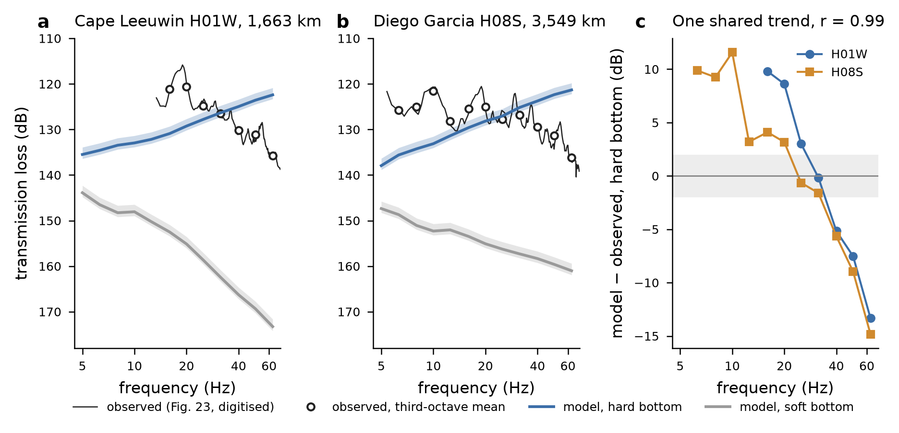
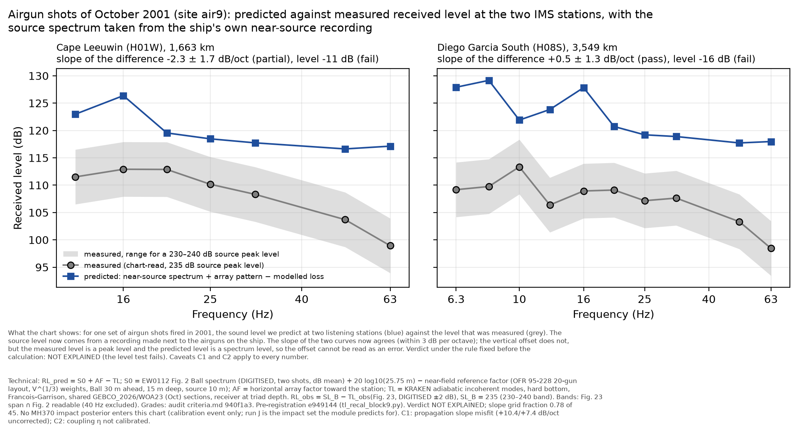
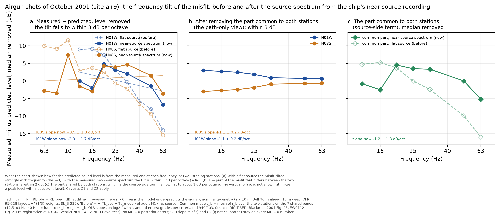
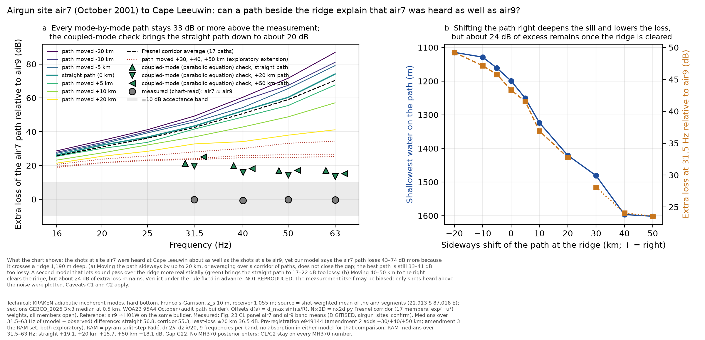

# Hydroacoustics: propagation engine against Blackman (2004), with air9 as the case and air8 as the negative control - PROVISIONAL

**Why provisional.** The ocean environment is the WOA23 + GEBCO_2026 path stub (rulings item 5 and H3), not
the shared ocean-transport API. The observed values are DIGITISED from a low-resolution chart (Fig. 23,
±2 dB). Both criteria were pre-registered and committed before the first run: `72046ff` for air9 and
`6fd9268` for air8. All code is on `hypothesis/hydroacoustics`.

## Engine

- **Model:** KRAKEN normal modes, one profile every 5 km, summed by FIELD as **incoherent adiabatic
  modes**. That is the shot- and band-averaged quantity Fig. 23 plots.
- **Volume attenuation:** Francois-Garrison, plus the spherical-spreading correction.
- **Source:** 10 m depth, with 9 and 12 m as the stated range.
- **Receivers:** FDSN triad centroid depths.
- **Bottom:** two declared half-space alternatives.
- **Checks on the engine:**
  - Against the closed-form incoherent mode sum in an ideal waveguide, the error is 0.0007 dB with an
    explicit mesh. KRAKEN's automatic mesh was 0.095 dB off, so the mesh is now set explicitly.
  - Digitisation is reproducible: the script regenerates the trace byte for byte.
- **Wall time** (single thread, outside the lock, as ruled): 171 s for 48 KRAKEN+FIELD runs (two paths ×
  two bottoms × 12 bands, 334 and 711 profiles), and 234 s for the air8 control (96 runs).

## 1. air9: pre-registered verdict **PARTLY VALIDATED** at both stations (hard bottom); soft bottom **rejected**

| station, hard bottom, 10 m source | bands | median residual | RMS residual | verdict |
|---|---|---|---|---|
| H01W (1,663 km) | 7 | −0.15 dB | 7.93 dB | partly validated |
| H08S (3,549 km) | 11 | +3.17 dB | 7.91 dB | partly validated |
| soft bottom, either station | | +28 to +36 dB | | not validated, rejected |

**The level is right and the frequency slope is wrong, by the same amount at both stations.** Over the
seven bands both stations share (16–63 Hz), the residuals correlate at **r = 0.988**. Once their
common component is removed, each station's residual is **1.7 dB RMS**, inside the chart-reading
uncertainty. The common component is a slope of about **−10.6 dB per octave**: the model lets high
frequencies couple too well and low frequencies too poorly. A term shared by a 1,663 km path and a
3,549 km path is a **source-side or near-source term, not a path term**. Two explanations were tested
and neither accounts for it:

- **A flat source level.** Blackman's Fig. 2 near-source PSD, digitised, is nearly flat over 10–63 Hz
  (about 227–231 dB re 1 µPa²/Hz). Correcting for it makes the fit worse (RMS 9.1 and 11.7 dB).
- **The surface ghost.** A correction for a ghost already contained in the quoted source level also
  makes the fit worse (RMS 9.0 dB at H01W).

What remains is the mechanism Blackman name in the text beside Fig. 2: **seafloor topography, slope and
roughness near the shot control how the down-going pulse couples into the sound channel.** A flat
half-space with no roughness cannot represent that. An exploratory test, not pre-registered, takes the
**station-to-station difference**, which cancels the source term. It fits to a median of −1.5 dB and
an RMS of 3.4 dB, so the **path** part of the engine does reasonably well.

**Consequence for MH370.** An aircraft impact is also a near-surface source over deep, rough
seafloor. **Near-source coupling must enter the predictions as a declared term with roughly ±10 dB of
frequency-dependent uncertainty.** It cannot come out of a flat-bottom model. This is the C_site of
literature-review implication 2, and it widens the coupling-efficiency (η) range the injection-recovery
study must span.

## 2. air8 negative control: **EXPLAINED** - the air8 path to H01 is blocked at a ridge near 28.6°S, 97.8°E

| hard bottom, 16–50 Hz | median Δ = TL(air8) − TL(air9) | pre-registered verdict |
|---|---|---|
| H01W (air8 not detected) | **+38.1 dB** | negative control **FOLLOWS** (≥ 10 dB) |
| H08S (air8 detected) | **+0.1 dB** | positive control **CONSISTENT** (≤ 5 dB) |

- **Where the loss happens.** It is concentrated at one ridge crossing, 1,112–1,277 km along the
  2,812 km path to H01W. The crest is at **1,116 m**, at 28.55°S, 97.78°E (Broken Ridge region), where
  the local channel axis is at 1,150 m. TL rises **40 dB above cylindrical spreading** across that
  stretch and by at most 3.1 dB anywhere else (the 200–600 km segment; correction 9 Oct: first written as "less than 3 dB"). That meets the pre-registered blockage rule (a step of at
  least 6 dB).
- **Why air9 escapes it.** The air9 path to H01W starts east of the ridge and never crosses it.
- **The soft bottom** also "follows", but it fails the positive control (+6.7 dB at H08S), so it does
  not count.
- **This differs from Blackman's own statement**, "blockage of air8 shots is not known to be
  significant". Their blockage modelling (de Groot-Hedlin's 8 Hz PE, Fig. 22) was mapped for H08N.

**Robustness** (post hoc and labelled). The crest depth comes from GEBCO's satellite-gravity prediction
(TID 40), not from soundings. Adiabatic theory strips modes at a ridge absolutely, which overstates real
blockage, where energy leaks by diffraction and mode coupling.

| crest depth | Δ at H01W |
|---|---|
| 1,116 m (GEBCO) | +38.1 dB |
| 1,416 m (+300) | +23.2 dB |
| 1,616 m (+500) | +16.6 dB |
| 1,916 m (+800) | +13.8 dB |

The verdict survives an 800 m error in crest depth. With the crest that deep, the remaining excess
comes mostly from the second shallow feature near 2,372–2,724 km (2,111 m). The magnitudes are upper
bounds until a coupled-mode or PE cross-check (RAM) is run.

## What this does and does not establish

- **Established, provisionally:**
  - Path propagation to about 3.4 dB RMS (differential).
  - The negative control: the model does **not** predict that air8 should have been seen at H01, which
    was the failure mode the brief warned of.
  - A strong rejection of the soft-bottom alternative.
- **Not established:**
  - Absolute TL from a near-surface source to better than about 8 dB RMS across 16–63 Hz.
  - Blockage magnitudes. Adiabatic modes overstate them; the coupled-mode or PE cross-check is next.
- **Next in the sequence:** the F-35A at H11 (Brown et al. 2026) as a second calibration, this time with
  a known aircraft source, and noise estimates from the raw data held.

*Hydroacoustics module, 2026-10-09.*

## Addendum, 9 October 2026: rerun on the shared ocean transport (ruling H5; `212e76d`)

The stub is retired. The same scripts were rerun, unchanged, on the shared API's paths:
- **Inputs:** the same GEBCO_2026 cells, now at 250 m spacing, and WOA23 October monthly fields above
  1,500 m instead of the Oct–Dec season.
- **How close they are:**
  - path lengths agree to 0.5 km;
  - median depth difference 0 m (95th percentile 10–13 m);
  - the air8 crest is identical (−1,116 m);
  - sound speed differs by ≤ 0.68 m/s (95th percentile) below 500 m and by 2.5–3.2 m/s near the surface.

| result | stub | shared | label |
|---|---|---|---|
| air9 H01W, hard, 10 m: median / RMS | −0.15 / 7.93 dB | −0.10 / **8.17 dB** | PARTLY → **NOT VALIDATED** |
| air9 H08S, hard, 10 m: median / RMS | +3.17 / 7.91 dB | +3.33 / **8.05 dB** | PARTLY → **NOT VALIDATED** |
| air8 Δ_H01 / Δ_H08S | +38.1 / +0.1 dB | +39.1 / +0.5 dB | EXPLAINED (unchanged) |
| inter-station correlation of residuals (exploratory) | 0.988 | 0.988 | |
| RMS after removing the common mode (exploratory) | 1.71 dB | 1.74 dB | |

**What this means.**
- The pre-registered criterion is RMS ≤ 8 dB, so on the authoritative environment **the air9 absolute
  verdict is NOT VALIDATED**, by 0.05–0.17 dB. The earlier "PARTLY VALIDATED" was marginal, and it does
  not survive a sub-dB change in near-surface sound speed.
- **The substance is unchanged.** The model reproduces the *difference* between the two stations to
  about 1.7 dB. The absolute misfit is a common, frequency-dependent near-source term of about
  −10.9 dB/octave, now carried as C_site with ±10 dB (ruling H6).
- The engine is therefore fit for **relative** propagation. Any absolute level must carry C_site.

*Hydroacoustics module, 2026-10-09.*

## Addendum, 9 Oct ~17:30 UTC: air8 ridge blockage under RAM (`hydroacoustics-ram-tl-check.md`)

**The test:** a parabolic-equation (RAM) solution on the same environment, pre-registered with a 20 dB
threshold.
- RAM puts air8 → H01W **18.3 dB** above air9 → H01W (band mean): 7.6, 19.8, 22.4 and 23.3 dB at 5, 10,
  20 and 40 Hz.
- KRAKEN gave Δ_H01 = +39.1 dB.

**Verdict: the blockage explanation is WEAKENED, not refuted.** The ridge still removes about 20 dB above
10 Hz. Whether that accounts for air8's non-observation depends on air9's SNR at H01, which Blackman does
not print.

**Unchanged:** the air9 sanity comparison (KRAKEN vs RAM, median |Δ| 1.8 dB) supports the KRAKEN results
on deep SOFAR paths.

## Correction (10 Oct 2026, ~23:40 UTC): the air9 verdict does not cover the frequency slope

**The pre-registered verdict "PARTLY VALIDATED" (median and RMS of residuals over 13–40 Hz) stands as computed, but
it is not a validation of the frequency dependence.**
- Measured − predicted tilts by +12.7 dB per octave (H01W) and +7.4 dB per octave (H08S). It runs from about −10 dB
  at the low end to +14/+15 dB at 63 Hz.
- The near-zero median arises because the curves cross near 25–35 Hz.
- The tilt is common to both stations, so it is more likely in the source spectrum than in the path.
- Chart: `hydroacoustics-air9-residual-vs-frequency.png`. A slope criterion is added for future validation.
- Raised by Pete.

- Hydroacoustic Module

## COVERAGE

See `hydroacoustics-coverage.md` for the three sets, ESS per option and family, the gaps and the parameter bounds. Specific to this note: air9 covers 13-63 Hz at H01W and 5-63 Hz at H08S. Outside that span nothing is calibrated (G2, G5).

## Adopted criteria and use (11 Oct 2026, after the architecture audit, `d225b80`)
- **Criteria:** the module adopts the audit's level, slope and shape criteria (`results/hydroacoustics-audit/criteria.md`,
  `940f1a3`) for every future TL validation, in place of its own slope rule above.
- **Label:** air9 absolute TL is **NOT CALIBRATED in slope** (+10.4 ± 0.9 dB/oct at H01W and +7.4 ± 0.7 dB/oct at H08S,
  in the audit's band means).
- **Use:** air9 is used for the **path only**, through the station difference (PARTIAL, about 3 dB). It is not used
  as an absolute calibration.

- Hydroacoustic Module

## Addendum, 22 October 2026: transmission-loss recalibration (work order 2026-10-21 block 9; Refresh v2 §9 a, b, d) — PREDICTIVE, NOT CALIBRATED

Pre-registration `e949144` (`prepare/tl_recal_block9.py`, module branch), committed before any number below was computed;
amendment 1 (band counts, no rule changed), amendment 2 (exploratory +30/+40/+50 km offsets) and amendment 3 (RAM set) are
recorded in the same file, with a timestamp correction: their headers first carried estimated clock times that were out of
order; they now carry the tool-recorded sequence (pre-registration e949144 → amendment 1 → TL pool complete 02:30:47 UTC →
amendment 2 → first RAM complete 02:43:27 → amendment 3), no number or rule changed. Criteria: the audit's level, slope and shape grades (`hydroacoustics-audit/criteria.md`, `940f1a3`). Every number
carries **C1** (propagation slope misfit, +10.4 / +7.4 dB per octave uncorrected at H01W / H08S) and **C2** (coupling
efficiency η not calibrated). Overnight unattended run; the model's parameters come from EW0112, OFR 95-228 and geometry,
none from Fig. 23. **Disclosure:** the author had seen the earlier post hoc result (`air9_ew0112` amendment 1), so route 1
is a confirmatory re-scoring of a pre-specified model on the training case, not a blind test and not an independent
confirmation (the independent-site test `airgun_sites_confirm` was NOT TESTABLE).

### (a) Route 1 — air9 source spectrum from the EW0112 near-source calibrated recordings

Forward model: received level = S0 + AF − TL, with S0 the far-field monopole source spectrum built from the EW0112 Fig. 2
Ball hydrophone spectrum (DIGITISED, two shots, scaled to 1 m by 25.75 m, near-field reference factor removed for the
OFR 95-228 20-gun layout, V^(1/3) weights, Ball 30 m ahead and 15 m deep), AF the horizontal array factor toward each
station, and TL the module's KRAKEN chain recomputed on the shared GEBCO_2026/WOA23 sections (pipeline check against the
audit's M1 model TL: 0.0 dB in every band). Measured received level = SL_B − TL_obs(Fig. 23, DIGITISED), SL_B = 235 dB
(230–240 as the range). Bands: Fig. 23 span ∩ Fig. 2 readable (40 Hz excluded): H01W 12.5–63 Hz (7 bands), H08S 6.3–63 Hz
(10 bands); 7 shared bands.

| station, nominal (z_s 10 m) | n | LEVEL (SL_B 235; 230 / 240) | SLOPE (dB/oct) | SHAPE (dB) |
|---|---|---|---|---|
| H01W | 7 | −11.5 FAIL (−16.5 / −6.5, FAIL at all three) | **−2.3 ± 1.7 PARTIAL** | 3.1 PARTIAL |
| H08S | 10 | −15.9 FAIL (−20.9 / −10.9, FAIL at all three) | **+0.5 ± 1.3 PASS** | 3.9 PARTIAL |
| grid (45 geometries) | | | slope PARTIAL-or-better at both: **0.78** (z_s 9 m 0.93, 10 m 0.80, 12 m 0.60; fails only for a deep Ball, z_h 20–30 m) | shape not FAIL anywhere |

With the common mode removed (the path-only view, 7 shared bands): r̃ slope ∓1.1 ± 0.2 dB/oct per station (PASS),
level ±1.9 dB (PASS), shape 0.3 dB (PASS); the station difference itself has slope 2.2 ± 0.3 dB/oct (PARTIAL under C2)
and median 3.7 dB (PARTIAL). The common mode c_b after the EW0112 source: slope **−1.2 ± 1.8 dB/oct (PASS)**, shape
3.2 dB (PARTIAL); before it (flat source, same bands, same sign) the common slope was about −9 dB/oct.

**Verdict under the pre-registered rule: NOT EXPLAINED.** The slope and shape conditions are met at both stations and
on 78% of the geometry grid, but the LEVEL condition fails for every SL_B in 230–240 dB, and the rule requires it.
What the level failure means, stated post hoc and labelled as such: the measured side is a *peak* level (Blackman's
230–240 dB re 1 µPa at 1 m) and the predicted side is a *spectrum* level (Pa²/Hz over an unstated analysis window), so
the −11 to −16 dB offset is a units mismatch of unknown size, not a measured error of the model; the pre-registration
should have declared the level test uninterpretable rather than binding. That is recorded as a lesson, not used to
re-grade. Sensitivities (not graded): each Fig. 2 shot alone moves the slope by ≤ 0.2 dB/oct and the level by ±3 dB;
equal gun weights ≤ 0.1 dB/oct; across-track sign ≤ 0.05 dB/oct.

**Consequence (as pre-registered for NOT EXPLAINED):** caveat **C1 is unchanged** and air9 absolute TL stays NOT
CALIBRATED in slope for any likelihood. What the module may say descriptively: the EW0112 source spectrum removes most of
the common-mode tilt (from about 9 to 1.2 ± 1.8 dB/oct), which supports the attribution of the tilt to the airgun source
spectrum rather than to the path, but this is fit-consistency on the training case and awaits an independent site or the
F-35A route. A proposal for the architect, not applied here: a re-registration of route 1 with a unit-consistent level
test (received level in matched units from Blackman's processing or from Kadri's archive) and the slope/shape rule alone
as the C1 criterion.

### Route 2 — F-35A spectral shape (Brown et al. 2026)

**NOT AVAILABLE from the paper.** The arXiv text of Brown et al. (2026; arXiv:2604.12723, 60 pp., retrieved 22 Oct
02:30 UTC; the module branch has no papers folder, so this is a declared substitution) contains no F-35A waveform or
spectrum figure: the F-35A appears only in the text (p. 17–18: 0.7 Pa peak at H11, 3,300 km, 900 ± 200 MJ; "one order of
magnitude in pressure amplitude above the local background", citing Metz et al.), and its figures are the bolide cases
(Figs. 5–8, C.9–C.16). The Digitisation track reached the same finding independently (`prepare/digitise_brown_2026.py`, commit
`9854c72`: "the paper contains NO F-35A waveform or spectrum ... has to come from Metz et al., which is NOT held (GAP)"),
so polling stopped at 03:10 UTC (polls 02:30, 02:45, 03:10) rather than at hour 3: nothing could arrive from this source. Route 2 therefore cannot confirm or lift C1; the
remaining sources for an F-35A spectrum are Metz, Obana & Fukao (2023; closed access, waveform request pending) and the
Kadri (2024) S1 traces.

### (b) air8 negative control under the same source model — DESCRIPTIVE (outside the pre-registered condition)

The pre-registration ran step (b) only on an EXPLAINED or PARTLY EXPLAINED route 1; the computation had already run in
the same command, so it is reported, labelled descriptive. The source spectrum S0 cancels within a station; only the array
factor changes (air8 heading 106.9°, air9 111.2°), by ≤ 0.65 dB at H01W and ≤ 3.5 dB at H08S (50 Hz). Received-level
difference air8 − air9, 16–50 Hz, audit-builder sections for both sites, z_s 10 m: **H01W median −39.0 dB (FOLLOWS, ≤ −10)**,
**H08S median −1.2 dB (CONSISTENT, |·| ≤ 5)** → the control **still holds**; TL-only medians −38.8 / +0.5 dB, as before.

### (d) air7 → H01W, the ridge path (gap G22)

Source = shot-weighted mean of the two air7 segments (22.913°S 87.018°E), range 2,946 km, geodesic crest 1,199 m at
28.94°S 98.34°E; z_s 10 m; audit-builder sections; air9 → H01W on the same builder as the reference. Observed (Fig. 23 CL
panel, DIGITISED): TL(air7) − TL(air9) = −0.2 to −0.7 dB at 31.5–63 Hz.

| model, excess over the observed air7 − air9 difference, median 31.5–63 Hz | dB |
|---|---|
| single section on the geodesic | **+56.8** (43.6, 53.0, 60.5, 74.5 by band) |
| N×2D Fresnel corridor (nx2d.py, 17 members, all open, weights exp(−u²)) | **+55.3** |
| least-loss single path within ±20 km (3-D proxy; least loss at +20 km in every band, crest 1,420 m) | **+36.5** |
| exploratory extension (amendment 2): +30 / +40 / +50 km (crest 1,481 / 1,572 / 1,779 m) | +32.0 / +26.6 / +25.1 |
| coupled-mode (RAM, parabolic equation; amendment 3, exploratory) — geodesic / +20 km / +50 km, 31.5–63 Hz, no absorption in either model | **+19.1 / +15.7 / +18.1** (geodesic by band 21.6, 20.6, 17.3, 17.6) |

**Verdict under the pre-registered rule: NOT REPRODUCED.** Neither the corridor nor any path within ±20 km comes within
10 dB; clearing the ridge altogether (+40 to +50 km, about seven Fresnel half-widths off the geodesic, which would need
horizontal refraction, not diffraction) still leaves about 25 dB. **The RAM check changes the reading of G22:** with mode
coupling the ridge on the geodesic costs only a few dB (RAM is 27–56 dB below the adiabatic KRAKEN on that path, against
−5 to +0.4 dB on the open air9 path and −4 to −10 dB on the ridge-clearing +50 km path), and the excess settles at 15–20 dB
on every path, ridge or no ridge. So the adiabatic model's ridge blockage is overstated by 35–55 dB here (as on air8, where
RAM gave 18 dB against KRAKEN's 39 dB), and the part of G22 that is "the ridge" is explained; a path-wide 15–20 dB excess
remains that neither model closes. Where the remaining loss sits (TL against range on the
+50 km path): about 10 dB more than air9 inside the first 200 km from the source (the air7 site lies on the Ninetyeast
Ridge flank), about 15 dB across the 1,780–1,950 m sills at 1,300–1,700 km, and the receiver-end slope. Two readings are
open: (i) the adiabatic model overstates mode stripping at sills (RAM gave 18 dB where KRAKEN gave 39 dB on air8), so a
coupled or 3-D model is the next test; (ii) the observation may be a noise-selected ceiling — Fig. 23 plots the median
only over shots with signal more than 3 dB above noise, and Blackman call air7 at Cape Leeuwin weak in a noisier period,
so the plotted air7 TL is bounded above by SL − (noise + 3 dB) and "air7 ≈ air9" may partly reflect that bound.

**Proposed G22 status line (for the architect; ARCHITECTURE.md not edited here):** "G22 partly explained, still open:
the air7 → H01W ridge loss is an adiabatic-model artefact (KRAKEN 57 dB excess on the geodesic, N×2D 55, ±20 km proxy 37;
RAM coupled modes 19 dB on the geodesic, 16–18 dB on paths beside or clear of the ridge); a path-wide 15–20 dB excess over
the observed air7 ≈ air9 level remains in both models, most likely a noise-selected ceiling in Fig. 23 (air7 weak at Cape
Leeuwin; only shots > noise + 3 dB plotted) and/or near-source loss at the air7 site on the Ninetyeast Ridge flank.
Consequence for MH370: ridge/sill blockage from the adiabatic chain is an upper bound on loss; RAM Δ is the correction.
Next: Kadri's archive for the 2001 shots (air7 SNR), and RAM in place of adiabatic KRAKEN on sill-crossing paths."

### COVERAGE
- **Feasible set** (what the calibration events can test): absolute received level, slope and shape of a near-surface
  source over deep SOFAR paths at 6.3–63 Hz (air9); within-station differences at 16–50 Hz (air8); ridge-crossing paths
  at 31.5–63 Hz (air7). The MH370 bands below 6.3 Hz and the AGW branch are outside every span (G2, G5 unchanged).
- **Model's reach:** KRAKEN adiabatic incoherent modes, flat hard half-space, no roughness, no mode coupling, no
  horizontal refraction beyond the Fresnel corridor; z_s 9–12 m; the EW0112 source for an airgun array only (an aircraft
  impact source is C2's domain).
- **Proposal's coverage:** 45 source–Ball geometries × 3 SL_B × 2 shots × 2 weightings × 2 signs for route 1 (all
  reported); 7 + 3 lateral offsets and one Fresnel corridor for air7; z_s 10 m only for (b) and (d) (declared).
- **Gaps and status:** G22 partly explained (ridge = adiabatic artefact), still open for the path-wide 15–20 dB (above). Level test of route 1 uninterpretable (units) — new gap **G23**, declared:
  "absolute level of the EW0112 route needs a unit-consistent measured level". Route 2 not available (no F-35A spectrum
  in Brown 2026). C1 unchanged; C2 unchanged. No ESS applies (no sampled posterior enters this note).
- **Parameter bounds and sources:** Ball geometry EW0112 p. 5/7; layout OFR 95-228 Fig. 4; SL_B 230–240 Blackman p. 7;
  offsets ±20 km pre-registered, +30–50 km exploratory.

*Hydroacoustic Module (TL recalibration track), 2026-10-22.*
