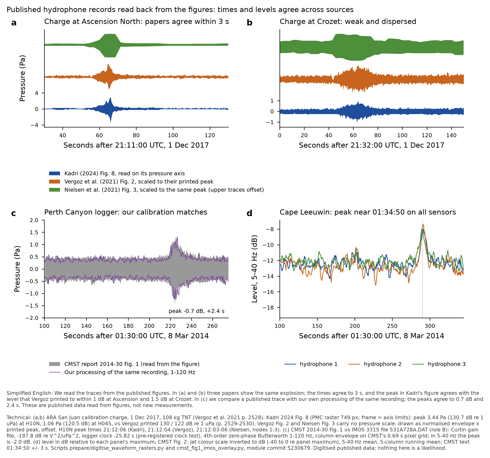
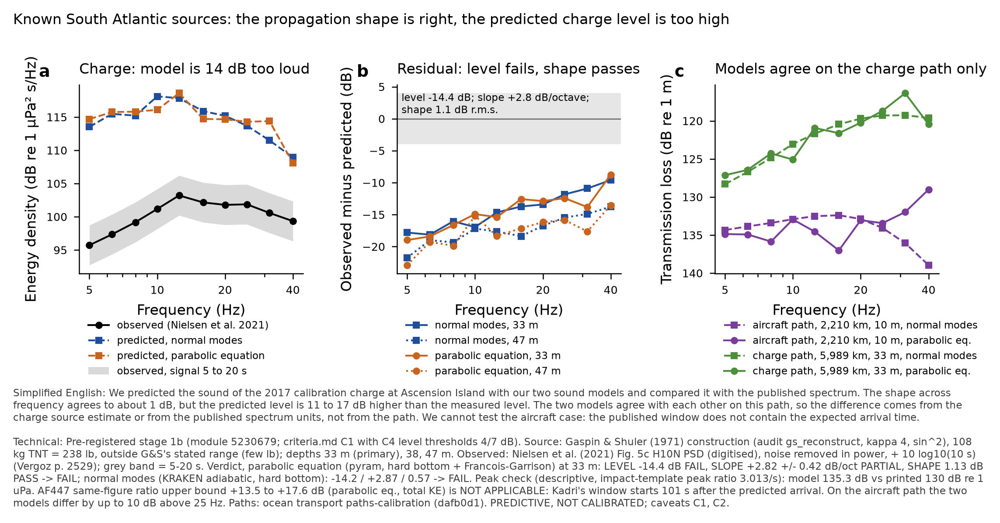
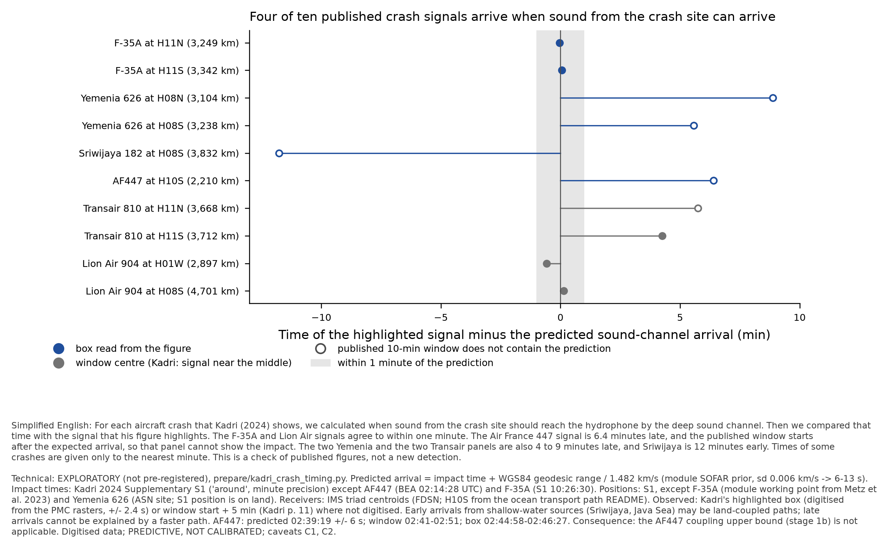

# Hydroacoustics: calibration events on known South Atlantic sources (stage 1b) and the published-record checks

Hydroacoustic Module (correction track), 22 October 2026. **PREDICTIVE, NOT CALIBRATED; caveats C1 (propagation slope
misfit, now a source-term caveat) and C2 (coupling efficiency not calibrated; eta swept over four decades; the F-35A anchor
value is under ruling, see the metz-f35a entry of 22 Oct) apply to every number.** Nothing here is a likelihood and nothing
moves the posterior. Pre-registration: `prepare/calibration_events_stage1b.py`, module commit `5230679`, pushed before any
module TL or RAM value on these paths was computed. The KRAKEN half is **not blind** (the architecture stand-in ran it on
11 Oct; this run reproduces it to 0.0 dB); the RAM half and the absolute charge source are blind. Companion: the addendum of
22 Oct in `hydroacoustics-digitised-sources.md` (G6–G8, Kadri's chain, IMOS 3315/3275).

## Results in one paragraph
The published records of the 1 Dec 2017 South Atlantic calibration charge agree with each other in time (3 s) and in peak
level (Kadri's figure against Vergoz's printed level: +0.7 dB at Ascension North, −1.5 dB at Crozet), and the module's own
processing of an IMOS recording reproduces the CMST report's published trace (−0.7 dB, +2.4 s). Against that measured
charge, the module's propagation **shape** across 5–40 Hz is right (detrended r.m.s. 1.1 dB, PASS), the **slope** is
PARTIAL (+2.8 dB per octave), and the **level** FAILS: the model is 14.4 dB louder than the published spectrum (11 to 17 dB
over the declared signal-duration range). The two propagation models agree on this path (RAM − KRAKEN within ±3 dB per
band), so the level gap is in the source term (Gaspin & Shuler used 50× outside their stated charge range) or in the unit
conversion of the published spectrum, not in the path; the peak-pressure route gives a smaller gap (+5.3 dB), which points
at the latter. **AF447 cannot calibrate coupling from Kadri's panel**: the published window starts 101 s after the
sound-channel arrival from the impact site, and the highlighted signal is 6.4 min late.

## 1. San Juan calibration charge → H10N (Q2, absolute level; pre-registered)
- Paths: ocean transport `paths-calibration` (READY, dafb0d1): `sanjuan-charge-H10N` 5,989 km, receiver 847.3 m.
- Source: Gaspin & Shuler (1971) construction (audit `gs_reconstruct.py`, route B: kappa 4, sin² negative phases),
  108 kg TNT = 238 lb (Vergoz et al. 2021 p. 2528); depth 33 m primary, 38 m (planned), 47 m (depth at which G&S's own
  bubble-period relation gives Vergoz's 0.345 s cepstral delay).
- Observed: Nielsen et al. (2021) Fig. 5c (digitised 11 Oct), noise removed in power, PSD + 10 log10(10 s).

| model, source depth | LEVEL (dB) | SLOPE (dB/oct) | SHAPE (dB rms) | verdict |
|---|---|---|---|---|
| RAM, 33 m (primary) | −14.4 (−17.4 at 5 s, −11.4 at 20 s) FAIL | +2.82 ± 0.42 PARTIAL | 1.13 PASS | **FAIL** |
| KRAKEN, 33 m | −14.2 FAIL | +2.87 ± 0.21 PARTIAL | 0.57 PASS | FAIL |
| KRAKEN, 38 m | −15.5 FAIL | +2.55 ± 0.30 PARTIAL | 0.81 PASS | FAIL |
| RAM, 47 m | −17.4 FAIL | +2.09 ± 0.58 PARTIAL | 1.57 PASS | FAIL |
| KRAKEN, 47 m | −17.4 FAIL | +2.20 ± 0.29 PARTIAL | 0.77 PASS | FAIL |

Residual = observed − model (negative: the model is too loud). LEVEL thresholds 4 / 7 dB (audit C4, widened for the
source), SLOPE 1.5 / 3, SHAPE 3 / 5 (criteria.md C1). Span 5–40 Hz, observed SNR 4–15 dB in every band.
- Descriptive peak check (not a verdict): model peak 135.3 dB re 1 µPa (RAM, 33 m; impact-template peak ratio 3.013 /s)
  against 130 dB printed by Vergoz and 130.7 dB read from Kadri Fig. 8: model +4.6 to +5.3 dB. The two routes disagree by
  about 9 dB; the ESD route depends on Nielsen's undisclosed Welch window and the peak route on a template ratio built for
  impact pulses. Neither is decisive; both say the predicted level is too high.
- Path: RAM − KRAKEN on this path is −2.9 to +2.0 dB per band. The Rio Grande Rise crossing does not cause the 20 dB loss
  that Vergoz et al. (p. 2538) predict for the San Juan wreck position with a 500 m source; along this geodesic the rise
  peaks at 674 m and the WOA23 December channel axis is at about 850 m. The 2-D treatment is still the stated limit
  (N×2D not run; ocean transport flagged the path for it).
- Timing: peak at H10N 21:12:04 UTC (three papers), origin 20:04:30 ± 14 s → apparent group speed 1.4773 km/s on the
  5,989 km geodesic, inside the module's SOFAR prior (1.482 ± 0.006, −0.8 sd).
- What this tests: propagation and near-surface coupling for a 33–47 m explosive with a bubble pulse. It does **not**
  test the coupling of an aircraft impact.

## 2. AF447 → H10S (Q1; pre-registered) and the timing finding (exploratory)
- Same-figure ratio with the F-35A (calibration_events amendment 1): upper bound +13.5 to +17.6 dB (RAM, total KE;
  median +15.3), +15.3 to +21.7 dB (KRAKEN). Verdict by the pre-registered rule: not testable (bound ≥ +6 dB).
- **But the bound is not applicable.** Predicted sound-channel arrival at H10S: 02:39:19 ± 6 s (BEA impact 02:14:28,
  2,209.7 km). Kadri's Fig. 5a window is 02:41–02:51 UTC and his box 02:44:58–02:46:27. The window does not contain the
  water-path arrival, so the panel's peak is not an upper limit on the AF447 arrival.
- Over the ten crash panels with S1 times (`results-data/calibration_events/stage1b/kadri_crash_timing_EXPLORATORY.csv`):
  four agree within 1 min (F-35A H11N −2 s, H11S +3 s; Lion Air 904 H01W −35 s, H08S +8 s); five are 4.3–8.9 min late
  (Yemenia 626 ×2, AF447, Transair 810 ×2); Sriwijaya 182 is 11.8 min early. Late arrivals cannot come from a faster path.
  Caveats: S1 gives most times to the minute ("around"); Lion Air and Transair boxes were not digitised (window + 5 min);
  the F-35A anchor is time-consistent, which supports its use.
- RAM − KRAKEN on the AF447 path: within ±2.4 dB to 12.5 Hz, +4.6 dB at 16 Hz, −4.1 / −9.9 dB at 31.5 / 40 Hz (RAM lower
  loss). The adiabatic result above 25 Hz is the less reliable one here.

## 3. Kadri's processing chain (confirmed, with refinements)
Kadri 2017 (p. 7): Butterworth IIR high-pass below 5 Hz; windowed entropy, window 4 s, step 0.5 s, threshold 2.3·10⁴, peaks
within 2 s across channels → bearing. Kadri 2024 (p. 11): the same high-pass "in addition to the CTBTO high pass filter",
**plus** a 2–40 Hz band-pass; log-energy entropy over "a few seconds", step 0.5 s, same threshold; TOA cross-correlation
bearing ±0.4° (99.5 %); fs 250 Hz; crash panels centred in 10-min windows. SnT 2025 poster: same chain. Kadri 2019 is
theory only. The comparison charts' "5 Hz high-pass + 2–40 Hz band-pass, entropy detector" is right for 2024; for 2017 it
is "5 Hz high-pass, entropy detector". Effective 2024 passband 5–40 Hz. Brief §5 amendment requested.

## Data-readiness record (operating note v3, received after the compute; written retrospectively and checked)
| step | input | where found / version | right one? | status |
|---|---|---|---|---|
| charge TL | `bathy_/ssp_sanjuan-charge-H10N.csv` | exchange `ocean-transport/paths-calibration/` (READY, SHA256SUMS, dafb0d1) | source 45.67 S 59.24 W = Vergoz's charge position; H10N centroid; WOA23 B5C2 December | held, correct |
| AF447 TL | `bathy_/ssp_af447-H10S.csv` | same export | AF447 at 3.07 N 30.56 W (within 0.5 km of S1); H10S; WOA23 A5B4 June | held, correct (position not checked against the BEA report: open) |
| receiver depths | H10N 847.3 m, H10S 860.0 m | EarthScope FDSN triad means (stand-in note of 11 Oct) | H10 is not in `data/stations.csv` | held |
| charge source | G&S 1971 reconstruction | audit `gaspin-shuler/gs_reconstruct.py` (sha of the report 215c3658…) | used at 238 lb, outside G&S's stated range | held; declared extrapolation, not a stand-in |
| charge observed | `nielsen_fig5cd_bands.csv` | module results-data (digitised 11 Oct) | H10N, 1 Dec 2017, PSD units | held; PSD→ESD needs the signal window, **not published**: 10 s from Vergoz p. 2529, 5–20 s range declared — this is an assumption, flagged |
| peak check | R_pk = 3.013 /s | `f35a_cal/eta_cal_summary.json` (impact template T_C2) | an impact-pulse ratio applied to an explosive arrival | **proxy, descriptive only; not used in any verdict** |
| AF447 / F-35A peaks | `kadri_peaks.csv` | module results-data (11 Oct) | Kadri Figs. 4a/5a | held |
| F-35A TL | `f35a_cal/f35a_tl.csv`, `ram_check/h11_tl_ramcorr.csv` | module results-data | H11N/H11S, z 10 m | held |
| crash timing | S1 times/positions; Kadri box times | repo `kadri-S1.txt`; `kadri_peaks.csv` | S1 times to the minute; 4 panels (Transair ×2, Lion Air ×2) have no digitised box: **window + 5 min used — provisional rows** | partly held |
| CMST overlay | IMOS 3315 `531A728A.DAT`, Curtin gain file, sens −197.8 dB, clock −25.82 s | `mh370-inputs/hydroacoustics/imos/MH370/3315_PerthCanyon/` (sha in `data/imos/recordings.csv`); `results-data/imos1d/clock_test.json` | the logger CMST shows (time and level match) | held, correct |
| IMOS 3315/3275 1–15 Mar | archive listing | `imos-data.s3-ap-southeast-2.amazonaws.com/IMOS/ANMN/Acoustic/` listed 22 Oct | **no 3315 or 3275 deployment exists in the archive: 0 days, 0 files, 0 bytes** | not retrieved — ask Pete; nothing downloaded |
| San Juan real-arrival test (not built here) | traceable traces | Kadri 2024 Figs. 7–8 (PMC 669–749 px; pressure axes; 0.51 s and 0.04–0.8 Pa per px): usable for peak and timing; Vergoz Fig. 2 (1,598 px, 0.29 s per px, no pressure scale): usable for envelope shape and timing; Nielsen Fig. 3 (1,870 px over 24 min, 2.9 s per px): timing only, **not usable as a waveform** | no calibrated waveform at better than 0.29 s exists in the held sources | report only |

## COVERAGE
- **(a) Feasible set.** Calibration events with a published source and a received record at an IMS triad: AF447 (H10S),
  San Juan charge (H10N, H04S, H03S), San Juan event (H10N, H04S, H03S), Yemenia 626 (H08N/S), the other Kadri crashes.
- **(b) Model's reach.** 2-D along the geodesic (KRAKEN adiabatic and RAM coupled), hard half-space bottom, WOA23
  climatology of the event month and decade; explosive source from G&S (charge far outside its stated range). Cannot
  represent 3-D scattering round the Rio Grande Rise, land-coupled paths (H03S; Sriwijaya), or Yemenia's bank crossings.
- **(c) Coverage of this run.** Scored: charge → H10N (KRAKEN 3 depths, RAM 2 depths, 10 bands). AF447 → H10S scored for
  the record but declared not applicable. Not scored: charge → H04S (no path section; reach gap, requested from ocean
  transport on 11 Oct), San Juan event (unknown source), H03S (land path), Yemenia (bank crossing). Timing check covers all
  ten S1 crash panels. ESS: not applicable (no sampling).
- **Gaps and status.** G-CAL1 charge LEVEL FAIL — open (source term or published-spectrum units; resolve with a unit-
  consistent received level, e.g. a calibrated H10N waveform, or a second explosive source model). G-CAL2 AF447 not
  usable for coupling — open, question E6 to Kadri. G-CAL3 H04S path section — open (ocean transport). G7, Dall'Osto 2019,
  Kadri 2024 publisher PDF — not retrieved, ask Pete.
- **Parameter bounds with sources.** 108 kg TNT (Vergoz p. 2528; Nielsen 102 kg); 33 m (Vergoz p. 2548), 38 m planned,
  47 m from the bubble period (Vergoz Table 2 + G&S Table 2); T_sig 10 s (Vergoz p. 2529), 5–20 s declared; SOFAR speed
  1.482 ± 0.006 km/s (module prior); AF447 205 t, 55.4 / 55.0 m/s (BEA, via calibration_events.py).

## Deviations from the task
- RAM was run at one AF447 source depth (10 m) and two charge depths (33, 47 m), not the full KRAKEN depth grid.
- The H04S station difference (criteria.md C2) could not be formed: no H04S path section exists.
- The crash-timing check is exploratory (not pre-registered) and uses window-centre times for the four undigitised panels.

## Files
Module branch: `prepare/calibration_events_stage1b.py`, `prepare/kadri_crash_timing.py`,
`prepare/digitise_waveform_rasters.py`, `prepare/raster_trace.py`, `prepare/cmst_fig1_imos_overlay.py`;
`results-data/calibration_events/stage1b/` (TL tables, residuals, summary JSON, timing CSV);
`results-data/digitised/waveform-rasters/` (traces, overlays, summary). Work branch: figures and chart scripts in
`results/hydroacoustics-graphics-2026-10-22/sources-correction/`.

done: stage 1b scored (charge FAIL on level, PASS on shape), AF447 bound declared not applicable, published records re-traced.
next: unit-consistent H10N charge level (waveform or band-level series) to separate source from units; H04S section.
blocker: none in this module; the H04S section is ocean transport's, the publisher PDF and Dall'Osto 2019 are Pete's.

— Hydroacoustic Module (correction track), 22 October 2026
