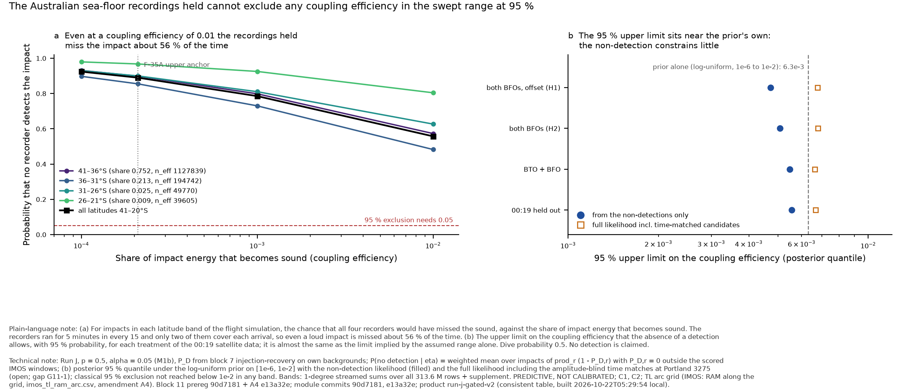
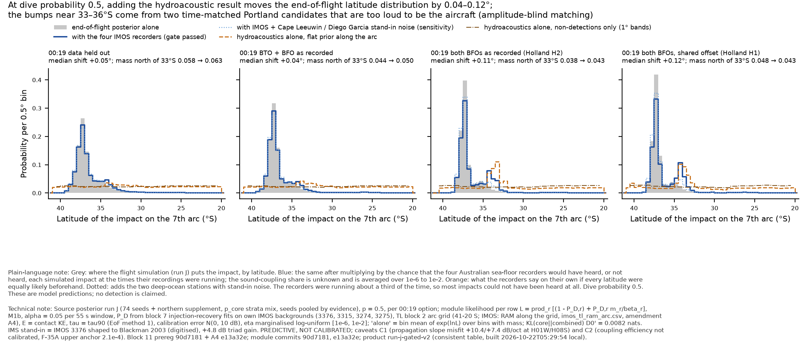

# Hydroacoustics: composition on run J — gated likelihood columns, upper limits on coupling, evidence three ways, Bayes factors per conditional, two-site coincidence (work order 2026-10-21, block 11)

*Hydroacoustic Module (composition track), 22 Oct 2026 ~07:00 UTC. Unattended overnight run. Pre-registration `prepare/composition_run_j/prereg.py` committed at `90d7181` BEFORE any likelihood value, limit, evidence or Bayes factor was computed; code at `dddfbd0` (+ this note's commit for amendments A2–A3, `tables.py`, `charts.py`). Data: `results-data/composition_run_j/` on `hypothesis/hydroacoustics` (tables, summaries, exchange README copy); the per-impact columns, per-seed streamed accumulators and 1-in-125 subsamples in `/Users/pete/Downloads/mh370-exchange/hydroacoustics/run-j-gated/` (6.5 GB, SHA256SUMS, READY). Charts: `hydroacoustics-composition-run-j-evidence.{png,pdf}`, `hydroacoustics-composition-run-j-limits.{png,pdf}`.*

**Status: PREDICTIVE, NOT CALIBRATED. No detection is claimed.** The columns written tonight are the module's first likelihood term; **they do not enter the composer until architecture rules** (ruling request in §8). Every number carries caveat C1 (propagation slope misfit, +10.4/+7.4 dB per octave at H01W/H08S; after the TL-recalibration track a source-term caveat) and C2 (coupling efficiency η not calibrated; swept over four decades, F-35A upper anchor 2.1 × 10⁻⁴). The gate of contract rule 2 is **passed at the four IMOS loggers only** (3376, 3315 Perth Canyon; 3274, 3275 Portland: own real backgrounds, block 7); H01W and H08S enter only as a labelled **SENSITIVITY** on proxy backgrounds (IMOS 3376 shaped to Blackman 2003 medians, digitised). Both Kadri times are carried: "text time 00:52:03" and "caption time 00:54:30".

## 1. Headline

**Plain words.** The four Australian sea-floor recorders were running for five minutes in every fifteen, and the sound of an impact would have been near or below their background noise unless a large share of the impact energy became sound. So the fact that nothing was heard tells us little: it removes about 6 % of the probability of the most likely impact region and moves the end-of-flight latitude estimate north by about a tenth of a degree. It cannot rule out any value of the sound-coupling share that we consider possible. Two faint signals on one Portland recorder line up in time with some simulated impacts, but they are far too loud to be the aircraft, and the method as pre-registered does not yet use loudness when it matches; where they matter (the Holland-type early-impact options at dive probability 1) the result is not to be trusted until that is fixed.

**Technical.** With the pre-registered form L_r = (1 − P_D,r) + P_D,r m_r/β_r (M1b, α = 0.05 per 55 s window, P_D from block 7 on own backgrounds, TL from the block 2 arc grid, E = contact KE, τ = tau90, calibration error N(0, 10 dB), η marginalised over log-uniform [10⁻⁶, 10⁻²]), the IMOS-gated term has log-evidence **ln Z = −0.066** against the run J core under 00:19 Held Out, p = 0.5 (−0.10 to −0.03 across p; D2 −0.10, D3 −0.05, D4 −0.08). Combined with the core it shifts the median impact latitude **+0.10°** (37.08 → 36.98°S) and the mass north of 33°S from **0.058 to 0.072**; KL(core ‖ combined) = **0.019 nats**. With the non-detection likelihood alone (time matches removed) the shift is +0.02°, 0.058 → 0.067, KL 0.002 nats. The **95 % upper limit on η from the non-detection** (posterior quantile under the declared prior) is **4.6 × 10⁻³** under D0′ p 0.5 (4.5–4.8 × 10⁻³ over p; D2 4.3, D3 3.7, D4 3.3 × 10⁻³), against **6.3 × 10⁻³ for the prior alone**; by 5° band under D0′: 4.5 (41–36°S), 4.7 (36–31), 6.0 (31–26), 6.4 (26–21), 6.5 × 10⁻³ (21–20°S). The **classical 95 % exclusion is not reached below η = 10⁻²** in any option, p or band: the weighted probability that all four loggers miss the impact is **0.37 at η = 10⁻², 0.61 at 10⁻³ and 0.75 at the anchor** (D0′ p 0.5). Bayes factors per conditional are all within |ln BF| ≤ 0.15 on the gated term (Kadri 306.18° row −0.004 at both times; Royer B −0.14; D1/D2 and poster boxes 1–3 carry no information, +0.07 = −ln Z; box 4 −0.02; Holland p = 1 against p = 0: −0.08 under D0′, −0.15 under D3/D4). The two-site pair H01W 00:52:04 × H08S 01:12:49 has an arc locus at 33.6°S whose implied impact time 00:31:41 sits inside the run J 50 % band (mass within ±1° 0.23), but the coupling needed for P_D = 0.5 at both proxies is **0.069, about 330 times the anchor**, and the pair's permutation p of 0.019 is what 36 pair tests produce by chance about half the time.

## 2. What was computed (as pre-registered; deviations in §9)

- **Likelihood per impact row** (prereg §2–7): product over the gated receivers whose predicted SOFAR arrival (impact time + WGS84 geodesic / 1.482 km/s) falls inside a window the block 5 searches actually scored (13–15 windows of 55 s per IMOS logger; 30/20 per digitised H01W/H08S panel); receivers without a scored window at the predicted time contribute no factor (P_D = 0, L_r = 1). P_D,r is the block 7 logistic fit in received level relative to the receiver's background median at α = 0.05, τ cell nearest tau90; m_r the Gaussian timing-kernel density over the pre-registered candidate table at p ≤ 0.05 (σ_t² = (d c_sd/c²)² + 3² + 2² s²), β_r = α / 55 s. Candidates matched at α = 0.05: **Portland 3275 01:20:35 (M1b p 0.008, η needed 30) and 01:07:47 (p 0.016, η needed 19)**; H01W 00:52:04 (p 0.043, η needed 0.026; sensitivity column only); H08S residual: none. Matching is amplitude-blind (gap G11-1, §7).
- **η:** fixed 10⁻³, 2.1 × 10⁻⁴, 10⁻⁴; marginal over the 41-point log-uniform grid [10⁻⁶, 10⁻²].
- **Columns** (float32, row-aligned with `impacts32.npy`, 74 seeds, 313,599,968 rows, NaN = not computed — 0 rows tonight; 0.0 = no information): `hydro-lnL-imos-eta1e-3`, `-eta2.1e-4`, `-eta1e-4`, `hydro-lnL-imos-margeta` (proposed default), `hydro-lnL-ims-proxy-margeta` (sensitivity). 92.6 % of rows have a predicted arrival inside at least one scored window (any receiver); 88.9 % have a non-zero IMOS-gated value. Weighted quantiles of `hydro-lnL-imos-margeta` under D0′ p 0.5: 1/5/50/95/99 % = −2.37 / −1.31 / −0.21 / +0.18 / +1.96; 56 % of the mass lies within |ln L| < 0.25. The fixed-η columns are wider (η = 10⁻³: 1 % quantile −8.6 per seed).
- **Streamed statistics** over all rows + the northern supplement (1,277,785 technique ≥ 1 rows, share 0.126 / 0.111 / 0.106 / 0.105 under D0′/D2/D3/D4; native weights at every p, gap G-W1): per option × p × 1° band × η grid, sums of w, w², w·Π(1 − P_D) and w·L for IMOS and IMS versions; per 0.5° bin w and w·exp(lnL_marg); per family; the lnL histogram. Kish ESS reproduces the windows note to 0.2 % (D0′ p 0.5: 1,334,115 against 1,336,700; D3 p 0.5: 5,672 against 5,671).
- **`lnL_gated` in `run-j/primary-tau-eof` stays 0.0** (unchanged).

## 3. 95 % upper limits on the coupling efficiency (non-detection at the IMOS loggers)

Two readings are given because they answer different questions. The **Bayesian** limit is the 95 % quantile of the η posterior under the declared log-uniform prior on [10⁻⁶, 10⁻²] with the non-detection likelihood Π_r(1 − P_D,r) averaged over the run J impacts; it is always finite and is dominated by the prior's upper bound when the data constrain little (the prior alone gives 6.3 × 10⁻³). The **classical** limit is the η at which the weighted probability of no detection falls to 0.05; it is "not reached below 10⁻²" everywhere tonight because the loggers' 34 % duty cycle alone leaves a loud impact unheard about 40 % of the time. The IMS-proxy columns add H01W/H08S on proxy backgrounds (PREDICTIVE for IMS).

**Table 1. 95 % upper limits on the coupling efficiency η from the non-detection (all latitudes 41–20°S), per 00:19 option and dive probability p; α = 0.05; IMOS gated (IMS-proxy version in the last two columns).** 'Bayes ND' = 95 % posterior quantile under the log-uniform prior on [1e-6, 1e-2] with the non-detection likelihood (the prior alone gives 6.3e-3); 'Bayes full' = the same with the full likelihood including time-matched candidates; 'classical' = η at which the weighted probability of no detection falls to 0.05; P(nd) = weighted probability of no detection at η = 1e-2 / 1e-3 / anchor 2.1e-4.

| Option | p | ESS | Bayes ND | Bayes full | classical | P(nd) 1e-2 | P(nd) 1e-3 | P(nd) anchor | IMS-proxy Bayes ND | IMS-proxy P(nd) 1e-2 |
|---|---|---|---|---|---|---|---|---|---|---|
| 00:19 Held Out (D0') | 0 | 954,219 | 4.8e-03 | 6.9e-03 | not reached below 1e-2 | 0.39 | 0.64 | 0.78 | 4.2e-03 | 0.30 |
| 00:19 Held Out (D0') | 0.5 | 1,334,042 | 4.6e-03 | 6.7e-03 | not reached below 1e-2 | 0.37 | 0.61 | 0.75 | 4.0e-03 | 0.28 |
| 00:19 Held Out (D0') | 1 | 932,891 | 4.5e-03 | 6.5e-03 | not reached below 1e-2 | 0.35 | 0.57 | 0.72 | 3.8e-03 | 0.25 |
| R600 BTO + BFO (D2) | 0 | 61,106 | 4.4e-03 | 6.8e-03 | not reached below 1e-2 | 0.34 | 0.59 | 0.74 | 3.7e-03 | 0.25 |
| R600 BTO + BFO (D2) | 0.5 | 107,224 | 4.3e-03 | 6.7e-03 | not reached below 1e-2 | 0.32 | 0.57 | 0.72 | 3.5e-03 | 0.23 |
| R600 BTO + BFO (D2) | 1 | 69,845 | 4.2e-03 | 6.5e-03 | not reached below 1e-2 | 0.31 | 0.54 | 0.70 | 3.4e-03 | 0.21 |
| both BFOs as recorded (D3) | 0 | 3,184 | 4.6e-03 | 7.2e-03 | not reached below 1e-2 | 0.38 | 0.64 | 0.79 | 3.3e-03 | 0.22 |
| both BFOs as recorded (D3) | 0.5 | 5,671 | 3.7e-03 | 6.9e-03 | not reached below 1e-2 | 0.25 | 0.47 | 0.63 | 2.5e-03 | 0.13 |
| both BFOs as recorded (D3) | 1 | 2,945 | 2.1e-03 | 6.4e-03 | not reached below 1e-2 | 0.11 | 0.29 | 0.47 | 1.1e-03 | 0.05 |
| both BFOs, shared start-up offset (D4) | 0 | 17,903 | 4.2e-03 | 7.1e-03 | not reached below 1e-2 | 0.31 | 0.54 | 0.69 | 2.9e-03 | 0.17 |
| both BFOs, shared start-up offset (D4) | 0.5 | 25,409 | 3.3e-03 | 6.8e-03 | not reached below 1e-2 | 0.20 | 0.40 | 0.57 | 2.1e-03 | 0.11 |
| both BFOs, shared start-up offset (D4) | 1 | 22,569 | 1.9e-03 | 6.5e-03 | not reached below 1e-2 | 0.10 | 0.27 | 0.44 | 1.0e-03 | 0.04 |

**Table 2. Upper limits per 5° latitude band, p = 0.5, α = 0.05, IMOS gated (IMS proxy beside).** Share = run J mass in the band under the option; ESS = Kish effective sample size in the band.

| Option | Band | share | ESS | Bayes ND | classical | P(nd) 1e-2 | P(nd) 1e-3 | P(nd) anchor | IMS-proxy Bayes ND | IMS-proxy P(nd) 1e-2 |
|---|---|---|---|---|---|---|---|---|---|---|
| 00:19 Held Out (D0') | 41–36°S | 0.7522 | 1,127,839 | 4.5e-03 | not reached below 1e-2 | 0.35 | 0.59 | 0.74 | 3.9e-03 | 0.26 |
| 00:19 Held Out (D0') | 36–31°S | 0.2128 | 194,742 | 4.7e-03 | not reached below 1e-2 | 0.39 | 0.63 | 0.78 | 4.1e-03 | 0.30 |
| 00:19 Held Out (D0') | 31–26°S | 0.0255 | 49,770 | 6.0e-03 | not reached below 1e-2 | 0.66 | 0.83 | 0.91 | 5.1e-03 | 0.47 |
| 00:19 Held Out (D0') | 26–21°S | 0.0093 | 39,605 | 6.4e-03 | not reached below 1e-2 | 0.79 | 0.92 | 0.96 | 5.7e-03 | 0.58 |
| 00:19 Held Out (D0') | 21–20°S | 0.0001 | 491 | 6.5e-03 | not reached below 1e-2 | 0.83 | 0.95 | 0.98 | 5.7e-03 | 0.60 |
| R600 BTO + BFO (D2) | 41–36°S | 0.7994 | 81,573 | 4.2e-03 | not reached below 1e-2 | 0.30 | 0.55 | 0.71 | 3.4e-03 | 0.21 |
| R600 BTO + BFO (D2) | 36–31°S | 0.1704 | 21,699 | 4.5e-03 | not reached below 1e-2 | 0.35 | 0.60 | 0.76 | 3.7e-03 | 0.26 |
| R600 BTO + BFO (D2) | 31–26°S | 0.0189 | 3,873 | 6.1e-03 | not reached below 1e-2 | 0.68 | 0.85 | 0.92 | 5.0e-03 | 0.45 |
| R600 BTO + BFO (D2) | 26–21°S | 0.0110 | 2,126 | 6.5e-03 | not reached below 1e-2 | 0.81 | 0.93 | 0.97 | 5.5e-03 | 0.56 |
| R600 BTO + BFO (D2) | 21–20°S | 0.0001 | 7 | 6.3e-03 | not reached below 1e-2 | 0.76 | 0.94 | 0.98 | 5.1e-03 | 0.48 |
| both BFOs as recorded (D3) | 41–36°S | 0.8104 | 4,222 | 3.7e-03 | not reached below 1e-2 | 0.25 | 0.47 | 0.63 | 2.4e-03 | 0.13 |
| both BFOs as recorded (D3) | 36–31°S | 0.1644 | 1,383 | 3.3e-03 | not reached below 1e-2 | 0.21 | 0.43 | 0.61 | 2.4e-03 | 0.13 |
| both BFOs as recorded (D3) | 31–26°S | 0.0167 | 322 | 5.3e-03 | not reached below 1e-2 | 0.51 | 0.74 | 0.86 | 3.8e-03 | 0.27 |
| both BFOs as recorded (D3) | 26–21°S | 0.0083 | 226 | 6.1e-03 | not reached below 1e-2 | 0.70 | 0.87 | 0.94 | 5.0e-03 | 0.45 |
| both BFOs as recorded (D3) | 21–20°S | 0.0000 | 63 | 6.6e-03 | not reached below 1e-2 | 0.83 | 0.93 | 0.96 | 5.6e-03 | 0.57 |
| both BFOs, shared start-up offset (D4) | 41–36°S | 0.8118 | 23,389 | 3.2e-03 | not reached below 1e-2 | 0.19 | 0.39 | 0.56 | 2.0e-03 | 0.10 |
| both BFOs, shared start-up offset (D4) | 36–31°S | 0.1524 | 6,768 | 3.1e-03 | not reached below 1e-2 | 0.19 | 0.39 | 0.57 | 2.2e-03 | 0.12 |
| both BFOs, shared start-up offset (D4) | 31–26°S | 0.0254 | 86 | 4.6e-03 | not reached below 1e-2 | 0.37 | 0.59 | 0.76 | 3.1e-03 | 0.20 |
| both BFOs, shared start-up offset (D4) | 26–21°S | 0.0103 | 436 | 5.6e-03 | not reached below 1e-2 | 0.56 | 0.79 | 0.90 | 4.1e-03 | 0.31 |
| both BFOs, shared start-up offset (D4) | 21–20°S | 0.0001 | 66 | 5.5e-03 | not reached below 1e-2 | 0.55 | 0.75 | 0.86 | 4.2e-03 | 0.31 |

**Table 3. False-alarm-level sensitivity (D0', p = 0.5, all latitudes, IMOS gated).**

| α | Bayes ND | Bayes full | P(nd) 1e-2 | P(nd) anchor | ln Z_hydro (evidence, η marginal) |
|---|---|---|---|---|---|
| 0.05 | 4.6e-03 | 6.7e-03 | 0.37 | 0.75 | -0.0656 |
| 0.3 | 3.8e-03 | 6.9e-03 | 0.23 | 0.55 | -0.0540 |
| 0.01 | 5.0e-03 | 8.4e-03 | 0.45 | 0.82 | +0.2580 |

## 4. Evidence three ways (ARCHITECTURE rule 5 / composer §0)

Reading Table 4: at p ≤ 0.5 the combined distribution differs from the core by ≤ 0.3° in median latitude and ≤ 0.02 in the mass north of 33°S under every option. **At p = 1 under D3 and D4 the median shifts by +1.4° to +1.5° and KL rises to 0.31 nats; Table 4b shows that this comes entirely from the two time-matched Portland 3275 candidates** (early Holland-type impacts near 33–36°S arrive at Portland at 01:07–01:21), not from the non-detections: with the non-detection likelihood alone every shift is within ±0.05° and KL ≤ 0.007 nats. Both candidates need η ≈ 19–30 — louder than any impact could be at Portland — so the amplitude-blind form (G11-1) over-credits them; this is the reason the ruling request offers an amplitude-aware or non-detection-only default. The "alone on a flat arc prior" distribution is nearly uniform with a mild preference north of 33°S (where nothing is detectable, L ≈ 1) and the same two spikes.

**Table 4. Evidence three ways (α = 0.05, η marginalised): the module's log-evidence against the core, the median impact latitude and the mass north of 33°S for the core alone, combined with the module, and the module alone on a flat prior along the arc; KL(core ‖ combined).**

| Option | p | receivers | ln Z_hydro | median lat core | combined | alone | shift (°) | north of 33°S core | combined | alone | KL (nats) |
|---|---|---|---|---|---|---|---|---|---|---|---|
| 00:19 Held Out (D0') | 0 | IMOS gated | -0.0273 | -37.08 | -37.02 | -30.87 | +0.063 | 0.0579 | 0.0670 | 0.623 | 0.0130 |
| 00:19 Held Out (D0') | 0 | IMS proxy + IMOS | -0.2067 | -37.08 | -37.04 | -30.35 | +0.048 | 0.0579 | 0.0656 | 0.634 | 0.0063 |
| 00:19 Held Out (D0') | 0.5 | IMOS gated | -0.0656 | -37.08 | -36.98 | -30.87 | +0.096 | 0.0582 | 0.0723 | 0.629 | 0.0192 |
| 00:19 Held Out (D0') | 0.5 | IMS proxy + IMOS | -0.2572 | -37.08 | -37.01 | -30.32 | +0.068 | 0.0582 | 0.0692 | 0.638 | 0.0096 |
| 00:19 Held Out (D0') | 1 | IMOS gated | -0.1057 | -37.08 | -36.93 | -30.87 | +0.148 | 0.0585 | 0.0781 | 0.635 | 0.0269 |
| 00:19 Held Out (D0') | 1 | IMS proxy + IMOS | -0.3107 | -37.08 | -36.98 | -30.29 | +0.096 | 0.0585 | 0.0732 | 0.642 | 0.0137 |
| R600 BTO + BFO (D2) | 0 | IMOS gated | -0.0729 | -37.14 | -37.08 | -31.17 | +0.059 | 0.0428 | 0.0533 | 0.618 | 0.0213 |
| R600 BTO + BFO (D2) | 0 | IMS proxy + IMOS | -0.2635 | -37.14 | -37.10 | -30.48 | +0.040 | 0.0428 | 0.0528 | 0.632 | 0.0109 |
| R600 BTO + BFO (D2) | 0.5 | IMOS gated | -0.1038 | -37.14 | -37.06 | -31.20 | +0.076 | 0.0437 | 0.0597 | 0.627 | 0.0263 |
| R600 BTO + BFO (D2) | 0.5 | IMS proxy + IMOS | -0.3016 | -37.14 | -37.09 | -30.50 | +0.047 | 0.0437 | 0.0564 | 0.635 | 0.0127 |
| R600 BTO + BFO (D2) | 1 | IMOS gated | -0.1359 | -37.13 | -37.04 | -31.22 | +0.093 | 0.0447 | 0.0665 | 0.637 | 0.0324 |
| R600 BTO + BFO (D2) | 1 | IMS proxy + IMOS | -0.3415 | -37.13 | -37.08 | -30.50 | +0.055 | 0.0447 | 0.0604 | 0.640 | 0.0146 |
| both BFOs as recorded (D3) | 0 | IMOS gated | +0.0166 | -37.32 | -37.27 | -32.08 | +0.054 | 0.0370 | 0.0399 | 0.564 | 0.0359 |
| both BFOs as recorded (D3) | 0 | IMS proxy + IMOS | -0.2060 | -37.32 | -37.31 | -30.82 | +0.010 | 0.0370 | 0.0405 | 0.612 | 0.0091 |
| both BFOs as recorded (D3) | 0.5 | IMOS gated | -0.0527 | -37.23 | -37.06 | -32.94 | +0.170 | 0.0385 | 0.0520 | 0.505 | 0.1465 |
| both BFOs as recorded (D3) | 0.5 | IMS proxy + IMOS | -0.3767 | -37.23 | -37.18 | -31.25 | +0.049 | 0.0385 | 0.0510 | 0.599 | 0.0436 |
| both BFOs as recorded (D3) | 1 | IMOS gated | -0.1295 | -37.17 | -35.80 | -33.17 | +1.369 | 0.0400 | 0.0664 | 0.446 | 0.3127 |
| both BFOs as recorded (D3) | 1 | IMS proxy + IMOS | -0.5896 | -37.17 | -37.05 | -32.01 | +0.119 | 0.0400 | 0.0668 | 0.575 | 0.0997 |
| both BFOs, shared start-up offset (D4) | 0 | IMOS gated | -0.0068 | -37.24 | -37.12 | -33.39 | +0.122 | 0.0468 | 0.0426 | 0.461 | 0.1036 |
| both BFOs, shared start-up offset (D4) | 0 | IMS proxy + IMOS | -0.2718 | -37.24 | -37.24 | -31.82 | -0.004 | 0.0468 | 0.0460 | 0.552 | 0.0277 |
| both BFOs, shared start-up offset (D4) | 0.5 | IMOS gated | -0.0787 | -37.18 | -36.89 | -33.36 | +0.292 | 0.0480 | 0.0514 | 0.447 | 0.1939 |
| both BFOs, shared start-up offset (D4) | 0.5 | IMS proxy + IMOS | -0.4335 | -37.18 | -37.12 | -32.03 | +0.053 | 0.0480 | 0.0557 | 0.550 | 0.0610 |
| both BFOs, shared start-up offset (D4) | 1 | IMOS gated | -0.1555 | -37.14 | -35.65 | -33.19 | +1.493 | 0.0491 | 0.0614 | 0.461 | 0.3110 |
| both BFOs, shared start-up offset (D4) | 1 | IMS proxy + IMOS | -0.6244 | -37.14 | -37.02 | -31.35 | +0.121 | 0.0491 | 0.0692 | 0.584 | 0.1045 |

**Table 4b. The same with the non-detection likelihood only (amplitude-blind time matches removed; 1° resolution).**

| Option | p | receivers | ln Z (ND only) | median lat core | combined | shift (°) | north of 33°S core | combined | KL (nats) |
|---|---|---|---|---|---|---|---|---|---|
| 00:19 Held Out (D0') | 0 | IMOS gated | -0.2496 | -37.10 | -37.09 | +0.011 | 0.0578 | 0.0649 | 0.0011 |
| 00:19 Held Out (D0') | 0 | IMS proxy + IMOS | -0.3267 | -37.10 | -37.08 | +0.019 | 0.0578 | 0.0652 | 0.0020 |
| 00:19 Held Out (D0') | 0.5 | IMOS gated | -0.2788 | -37.10 | -37.08 | +0.021 | 0.0581 | 0.0667 | 0.0018 |
| 00:19 Held Out (D0') | 0.5 | IMS proxy + IMOS | -0.3674 | -37.10 | -37.06 | +0.034 | 0.0581 | 0.0673 | 0.0034 |
| 00:19 Held Out (D0') | 1 | IMOS gated | -0.3091 | -37.10 | -37.07 | +0.030 | 0.0584 | 0.0686 | 0.0025 |
| 00:19 Held Out (D0') | 1 | IMS proxy + IMOS | -0.4101 | -37.10 | -37.05 | +0.050 | 0.0584 | 0.0697 | 0.0051 |
| R600 BTO + BFO (D2) | 0 | IMOS gated | -0.2912 | -37.17 | -37.17 | +0.007 | 0.0428 | 0.0507 | 0.0016 |
| R600 BTO + BFO (D2) | 0 | IMS proxy + IMOS | -0.3777 | -37.17 | -37.16 | +0.012 | 0.0428 | 0.0511 | 0.0024 |
| R600 BTO + BFO (D2) | 0.5 | IMOS gated | -0.3134 | -37.17 | -37.16 | +0.010 | 0.0437 | 0.0526 | 0.0019 |
| R600 BTO + BFO (D2) | 0.5 | IMS proxy + IMOS | -0.4098 | -37.17 | -37.16 | +0.016 | 0.0437 | 0.0532 | 0.0030 |
| R600 BTO + BFO (D2) | 1 | IMOS gated | -0.3362 | -37.17 | -37.16 | +0.013 | 0.0446 | 0.0546 | 0.0023 |
| R600 BTO + BFO (D2) | 1 | IMS proxy + IMOS | -0.4431 | -37.17 | -37.15 | +0.021 | 0.0446 | 0.0554 | 0.0036 |
| both BFOs as recorded (D3) | 0 | IMOS gated | -0.2500 | -37.31 | -37.33 | -0.016 | 0.0369 | 0.0406 | 0.0010 |
| both BFOs as recorded (D3) | 0 | IMS proxy + IMOS | -0.3693 | -37.31 | -37.32 | -0.009 | 0.0369 | 0.0412 | 0.0012 |
| both BFOs as recorded (D3) | 0.5 | IMOS gated | -0.4056 | -37.29 | -37.30 | -0.006 | 0.0384 | 0.0466 | 0.0029 |
| both BFOs as recorded (D3) | 0.5 | IMS proxy + IMOS | -0.5490 | -37.29 | -37.29 | +0.003 | 0.0384 | 0.0479 | 0.0041 |
| both BFOs as recorded (D3) | 1 | IMOS gated | -0.5962 | -37.27 | -37.26 | +0.015 | 0.0400 | 0.0552 | 0.0034 |
| both BFOs as recorded (D3) | 1 | IMS proxy + IMOS | -0.7758 | -37.27 | -37.24 | +0.032 | 0.0400 | 0.0583 | 0.0052 |
| both BFOs, shared start-up offset (D4) | 0 | IMOS gated | -0.3397 | -37.26 | -37.29 | -0.028 | 0.0467 | 0.0515 | 0.0029 |
| both BFOs, shared start-up offset (D4) | 0 | IMS proxy + IMOS | -0.4722 | -37.26 | -37.28 | -0.022 | 0.0467 | 0.0518 | 0.0031 |
| both BFOs, shared start-up offset (D4) | 0.5 | IMOS gated | -0.4768 | -37.25 | -37.26 | -0.011 | 0.0479 | 0.0587 | 0.0041 |
| both BFOs, shared start-up offset (D4) | 0.5 | IMS proxy + IMOS | -0.6316 | -37.25 | -37.25 | -0.001 | 0.0479 | 0.0599 | 0.0054 |
| both BFOs, shared start-up offset (D4) | 1 | IMOS gated | -0.6343 | -37.23 | -37.22 | +0.014 | 0.0491 | 0.0683 | 0.0047 |
| both BFOs, shared start-up offset (D4) | 1 | IMS proxy + IMOS | -0.8193 | -37.23 | -37.20 | +0.032 | 0.0491 | 0.0712 | 0.0068 |

**Table 5. Families (p = 0.5): share, ESS and the module's log-evidence per family (η marginal, α = 0.05).**

| Option | family | share | ESS | ln Z IMOS gated | ln Z IMS proxy |
|---|---|---|---|---|---|
| 00:19 Held Out (D0') | A1 | 0.1669 | 440,183 | -0.2363 | -0.6731 |
| 00:19 Held Out (D0') | A2 | 0.3381 | 495,266 | -0.0628 | -0.2211 |
| 00:19 Held Out (D0') | B | 0.4941 | 536,307 | -0.0159 | -0.1709 |
| 00:19 Held Out (D0') | outside B | 0.0008 | 3,735 | 0.0004 | -0.5509 |
| R600 BTO + BFO (D2) | A1 | 0.2300 | 52,612 | -0.3600 | -0.7375 |
| R600 BTO + BFO (D2) | A2 | 0.2360 | 33,201 | -0.0382 | -0.1985 |
| R600 BTO + BFO (D2) | B | 0.5329 | 42,768 | -0.0386 | -0.2019 |
| R600 BTO + BFO (D2) | outside B | 0.0011 | 579 | -0.0720 | -0.5578 |
| both BFOs as recorded (D3) | A1 | 0.0912 | 411 | -0.2102 | -0.7249 |
| both BFOs as recorded (D3) | A2 | 0.4007 | 4,662 | -0.0908 | -0.3772 |
| both BFOs as recorded (D3) | B | 0.5071 | 2,115 | 0.0022 | -0.3242 |
| both BFOs as recorded (D3) | outside B | 0.0010 | 14 | -0.3787 | -0.6961 |
| both BFOs, shared start-up offset (D4) | A1 | 0.2488 | 2,290 | -0.0608 | -0.6816 |
| both BFOs, shared start-up offset (D4) | A2 | 0.3439 | 36,730 | -0.1322 | -0.3757 |
| both BFOs, shared start-up offset (D4) | B | 0.4054 | 18,124 | -0.0458 | -0.3513 |
| both BFOs, shared start-up offset (D4) | outside B | 0.0019 | 100 | -0.1655 | -0.7227 |

## 5. Bayes factors per conditional hypothesis

Likelihood = the gated IMOS term marginalised over η for a fixed source (lat, lon, t_impact), with E and τ resampled from run J rows within ±1° of the hypothesis latitude (D0′ p 0.5 weights; 20,000 draws) and the calibration error drawn; BF against the run J marginal Z = Σ w exp(lnL) under D0′ p 0.5 (ln Z = −0.066). A hypothesis whose arrivals fall outside every scored window carries no information and gets ln BF = −ln Z = +0.066 by construction. Prior statements: run J D0′ mass within 100 km of the locus, and the implied impact time against 00:19:29.

- **Kadri 306.18° row** (locus 25.8°S 101.4°E; implied impact 00:34:14 at the text time, 00:36:41 at the caption time; run J mass within 100 km 0.022): only Perth Canyon 3376 is scored at the predicted time; P(no detection) 0.93; **ln BF −0.004 at both times — uninformative on the gated term.** The IMS-proxy column gives +1.38 at the text time (the H01W 00:52:04 candidate matches) and +0.10 at the caption time (00:54:29, p 0.123, is above α): **circular**, because the hypothesis was built from that candidate, and labelled so.
- **Royer B** (35.224°S 99.922°E, 00:21:30.6; 493 km off the arc, mass within 100 km < 10⁻⁶): 3376, 3274, H01W, H08S scored; ln BF −0.14 (IMS proxy −0.08). **D1/D2** (01:04:39 / 01:06:05): arrivals after every scored window — no information (+0.07); on timing they are outside the run J 99 % impact-time band (windows note).
- **Poster panel (a) boxes** as the declared "source before 00:19:29 or off the arc" row (nearest arc locus 28.0°S, 1,563 km from H01W): implied impact times 00:11:22, 00:13:34, 00:15:40, 00:18:34 — all **before 00:19:29**, prior 0 under the 00:19 log-on; scored as what-ifs: boxes 1–3 no information (+0.07), box 4 (3376 scored) −0.02.
- **Holland-type unarrested descent** (p = 1 against p = 0): ln BF −0.08 (D0′), −0.06 (D2), −0.15 (D3), −0.15 (D4) on the gated term at α 0.05; non-detection only −0.06 / −0.05 / −0.35 / −0.30; the α = 0.01 values (−0.18 to −0.78) are driven by the 3275 match (β five times smaller). Weak evidence against p = 1 at most, and under D3/D4 subject to G11-1.

**Table 6. Bayes factors per conditional hypothesis (ln BF against the run J marginal under D0', p = 0.5; α = 0.05; η marginalised).** Prior column: run J D0' mass within 100 km of the locus. The IMS-proxy column for the Kadri rows is CIRCULAR (the hypothesis was built from the H01W 00:52:04 candidate) and is a sensitivity only.

| Hypothesis | implied impact (UTC) | vs 00:19:29 | prior mass < 100 km | receivers scored | P(nd) IMOS | L IMOS | ln BF IMOS gated | ln BF IMS proxy | ln BF IMOS at α 0.3 / 0.01 |
|---|---|---|---|---|---|---|---|---|---|
| Kadri 306.18 deg row, text time 00:52:03, locus 25.8 S 101.4 E | 00:34:14 | after | 0.0224 | 3376,H01W,H08S | 0.932 | 0.932 | -0.004 | +1.382 | -0.162 / -0.296 |
| Kadri 306.18 deg row, caption time 00:54:30, locus 25.8 S 101.4 E | 00:36:41 | after | 0.0224 | 3376,H01W,H08S | 0.932 | 0.932 | -0.004 | +0.102 | -0.162 / -0.297 |
| Royer OHASISBIO event B as source | 00:21:30 | after | 0.0000 | 3376,3274,H01W,H08S | 0.813 | 0.813 | -0.142 | -0.078 | -0.467 / -0.388 |
| Royer OHASISBIO event D1 as source | 01:04:39 | after | 0.0000 | none (arrivals outside every scored window: no information) | 1.000 | 1.000 | +0.066 | +0.257 | +0.054 / -0.258 |
| Royer OHASISBIO event D2 as source | 01:06:05 | after | 0.0000 | none (arrivals outside every scored window: no information) | 1.000 | 1.000 | +0.066 | +0.257 | +0.054 / -0.258 |
| poster (a) box 1: 'source before 00:19:29 or off the arc' row, nearest arc locus 28.0 S | 00:11:22 | BEFORE 00:19:29 (prior 0 under the 00:19 log-on; what-if only) | 0.0189 | H01W | 1.000 | 1.000 | +0.066 | +0.176 | +0.054 / -0.258 |
| poster (a) box 2: 'source before 00:19:29 or off the arc' row, nearest arc locus 28.0 S | 00:13:34 | BEFORE 00:19:29 (prior 0 under the 00:19 log-on; what-if only) | 0.0189 | H01W | 1.000 | 1.000 | +0.066 | +0.177 | +0.054 / -0.258 |
| poster (a) box 3: 'source before 00:19:29 or off the arc' row, nearest arc locus 28.0 S | 00:15:40 | BEFORE 00:19:29 (prior 0 under the 00:19 log-on; what-if only) | 0.0189 | H01W | 1.000 | 1.000 | +0.066 | +0.177 | +0.054 / -0.258 |
| poster (a) box 4: 'source before 00:19:29 or off the arc' row, nearest arc locus 28.0 S | 00:18:34 | BEFORE 00:19:29 (prior 0 under the 00:19 log-on; what-if only) | 0.0189 | 3376,H01W | 0.919 | 0.919 | -0.019 | +0.131 | -0.190 / -0.306 |

**Table 7. Holland-type unarrested descent: ln BF (p = 1 against p = 0) from the module's evidence, per option and α (η marginal); 'ND only' uses the non-detection likelihood alone.**

| Option | α | ln BF p1:p0 IMOS gated | ND only | IMS proxy | ln BF p0.5:p0 |
|---|---|---|---|---|---|
| 00:19 Held Out (D0') | 0.05 | -0.078 | -0.059 | -0.104 | -0.038 |
| 00:19 Held Out (D0') | 0.3 | +0.006 | -0.068 | -0.113 | +0.003 |
| 00:19 Held Out (D0') | 0.01 | -0.179 | -0.048 | -0.131 | -0.085 |
| R600 BTO + BFO (D2) | 0.05 | -0.063 | -0.045 | -0.078 | -0.031 |
| R600 BTO + BFO (D2) | 0.3 | +0.012 | -0.052 | -0.077 | +0.006 |
| R600 BTO + BFO (D2) | 0.01 | -0.146 | -0.036 | -0.101 | -0.070 |
| both BFOs as recorded (D3) | 0.05 | -0.146 | -0.346 | -0.384 | -0.069 |
| both BFOs as recorded (D3) | 0.3 | -0.348 | -0.439 | -0.828 | -0.156 |
| both BFOs as recorded (D3) | 0.01 | -0.777 | -0.270 | -0.559 | -0.309 |
| both BFOs, shared start-up offset (D4) | 0.05 | -0.149 | -0.295 | -0.353 | -0.072 |
| both BFOs, shared start-up offset (D4) | 0.3 | -0.341 | -0.373 | -0.790 | -0.157 |
| both BFOs, shared start-up offset (D4) | 0.01 | -0.623 | -0.228 | -0.453 | -0.265 |

## 6. Two-site coincidence summary

**Table 8. Two-site coincidence summary.**

| Item | Value |
|---|---|
| Pair | H01W 00:52:04 (M1b p 0.043, text time box) x H08S 01:12:49 (M1b p 0.039, p_B 0.30; raw panel, airgun-dominated: G-S9 variant) |
| Lag | 1245 s (pre-registered interval [809, 1536] s) |
| Pair count against chance | 19 against 8.8 expected; held-span permutation p = 0.019 |
| Pair tests performed | 36; probability that at least one reaches p ≤ 0.019 by chance ≈ 0.51 |
| η needed for the rows (searches, median impact) | H01W 0.026, H08S 1.5 (F-35A anchor 2.1e-4) |
| Arc locus with this lag | 33.56°S 94.51°E; implied impact 00:31:41 (after); run J D0' mass within ±1° of the latitude 0.226; median E 1.08 GJ, τ 3.3 s |
| η for P_D(H01W)·P_D(H08S) = 0.5 / 0.05 (proxy fits, α 0.05, +4.8 dB) | 0.0692 / 0.00676 (α 0.3: 0.0117 / 0.000295) |
| P_D at the anchor, α 0.05 | H01W 0.030, H08S 0.004, both 0.0001 |
| Arc locus with this lag | 20.50°S 104.26°E; implied impact 00:31:04 (after); run J D0' mass within ±1° of the latitude 0.001; median E 1.05 GJ, τ 3.2 s |
| η for P_D(H01W)·P_D(H08S) = 0.5 / 0.05 (proxy fits, α 0.05, +4.8 dB) | 0.24 / 0.024 (α 0.3: 0.0457 / 0.00115) |
| P_D at the anchor, α 0.05 | H01W 0.003, H08S 0.004, both 0.0000 |

**Table 9. Kish ESS per option / p (streamed over all rows + supplement; subsample 1-in-125 beside).**

| Option / p | ESS streamed | ESS subsample |
|---|---|---|
| D0/p0 | 954,123 | 22,117 |
| D0/p0.5 | 1,334,115 | 22,121 |
| D0/p1 | 933,018 | 22,124 |
| D2/p0 | 61,113 | 7,887 |
| D2/p0.5 | 107,236 | 7,887 |
| D2/p1 | 69,853 | 7,887 |
| D3/p0 | 3,185 | 884 |
| D3/p0.5 | 5,672 | 884 |
| D3/p1 | 2,945 | 884 |
| D4/p0 | 17,905 | 2,569 |
| D4/p0.5 | 25,411 | 2,569 |
| D4/p1 | 22,570 | 2,569 |

The pair's lag selects an arc locus at 33.6°S 94.5°E with implied impact 00:31:41, inside the run J 50 % impact-time band and with 0.23 of the D0′ mass within ±1° of that latitude: on geometry and timing the pair is consistent with a typical run J impact. On level it is not: with the proxy P_D fits, +4.8 dB triad gain and the median E (1.1 GJ) and τ (3.3 s) at that latitude, P_D(H01W)·P_D(H08S) reaches 0.5 only at η = 0.069 and 0.05 at η = 0.0068 (α 0.05); at the F-35A anchor P_D is 0.030 at H01W, 0.004 at H08S and 10⁻⁴ for both. The H08S row is a raw-panel row typical of its own airgun-dominated panel (p_B 0.30; searches gap G-S9); the residual detectors leave no H08S candidate. With 36 pair tests, a smallest permutation p of 0.019 arises by chance with probability about 0.5. **No coincidence supports a claim.** A second, formal locus at 20.5°S holds 0.001 of the mass and is listed for completeness.

## 7. COVERAGE

- **(a) Feasible set.** Every run J impact (74 seeds, 313.6 M rows, 00:19:37–01:15:56, 44.5–10.4°S over all strata) plus the northern supplement (1.28 M rows, to 20°S and beyond); the four 00:19 options and p ∈ {0, 0.5, 1}; the four families; coupling over [10⁻⁶, 10⁻²] (prior) with three fixed values; the conditional sources (Kadri locus, Royer B/D1/D2, poster boxes) as fixed points.
- **(b) Model's reach.** Receivers with P_D: IMOS 3376/3315/3274/3275 (gate passed), H01W/H08S (proxy, sensitivity); **no factor** from H08N (blocked), 3250 (no information), the OHASISBIO sites, infrasound, or the **AGW branch (not searchable with the data held, G-S1)**. SOFAR arrival by geodesic at 1.482 km/s (no refraction or path lengthening); TL latitude-only on the offset-0 arc line (cross-arc offset not used, G-TL-X; IMOS RAM correction extrapolated on 10–33 % of open rows, G-TL1; 3376 terminal-profile sensitivity ±9.6 dB in two bands, G-TL2); η range 10⁻⁶–10⁻² (the brief's four decades; 10⁻⁸–10⁻⁶ of block 7 would only add non-detection-free mass); bands 41–20°S with clamped TL south of 41°S (< 0.2 % of mass); single-hydrophone P_D with model-matched templates (G7-8); one-pole f⁻² source, k = 1 in the τ mapping; **amplitude-blind matching (G11-1)**; attitude enters no value.
- **(c) Proposal's coverage (Kish ESS, streamed, mixture incl. supplement).** D0′: 954k / 1.33 M / 933k (p 0 / 0.5 / 1); D2: 61k / 107k / 70k; D3: 3.2k / 5.7k / 2.9k; D4: 17.9k / 25.4k / 22.6k. Per family at p 0.5 (Table 5): D0′ A1 440k, A2 495k, B 536k, outside-B 3.7k; D3 A1 411 (thin), outside-B 14 (not estimable); D4 A1 2.3k. Per 5° band at p 0.5 (Table 2): D0′ 1.13 M / 195k / 50k / 40k / 491 (41–36 … 21–20°S); D3 4.2k / 1.4k / 322 / 226 / 63; D4 23k / 6.8k / 86 / 436 / 66. **Bands north of 26°S under D3/D4 and the 21–20°S band under every option are not estimable to better than a factor of about 2; D3 at p = 1 (ESS 2,945) is thin; "outside B" is not estimable under D3.** The per-row NaN count is 0; 11.1 % of rows have no scored window at any gated receiver and carry 0.0 (the weighted share was not computed).
- **Gaps carried in, with status.** TL grid: G-TL1 open (RAM along the grid for IMOS receivers; a RAM-grid product appeared in the exchange tonight, `run-j-imos-ram-grid`, not yet consumed), G-TL2 open, G-TL-X open (latitude-only chain), G-N2/K5 open (ridge rows kept, flagged). Injection: G7-1 closed for the statistics (supplement included; its τ is a declared stand-in, G11-3), G7-2 open (one profile per path), G7-3 open (AGW not injected), G7-4 closed (per-family ln Z in Table 5), G7-5 open (co-located IMOS loggers differ by 4–27 dB in TL; the any-receiver product is less exposed), G7-6 open, G7-7 open (H01W proxy conservative, H08S proxy optimistic on 8 March), G7-8 open (model-matched templates), G7-9 open (±3 dB absolute IMOS level), G7-10 closed (arc grid replaces the clamped table). Searches: G-S1 open (AGW), G-S2 open (digitised panels only), G-S3 permanent (no IMOS bearing), G-S4 open (3315/3275 nulls are stand-ins), G-S5 superseded (η needed now quoted from the arc grid pass A; unchanged), G-S6 closed for this block (permutation null used), G-S7 open (geometry sample strata), G-S8 labelled, G-S9 applied (H08S raw rows excluded from m_r). Windows: G-W1 open (supplement not re-weighted for p ≠ 0.5), G-W2 reported (D3 thin), G-W3 flagged, G-W4 open (mixture conditional on the waypoints family, 99.8 %), G-W5 n/a (AGW not used), G-W6 covered by σ_clock = 2 s (declared allowance, not a correction). TL recalibration / weak signal: G23 open (EW0112 absolute level needs a unit-consistent measured level), G4 open (F-35A spectrum absent from Brown 2026), G5 open (bands below 6.3 Hz and the AGW branch outside every calibration span). **New tonight:** **G11-1** amplitude-blind matching (fix: an amplitude kernel on the candidate's excess level against the predicted level, or a non-detection-only column; pre-register as an amendment); **G11-2** 10 of 18 free-stratum seeds (0.13 % of the mixture mass) carry only the marginalised IMOS column (disk floor; top-up recipe in the README); **G11-3** the supplement's τ is a log-normal stand-in through the run J tau90 quantiles (the reduced file carries no tau90); **G11-4** IMOS clock drift not corrected (σ_clock allowance only); **G11-5** the 55 s (searches) against 60 s (injection) window mismatch, ≤ 0.4 dB in threshold.
- **Parameter bounds with sources.** α 0.05 primary (13 Oct ruling, report level; 0.3 and 0.01 sensitivities); β = α/55 s (searches window); c 1.482 ± 0.006 km/s (module standard); σ_inj 3 s (block 7 errors.csv), σ_clock 2 s (declared); η prior [10⁻⁶, 10⁻²] (task; brief four decades); fixed η 10⁻³, 2.1 × 10⁻⁴ (Brown et al. 2026 F-35A anchor), 10⁻⁴; calibration error N(0, 10 dB) (module amendment 2); triad gain 4.8 dB (audit F9); τ clip 0.02–30 s; ρc = 1025 × 1500; TL arc grid 41–20°S (block 2, fc825c0); P_D fits (block 7, d32b14c); candidates and windows (block 5, 7561cc5); weights (run_j_windows.ln_weights, EoF total q = 1/3 cell; p_core 0.9982/0.0013/0.0003/0.0002).

## 8. Ruling request (architecture, composer, Pete)

May the IMOS-gated, η-marginalised term `hydro-lnL-imos-margeta` enter the composer as the module's likelihood (default), with `hydro-lnL-ims-proxy-margeta` as the labelled sensitivity? The module's own recommendation, given §4: **either (a) admit the column as written with the G11-1 label and read the D3/D4 p = 1 shifts as not yet trustworthy, or (b) wait one amendment for an amplitude-aware match (or a non-detection-only column), which this note shows changes nothing at p ≤ 0.5 under D0′/D2 (shift ≤ 0.1°) and removes the 1.4–1.5° shifts under D3/D4 at p = 1.** Until ruled, the composer default remains `lnL_gated = 0.0`.

## 9. Deviations from the task text and amendments (declared)

1. Primary false-alarm level α = 0.05 (report level) rather than the screen level 0.3 named in the task; 0.3 and 0.01 are reported as sensitivities (Table 3). Reason in prereg §3.
2. H08S candidates for m_r are the suppressed-residual rows only (none at α ≤ 0.3), following searches gap G-S9; the raw-panel row 01:12:49 appears in the coincidence table only.
3. Amendment A1 (before any seed ran): E read from the tau90 sidecar's `energy_transferred_j` (the impacts32 column is NaN in run J); verified equal to 0.5 m v² to 6 × 10⁻⁸ on three seeds, so no value changed. Chunk size 1 M → 500 k rows.
4. Amendment A2: `B11_TOPUP=1` re-run mode for seeds short-written while another process held the disk below the 20 GiB floor; 4 of 14 such seeds were topped up (waypoints 21–24); 10 free-stratum seeds (G11-2) still carry only the marginalised IMOS column. The free stratum holds 0.13 % of the mixture mass.
5. Amendment A3: the merged subsample is not written to the exchange (1.1 GB duplicate); the per-seed subsamples remain. The exchange product is 6.5 GB against the task's 6 GB figure (the five full columns alone would be 6.27 GB; declared in the pre-registration).
6. The supplement's τ is a stand-in (G11-3); the supplement enters the statistics, not the columns (no row alignment exists for it).
7. Attitude (`attitude_v1.npz`) enters no value (the chain's coupling has no attitude dependence; per_impact_lnl amendment 8c).
8. Compute: 18,860 CPU-seconds in 4 single-thread processes, 86 min wall under machine load averages of 100–470 from parallel tracks; no compute slot was requested (the task budget of 4 processes was kept).

## 10. Files

- Module branch `hypothesis/hydroacoustics`: `prepare/composition_run_j/{prereg.py, common.py, worker.py, driver.py, reduce.py, tables.py, charts.py}`; `results-data/composition_run_j/{upper_limits.csv, evidence_three_ways.csv, evidence_nd_only_1deg.csv, families.csv, holland_p1_vs_p0.csv, bayes_factors_conditionals.csv, coincidence_locus.csv, coincidence_summary.json, nd_alone_1deg.json, summary.json, tables.md, exchange_README.txt}`.
- Exchange `/Users/pete/Downloads/mh370-exchange/hydroacoustics/run-j-gated/`: `<stratum>/seed-N/{hydro-lnL-*.npy, COLUMNS.txt, SHA256SUMS, acc.npz, subsample.npz}`, `supplement/`, `_parts/`, `reduce/`, `README.txt`, `SHA256SUMS`, `READY`. Run J inputs: `end-of-flight/run-j` (code_revision 16f2eb1, config `sensitivity/run-j`, prior track 289.7° ± 1.0°), `run-j-supplement/reduced/impacts-ruleB.npz`.

## done / next / blocker

- done: pre-registered (90d7181) and computed the IMOS-gated likelihood on all 313.6 M run J rows (five columns, four strata, 74 seeds; READY), the streamed statistics with the supplement, 95 % upper limits two ways per option / p / 5° band, the evidence three ways with the non-detection-only control, Bayes factors for the Kadri row (both times), Royer B/D1/D2, the poster boxes and the Holland-type descent, the two-site coincidence summary, two charts, this note, the coordination entry with the ruling request.
- next: (i) ruling on §8; (ii) pre-register and run the amplitude-aware match (or the non-detection-only column) to close G11-1; (iii) top up the 10 free-stratum seeds when ≥ 22 GiB are free (README recipe); (iv) consume `run-j-imos-ram-grid` for G-TL1 and re-run; (v) carry the 33.6°S / 00:31:41 coincidence locus into the Kadri package (block 12) as a labelled candidate row with its η requirement.
- blocker: none for this block; the composer change waits on the ruling.

---

## Addendum A4 (22–23 Oct 2026): columns and statistics on the corrected IMOS transmission-loss table (RAM along the arc grid) — product `run-j-gated-v2`

*Hydroacoustic Module (composition track). Pre-registered as amendment A4 in `prepare/composition_run_j/prereg.py` (`e13a32e`) before any re-run; A5 (statistics re-run on the stable table) disclosed below; code/data commits: module 8093d97 (A4 code), work e79bba2 (first addendum, superseded numbers), plus this commit. Trigger: the RAM-along-grid track closed G-TL1 (`results/hydroacoustics-imos-ram-grid.md` and its addendum; table `run-j-tl-grid/tables/imos_tl_ram_arc.csv`, built 2026-10-22T05:29:54, 5/8/10/20/40 Hz on all 253 paths). PREDICTIVE, NOT CALIBRATED; C1, C2; both Kadri times; no detection claimed.*

**Plain words.** The corrected sound-loss table makes the Australian recorders less sensitive to impacts in the most likely region (south of 36°S) than the first table did. Everything stated above stays true and the small effects get smaller: adding the recorders now moves the latitude estimate north by about 0.05° (was 0.10°), and the recorders still cannot rule out any sound-coupling share in the assumed range. **The product to use is `run-j-gated-v2`** (all 74 seeds, five columns, corrected table); the first product `run-j-gated` is superseded and says so in its README.

**What changed and what did not.** Only the IMOS TL for the four gated loggers was switched (offset-0 line, 10 m source; covered share of open rows: 3376 1.00, 3315 1.00, 3274 1.00, 3275 1.00; uncovered rows keep the old value inside the drop-in file). IMS TL, P_D fits, candidates, windows, weights and the η prior are unchanged; Kish ESS is identical (D0′/D2/D3/D4 at p 0.5: 1,334,115 / 107,236 / 5,672 / 25,411). **A5, disclosed:** the first statistics-only re-run (`stats-ramgrid/`, 09:54–11:34Z) straddled the RAM-grid track's rewrite of the table at 11:29:54Z (5 and 8 Hz added on every path), so its seeds used two table versions; it is marked SUPERSEDED in its DONE file and its numbers are withdrawn. The statistics below come from the consistent product run (`run-j-gated-v2`, 11:46–12:34Z, all seeds on the final table).

**Headline, corrected table (D0′, p 0.5, α 0.05, η marginal):** ln Z = **-0.034** (was -0.066); median latitude shift **+0.05°** (was +0.10°); mass north of 33°S 0.058 → **0.063** (was 0.072); KL **0.008 nats** (was 0.019). Amplitude-weighted variant: not available on this product (computed only in the statistics-only runs). Non-detection only: ln Z -0.140, shift -0.02°, KL 0.001. 95 % upper limit on η from the non-detection **5.6e-03** (was 4.6e-03; prior alone 6.3e-3); per option at p 0.5: D2 5.5e-03, D3 5.1e-03, D4 4.7e-03; per 5° band under D0′: 5.6e-03 / 5.2e-03 / 5.9e-03 / 6.5e-03 / 6.7e-03 (41–36 … 21–20°S). P(no detection | η) **0.56 at 10⁻², 0.79 at 10⁻³, 0.89 at the anchor** (were 0.37 / 0.61 / 0.75). Classical exclusion still not reached below 10⁻² anywhere. **The D3/D4 p = 1 shifts fall from +1.37 / +1.49° to +0.15 / +0.15°** (KL 0.31 / 0.31 → 0.17 / 0.16; non-detection only -0.02 / -0.02°): G11-1 remains the reason those rows are not yet trustworthy, but the corrected table has removed most of the effect. Bayes factors on the gated term: Kadri 306.18° row -0.037 (text time) / -0.037 (caption time) (was -0.004; IMS proxy, circular: +1.34 / +0.06); Royer B -0.183; Holland p = 1 : p = 0 -0.030 (D0′), -0.025 (D2), +0.011 (D3), -0.018 (D4) (non-detection only -0.032 / -0.024 / -0.155 / -0.127). The coincidence locus and its η requirement are unchanged (IMS proxy chain untouched).

**Amplitude-consistency-weighted match (G11-1 sensitivity, A4c).** For the IMOS receivers the time-matched candidate density is multiplied by exp(−½((log₁₀ E_c − log₁₀ SE_r(i, η))/1.0)²), E_c the candidate's observed excess 5–40 Hz band energy, SE_r the row's predicted received band energy at η (σ = 10 dB, generous). It only down-weights, so it lies between the full and the non-detection-only likelihoods and is labelled, not a calibrated likelihood ratio (no background level density is divided out). With a 10 dB kernel the two Portland 3275 candidates (η needed 19–30 for the median impact) still match the loudest rows near η = 10⁻² (E up to 12 GJ and +2σ calibration), so the variant removes part of their effect, not all of it; the non-detection-only control removes it entirely.

**Table A1. Upper limits and P(no detection | η), OLD IMOS TL (constant rule-2 correction) against NEW (RAM along the grid), all latitudes, α = 0.05, IMOS gated; 'amp' = the amplitude-consistency-weighted match variant (new table).**

| Option | p | Bayes ND old → new | Bayes full old → new | full, amp-weighted (new) | P(nd) 1e-2 old → new | P(nd) 1e-3 old → new | P(nd) anchor old → new |
|---|---|---|---|---|---|---|---|
| 00:19 Held Out (D0') | 0 | 4.8e-03 → 5.7e-03 | 6.9e-03 → 6.8e-03 | n/a | 0.39 → 0.59 | 0.64 → 0.81 | 0.78 → 0.91 |
| 00:19 Held Out (D0') | 0.5 | 4.6e-03 → 5.6e-03 | 6.7e-03 → 6.7e-03 | n/a | 0.37 → 0.56 | 0.61 → 0.79 | 0.75 → 0.89 |
| 00:19 Held Out (D0') | 1 | 4.5e-03 → 5.4e-03 | 6.5e-03 → 6.5e-03 | n/a | 0.35 → 0.53 | 0.57 → 0.76 | 0.72 → 0.87 |
| R600 BTO + BFO (D2) | 0 | 4.4e-03 → 5.6e-03 | 6.8e-03 → 6.7e-03 | n/a | 0.34 → 0.56 | 0.59 → 0.79 | 0.74 → 0.90 |
| R600 BTO + BFO (D2) | 0.5 | 4.3e-03 → 5.5e-03 | 6.7e-03 → 6.6e-03 | n/a | 0.32 → 0.54 | 0.57 → 0.78 | 0.72 → 0.88 |
| R600 BTO + BFO (D2) | 1 | 4.2e-03 → 5.4e-03 | 6.5e-03 → 6.5e-03 | n/a | 0.31 → 0.52 | 0.54 → 0.76 | 0.70 → 0.87 |
| both BFOs as recorded (D3) | 0 | 4.6e-03 → 5.7e-03 | 7.2e-03 → 7.0e-03 | n/a | 0.38 → 0.60 | 0.64 → 0.82 | 0.79 → 0.91 |
| both BFOs as recorded (D3) | 0.5 | 3.7e-03 → 5.1e-03 | 6.9e-03 → 6.8e-03 | n/a | 0.25 → 0.46 | 0.47 → 0.71 | 0.63 → 0.84 |
| both BFOs as recorded (D3) | 1 | 2.1e-03 → 4.1e-03 | 6.4e-03 → 6.6e-03 | n/a | 0.11 → 0.32 | 0.29 → 0.60 | 0.47 → 0.77 |
| both BFOs, shared start-up offset (D4) | 0 | 4.2e-03 → 5.4e-03 | 7.1e-03 → 6.9e-03 | n/a | 0.31 → 0.51 | 0.54 → 0.75 | 0.69 → 0.87 |
| both BFOs, shared start-up offset (D4) | 0.5 | 3.3e-03 → 4.7e-03 | 6.8e-03 → 6.8e-03 | n/a | 0.20 → 0.40 | 0.40 → 0.66 | 0.57 → 0.81 |
| both BFOs, shared start-up offset (D4) | 1 | 1.9e-03 → 3.9e-03 | 6.5e-03 → 6.6e-03 | n/a | 0.10 → 0.29 | 0.27 → 0.57 | 0.44 → 0.75 |

**Table A2. Per 5° band, p = 0.5, α = 0.05, IMOS gated: Bayes ND limit and P(no detection) at η = 1e-2, old → new.**

| Option | Band | share | ESS | Bayes ND old → new | P(nd) 1e-2 old → new | P(nd) anchor old → new | classical (new) |
|---|---|---|---|---|---|---|---|
| 00:19 Held Out (D0') | 41–36°S | 0.7522 | 1,127,839 | 4.5e-03 → 5.6e-03 | 0.35 → 0.57 | 0.74 → 0.90 | not reached below 1e-2 |
| 00:19 Held Out (D0') | 36–31°S | 0.2128 | 194,742 | 4.7e-03 → 5.2e-03 | 0.39 → 0.48 | 0.78 → 0.85 | not reached below 1e-2 |
| 00:19 Held Out (D0') | 31–26°S | 0.0255 | 49,770 | 6.0e-03 → 5.9e-03 | 0.66 → 0.63 | 0.91 → 0.90 | not reached below 1e-2 |
| 00:19 Held Out (D0') | 26–21°S | 0.0093 | 39,605 | 6.4e-03 → 6.5e-03 | 0.79 → 0.80 | 0.96 → 0.97 | not reached below 1e-2 |
| 00:19 Held Out (D0') | 21–20°S | 0.0001 | 491 | 6.5e-03 → 6.7e-03 | 0.83 → 0.87 | 0.98 → 0.99 | not reached below 1e-2 |
| R600 BTO + BFO (D2) | 41–36°S | 0.7994 | 81,573 | 4.2e-03 → 5.5e-03 | 0.30 → 0.55 | 0.71 → 0.89 | not reached below 1e-2 |
| R600 BTO + BFO (D2) | 36–31°S | 0.1704 | 21,699 | 4.5e-03 → 5.1e-03 | 0.35 → 0.46 | 0.76 → 0.85 | not reached below 1e-2 |
| R600 BTO + BFO (D2) | 31–26°S | 0.0189 | 3,873 | 6.1e-03 → 5.9e-03 | 0.68 → 0.65 | 0.92 → 0.91 | not reached below 1e-2 |
| R600 BTO + BFO (D2) | 26–21°S | 0.0110 | 2,126 | 6.5e-03 → 6.5e-03 | 0.81 → 0.82 | 0.97 → 0.97 | not reached below 1e-2 |
| R600 BTO + BFO (D2) | 21–20°S | 0.0001 | 7 | 6.3e-03 → 6.4e-03 | 0.76 → 0.79 | 0.98 → 0.99 | not reached below 1e-2 |
| both BFOs as recorded (D3) | 41–36°S | 0.8104 | 4,222 | 3.7e-03 → 5.2e-03 | 0.25 → 0.49 | 0.63 → 0.86 | not reached below 1e-2 |
| both BFOs as recorded (D3) | 36–31°S | 0.1644 | 1,383 | 3.3e-03 → 4.1e-03 | 0.21 → 0.31 | 0.61 → 0.75 | not reached below 1e-2 |
| both BFOs as recorded (D3) | 31–26°S | 0.0167 | 322 | 5.3e-03 → 5.2e-03 | 0.51 → 0.48 | 0.86 → 0.84 | not reached below 1e-2 |
| both BFOs as recorded (D3) | 26–21°S | 0.0083 | 226 | 6.1e-03 → 6.2e-03 | 0.70 → 0.72 | 0.94 → 0.94 | not reached below 1e-2 |
| both BFOs as recorded (D3) | 21–20°S | 0.0000 | 63 | 6.6e-03 → 6.7e-03 | 0.83 → 0.87 | 0.96 → 0.98 | not reached below 1e-2 |
| both BFOs, shared start-up offset (D4) | 41–36°S | 0.8118 | 23,389 | 3.2e-03 → 4.9e-03 | 0.19 → 0.42 | 0.56 → 0.83 | not reached below 1e-2 |
| both BFOs, shared start-up offset (D4) | 36–31°S | 0.1524 | 6,768 | 3.1e-03 → 3.9e-03 | 0.19 → 0.29 | 0.57 → 0.72 | not reached below 1e-2 |
| both BFOs, shared start-up offset (D4) | 31–26°S | 0.0254 | 86 | 4.6e-03 → 4.4e-03 | 0.37 → 0.34 | 0.76 → 0.73 | not reached below 1e-2 |
| both BFOs, shared start-up offset (D4) | 26–21°S | 0.0103 | 436 | 5.6e-03 → 5.7e-03 | 0.56 → 0.59 | 0.90 → 0.91 | not reached below 1e-2 |
| both BFOs, shared start-up offset (D4) | 21–20°S | 0.0001 | 66 | 5.5e-03 → 5.8e-03 | 0.55 → 0.62 | 0.86 → 0.90 | not reached below 1e-2 |

**Table A3. Evidence three ways, old → new (α = 0.05, η marginal): ln Z, median-latitude shift, mass north of 33°S (core → combined), KL; the amplitude-weighted variant and the non-detection-only control on the new table.**

| Option | p | ln Z old → new | shift (°) old → new | north of 33°S combined old → new (core) | KL old → new | amp-weighted: ln Z / shift / KL | ND-only (new): ln Z / shift / KL |
|---|---|---|---|---|---|---|---|
| 00:19 Held Out (D0') | 0 | -0.027 → -0.019 | +0.06 → +0.04 | 0.067 → 0.061 (0.058) | 0.013 → 0.006 | n/a | -0.124 / -0.02 / 0.001 |
| 00:19 Held Out (D0') | 0.5 | -0.066 → -0.034 | +0.10 → +0.05 | 0.072 → 0.063 (0.058) | 0.019 → 0.008 | n/a | -0.140 / -0.02 / 0.001 |
| 00:19 Held Out (D0') | 1 | -0.106 → -0.049 | +0.15 → +0.06 | 0.078 → 0.066 (0.058) | 0.027 → 0.011 | n/a | -0.156 / -0.01 / 0.001 |
| R600 BTO + BFO (D2) | 0 | -0.073 → -0.034 | +0.06 → +0.03 | 0.053 → 0.046 (0.043) | 0.021 → 0.009 | n/a | -0.134 / -0.02 / 0.001 |
| R600 BTO + BFO (D2) | 0.5 | -0.104 → -0.047 | +0.08 → +0.04 | 0.060 → 0.050 (0.044) | 0.026 → 0.011 | n/a | -0.146 / -0.02 / 0.001 |
| R600 BTO + BFO (D2) | 1 | -0.136 → -0.059 | +0.09 → +0.04 | 0.066 → 0.054 (0.045) | 0.032 → 0.014 | n/a | -0.159 / -0.01 / 0.001 |
| both BFOs as recorded (D3) | 0 | +0.017 → +0.010 | +0.05 → +0.05 | 0.040 → 0.037 (0.037) | 0.036 → 0.023 | n/a | -0.116 / -0.02 / 0.001 |
| both BFOs as recorded (D3) | 0.5 | -0.053 → +0.016 | +0.17 → +0.11 | 0.052 → 0.043 (0.038) | 0.146 → 0.086 | n/a | -0.189 / -0.02 / 0.001 |
| both BFOs as recorded (D3) | 1 | -0.130 → +0.021 | +1.37 → +0.15 | 0.066 → 0.049 (0.040) | 0.313 → 0.167 | n/a | -0.271 / -0.02 / 0.002 |
| both BFOs, shared start-up offset (D4) | 0 | -0.007 → +0.022 | +0.12 → +0.09 | 0.043 → 0.039 (0.047) | 0.104 → 0.064 | n/a | -0.164 / -0.03 / 0.002 |
| both BFOs, shared start-up offset (D4) | 0.5 | -0.079 → +0.013 | +0.29 → +0.12 | 0.051 → 0.043 (0.048) | 0.194 → 0.108 | n/a | -0.226 / -0.03 / 0.002 |
| both BFOs, shared start-up offset (D4) | 1 | -0.155 → +0.004 | +1.49 → +0.15 | 0.061 → 0.048 (0.049) | 0.311 → 0.160 | n/a | -0.291 / -0.02 / 0.001 |

**Table A4. Holland-type descent ln BF (p = 1 : p = 0), α = 0.05, old → new; amplitude-weighted and ND-only on the new table.**

| Option | IMOS gated old → new | amp-weighted (new) | ND only old → new | IMS proxy old → new |
|---|---|---|---|---|
| 00:19 Held Out (D0') | -0.078 → -0.030 | n/a | -0.059 → -0.032 | -0.104 → -0.089 |
| R600 BTO + BFO (D2) | -0.063 → -0.025 | n/a | -0.045 → -0.024 | -0.078 → -0.065 |
| both BFOs as recorded (D3) | -0.146 → +0.011 | n/a | -0.346 → -0.155 | -0.384 → -0.348 |
| both BFOs, shared start-up offset (D4) | -0.149 → -0.018 | n/a | -0.295 → -0.127 | -0.353 → -0.324 |

**Table A5. Conditional hypotheses, ln BF on the gated IMOS term (α = 0.05), old → new, with the amplitude-weighted variant (new) and the IMS-proxy sensitivity (new; Kadri rows circular).**

| Hypothesis | P(nd) IMOS old → new | ln BF IMOS old → new | amp-weighted (new) | ln BF IMS proxy (new) |
|---|---|---|---|---|
| Kadri 306.18 deg row, text time 00:52:03, locus 25.8 S 101.4 E | 0.932 → 0.932 | -0.004 → -0.037 | n/a | +1.342 |
| Kadri 306.18 deg row, caption time 00:54:30, locus 25.8 S 101.4 E | 0.932 → 0.932 | -0.004 → -0.037 | n/a | +0.064 |
| Royer OHASISBIO event B as source | 0.813 → 0.805 | -0.142 → -0.183 | n/a | -0.122 |
| Royer OHASISBIO event D1 as source | 1.000 → 1.000 | +0.066 → +0.034 | n/a | +0.220 |
| Royer OHASISBIO event D2 as source | 1.000 → 1.000 | +0.066 → +0.034 | n/a | +0.220 |
| poster (a) box 1: 'source before 00:19:29 or off the arc' row, nearest arc locus 28.0 S | 1.000 → 1.000 | +0.066 → +0.034 | n/a | +0.139 |
| poster (a) box 2: 'source before 00:19:29 or off the arc' row, nearest arc locus 28.0 S | 1.000 → 1.000 | +0.066 → +0.034 | n/a | +0.140 |
| poster (a) box 3: 'source before 00:19:29 or off the arc' row, nearest arc locus 28.0 S | 1.000 → 1.000 | +0.066 → +0.034 | n/a | +0.139 |
| poster (a) box 4: 'source before 00:19:29 or off the arc' row, nearest arc locus 28.0 S | 0.919 → 0.860 | -0.019 → -0.118 | n/a | +0.041 |

**Table A6. Two-site coincidence locus (unchanged geometry; the η requirement uses the IMS proxy fits and IMS TL, which A4 does not touch).**

- Locus 33.56°S 94.51°E, implied impact 00:31:41: η for P_D(both) = 0.5 / 0.05 at α 0.05: old 0.0692 / 0.00676 → new 0.0692 / 0.00676; run J mass within ±1° 0.226.
- Locus 20.50°S 104.26°E, implied impact 00:31:04: η for P_D(both) = 0.5 / 0.05 at α 0.05: old 0.24 / 0.024 → new 0.24 / 0.024; run J mass within ±1° 0.001.

**Charts.** `hydroacoustics-composition-run-j-evidence` and `-limits` are re-rendered on the corrected table (footnotes name `imos_tl_ram_arc.csv`, amendment A4).

**Coverage changes.** G-TL1 closed for the statistics and for the `run-j-gated-v2` columns (G-TL1a/b closed by the RAM-grid addendum: all 253 paths, 5–40 Hz); G11-6 (exchange columns on the old table) closed by `run-j-gated-v2`; `run-j-gated` superseded, kept; G11-2 closed (all 74 seeds carry five columns in v2); G-TL-X unchanged (latitude-only chain); G11-1 narrowed by the amplitude-weighted sensitivity, not closed. All other gaps as in §7.

**Ruling request, updated.** As §8 with `run-j-gated-v2` as the product: may `hydro-lnL-imos-margeta` (v2) enter the composer as the module's likelihood (default), with `hydro-lnL-ims-proxy-margeta` (v2) as the labelled sensitivity? The module recommends admitting it with the G11-1 label (the D3/D4 p = 1 rows carry the caveat), or the amplitude-weighted variant if architecture prefers a conservative match term (it would need its own column; one driver run).

- done (A4/A5): pre-registered amendment; `run-j-gated-v2` written on the corrected table (74 seeds, five columns, READY, 3,147,707 subsample rows); statistics from the consistent run; first statistics re-run withdrawn (table changed under it) and re-run on the stable table (in progress at the time of writing; the amplitude-weighted numbers follow in a further addendum); charts re-rendered; README of the old product marked SUPERSEDED.
- next: ruling on `run-j-gated-v2`; an amplitude-weighted or non-detection-only column if preferred; the Kadri-package candidate row (33.6°S / 00:31:41 locus).
- blocker: the ruling.
