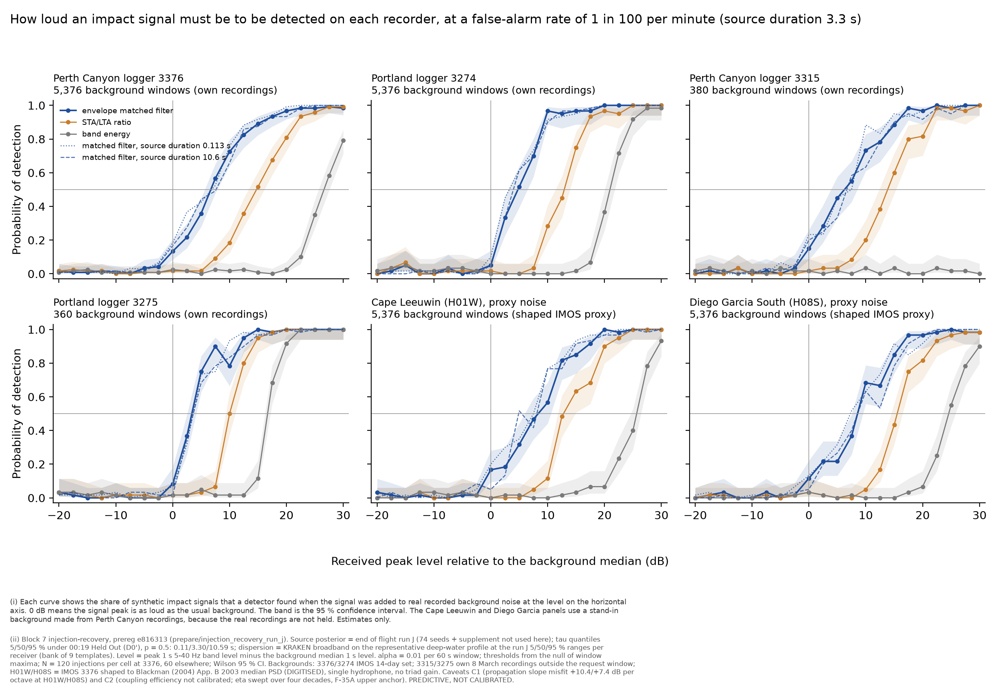
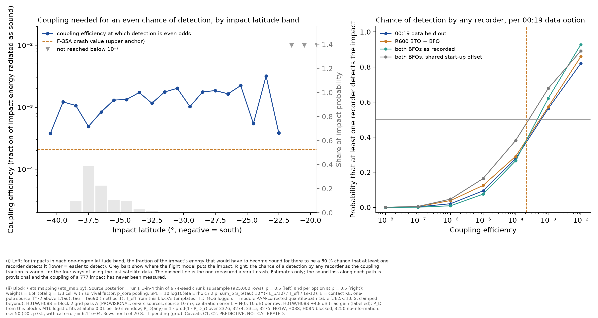

# Hydroacoustics: injection-recovery on run J — P_D against received level, the gate of contract rule 2 (block 7)

*Hydroacoustic Module (block 7 track), 22 Oct 2026 ~04:40 UTC. Unattended overnight run of work order 2026-10-21. Pre-registration `prepare/injection_recovery_run_j/prereg.py` committed at e816313 before any statistic on hydrophone data; code at 0106f51 (+ this note's commit). Data: `results-data/injection_run_j/` on `hypothesis/hydroacoustics` (tables, fits, thresholds, summaries); full outputs including the 26,460-row injection table, null maxima, templates and the run J subsample in `mh370-exchange/hydroacoustics/run-j-injection/` (214 MB, SHA256SUMS).*

**Status: PREDICTIVE, NOT CALIBRATED.** This block measures how detectable a signal of a given received level is on each recorder (P_D against level) by injecting synthetic impact arrivals into real recorded background. It does not claim any detection and writes no likelihood column. Every number carries caveats C1 (propagation slope misfit, +10.4/+7.4 dB per octave at H01W/H08S) and C2 (coupling efficiency not calibrated; η swept over four decades, F-35A upper anchor). The H01W and H08S backgrounds are proxies (declared below); the IMS raw data are still not held. Where a Kadri time is quoted both are carried: "text time 00:52:03" and "caption time 00:54:30".

## 1. Summary

1. **P_D(received level) now exists for six receivers on declared real backgrounds.** With the dispersion-aware envelope matched filter (M1b, the weak-signal track's recommendation) at a false-alarm rate of 0.01 per 60 s window, P_D = 0.5 is reached at a peak 1 s 5–40 Hz level of **4.0–7.0 dB above the background median** on the four IMOS loggers (3376 7.0, 3315 6.6, 3274 4.8, 3275 4.0 dB; source duration τ = 3.3 s) and **7.8 / 8.5 dB on the H01W / H08S proxies**. STA/LTA needs 10–16 dB and band energy 16–28 dB at the same false-alarm rate. At α = 0.001 per window (the level that stands in for a family-wise 0.05–0.07 over a 70-min request window) M1b needs 11–19 dB; at α = 0.05, 1.3–4.3 dB; at α = 0.3 (the screen level of the 13 Oct ruling) −6 to −7 dB, i.e. below the noise median.
2. **Timing is recovered to within ±0.3 s (5–95 %) once detected at ≥ +5 dB for the τ = 3.3 s cell at every receiver.** Pooled over the three τ cells the 5 % tail is wider where detections are few: −2.5 s at the H08S proxy at +5 dB and −9 to −11 s at 0 dB on 3376 and 3275; at ≥ +10 dB every receiver and τ is within ±0.25 s, and ≥ 96 % of detections lie within ±5 s at every level from 0 dB up. The recovered level is within +1.5 dB of the injected level at 0 dB and within +0.5 dB above +10 dB. These are model-matched figures (the templates and the injected pulses share the propagation model): upper bounds on real performance, declared.
3. **Detectability statement (deliverable 6).** Mapping received level back to coupling efficiency with the run J energies and the TL tables available tonight: under 00:19 Held Out (D0′), p = 0.5, the coupling efficiency at which **P_D(any unblocked receiver) = 0.5 is η₅₀ ≈ 6 × 10⁻⁴** (α 0.01 per window, with the module's ±10 dB calibration-error draw; 8 × 10⁻⁴ without it). That is about **three times the F-35A anchor (2.1 × 10⁻⁴)**; at the anchor itself P_D(any) ≈ 0.36 (0.28 without the calibration error). At α = 0.05, η₅₀ ≈ 1.9 × 10⁻⁴ (P_D(any) at the anchor ≈ 0.5); at α = 0.001, η₅₀ ≈ 4.8 × 10⁻³. Per option at p = 0.5: D2 6.1 × 10⁻⁴, D3 5.5 × 10⁻⁴ (ESS 31, thin), D4 2.5 × 10⁻⁴ (ESS 110). Per receiver alone, 3315, 3275, H01W and H08S reach P_D = 0.5 at η = (2.5–6.3) × 10⁻³, while 3376 and 3274 do not reach it below 10⁻² (the difference between co-located loggers is in the TL table, section 5, gap G7-5). By latitude band, η₅₀ is (0.4–1.3) × 10⁻³ for 41–36°S where 72 % of the D0′ mass sits, and mostly (1–3) × 10⁻³ north of 34°S (thin bands scatter more).
4. **Gate verdict (rule 2):** the module now has P_D as a function of received level **on a declared background at each of the four IMOS loggers** (own recordings) and **proxy-only** at H01W and H08S; H08N is blocked and 3250 is a declared no-information row. The likelihood form is written down in section 6. Whether the gate is passed for composition is a judgement for review: on the IMOS side it is, with the model-matched caveat; on the IMS side it is not until real H01W/H08S recordings (or at least their real background) are held. **No likelihood column is written by this block.**

## 2. Method (as pre-registered; deviations in section 7)

- **Receivers and backgrounds.** 3376 and 3274: own 14-day sets (1–7 and 9–15 March 2014, 1,344 files each, 0 unreadable; `data/imos_background/MANIFEST.json`). 3315 and 3275: own 8 March 2014 recordings outside the run J request window (SOFAR ∪ AGW, p ∈ {0, 0.5, 1}, ±60 s): 95 of 100 and 90 of 96 files. H01W, H08S: IMOS 3376 14-day set converted to µPa and spectrally shaped (257-tap zero-phase FIR, 5–40 Hz) so that its median PSD equals the Blackman et al. (2004) App. B 2003 median PSD of the station (`results-data/blackman_noise`, DIGITISED); shaped medians agree with Blackman within 1 dB in nine of ten third-octave bands (−3 dB at 5 Hz, the filter edge). 1,344 realisations, above the 400 of block 10. Single hydrophone; no triad gain in P_D.
- **Source and channel.** One-pole source (ESD flat to 1/τ, f⁻² above); τ at the run J tau90 quantiles 5/50/95 % under D0′ p = 0.5: **0.11 / 3.30 / 10.59 s** (74 seeds, 8 × 50,000-row chunk subsample per seed, 1-in-4 thin). KRAKEN coherent broadband (2–48 Hz, 1/64 Hz, 2,945 frequencies, 5–121 modes) on the weak-signal track's representative profile (WOA23 March at the run J median-impact → H01W midpoint; flat bottom 4,610 m; source 10 m; receiver 1,200 m), at 75 ranges: the 25 km grid over each receiver's run J 5–95 % range (H01W 1,778–2,275 km; Perth Canyon 1,901–2,461; H08S 3,601–3,826; Portland 4,152–4,534) plus the exact 5/50/95 % bank ranges (9 templates per receiver). Build 22 s at 4 processes, 0 failures. Pulse: 50 s window, energy peak at 35 s; the dispersed arrival spans about 8 s (90 % energy) at Perth Canyon range, 17 s at H08S and 26 s at Portland range.
- **Level grid.** Peak 1 s 5–40 Hz level of the pulse relative to the receiver's background median 1 s level, −20 to +30 dB in 2.5 dB steps; absolute levels in `pd_vs_level.csv` (IMOS calibration chain, band-average gain over 5–40 Hz, ±3 dB; IMS by the Blackman median).
- **Detectors.** M1b envelope matched filter (primary), M0a STA/LTA (2 s / 30 s), M0b band energy; statistic maximum in [onset − 10 s, onset + 50 s] above the null threshold.
- **Null and thresholds.** Window maxima over non-overlapping 60 s windows of every background file; (1 − α) quantiles at α ∈ {0.3, 0.1, 0.05, 0.01} plus 0.001. **p floors: 1/5,376 = 1.9 × 10⁻⁴ at 3376, 3274, H01W, H08S; 1/380 = 2.6 × 10⁻³ at 3315 and 1/360 = 2.8 × 10⁻³ at 3275** (α = 0.001 not resolvable there).
- **Injections.** 120 per (level, τ) cell at 3376, 60 elsewhere; 21 × 3 cells per receiver; 26,460 injections in total; rng `[20261022, 7, receiver index]`. Total run time 129 s at 4 processes (loading 2,873 files 23 s, nulls 51 s, injections 55 s).

## 3. P_D against received level (M1b, τ = 3.30 s)

**Level at P_D = 0.5 (L50, dB re the background median) per false-alarm level, and the background:**

| Receiver | Background | Null windows | p floor | Median band level (dB re 1 µPa, 5–40 Hz, 1 s) | L50 α=0.3 | L50 α=0.1 | L50 α=0.05 | L50 α=0.01 | L50 α=0.001 |
|---|---|---|---|---|---|---|---|---|---|
| IMOS 3376 Perth Canyon | own-14day | 5376 | 0.0002 | 99.3 | -6.5 | 0.9 | 3.0 | 7.0 | 19.2 |
| IMOS 3274 Portland | own-14day | 5376 | 0.0002 | 103.4 | -7.0 | -0.5 | 1.3 | 4.8 | 11.3 |
| IMOS 3315 Perth Canyon | own-8mar-outside-window | 380 | 0.0026 | 99.6 | -6.6 | -0.1 | 2.5 | 6.6 | n/r |
| IMOS 3275 Portland | own-8mar-outside-window | 360 | 0.0028 | 95.1 | -6.0 | -0.1 | 1.9 | 4.0 | n/r |
| H01W Cape Leeuwin (proxy) | proxy-3376-shaped-blackman | 5376 | 0.0002 | 100.6 | -6.1 | 1.4 | 3.2 | 7.8 | 15.3 |
| H08S Diego Garcia S (proxy) | proxy-3376-shaped-blackman | 5376 | 0.0002 | 94.8 | -5.9 | 1.6 | 4.3 | 8.5 | 15.7 |

n/r = not resolvable (α below the p floor). Absolute spectral density = band level − 15.4 dB (10 log₁₀ 35). The IMOS absolute levels rest on a band-average gain (±3 dB against the per-band chain of `hydroacoustics-imos-noise.md`); the IMS values are Blackman's 2003 medians, so the 8 March 2014 H08S level during the TGS survey is understated (declared).

**Detectors compared at α = 0.01 (L50 / L90, dB re background median):**

| Receiver | matched filter L50 | matched filter L90 | STA/LTA L50 | STA/LTA L90 | band energy L50 | band energy L90 |
|---|---|---|---|---|---|---|
| IMOS 3376 Perth Canyon | 7.0 | 15.6 | 14.7 | 22.9 | 28.3 | 39.3 |
| IMOS 3274 Portland | 4.8 | 11.0 | 12.4 | 19.5 | 20.9 | 29.5 |
| IMOS 3315 Perth Canyon | 6.6 | 14.7 | 13.9 | 20.9 | not reached | — |
| IMOS 3275 Portland | 4.0 | 9.9 | 10.0 | 16.0 | 16.3 | 23.3 |
| H01W Cape Leeuwin (proxy) | 7.8 | 16.2 | 14.0 | 20.5 | 25.6 | 35.3 |
| H08S Diego Garcia S (proxy) | 8.5 | 17.0 | 15.8 | 22.5 | 24.9 | 31.7 |

**Source-duration sensitivity of the matched filter (L50 at α = 0.01) and two grid values:**

| Receiver | τ=0.11 s | τ=3.30 s | τ=10.59 s | P_D at 0 dB | P_D at +10 dB |
|---|---|---|---|---|---|
| IMOS 3376 Perth Canyon | 5.9 | 7.0 | 6.9 | 0.13 | 0.72 |
| IMOS 3274 Portland | 4.3 | 4.8 | 4.9 | 0.05 | 0.97 |
| IMOS 3315 Perth Canyon | 5.9 | 6.6 | 7.2 | 0.15 | 0.73 |
| IMOS 3275 Portland | 4.0 | 4.0 | 4.7 | 0.08 | 0.78 |
| H01W Cape Leeuwin (proxy) | 6.4 | 7.8 | 7.3 | 0.17 | 0.57 |
| H08S Diego Garcia S (proxy) | 7.8 | 8.5 | 9.2 | 0.12 | 0.68 |

The full grid P_D(level) for every receiver, detector, τ and α with Wilson intervals is `pd_vs_level.csv` (1,890 rows). Reading the table: the detectors' rankings reproduce the weak-signal track (M1b ≈ 7 dB better than STA/LTA, 14–21 dB better than band energy); τ changes L50 by ≤ 1.4 dB because the one-pole roll-off above 1/τ falls mostly below the 5 Hz band edge for τ ≥ 0.1 s; the quietest-tailed background (Portland, q99 − median 10–12 dB) gives the lowest L50, the burstiest (Perth Canyon, 15–16 dB) the highest.

## 4. Timing and level recovery (M1b, α = 0.01, detected injections)

| Receiver | Level | Timing error median (s) | 5–95 % (s) | within ±5 s | Level error median (dB) |
|---|---|---|---|---|---|
| 3376 | 0 dB | +0.06 | −9.4 to +0.1 | 0.93 | +1.6 |
| 3376 | +5 dB | +0.06 | −0.07 to +0.19 | 0.99 | +0.9 |
| 3376 | +10 dB | +0.06 | −0.06 to +0.16 | 0.98 | +0.3 |
| 3274 | +5 dB | 0.00 | −0.19 to +0.23 | 0.99 | +1.1 |
| H01W proxy | +5 dB | −0.07 | −0.11 to 0.00 | 1.00 | +1.1 |
| H08S proxy | +5 dB | 0.00 | −2.5 to +0.2 | 0.96 | +0.8 |

Timing error = time of the statistic maximum minus the pulse's energy-peak time. The rows above are means over the three τ cells; the wide 5 % tails at 0 dB and at the H08S proxy at +5 dB come from τ cells with few detections (for τ = 3.3 s alone every receiver is within −0.2 to +0.3 s at +5 dB). The full table by receiver, detector, α, τ and level is `errors.csv`. Because the bank templates share the injected pulses' propagation model (range mismatch ≤ half the bank spacing only), these are **model-matched upper bounds**: the weak-signal track's gap G-W1 (gain loss against a real long-range arrival of known source) is still open and applies here.

## 5. Detectability statement: received level → coupling efficiency (deliverable 6)

Per run J row: SPL_r = 10 log₁₀(η E ρc/2π · Σ_b S_b(τ) 10^(−TL_b/10) / T_eff / 10⁻¹²), E = contact kinetic energy (D0′ p 0.5 quantiles 5/25/50/75/95 %: 0.35 / 0.54 / 1.11 / 5.92 / 11.35 GJ), T_eff from this block's templates (1.2–2.9 s Perth Canyon, 1.5–7.6 s H01W, 2.3 s Portland, 3.9–4.2 s H08S), TL for the IMOS loggers from the module's RAM-corrected quantile-path table (38.46–31.64°S, clamped beyond: 4.6 % of D0′ mass is extrapolated), TL for H01W/H08S from the block 2 TL grid pass A (on-arc sources 41–20°S, source 10 m; **PROVISIONAL**: pass A was read from disk while that track ran; its note `hydroacoustics-tl-grid-run-j.md` landed concurrently and should be read with this one), calibration error L ~ N(0, 10 dB) per row shared by receivers, +4.8 dB triad gain at H01W/H08S (labelled), P_D,r from this block's M1b logistic fits, P_D(any) = 1 − Π(1 − P_D,r). Rows: 925,000 (a further 1-in-8 thin of the saved subsample, declared); rows north of 20°S (0.01 %) 'TL pending (grid)'.

| Option / p | ESS (thin) | η50 α=0.01 | η50 α=0.05 | η50 α=0.001 | η50 α=0.01 no cal err | P_D(any) at F-35A anchor, α=0.01 |
|---|---|---|---|---|---|---|
| D0/p0 | 1120 | 8.8e-04 | 2.6e-04 | 6.9e-03 | 1.2e-03 | 0.32 |
| D0/p0.5 | 2693 | 6.1e-04 | 1.8e-04 | 4.8e-03 | 8.4e-04 | 0.36 |
| D0/p1 | 2275 | 4.2e-04 | 1.2e-04 | 3.2e-03 | 5.2e-04 | 0.41 |
| D2/p0 | 67 | 8.3e-04 | 2.4e-04 | 6.3e-03 | 1.0e-03 | 0.31 |
| D2/p0.5 | 157 | 6.1e-04 | 1.7e-04 | 4.3e-03 | 7.3e-04 | 0.37 |
| D2/p1 | 140 | 4.0e-04 | 1.1e-04 | 2.7e-03 | 4.4e-04 | 0.43 |
| D3/p0 | 16 | 9.7e-04 | 3.0e-04 | 7.1e-03 | 1.5e-03 | 0.20 |
| D3/p0.5 | 31 | 5.5e-04 | 1.6e-04 | 4.0e-03 | 4.7e-04 | 0.35 |
| D3/p1 | 15 | 1.8e-04 | 4.9e-05 | 1.3e-03 | 1.3e-04 | 0.52 |
| D4/p0 | 71 | 8.1e-04 | 2.4e-04 | 5.8e-03 | 7.8e-04 | 0.32 |
| D4/p0.5 | 110 | 2.5e-04 | 7.2e-05 | 1.8e-03 | 1.6e-04 | 0.48 |
| D4/p1 | 75 | 9.6e-05 | 2.7e-05 | 6.4e-04 | 6.9e-05 | 0.63 |

D3 rows (ESS 15–31 after the thin) are **not estimable to better than a factor of about 2** and are reported as such; D2 and D4 are thin (ESS 67–157).

**P_D(any receiver) by coupling decade (D0′, p 0.5, with calibration error):**

| η | P_D(any), α 0.01 | α 0.05 | α 0.001 |
|---|---|---|---|
| 1e-08 | 0.0 | 0.002 | 0.0 |
| 1e-07 | 0.003 | 0.012 | 0.001 |
| 1e-06 | 0.021 | 0.058 | 0.008 |
| 1e-05 | 0.094 | 0.186 | 0.039 |
| 1e-04 | 0.278 | 0.427 | 0.132 |
| 1e-03 | 0.563 | 0.703 | 0.323 |
| 1e-02 | 0.82 | 0.901 | 0.587 |

Marginal over the module's log-uniform four-decade η prior (10⁻⁸ to the anchor), P_D(any) is of order 0.1 at α 0.01: the hydroacoustic non-detections on the data held are, as before, weakly informative on position, and the dominant uncertainty is η, not the detector.

**Per receiver alone (D0′, p 0.5, α 0.01, no calibration error):**

| Receiver | η50 (alone) | P_D at anchor |
|---|---|---|
| IMOS 3376 Perth Canyon | not reached below 1e-2 | 0.036 |
| IMOS 3274 Portland | not reached below 1e-2 | 0.007 |
| IMOS 3315 Perth Canyon | 3.5e-03 | 0.141 |
| IMOS 3275 Portland | 2.5e-03 | 0.156 |
| H01W Cape Leeuwin (proxy) | 4.1e-03 | 0.128 |
| H08S Diego Garcia S (proxy) | 6.3e-03 | 0.105 |

The co-located pairs (3315/3376, 3275/3274) differ by a factor of 4–20 in P_D at the anchor although their P_D(level) curves agree within 1 dB: the difference is entirely in the module's RAM-corrected TL table, which at 20–40 Hz differs by 4–27 dB between receivers 38 m (Perth Canyon) and 13 m (Portland) apart in depth. That is a TL-to-seabed-receiver sensitivity, not a detector result (gap G7-5); the any-receiver η₅₀ is less exposed to it.

**By latitude band (D0′, p 0.5, α 0.01, with calibration error):**

| lat_lo | lat_hi | share | n | eta50 | pd_any_at_anchor |
|---|---|---|---|---|---|
| -41.0 | -40.0 | 0.0002 | 7999 | 3.8e-04 | 0.387 |
| -40.0 | -39.0 | 0.0079 | 32625 | 1.2e-03 | 0.137 |
| -39.0 | -38.0 | 0.099 | 107578 | 1.1e-03 | 0.162 |
| -38.0 | -37.0 | 0.3868 | 239841 | 4.9e-04 | 0.375 |
| -37.0 | -36.0 | 0.225 | 243321 | 8.4e-04 | 0.286 |
| -36.0 | -35.0 | 0.1044 | 145132 | 1.3e-03 | 0.23 |
| -35.0 | -34.0 | 0.0992 | 72191 | 1.3e-03 | 0.177 |
| -34.0 | -33.0 | 0.0335 | 22617 | 1.7e-03 | 0.197 |
| -33.0 | -32.0 | 0.0105 | 7097 | 1.2e-03 | 0.273 |
| -32.0 | -31.0 | 0.0042 | 3843 | 1.8e-03 | 0.12 |
| -31.0 | -30.0 | 0.0038 | 4039 | 2.0e-03 | 0.16 |
| -30.0 | -29.0 | 0.0055 | 4806 | 1.0e-03 | 0.197 |
| -29.0 | -28.0 | 0.0031 | 5714 | 1.8e-03 | 0.245 |
| -28.0 | -27.0 | 0.0044 | 6607 | 1.9e-03 | 0.113 |
| -27.0 | -26.0 | 0.0039 | 8580 | 1.6e-03 | 0.277 |
| -26.0 | -25.0 | 0.0027 | 5793 | 2.2e-03 | 0.167 |
| -25.0 | -24.0 | 0.0047 | 2894 | 5.5e-04 | 0.247 |
| -24.0 | -23.0 | 0.0006 | 1323 | 3.2e-03 | 0.121 |
| -23.0 | -22.0 | 0.0 | 396 | 3.8e-04 | 0.353 |
| -22.0 | -21.0 | 0.0002 | 172 | not reached | — |
| -21.0 | -20.0 | 0.0001 | 62 | not reached | — |

Bands north of 31.6°S use the clamped (extrapolated) IMOS TL and the grid pass A for the IMS stations; bands with n < 1,000 are noisy. The band-to-band scatter (factor 2–3) is largely the IMOS TL table's latitude structure and the energy distribution, not a detector effect.

## 6. Gate verdict and the likelihood form

| Receiver | P_D(received level) on a declared background? | Background | p floor | Verdict |
|---|---|---|---|---|
| IMOS 3376, 3274 | yes | own 14-day set (1,344 files) | 1.9 × 10⁻⁴ | **yes** (model-matched caveat) |
| IMOS 3315, 3275 | yes | own 8 March recordings outside the request window (95 / 90 files) | 2.6–2.8 × 10⁻³ | **yes**, α ≥ 0.01 only |
| H01W, H08S | proxy | IMOS 3376 shaped to Blackman 2003 medians (digitised); single hydrophone | 1.9 × 10⁻⁴ | **proxy-only** |
| H08N | no | — | — | **blocked** (N×2D corridor K4) |
| IMOS 3250 | no | — | — | **no-information row** (path crosses land) |

Likelihood form once composition is authorised (contract rule 2), per receiver r and impact row:

  L_r = (1 − P_D,r(SPL_r)) + P_D,r(SPL_r) × m_r / β_r,

where P_D,r is this block's logistic fit in received level (M1b, the chosen α), SPL_r the predicted peak 1 s 5–40 Hz level at the receiver for the row (η, E, τ, TL, calibration error), **m_r the density of matching detections at the predicted arrival time and (where a triad) bearing — a detection within the pre-registered window counted with its timing kernel, in units of per second (per second per degree with a bearing)** — and **β_r the background rate of screen-level candidates on that receiver, in the same units (per second, or per second per degree), measured on the same real background as the null here (window maxima above the α threshold per 60 s window: β = α / 60 s by construction at the chosen α, or the measured candidate rate where the screen differs)**. With m and β in the same units the ratio is dimensionless and L_r is an absolute-scale likelihood (a probability of the observation record under the row), so it may be mixed across alternatives; the product over receivers assumes independent backgrounds. Where no recording covers the predicted window P_D,r = 0 and L_r = 1 (no information, rule 7). **This block writes no likelihood column**; the composition block does so after review.

## 7. COVERAGE

- **(a) Feasible set.** Every run J impact (74 seeds, 313.6 M rows, 00:19:37–01:15:56; the northern supplement is not in this block's subsample — gap G7-1), every receiver that could carry information (IMOS 3315, 3376, 3274, 3275; H01W, H08S; H08N blocked; 3250 no information), received levels from far below to far above the background, source durations across the run J tau90 span, both log-on causes and p ∈ {0, 0.5, 1}.
- **(b) Model's reach.** One representative deep-water profile for every path (reach gap G7-2: the Portland shelf, Perth Canyon and the H08S ridge crossings disperse differently; M1b's robustness to that is untested beyond the ±225–350 km range mismatch exercised here); SOFAR branch only (AGW arrivals not injected — G7-3); single-hydrophone statistics (bearing not recovered; triad gain only as a labelled +4.8 dB); one-pole source with f⁻² roll-off; level grid −20 to +30 dB covers the full transition for every detector except band energy at 3315 (not reached) and 3376 (L90 39 dB, above the grid).
- **(c) Proposal's coverage.** Injections: 21 levels × 3 τ × 120 (3376) or 60 (others) per cell, 26,460 in total; every cell filled; Wilson intervals in the tables (half-width ≈ ±0.09 at n = 120 and ±0.13 at n = 60 near P_D = 0.5). Backgrounds: 5,376 windows at 3376/3274/H01W/H08S (p floor 1.9 × 10⁻⁴), 380/360 at 3315/3275 (2.6–2.8 × 10⁻³, α = 0.001 not resolvable). η mapping ESS (D0′/D2/D3/D4 at p 0.5): 2,693 / 157 / 31 / 110; by family not separated in this block (G7-4).
- **Gaps and status.** G7-1 supplement rows absent from the η mapping (fix: include `impacts-ruleB.npz` rows; small, D0′ share 0.125). G7-2 path-dependent dispersion (fix: per-receiver bathymetry-following broadband templates from the block 2 grid once published). G7-3 AGW branch not injected (needs an AGW waveform model; none exists in the module). G7-4 per-family η₅₀ not reported. **G7-5 the IMOS RAM-corrected TL table differs by 4–27 dB at 20–40 Hz between co-located loggers 13–38 m apart in depth** (fix: a RAM run at both receiver depths on identical paths, or a receiver-depth-averaged TL; until then the any-receiver statement is the one to quote). G7-6 3315/3275 own backgrounds are one night (same-night non-stationarity untested; cross-check against 3376/3274 shows L50 within 0.8 dB). G7-7 the IMS proxies carry IMOS temporal statistics: the 1 s level spread (q10–q90 11.5 dB) is wider than Blackman's 6 s H01W spread (2.3–5.5 dB) and than the digitised Kadri Fig. 9 panel (b) spread (2.9 dB at envelope resolution, against 4–15 dB for the emulated proxy), so the H01W proxy is **conservative** (P_D understated); for H08S Blackman's spread (6.6–10.6 dB) is comparable, but the 2014 TGS survey is absent, so the H08S proxy is **optimistic** on 8 March 2014. G7-8 model-matched templates (weak-signal G-W1) — real-arrival test still outstanding. G7-9 absolute IMOS levels ±3 dB (band-average gain). G7-10 IMOS TL extrapolated (clamped) north of 31.64°S, 4.6 % of D0′ mass; TL grid pass A was used from disk before its note landed (`hydroacoustics-tl-grid-run-j.md`, same night); not re-run against the published tables.
- **Parameter bounds with sources.** τ 0.11–10.59 s (run J tau90 5–95 %, method 1); ranges per receiver (run J 5–95 %, inputs.json); level −20..+30 dB (pre-registered); α 0.3/0.1/0.05/0.01 (13 Oct ruling) + 0.001; η 10⁻⁸–10⁻² (bisection bounds; prior four decades below the F-35A anchor 2.1 × 10⁻⁴, Brown et al. 2026); ρc = 1025 × 1500; T_eff measured; calibration error N(0, 10 dB) (module amendment 2); triad gain 4.8 dB (module audit F9).

## 8. Deviations from the task text (declared)

1. 3315 and 3275 backgrounds are their own 8 March recordings outside the request window, not the 14 GB set (which holds 3376, 3274, 3250 only).
2. The run J inputs come from an 8 × 50,000-row chunk subsample per seed, thinned 1-in-4 for storage and a further 1-in-8 for the η bisection (ESS reported); the northern supplement is not included.
3. IMOS TL is the module's RAM-corrected table (as pre-registered), not the block 2 grid; H01W/H08S TL is the block 2 grid pass A, used because it was complete on disk, labelled provisional. A first η run used pass A + RAM deltas for IMOS, contrary to the pre-registration; it was discarded and rerun as pre-registered (the discarded run gave η₅₀ 6.3 × 10⁻⁴, within 3 % of the pre-registered chain).
4. 3250 is excluded (no-information row), H08N blocked: no P_D for either.
5. Triad gain is applied only in the η mapping; the P_D curves are single-hydrophone.
6. No full-scale heavy compute was needed: the whole block ran in about 25 minutes of wall time at ≤ 4 processes (templates 22 s, main run 129 s, η mapping about 7 min, the rest input extraction); no compute slot was requested.

## done / next / blocker

- done: pre-registered (e816313) and ran injection-recovery at six receivers on declared real backgrounds (IMOS own; IMS proxy); P_D(level) tables for three detectors, three τ, five α; timing and level recovery; p floors; η mapping per 00:19 option and p and per latitude band; gate verdict and likelihood form; two charts; this note.
- next: (i) composition block 11 may use `fits.json` (M1b logistic in received level) once review accepts the IMOS 'yes' and the IMS 'proxy-only' labels; (ii) close G7-5 with a receiver-depth RAM check before any per-logger statement is quoted; (iii) rebuild the templates per receiver from the block 2 bathymetry-following paths when that note lands; (iv) add the supplement rows to the η mapping.
- blocker: none for this block. The IMS gate stays proxy-only until real H01W/H08S recordings or their real background are held (the standing data request).
