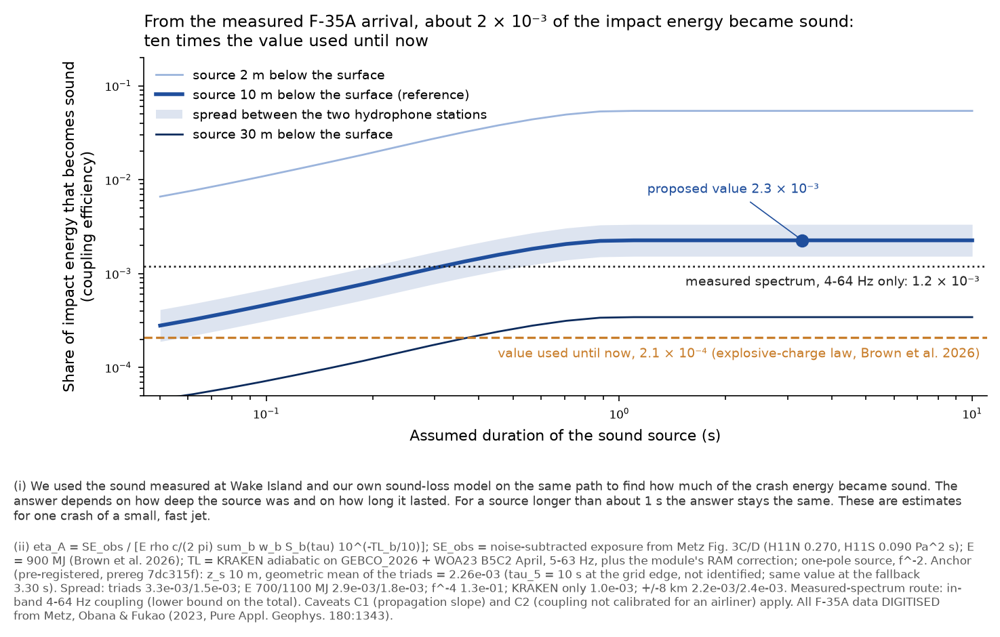
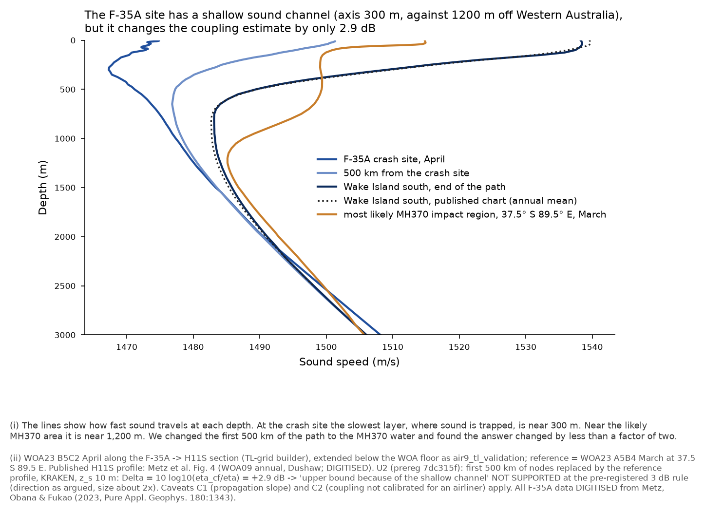
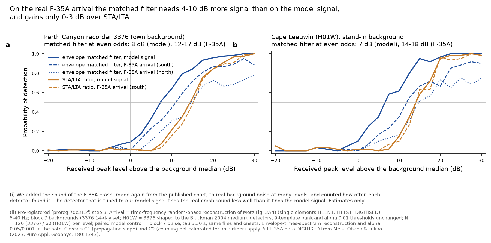
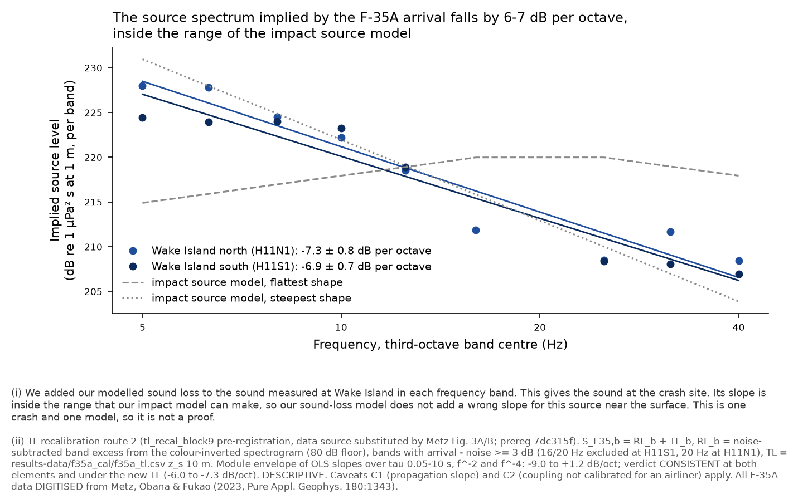
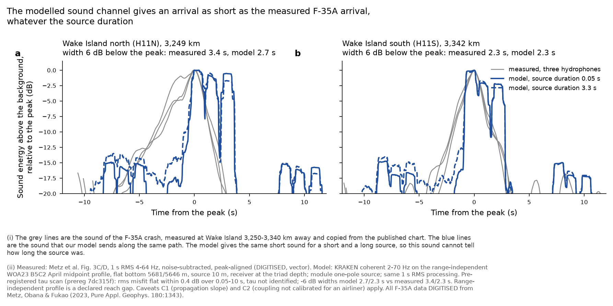

> **Registry status (23 Oct 2026): PENDING_RULING.** Its result waits for Pete's ruling. Read `results/hydroacoustics/INDEX.md` (generated from the registry) before you use any number here.

# Hydroacoustics: the F-35A coupling anchor re-derived from Metz et al. (2023) through the module's own chain; real-arrival test of the matched filter; TL route 2; source-pulse check — PREDICTIVE, NOT CALIBRATED

*Hydroacoustic Module, track "metz-f35a", 22 October 2026 (Pete's correction list items 1, 2 F-35A part, 4, 5). Every number
carries caveats C1 (propagation slope) and C2 (coupling efficiency not calibrated for an airliner). All F-35A data are
DIGITISED from the published figures; nothing here is a CTBTO waveform sample. No detection is claimed.*

**Pre-registration:** `prepare/metz_f35a/prereg.py`, module branch `7dc315f`, committed after the digitisation and before any
transmission loss, inversion, injection or route-2 band level. **Code and small outputs:** `prepare/metz_f35a/`,
`results-data/metz_f35a/` (module branch `6a718bf`). **Large outputs:** `mh370-exchange/hydroacoustics/run-j-metz-f35a/`.

## 0. Correction of record (gaps G4 and G5)

The overnight note of 22 October said that Metz, Obana & Fukao (2023) is "closed access, not held" (G4) and that Kadri (2019)
is "closed access" (G5). **Both statements were wrong.** Metz et al. is held by Pete (artifact store and
`mh370-exchange/hydroacoustics/sources/`); Kadri (2019, Sci. Rep. 9:912, doi 10.1038/s41598-018-37626-z, CrossRef-verified)
is gold open access under CC BY 4.0. Both are now extracted (manifest rows added to `results-data/digitised/MANIFEST.csv`).

- **What Metz holds** (pp. 1343–1351, read in full): H11N and H11S 1 s RMS envelopes (three elements each, 4–64 Hz, vector),
  spectrograms of H11N1 and H11S1 (raster, 80–100 dB re 1 µPa²/Hz), apparent velocity, closure and back azimuth of the
  detection windows (vector markers), the four cabled-observatory envelopes and spectrograms (DSOH, KSP1–3, 180–255 km), the
  H11 sound-speed profiles (Fig. 4, vector), times (origin 10:26:32 ± 9 s; first detections 11:03:00 H11N, 11:04:05 H11S),
  the 90 % ellipse (844 km², 36.8 × 7.3 km), 3,341 km to H11S, mooring and seafloor depths.
- **What Metz does not hold:** no impact energy, no source level, no coupling efficiency, no epicentre coordinates (a cross in
  Fig. 1E only). The 900 ± 200 MJ and the 0.7 Pa are Brown et al. (2026). The module's working point 40.64 N 142.96 E gives
  3,341.5 km to H11S, which matches Metz's 3,341 km; the geodesic deep-channel travel time at 1.482 km/s puts the H11S peak at
  11:04:06.7, against the digitised element peaks at 11:04:06.7–11:04:08.0.
- **What Kadri (2019) holds:** E1/E2 water–seabed route alternatives (Tables 1–2), the HA08s signals of interest (Table 3; its
  times 11:57 and 12:11 are 12-hour readings of 23:57 and 00:11 UTC, as the Fig. 1 labels show), and a 25-minute HA08s data gap
  from 03:07 UTC on 8 March 2014. **It holds no amplitude, no source level and no San Juan data**, so it cannot serve the
  real-arrival test (step 3 used the F-35A only).

Checks of the digitisation: tick-residuals < 0.01 s and < 0.004 dB (Fig. 3); overlays drawn for every vector object; the
spectrogram's absolute 4–64 Hz excess energy matches the envelope exposure to −0.56 / −0.32 dB (80 dB floor) and −0.06 /
+0.20 dB (70 dB floor) at H11N1 / H11S1 — an independent test of the colour inversion and of the published PSD scale.

## 1. The measured arrival (DIGITISED, Metz Fig. 3C/D)

| triad | peak 1 s RMS (dB re 1 µPa) | background (dB) | peak above background | exposure, 4–64 Hz (Pa² s) | width at −6 dB | 5–95 % energy span |
|---|---|---|---|---|---|---|
| H11N (3,249 km) | 109.9–111.3 (0.31–0.37 Pa) | 95.3–96.2 | 13.7–15.9 dB | **0.270** (SEL 114.3 dB; elements within 0.8 dB) | 3.5 s | 4.8 s |
| H11S (3,342 km) | 106.1–108.7 (0.20–0.27 Pa) | 93.4–94.3 | 12.2–14.6 dB | **0.090** (SEL 109.5 dB; within 2.2 dB) | 2.5 s | 3.4 s |

Brown's 0.7 Pa is about twice the measured peak 1 s RMS, so it is consistent with an instantaneous peak; the 9 Oct calibration
turned it into an exposure of 0.163 Pa² s by a template ratio, which falls between the two measured triad values (geometric
mean 0.156 Pa² s, −0.2 dB). The two triads differ by 4.8 dB in exposure while the modelled TL differs by about 1.3 dB; Metz
attribute the less distinct H11S arrival to more bottom interaction near Wake. Back azimuths (digitised, axis-limited):
H11N 320.6°, H11S 321.7°, against 322.3° geodesic at H11S.

## 2. Coupling anchor through the module's chain

**Path and TL.** Paths rebuilt with the TL-grid builder (GEBCO_2026 NW Pacific layer north of 30 N, global layer south;
WOA23 B5C2 April). They reproduce the 9 Oct ocean-transport sections (depth median |Δ| 1 m, 95 % 14–16 m; sound speed
95 % |Δ| 0.002 m/s). KRAKEN adiabatic, hard bottom, 5–63 Hz: TL at 10 m source 123.4–104.5 dB (H11N) and 124.4–105.9 dB (H11S);
the 9 Oct 5–40 Hz table is reproduced to ≤ 0.3 dB except 1.3 dB at 16 Hz (H11S). 5–58 propagating modes at the source (3–41 at the narrowest profile). Primary TL adds the
module's RAM correction (RAM is 0.8–3.8 dB above adiabatic on this path).

**Inversion (route A, the module's source model).** η = SE_obs / [E ρc/2π Σ_b w_b S_b(τ) 10^(−TL_b/10)], E = 900 MJ.

| quantity (z_s 10 m, f⁻², E 900 MJ) | value |
|---|---|
| **pre-registered anchor** (geometric mean of the triads, RAM-corrected TL, τ_5 = 10 s; identical at the 3.30 s fallback and for every τ ≥ 1.1 s) | **2.26 × 10⁻³** |
| by triad, H11N / H11S | 3.3 × 10⁻³ / 1.5 × 10⁻³ |
| at τ = 0.05 s (the physical entry time of a 16 m jet at 300 m/s) | 2.8 × 10⁻⁴ |
| E = 700 / 1,100 MJ | 2.9 × 10⁻³ / 1.8 × 10⁻³ |
| source depth 2 / 30 m | 5.4 × 10⁻² / 3.4 × 10⁻⁴ |
| f⁻⁴ roll-off | 1.3 × 10⁻¹ |
| KRAKEN without RAM | 1.05 × 10⁻³ |
| source ± 8 km in range | 2.2 / 2.4 × 10⁻³ |
| full range over all cases at τ_5 / at every τ | 8.6 × 10⁻⁵ – 6.3 / 1.1 × 10⁻⁵ – 6.3 |

**Route B (observed spectrum, model-free in shape):** in-band coupling 4–64 Hz = 1.5 × 10⁻³ (H11N1) and 0.93 × 10⁻³ (H11S1),
geometric mean **1.2 × 10⁻³** (70 dB floor: 1.4 / 0.88 × 10⁻³). This is the acoustic energy actually radiated in the observed
band divided by 900 MJ — a lower bound on the total. Radiated source spectrum level at 1 m (z_s 10 m, RAM TL): 224–229 dB re
1 µPa² s/Hz at 5–6.3 Hz, falling to 193–195 dB at 20 Hz (the spectral notch Metz report) and 194–200 dB at 50–63 Hz; source
exposure level 4–64 Hz 235.3 dB (H11N1) and 233.1 dB (H11S1) re 1 µPa² s at 1 m.

**Old → new.** The value quoted in every C2 line until now, 2.1 × 10⁻⁴, is Brown's Arons-law equivalent-yield coupling, a
different quantity. Like for like with the module's own 9 Oct calibration (same definition, z_s 10 m, f⁻², τ ≥ 1.1 s): KRAKEN
1.45 → 1.05 × 10⁻³ (−1.4 dB), RAM-corrected 3.0 → 2.26 × 10⁻³ (−1.2 dB). The measured exposure therefore **confirms the module's
own 9 Oct calibration to about 1 dB** and shows that the 2.1 × 10⁻⁴ carried as the "upper anchor" since then was low by a
factor of about 11 (10.3 dB) for the module's own η definition.

**The "upper bound because of the shallow sound channel" argument (U1, U2).**

- U1 (descriptive): the premise is right. The channel axis is at 300 m at the F-35A site (surface-to-axis contrast 7.5 m/s),
  650 m at 500 km, 800 m at H11S (Metz Fig. 4: 821–841 m, c_min within 0.8 m/s of WOA23), against 1,200 m and 29.7 m/s in the
  run J median region (37.5 S 89.5 E, March).
- U2 (pre-registered counterfactual): replacing the first 500 km of the path's sound speed with the MH370-region profile raises
  the TL by 2.3–3.1 dB and the inverted η by **+2.9 dB** (7.1 × 10⁻⁴ → 1.4 × 10⁻³, KRAKEN, H11S). **Verdict: NOT SUPPORTED** at
  the pre-registered 3 dB rule — the direction is the one Brown argues, the size is a factor of about 2, just below the threshold.
- Reading: the shallow channel matters for a path-blind inversion such as Brown's (by about 3 dB). The module's chain models the
  source-end profile, so its η is **not** an upper bound for this reason. Other reasons for a bound remain untested and are listed
  in COVERAGE (near-vertical 300 m/s jet vs shallow airliner entry; 19 t vs ~200 t; E = total kinetic energy).

## 3. Real-arrival test of the matched filter (gap G-W1)

The F-35A arrival (random-phase reconstruction from the digitised spectrogram, R1, primary; envelope × spectrum, R2) injected
into block 7's real backgrounds with block 7's detectors, template bank and thresholds unchanged; paired model control on the
same files and onsets. Level at P_D = 0.5 (dB above the background median 1 s 5–40 Hz level):

| receiver, α per 60 s | signal | matched filter (M1b) | STA/LTA | gain | real-arrival penalty |
|---|---|---|---|---|---|
| 3376, 0.01 | model control | **7.8** | 14.4 | 6.6 | — |
| 3376, 0.01 | F-35A south (R1) | 11.9 | 15.2 | 3.4 | **+4.0** |
| 3376, 0.01 | F-35A north (R1) | 17.3 | 18.8 | 1.4 | **+9.5** |
| 3376, 0.01 | F-35A south / north (R2) | 17.3 / 25.6 | 16.0 / 18.2 | −1.3 / −7.4 | +9.5 / +17.8 |
| 3376, 0.05 | control / R1 south / R1 north | 3.6 / 5.5 / 7.9 | 9.4 / 9.9 / 12.5 | 5.8 / 4.4 / 4.6 | — / +1.9 / +4.3 |
| H01W proxy, 0.01 | control / R1 south / R1 north | 7.2 / 13.8 / 18.3 | 14.1 / 14.5 / 18.3 | 6.9 / 0.7 / 0.0 | — / +6.6 / +11.1 |

- **Verdict (pre-registered rule on the R1 penalty at 3376): NOT CLOSED** (H11N1 +9.5 dB); PARTLY at H11S1 (+4.0 dB). G-W1 stays
  open, now with a measured size.
- On a real long-range arrival the dispersion-aware matched filter keeps only 0–3.4 dB of its 6.6–7 dB model-matched gain at
  α 0.01 (4.4–4.6 dB at α 0.05). Its P_D also saturates at 0.7–0.9 for the north arrival even at +30 dB: the correlation with
  the mismatched templates never reaches the threshold for some realisations. STA/LTA is nearly unaffected (+0.8 to +4.4 dB).
- Why: the module's templates are built on one Indian Ocean deep-water profile at the run J ranges; the real arrival (−6 dB width
  2.3–3.5 s, a 5–95 % energy span of 3–5 s) has a different shape. The M1b gain quoted since the weak-signal note ("P_D = 0.5 at
  about 7 dB against 13–16 dB for STA/LTA") is therefore an upper bound by 4–10 dB on a real arrival.
- Reproducibility of block 7's null on a 10 % file subset: M1b q99 0.858 vs 0.887; STA/LTA 22.7 vs 21.6 (3376).
- **San Juan: not run.** The Nielsen (2021) and Vergoz (2021) figure rasters are held but untraced; Kadri (2019) holds no San Juan
  data. Recorded as gap G-W1b (trace the Nielsen/Vergoz rasters; no request needed).

## 4. TL recalibration route 2 (gap G4)

Route 2 as pre-registered in block 9 (`tl_recal_block9.py`), with the data source substituted (Metz Fig. 3A/B; there is no
F-35A figure in Brown 2026). Implied source S_F35,b = RL_b + TL_b over the 5–40 Hz bands whose arrival exceeds the noise by ≥ 3 dB
(the 16 and 20 Hz bands drop out at H11S1, 20 Hz at H11N1 — the 20 Hz notch):

| element, TL | bands | slope (dB/octave) | module envelope | verdict |
|---|---|---|---|---|
| H11N1, 9 Oct f35a_tl (pre-registered) | 9 | −7.3 ± 0.8 | −9.0 to +1.2 | **CONSISTENT** |
| H11S1, 9 Oct f35a_tl (pre-registered) | 8 | −6.9 ± 0.7 | −9.0 to +1.2 | **CONSISTENT** |
| H11N1 / H11S1, new TL + RAM | 9 / 8 | −6.5 / −6.2 | same | CONSISTENT |
| extension 5–63 Hz (H11S1 adds 50 Hz) | 9 | −6.0 to −6.6 | −9.0 to +0.75 | CONSISTENT |

Reading (descriptive; one event, a figure-read PSD): the engine does not impose a tilt on this near-surface source beyond what the
impact source model can absorb, which supports the block 9 attribution of the air9 common-mode tilt to the airgun source spectrum
rather than to the path. **G4 is closed as a data gap; C1 is unchanged** (route 2 cannot lift C1 by itself, as pre-registered).

## 5. Source-pulse check

KRAKEN broadband on the range-independent F-35A midpoint profile (axis 1,000 m, flat bottom 5,681 / 5,646 m), the module's
one-pole source, Metz processing. The model reproduces the short arrival: −6 dB width 2.7 s vs 3.4 s measured (H11N), 2.3 s vs
2.3 s (H11S) — inside the pre-registered 1.5 s. **But τ is not identified:** the envelope misfit varies by only 0.4 dB over
τ = 0.05–10 s, and the pre-registered minimum falls at the grid edge (τ_5 = 10 s). The reason is structural: in the 4–64 Hz band
(f ≫ 1/τ) the one-pole source acts as an integrator, so τ changes the spectral slope and level but not the in-band duration; the
arrival's length is set by the channel's dispersion. Only the 5–95 % energy span responds to τ (model 3.6–8.3 s over the τ grid
against 5.7 s and 3.8 s measured), which favours τ ≈ 0.05–0.2 s — consistent with the physical entry time — but this statistic
was not pre-registered and is reported as descriptive.

Consequences: (i) the module's τ → source-duration conversion (τ_ac = τ90, k = 1) is **not testable** from a far-field envelope;
(ii) the anchor is insensitive to this for τ ≥ 1.1 s (band fractions are normalised over 1–500 Hz, so η saturates), which is
the regime of most run J impacts (D0′ p 0.5 τ quantiles 0.11 / 3.30 / 10.6 s), but it falls by a factor of 8 at τ = 0.05 s;
(iii) for MH370 rows with τ < 1 s the F-35A anchor at its own τ is ambiguous by up to 0.9 decades.

## 6. Changed numbers (old → new) and consequences

| quantity | old | new | consequence |
|---|---|---|---|
| F-35A coupling anchor quoted in C2 | 2.1 × 10⁻⁴ (Brown/Arons) | **2.26 × 10⁻³** (single-factor spread 2.8 × 10⁻⁴ at τ 0.05 s to 5.4 × 10⁻² at a 2 m source) | every "at the anchor" statement moves +10.3 dB in received level |
| module's own η_cal (RAM, z_s 10, τ ≥ 1.1 s) | 3.0 × 10⁻³ (0.7 Pa / template ratio) | 2.26 × 10⁻³ (measured exposure) | −1.2 dB; 9 Oct calibration confirmed |
| F-35A received exposure, 4–64 Hz | 0.163 Pa² s (both triads, inferred) | 0.270 (H11N) / 0.090 (H11S) Pa² s (measured) | triad spread 4.8 dB is now a measured term |
| matched-filter level at P_D 0.5, 3376, α 0.01 | 7.0 dB (model-matched) | 11.9–17.3 dB on the real arrival | detectability built on M1b is optimistic by 4–10 dB |
| matched-filter gain over STA/LTA, α 0.01 | 6.6–7.6 dB | 0–3.4 dB (real arrival) | the weak-signal headline is an upper bound |
| "upper bound because of the shallow channel" | asserted | +2.9 dB effect, NOT SUPPORTED at the 3 dB rule | the module's η is not an upper bound for that reason |
| TL route 2 | NOT AVAILABLE (G4) | CONSISTENT (−6 to −7.3 dB/oct inside −9.0 to +1.2) | G4 closed as a data gap; C1 unchanged |
| status of Metz 2023 / Kadri 2019 | closed access, not held | held / open access, extracted | G4/G5 recorded wrongly; corrected |

The two corrections pull in opposite directions: the anchor moves received levels up by about 10 dB, the real-arrival penalty moves
the detection threshold up by 4–10 dB. Neither is applied downstream here.

## 7. Downstream products that must be re-run (not re-run here)

1. **Levels and power screen** (`run-j-levels`): re-state "at the anchor" with 2.26 × 10⁻³; add the real-arrival M1b penalty.
2. **Injection P_D** (`run-j-injection`): add the real-arrival variant (R1/R2) to the template set or re-build the bank with a
   path-dependent dispersion; re-state η₅₀ against the new anchor. η₅₀ for P_D(any) = 0.5 was 6 × 10⁻⁴ on the old IMOS table and 4.0 × 10⁻³ on the corrected table (ranking track, architecture.md 22 Oct ~15:30Z): the new anchor sits 2.5 dB below the corrected η₅₀, before the 4–10 dB real-arrival penalty is added.
3. **Composition** (`run-j-gated-v2`, A4/A5): the η prior is log-uniform 10⁻⁶–10⁻² and is unchanged, but P(no detection | anchor)
   and the 95 % upper limit text must be re-read at 2.26 × 10⁻³, and the IMOS P_D curves carry the M1b penalty.
4. **Energy/coupling chart** and every C2 footnote: anchor 2.1 × 10⁻⁴ → 2.26 × 10⁻³ with its source-depth/τ spread.
5. **Kadri package v2**: predictions.csv (anchor line, M1b statement in the measurement script), and the cover note's G4/G5 lines.
6. TL-grid detectable-share chart, searches `eta_needed` comparisons, the overnight summary (C2 text), and the brief's §source-term
   paragraph ("η of order 10⁻⁴ ... upper bound") — for the architect and Pete to rule.

## COVERAGE

- **Feasible set (what this calibration can test):** one aircraft impact (F-35A, 19 t class, near-vertical, ~300 m/s, 900 ± 200 MJ
  per Brown) at a Pacific site with a 300 m channel axis, seen at two SOFAR-axis triads 3,249–3,342 km away in 4–64 Hz. An airliner
  at shallow descent, the AGW band below 4 Hz, seabed receivers and Indian Ocean paths are outside it (the transfer is C2's domain).
- **Model's reach:** KRAKEN adiabatic incoherent TL along the bathymetry-following section plus the module's RAM correction
  (H11S-derived, held above 40 Hz, applied to H11N — declared); flat hard half-space; one-pole source with f⁻²/f⁻⁴; source depths
  2–30 m; τ 0.05–10 s. The pulse check uses a range-independent midpoint profile (REACH GAP: path-dependent dispersion, Japan
  Trench and Wake seamounts). The injection uses block 7's single-profile template bank unchanged.
- **Proposal's coverage:** every grid point is computed (no sampling): 7 paths × 12 bands × 3 depths; 25 τ × 2 slopes × 3 E;
  18,900 injections (21 levels × 120 / 60 × 5 variants). No posterior enters, so no ESS applies.
- **Gaps and status:** G4 (F-35A spectrum) **closed as a data gap** (C1 unchanged). G5 (Kadri 2019) **closed** (no amplitude or San
  Juan data in it). G-W1 **open, measured**: real-arrival penalty +4 to +9.5 dB at α 0.01. New: G-W1b (San Juan rasters untraced);
  G-F1 (τ not identifiable from the far-field envelope); G-F2 (H11N/H11S 4.8 dB exposure split not reproduced by the TL, 1.3 dB);
  G-F3 (RAM delta only at H11S 5–40 Hz); G-F4 (transfer from a near-vertical fast jet to an airliner: untested).
- **Parameter bounds and sources:** E 700–1,100 MJ (Brown 2026); source position ± 8 km (Metz p. 1348); source depth 2–30 m
  (module convention, no F-35A source); τ 0.05–10 s (module grid); band 4–64 Hz (Metz processing).

## Deviations from the task

- San Juan real-arrival test not run (rasters untraced; Kadri 2019 holds no San Juan data).
- No new RAM run: the 9 Oct H11S RAM deltas were reused (5–40 Hz; held above 40 Hz; applied to H11N), as pre-registered.
- Step 5 τ selection hit the grid edge (τ not identified); the anchor is unaffected for τ ≥ 1.1 s; the 5–95 % span reading is
  post hoc and labelled descriptive. Envelope comparison clips at −15 dB (implementation detail, declared in the script).
- The pulse model and the injection templates are range-independent; Kadri 2019 figure panels (Fig. 4/5) are saved as rasters,
  not traced.
- A duplicate copy of Kadri 2019 was written to `mh370-exchange/hydroacoustics/sources/open-access-fetched-2026-10-22/`
  (`Kadri_2019_SciRep_9_912_...pdf`; the folder already held one) and the Acoustics Toolbox binaries were unpacked to
  `run-j-metz-f35a/at/` (57 MB) because the sandbox could not run them from the workspace; both can be deleted.

## Figures

`results/hydroacoustics-graphics-2026-10-22/metz-f35a/`: coupling-efficiency, real-arrival-detection, arrival-envelope,
source-spectrum-slope, sound-channel (PNG + PDF each). Chart code `prepare/metz_f35a/charts.py`.

done: Metz and Kadri 2019 extracted; anchor re-derived (2.26 × 10⁻³); U2 NOT SUPPORTED (+2.9 dB); G-W1 NOT CLOSED (+4 to +9.5 dB);
route 2 CONSISTENT; pulse check: duration reproduced, τ not identified.
next: the six re-runs in §7 (owned by the module's next session, on Pete's and the architect's ruling about the anchor).
blocker: none for this track; adoption of the new anchor in C2 is a ruling.
