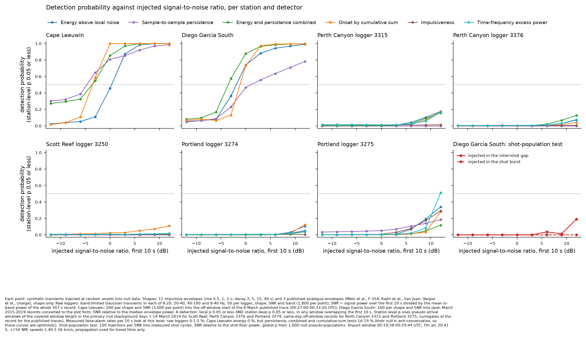

# Reverse-sensing screening of all hydroacoustic data held, 8 March 2014

Hydroacoustics module. Run of 4 November 2026. Status: SCREENING RESULT, NOT A DETECTION CLAIM.

Pre-registered rules: [reverse-methods-specification-2026-11-04.md](reverse-methods-specification-2026-11-04.md) (version 1.0, section 14 deviations log now filled) and Amendment 1 (spectral-shape weight W1). Frozen detector code: [reverse_detectors.py](reverse_detectors.py) v1.0.0 (25 unit tests pass). Propagation is used for travel time only. No amplitude is predicted.

## 1. What was run

1. Single-station screening detectors S1-S6 and S8 on the whole record of every station held, and S7 at Diego Garcia South. Plain names: energy above local noise (S1), sample-to-sample persistence (S2), energy and persistence combined (S3), onset by cumulative sum (S4), impulsiveness (S5, raw only), time-frequency excess power (S6, raw only), shot-population anomaly (S7), cluster of published picks (S8).
2. Empirical nulls per the specification. Look-elsewhere correction by pseudo arrival windows (station-level p) and across methods (common pseudo windows). Benjamini-Hochberg q over the event groups.
3. Known-event association (timing x spectral class on raw data). Removal at probability 0.95 or more. Airgun shots at Diego Garcia South are labelled and tested, never removed.
4. W1 spectral-shape weight on raw-logger candidates, in two versions (wide impact class, primary; F-35A-centred, for comparison).
5. Section 11 injection tests on real null data: 135,000 raw injections, 54,000 envelope injections, 900 shot-population injections, 894 W1 checks.
6. Arc mapping (section 9) of each candidate to 7th-arc cells and source times.

Not run in this step (the next plan steps): cross-station time-shift coincidence (B1), travel-time stacking (C1), unique-transient search (C2), analogue-shape correlation (C3), change-point onsets (C4), and network injections. The columns p_network_global_incl/excl and repeating_source are therefore empty.

## 2. Inputs (data-readiness check, all confirmed before compute)

| Input | Used for | Check |
|---|---|---|
| IMOS raw records, 8 March 2014: 3250 (100), 3274 (144), 3275 (96), 3315 (100), 3376 (100) records of 307 s at 6 kHz, decimated to 500 Hz | S1-S6, N1 | 540 records read; clock-corrected start times from the hydro data store segment table |
| IMOS background records, 1-14 March 2014, clock hours of the arrival window +/- 2 h: 3250 (252), 3274 (266), 3376 (266) | N2 | 784 records read; day 15 is not held |
| Kadri 2024 Fig. 9 vertices: Cape Leeuwin panels a-c (00:27-00:57), Diego Garcia South panels d-e (01:00-01:20) | S1-S4, S7 | 5 panels; about 19 vertices per s |
| Royer 2016 spectrogram 5-40 Hz band readings, 34 panels at 8 sites | S1-S4 (added form) | colour scale saturates |
| Published picks: Royer 2016 (8 sites), CMST detections (Cape Leeuwin 270, Diego Garcia South 802), Kadri 2024 Table 1 (19), Kadri 2019 Table 3 (6) | S8 | airgun shot list kept apart |
| Open IMS March 2015-2019, element 1 at Cape Leeuwin (100 days) and Diego Garcia South (121 days), downloaded 4 Nov 2026 from EarthScope | N3 (form check, sensitivity) | 271 station-days fetched, 50 with gaps skipped |
| Arrival windows (union over unblocked grid points), grid, known-event catalogue (67 events) and predicted arrivals, observed transients, airgun shot list, persistent sources | windows, association, labels | from the reverse-windows-data package (commit 264a9a4) |
| Blue whale Z-call detections at OHASISBIO sites, 7-8 Mar 23:00-03:00 (113 calls) | association | added on the lead's instruction |

## 3. Nulls

| Station | Primary null | Null windows per setting | Check |
|---|---|---|---|
| Scott Reef 3250, Portland 3274, Perth Canyon 3376 | N2 background days | about 30,000-32,000 (median over settings) | per-look false alarms at station level 0-0.7 % |
| Perth Canyon 3315, Portland 3275 | N1 same-day records outside the window | about 11,000-12,000 (median over settings) | 0-1.5 % |
| Cape Leeuwin, Diego Garcia South (Kadri traces) | N4 surrogates (100 phase-randomised + 100 block-bootstrap per panel) | 718,200 (Cape Leeuwin) | see the warning below |
| Royer spectrogram bands | N1 pooled over Royer panels of the same time resolution | small (null span 2.7-10.6 x the window) | weak calibration |

**Form check of N3 failed** (pre-registered rule applied). The quiet parts of the Kadri trace have a lag-1 autocorrelation of 0.01-0.05. The open data converted to the plot form give 0.19. So N4 is the primary null at both Kadri stations, and N3 p-values are given as p_local_altnull.

**Calibration warning (Kadri stations).** Station-level false alarms per 10 s look, measured on real noise (design value far below 5 %): Cape Leeuwin 8 March off-window trace: energy 0 %, persistence 19 %, combined 16 %, cumulative sum 0 %. Cape Leeuwin open data in plot form: energy 4.8 %, persistence 15 %, combined 15 %, cumulative sum 18.5 %. Diego Garcia South open data: 4-7 % for all four. The surrogates do not keep the real persistence of the envelope. Therefore the persistence and combined p-values at Cape Leeuwin are too small. The cumulative-sum test is calibrated on the 8 March record itself but not on the open data, so its p-values are uncertain (the off-window part is only 380 s). The energy test is calibrated (0-5 %).

## 4. Results

### 4.1 Candidate counts (local p 0.05 or less; one row = one detector, window length and band)

| Station | Energy | Persistence | Combined | Cumulative sum | Impulsiveness | Time-frequency | Picks | Kept | Removed |
|---|---|---|---|---|---|---|---|---|---|
| Cape Leeuwin | 139 | 27 | 36 | 40 | - | - | 6 | 245 | 3 |
| Diego Garcia South | 70 | 9 | 15 | 6 | - | - | 0 | 100 | 0 |
| Perth Canyon 3315 | 60 | 1 | 12 | 0 | 0 | 0 | - | 73 | 0 |
| Perth Canyon 3376 | 36 | 0 | 10 | 1 | 0 | 0 | - | 47 | 0 |
| Scott Reef 3250 | 84 | 0 | 23 | 19 | 0 | 3 | - | 129 | 0 |
| Portland 3274 | 68 | 5 | 19 | 13 | 1 | 2 | - | 108 | 0 |
| Portland 3275 | 46 | 3 | 10 | 8 | 5 | 2 | - | 74 | 0 |
| SWAMS1 / SWAMS2 / SWAMS3 | 0 / 3 / 31 | 0 / 0 / 5 | 0 / 0 / 16 | 0 / 0 / 18 | - | - | 1 / 2 / 3 | 0 / 3 / 67 | 1 / 2 / 6 |
| SSEIR | 34 | 4 | 6 | 12 | - | - | 3 | 43 | 16 |
| MAD / NCRO / WKER | 10 / 21 / 3 | 0 | 2 / 0 / 2 | 0 | - | - | 3 / 3 / 3 | 5 / 19 / 0 | 10 / 5 / 8 |

Total 964 candidates: 913 kept, 51 removed. They form 246 event groups (overlapping candidates at one station and data form); 227 groups are kept. Full table: [reverse-screening-candidates.csv](reverse-screening-candidates.csv) (section 12 schema plus W1, class scores and notes). Ranked groups: [reverse-screening-event-groups-ranked.csv](reverse-screening-event-groups-ranked.csv).

### 4.2 Removed candidates

All 51 removals are onsets at Royer 2016 located events or at a whale call: Royer A (11), B (6), C1 (6), C2 (4), C3 (8), 2 (7), 8 (8), and one Z-call at SWAMS3 (00:28:12). No raw-logger or Kadri-envelope candidate reaches 0.95. The highest association at a raw logger is 0.80. Kadri 2024 Table 1, Kadri 2019 and CMST transients are labels only (unexplained published events are test candidates, not known sources).

### 4.3 Strongest kept candidates

| Station, data | Onset (UTC) | Best detector | Smallest local p | Station-level p | Across-method p | BH q | Best known-event match (P) |
|---|---|---|---|---|---|---|---|
| Cape Leeuwin, Kadri trace | 00:51:58.3 | cumulative sum, 30 s | 1.6e-10 | 0.0002 | 0.0002 | 0.006 | earthquake T-phase ISC 606477922 (0.51); Royer 2/A picks 16-20 s earlier |
| Cape Leeuwin, Kadri trace | 00:36:07.5 | cumulative sum, 30 s | 2.3e-8 | 0.0002 | 0.0002 | 0.006 | earthquake EV081 (0.49); Royer B pick 00:35:51 |
| Cape Leeuwin, Kadri trace | 00:46:56.9 | combined, 10 s | 2.0e-6 | 0.0002 | 0.0002 | 0.006 | earthquake ISC 606477921 (0.52) |
| Cape Leeuwin, Kadri Table 1 picks | 00:52:36 | pick cluster | 5e-5 | 0.00015 | 0.00015 | 0.006 | degenerate: list has no off-window part |
| Cape Leeuwin, Kadri trace | 00:54:27.4 | cumulative sum, 10 s | 2.8e-5 | 0.0062 | 0.017 | 0.35 | Royer 5 (0.80; pick 00:54:10) |
| Portland 3275, raw | 01:21:40.0 | impulsiveness | 4.5e-4 | 0.026 | 0.049 | 0.76 | Royer 9 (0.46) |
| Portland 3275, raw | 01:07:43.1 | impulsiveness | 8.4e-5 (energy, 5 s, 8-20 Hz) | 0.046 | 0.091 | 1.0 | Royer A (0.58) |

The station-level and across-method p-values at Cape Leeuwin sit at the floor of 5,000 draws (0.0002). They rest on the N4 null, which is anti-conservative for persistence and combined tests and uncertain for the cumulative-sum test (section 3). The four Cape Leeuwin groups with BH q 0.006 coincide in time with published arrivals of known or listed events. No kept group has network evidence yet (B1/C1 not run). Nothing here is a detection under section 10 (which needs a network p of 0.01 or less at two or more stations).

### 4.4 Shot-population test at Diego Garcia South (S7)

Shots measured from the record: 63 bursts in panel d and 152 in panel e (78 off-comb secondary bursts). Comb period 9.93 s and 9.96 s; 60 and 59 cycles; median burst 0.9 s and 1.2 s. No cycle has a global p of 0.05 or less (minimum 0.17 in panel d, 0.53 in panel e; 1,000 null pseudo-populations). The 100 Diego Garcia South candidates: 83 fall in a shot burst, 16 in an inter-shot gap, 1 outside the shot sequence; the smallest S7 p of their cycles is 0.62. Tables: [s7-shot-population-summary.csv](s7-shot-population-summary.csv), [s7-shot-population-cycles.csv](s7-shot-population-cycles.csv).

Injection result: the test is weak on real shots. At +12 dB above the shot floor, 19 % of gap injections and 0 % of burst injections reach global p 0.05 ([s7-injection-results.csv](s7-injection-results.csv)). The synthetic reference of the specification (7 of 10 at +6 dB) does not transfer to the real record.

### 4.5 Sensitivity (station-level p 0.05 or less; injection into real null data)

| Station (host) | SNR50 energy | SNR50 combined | SNR50 cumulative sum | Best other | False alarms per look (station level) |
|---|---|---|---|---|---|
| Cape Leeuwin (8 Mar off-window trace) | -0.1 dB | -5.6 dB | -3.7 dB | persistence -5.9 dB | energy 0 %, persistence 19 %, combined 16 %, cumulative sum 0 % (18.5 % on open data) |
| Diego Garcia South (open data, plot form) | -1.8 dB | -3.8 dB | -1.6 dB | persistence +3.2 dB | 4-7 % |
| Raw loggers, all five | > +12 dB | > +12 dB | > +12 dB | Portland 3275 time-frequency +12.4 dB | 0-1.5 % |

For the raw loggers, the SNR is the injected power over 10 s against the mean in-band power of the whole 307 s record (pre-registered definition). The null records hold many natural transients, so a short transient must be strong to reach the station-level threshold. At local p 0.05 the raw detectors respond at lower SNR (for example energy: local detection 0.60-0.95 at 0 dB), but with 40-45 % false alarms per look. Full tables: [reverse-screening-sensitivity.csv](reverse-screening-sensitivity.csv), [reverse-screening-detection-curves.csv](reverse-screening-detection-curves.csv).

### 4.6 W1 spectral-shape weight

Impact-shaped injections get W1_wide about 2.0 (the top of the null) at 0, +6 and +12 dB. Tonal call-like injections get 0.43, 0.02 and 0.00. The F-35A-centred W1_metz gives 1.9-2.0 to both, so it does not separate them ([w1-injection-check.csv](w1-injection-check.csv)). W1 changes rank only.

### 4.7 Entry for the Portland 3275 transient flagged by Pete Large (01:07:30-01:08:00 UTC)

- Inside the Portland arrival window (01:01:51-01:33:19). One event group of 28 candidates. Onset 01:07:43.1 (cumulative sum).
- Detectors (best per detector; local p / station-level p): energy 5 s, 8-20 Hz, z 18.3: 8.4e-5 / 0.106; combined 10 s, 8-20 Hz: 8.1e-4 / 0.143; cumulative sum 10 s, 8-20 Hz: 0.0081 / 0.475; impulsiveness: 8.1e-4 / 0.046; time-frequency excess power: 0.0064 / 0.194; persistence: no candidate. Across-method p 0.091; BH q 1.0.
- W1_wide 1.97 (best fit: corner below 1 Hz, slope 3, no tonal bins). W1_metz 1.97. Free-fit log-log slope of the excess: -2.4 (power falling as f^-2.4). 60 % of the excess power is below 15 Hz.
- Source-class scores (version 2): impact-like 0.68, earthquake sound arrival 0.15, airgun 0.06, whale call or ship 0.06, ice 0.06. Version 1 (dynamic-range tonality, superseded): whale or ship 0.37, impact-like 0.22.
- Association against all catalogued events with arrivals at Portland: largest Royer A, up to 0.58 (best-match range over the 28 members 0.13-0.58), Royer 6 0.25, Royer B 0.21, earthquake EV083 body wave 0.18, ISC 606477929 body wave 0.12, ISC 606477923 T-phase 0.09; all others below 0.08. No catalogued earthquake T-phase explains it at 0.95. Known natural events stay in the null, which makes this conservative.
- Arc mapping: cells 30-38 S, source times 00:19:38-00:25:54. The intersection count (9 sites) is not informative at this candidate density.
- The steady line near 25 Hz is a separate persistent source; the local-noise reference removes steady lines from the excess spectrum.
- Nothing was tuned to this event. The class-score revision (deviation D15) was made after this event's features were seen; both versions are shown.

### 4.8 Cross-check against the back-to-basics cases (not used for removal)

| Case | Our result | Agreement |
|---|---|---|
| Cape Leeuwin 00:54:30 = Royer 5 | group at 00:54:27; best match Royer 5 (P 0.80); kept | agrees on identity; not removed because the envelope onset is 17 s after the Royer pick and the timing sd is 2 s |
| Cape Leeuwin 01:13:29 = Royer 6 | outside the Cape Leeuwin arrival window (ends 01:06:50); no candidate counted | agrees (not an impact candidate) |
| Cape Leeuwin 00:51:4x = Royer A / Kadri T1 00:51:50 | Royer 2 pick cluster removed (P 0.96); Kadri-trace onset 00:51:58 kept (best match an earthquake T-phase, 0.51; Royer A 0.07) | partly: same transient, but the onset is 16-20 s after the Royer picks, so the 0.95 rule keeps it |
| Diego Garcia South 01:13-01:16 rise = airgun shots | candidates 01:14:18-01:15:19 all in shot bursts (shots 86-92); S7 p 1.0 | agrees: labelled, not removed |
| Perth Canyon 3376 steady tonal lines, positive slopes | excess-spectrum log-log slope median -0.78, i.e. power falling as f^-0.78 (table column stores the exponent 0.78); 11 % rising; class mean earthquake 0.34, tonal 0.27, impact-like 0.27 | partly: our excess is over the local noise, which removes steady lines, so the slope differs |
| Portland 3275 01:20:35 = call-like tone 25-40 Hz | group at 01:20:31, best energy 2 s 20-40 Hz; whale or ship 0.49; W1_wide 0.0 for that window | agrees |
| Portland 3275 01:07:40 = impact-like | impact-like 0.68; W1_wide 1.97 | agrees |

### 4.9 Charts

One timeline per station with data, arrival window, candidates (kept filled, removed open; marker size = station-level p) and known-event arrivals: Cape Leeuwin, Diego Garcia South, Perth Canyon 3315 and 3376, Scott Reef 3250, Portland 3274 and 3275, SWAMS1-3, SSEIR, MAD, NCRO, WKER (files timeline-*.png). These charts were drawn before the final footnote edits. A re-render that removes the repeated Royer null description and adds the Kadri calibration warning (section 3) and the Portland 3275 note to the footnotes was stopped twice because the platform safety check was unavailable. Until it is re-run, read the charts together with sections 3 and 4.7. The candidates and labels on the charts are final.

## 5. Limits

1. Kadri stations: envelope only. Under N4, persistence and combined p-values are anti-conservative (15-19 % per look at Cape Leeuwin); cumulative-sum p-values are calibrated on the 8 March off-window trace (0 %) but not on open-data noise (18.5 %). Treat their small p-values as ranks; the energy test is calibrated.
2. Raw loggers: 34 % duty cycle; station-level sensitivity weaker than +12 dB under the pre-registered SNR definition.
3. Persistence (S2) has no power at Scott Reef and Perth Canyon 3376: the pre-registered thinning lag is 8-13 s, so a 10 s window holds 1 sample.
4. Royer spectrogram bands: saturating colour scale, pooled small null.
5. The association sd uses the pick error only (2-5 s). Emergent onsets 15-20 s after a published pick are therefore kept.
6. Class scores are rule-based and were set after the windows were opened (deviation D15). They enter only as a factor clipped to 0.1-10.
7. Injection counts reduced for raw loggers (50 per cell, not 200). Network and C2-C4 injections not run.
8. The ordered record of analysis cells could not be exported to this folder: the platform safety check was unavailable at that step. Scripts and helper modules are included.

## 6. Deviations

18 deviations, each with a reason: [reverse-screening-deviations.csv](reverse-screening-deviations.csv), and section 14 of the specification. The main ones: D1 empty-bin gate, D2 shot period by comb scan, D3 S6 numerical tail, D7 injection counts, D8 Royer bands added, D13 Z-calls added, D14 W1 wide model (Pete Large, 4 Nov 2026), D15 class-score revision.

## 7. Files

Code: [screen_core.py](screen_core.py), [prep_imos.py](prep_imos.py), [run_imos_stats.py](run_imos_stats.py), [run_s6.py](run_s6.py), [inj_imos.py](inj_imos.py), [inj_all.py](inj_all.py), [shard.py](shard.py), [reverse_detectors.py](reverse_detectors.py) (frozen v1.0.0). Paths are given by environment variables (HYDRO_DB, HYDRO_INPUTS).
