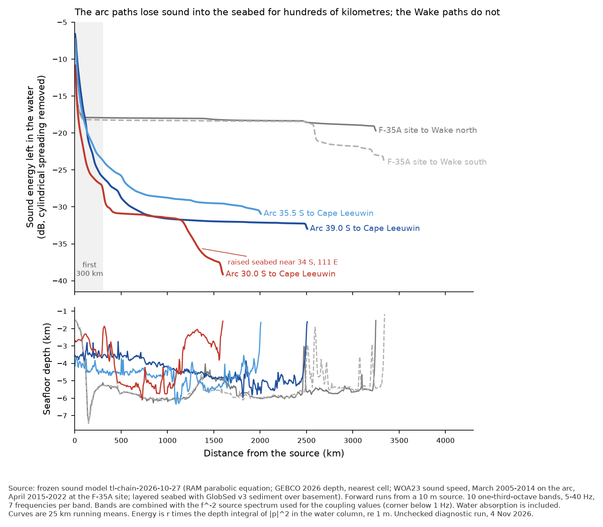
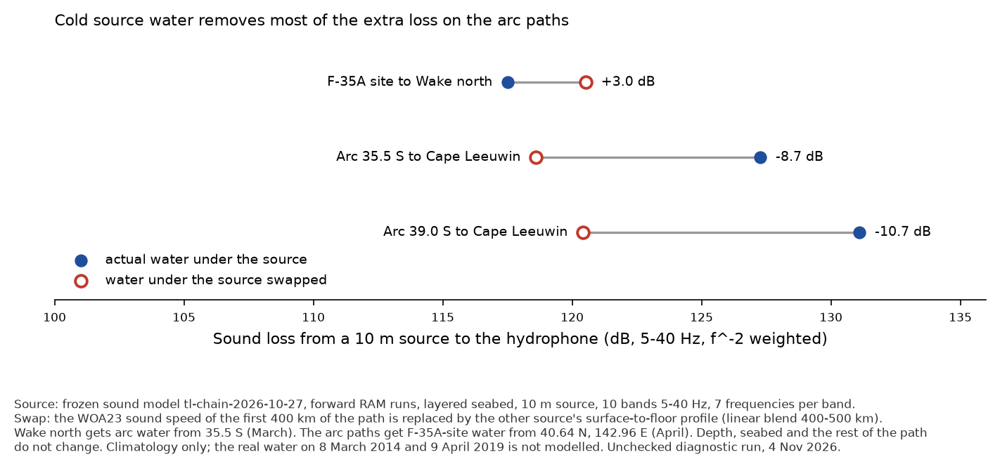
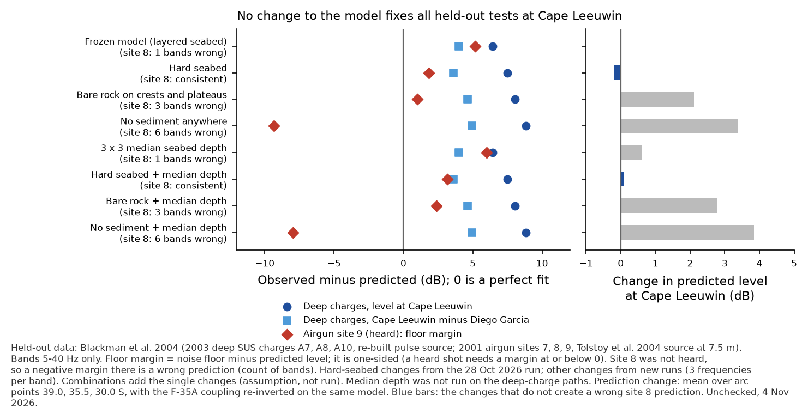
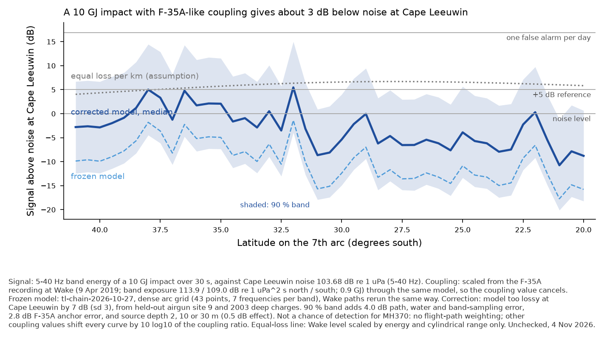
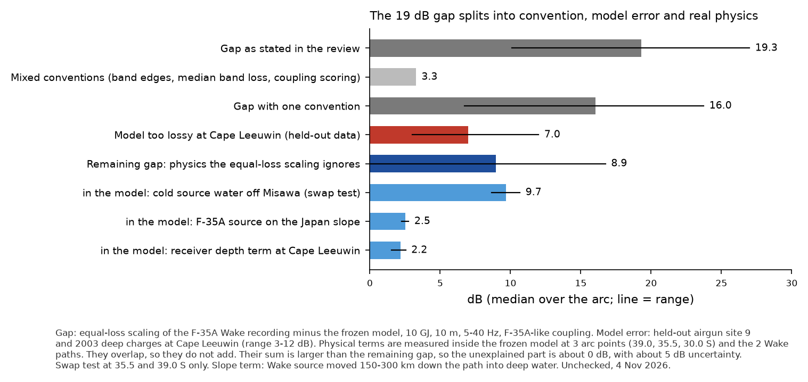

# Why the sound model and the F-35A recording disagree at Cape Leeuwin, and a corrected 10 GJ prediction

Back-to-basics step 1, 4 Nov 2026. Hydroacoustics. EXPLORATORY and UNCHECKED: no independent verifier has passed these results. ASD-STE100 style.

## Scope and deviations (read first)

1. Scope was as asked, with these reductions:
   - range analysis at 3 arc points (39.0, 35.5, 30.0 S), not all 43;
   - fix tests at the same 3 arc points, the 2 Wake paths and 9 held-out calibration paths (airgun sites 7, 8, 9 to Cape Leeuwin; 2003 SUS sites A7, A8, A10 to Cape Leeuwin and to Diego Garcia South);
   - calibration paths ran 3 frequencies per band and bands up to 40 Hz only. The fix effect is a difference at identical frequencies, so most band-sampling noise cancels;
   - arc and Wake runs used 7 frequencies per band, the same as the dense arc grid.
2. Not run:
   - the 3 x 3 median depth on the SUS paths (its change there is taken as 0);
   - hydrophone element positions against the triad centroid;
   - other sound-speed months or years;
   - the N x 2D corridor;
   - the swap test at 30 S.
3. Fix combinations are additive sums of single runs. They were not run together.
4. The hard-seabed changes on the calibration paths are reused from the 28 Oct 2026 run (Phase 4 table). The bare-rock rule is copied from Phase 3 and reproduces its masks exactly.
5. The Cape Leeuwin bias (7 dB, sd 3) and the error terms in the 90 % band are judgements from 6 calibration paths. They are not a fitted model. Every number below that uses them is provisional.
6. Compute: 3,100 RAM and KRAKEN runs, about 1.2 h wall time on 6 processes (2 more for 10 min), 0 errors.

## 1. F-35A coupling on the frozen model

The frozen model was run on both Wake paths in Phase 3 (27 Oct; table `tl_used_atlantic_pacific.csv`). The review said that no such table exists. That is not correct. I re-ran both paths with the dense-grid settings (7 frequencies per band). The f^-2-weighted loss agrees with Phase 3 to 0.02-0.19 dB. Single bands differ by up to 3.7 dB, which is expected band sampling.

| source depth | frozen, scored 5-63 Hz | frozen, scored 5-40 Hz | frozen hard seabed, 5-40 Hz | digitised CV01-CV03 | frozen / CV |
|---|---|---|---|---|---|
| 2 m | 0.0779 | 0.0745 | 0.0762 | 0.054 | 1.44 |
| 10 m | 3.16e-3 | 3.01e-3 | 3.10e-3 | 2.26e-3 | 1.40 |
| 30 m | 3.90e-4 | 3.62e-4 | 3.92e-4 | 3.4e-4 | 1.15 |

The 10 m value of 3.16e-3 reproduces the Phase 3 result exactly. All values use the stated definition: flat to a corner below 1 Hz, f^-2 above, normalised over 1-500 Hz. The north triad gives 4.3e-3 and the south triad 2.3e-3. The coupling value cancels in the prediction when one model carries both the Wake and the Cape Leeuwin paths, so its chain-to-chain change (1.4x) is not a cause of the gap. Table: [f35a-coupling-reinversion.csv](tables/f35a-coupling-reinversion.csv).

## 2. Where the extra loss builds up

With one convention (5-40 Hz third-octave bands at both ends, f^-2 weighting, 10 m), the frozen model loses 12-14 dB more to Cape Leeuwin than to Wake:

- median 133.2 dB over 43 arc points (range 124.6-141.0 dB);
- Wake 118.8 dB (north) and 120.6 dB (south);
- yet the arc paths are about half as long (1,560-2,890 km against 3,250-3,340 km).

The gap with equal loss per km is 16.0 dB median (6.7-23.7 dB; 16.1 dB with the 7-frequency Wake rerun), not 19.3 dB. About 3.3 dB of the review's figure comes from mixed conventions (17.5 % against 20.1 % band energy, median band loss against energy-weighted loss).

1. **The extra loss is spread along the path. It is not one block at the Cape Leeuwin shelf, slope or a ridge.** Energy budget (f^-2-weighted forward runs, 10 m source, layered seabed), loss in dB per segment:

   | segment | Wake north / south | arc 39 S | arc 35.5 S | arc 30 S |
   |---|---|---|---|---|
   | 5 to 100 km | 8.0 / 8.3 | 11.5 | 12.1 | 13.1 |
   | 100 to 300 km | 0.0 / 0.0 | 8.5 | 5.2 | 4.6 |
   | 300 km to 300 km before the hydrophone | 1.0 / 3.6 | 6.2 | 6.2 | 7.5 |
   | last 300 km | 1.4 / 2.4 | 0.9 | 1.4 | 4.6 |

   After the first 100 km the Wake paths keep their energy in the refracted channel. The arc paths keep losing energy into the seabed. Only the 30 S path has a large late loss, where it crosses raised seabed near 34 S, 111 E. The receiver depth term at Cape Leeuwin adds 1.5-2.6 dB. Tables: [energy-budget-by-path.csv](tables/energy-budget-by-path.csv), [band-by-band-energy-loss-by-segment.csv](tables/band-by-band-energy-loss-by-segment.csv).
2. **Band by band** (RAM, layered seabed), the arc-minus-Wake loss is 4.7-16.7 dB at 5-16 Hz and 7.9-20.6 dB at 20-40 Hz. It rises with frequency at 30 and 39 S. KRAKEN gives up to 43 dB at 30 S and 40 Hz, where its adiabatic modes are blocked by the raised seabed. Table: [band-by-band-arc-minus-wake.csv](tables/band-by-band-arc-minus-wake.csv).
3. **The cause is the water under the source.**
   - Off Misawa in April the surface sound speed is 1,474.8 m/s and the channel axis is at 300 m.
   - On the arc in March the surface is warm (1,511-1,527 m/s) and the axis is at 1,050-1,200 m. Depth excess is 149 m (39 S) or 360 m (35.5 S); at 30 S there is none.
   - A simple ray estimate gives refracted rays up to 14-16° from the surface on the Wake paths, but only 2-4° on the arc paths. That is about 19-24 dB less trapped energy for a near-surface (dipole) source.
   - Swap test: I put the cold Misawa profile under the first 400 km of the arc paths. The loss falls by 8.7 dB (35.5 S) and 10.7 dB (39 S), to 118.6 and 120.4 dB, which is the Wake level. Warm arc water under the Wake source raises the Wake loss by 3.0 dB.

   
4. **The F-35A slope site helps a little.** Moving the Wake source 150-300 km down the path into deep water raises the loss by 2.3-2.8 dB (the source sits in 1,515 m of water on the Japan slope). Table: [loss-vs-source-position.csv](tables/loss-vs-source-position.csv).
5. **Independent check.** KRAKEN adiabatic modes on the same sections give 6.5-16.1 dB more loss on the arc paths than on Wake (layered seabed), against 8.4-15.9 dB from RAM. The difference is not an artefact of the parabolic-equation runs. Table: [kraken-vs-ram-effective-loss.csv](tables/kraken-vs-ram-effective-loss.csv).
6. **Checks.**
   - The reverse arc runs reproduce the stored dense-run intensities exactly (210 runs, 0.0 dB).
   - Forward against reverse (reciprocity): −0.41 dB mean, band sd 1.9 dB.
   - The bare-rock masks reproduce Phase 3 exactly (291.0 / 272.75 / 176.5 km).

## 3. Candidate fixes against held-out data

A fix counts only if it improves the held-out Cape Leeuwin tests. Coupling is re-inverted on the same variant.

| change | deep charges, Cape Leeuwin level (route B) | Cape Leeuwin minus Diego Garcia | site 9 floor margin (heard) | site 8 (not heard): wrong bands | change in predicted Cape Leeuwin level |
|---|---|---|---|---|---|
| frozen | +6.4 | +4.0 | +5.2 | 1 | 0 |
| hard seabed | +7.5 | +3.6 | +1.8 | 0 | −0.2 |
| bare rock on crests | +8.0 | +4.6 | +1.0 | 3 | +2.1 |
| no sediment | +8.8 | +5.0 | −9.4 | 6 | +3.4 |
| 3 x 3 median depth | +6.4 | +4.0 | +6.0 | 1 | +0.6 |

Values are observed minus predicted in dB; 0 is a perfect fit. Combinations with the median depth are in the table files.

- No change passes all tests.
- The hard seabed is the only partial pass. It moves the Cape Leeuwin prediction by −0.2 dB.
- The changes that raise the prediction (bare rock, no sediment) predict that site 8 should have been heard. It was not.
- So no chain change explains the gap. The measured bias is used instead.

Tables: [fix-tests-heldout-calibration.csv](tables/fix-tests-heldout-calibration.csv), [fix-tests-cape-leeuwin-prediction.csv](tables/fix-tests-cape-leeuwin-prediction.csv).

## 4. Corrected prediction and gap accounting

The corrected prediction uses: the frozen dense grid, the Wake recording scaled through the same model (coupling cancels), and the measured Cape Leeuwin bias of +7 dB (sd 3). The bias comes from these held-out paths:

- airgun site 9, 100 km from the arc at 28 S: +8.3 dB on level, at least +5.2 dB on the one-sided floor;
- the 2003 deep charges: +6.4 dB (route B);
- the station difference against Diego Garcia: +4.0 dB.

The 90 % band adds:

- 4.0 dB for path scatter, water column and band sampling;
- 2.8 dB for the F-35A anchor (energy, element, triad, location);
- source depth 2-30 m, which changes the level by at most 0.5 dB with the F-35A depth tie.

**Result (10 GJ, F-35A-like coupling, 5-40 Hz, 30 s, Cape Leeuwin noise 103.68 dB):**

- Median over the arc: **−2.9 dB re noise**. Point medians run from −10.8 dB (21 S) to +5.5 dB (32 S).
- 90 % band at the median point: −12.4 to +6.7 dB.
- Chance above +5 dB: 8 % at the median point, 0-53 % along the arc.
- Chance above +16.9 dB (one false alarm per day): 0-3 %.
- Other coupling values shift every value by 10 log10 of the coupling ratio. For example, 1e-2 at 10 m gives +5.2 dB and 1e-4 gives −14.8 dB.
- This is not a chance of detection for MH370. It has no flight-path weighting, and it assumes F-35A-like coupling.

Table: [cape-leeuwin-10GJ-corrected-prediction-by-arc-point.csv](tables/cape-leeuwin-10GJ-corrected-prediction-by-arc-point.csv).

**How much of the 19 dB is explained:**

| part | dB |
|---|---|
| mixed conventions | 3.3 |
| model too lossy at Cape Leeuwin (held-out data) | 7 (3-12) |
| physics that the equal-loss scaling ignores | 8.9 median (−0.1 to 16.8 along the arc) |

The model attributes the physics part to:

- the cold source water off Misawa: 8.7-10.7 dB;
- the F-35A slope site: 2.3-2.8 dB;
- the Cape Leeuwin receiver depth term: 1.5-2.6 dB.

These terms overlap, so they do not add. Their sum exceeds the remaining 8.9 dB, so the **unexplained part is about 0 dB, with about ±5 dB uncertainty**. The "+2 to +9 dB" empirical scaling is therefore not a measurement at Cape Leeuwin. It rests on equal loss per km, and the physics here does not support that. Table: [gap-accounting.csv](tables/gap-accounting.csv).

## 5. Limits

1. The bias rests on 6 Cape Leeuwin paths. Only site 9 is a shallow source near the arc, and its level depends on the airgun source model (Tolstoy et al. 2004). The 7 dB (sd 3) is a judgement.
2. The bias probably lives in how the model strips bottom-interacting energy on warm-water paths. No seabed change tested here removes it without failing site 8.
3. The Wake side of the anchor is not calibrated on a known-yield Pacific source. A Wake-path model error would enter the prediction one-for-one. It is not in the 90 % band.
4. Water column: WOA23 climatology only. The swap test shows that the source-region water drives about 10 dB. The real profiles on 8 Mar 2014 (arc) and 9 Apr 2019 (Misawa) could move the result by several dB. This is a priority check (Argo or reanalysis profiles).
5. The F-35A spectrum is steeper than f^-2 (f^-3.1, corner about 5 Hz). With that shape the 5-40 Hz weighting changes; this was not re-run here.
6. Cost to extend the fix tests to all 43 arc points: about 65 min per variant on 6 processes. Not needed, because no fix passed.

## Files

Scripts, tables and charts are in this folder (`gapdiag.py`, `make_jobs_gap.py`, `make_jobs_fixes.py`, `make_jobs_swap.py`, `assemble_gap.py`). The frozen chain was imported unchanged (tl-chain-2026-10-27, 27/27 checksums OK). The raw per-frequency output is in gap-runs-raw-2026-11-04.tar.gz (project artifact version e6ee68b0) (76 MB; not committed to git).
