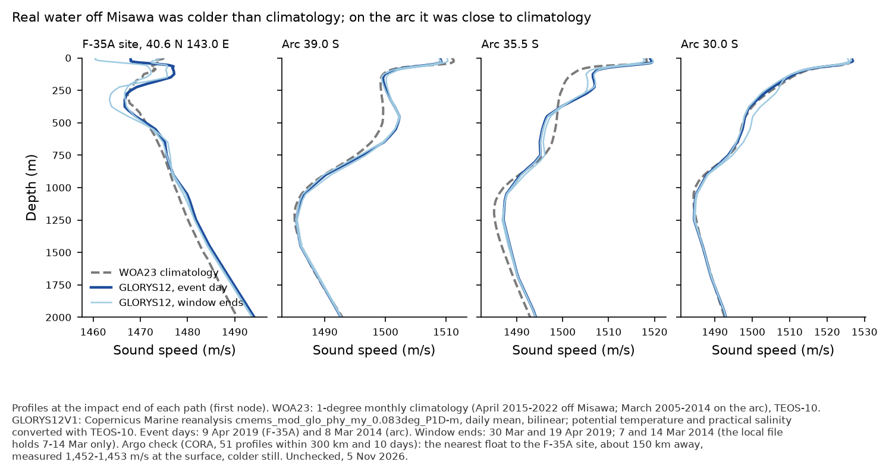
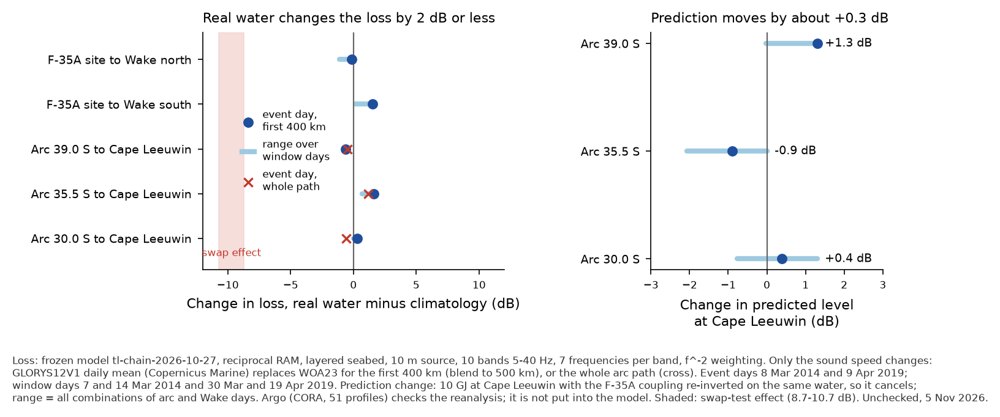

# Addendum: real ocean conditions instead of climatology (5 Nov 2026)

Addendum to [README.md](README.md) (step-1 note). EXPLORATORY and UNCHECKED. ASD-STE100 style.

## Deviations (read first)

1. **Argo services.** Argo came from the Copernicus Marine in-situ product CORA (`cmems_obs-ins_glo_phy-temp-sal_my_cora_irr`, version 202511), not from the Argo data centres. The Ifremer ERDDAP and Argovis services are outside the sandbox network allowlist. As instructed, I did not ask for approval and did not wait.
2. **Argo is a check only.** The 51 profiles test the reanalysis and the climatology. They are not put into the sound model, because they are too sparse to fill a 400 km section.
3. **Gridded source.** The gridded profiles come from the GLORYS12V1 daily reanalysis.
   - Arc: the local file (fetched 10 Oct 2026) holds only 7-14 Mar 2014. So the arc window is −1 to +6 days, not ±10 days.
   - Misawa: downloaded today, 30 Mar-19 Apr 2019 (±10 days), box 141-149 E, 36-42 N.
4. **Where the water changes.** Real water replaces climatology on the first 400 km of each path, blended to 500 km. On the arc paths it also replaces the whole path, as a sensitivity. On the Wake paths a whole-path run was not possible, because the download box covers only about 450 km.
5. **The full arc is not re-run.** The 43-point prediction is shifted by the mean change at the 3 run points (+0.26 dB). The bias (+7 dB, sd 3) and the error terms are unchanged, including the 2.5 dB water-column term.
6. **Argo selection.** The ±10-day test uses calendar days, so some arc profiles are up to 10.8 days from the event. 5 of the 27 Misawa profiles lie outside the GLORYS box and have no reanalysis comparison.
7. **Compute.** 1,260 RAM runs, 18.5 min on 6 processes, 0 errors. Only the sound-speed nodes changed: same seabed, bathymetry, bands, 7 frequencies per band, frozen chain tl-chain-2026-10-27.

## Data used

| region | source | dates | positions | file / record |
|---|---|---|---|---|
| arc paths (39.0, 35.5, 30.0 S) | GLORYS12V1 `cmems_mod_glo_phy_my_0.083deg_P1D-m`, daily mean thetao/so | event day 8 Mar 2014; window days 7 and 14 Mar | each 25 km node of the first 400-500 km (and the whole path) | `glorys12v1_uo_vo_thetao_so_75-115E_45-10S_20140307-20140314.nc` (sha256 864ebb0c…) |
| F-35A site to Wake | same product | event day 9 Apr 2019; window days 30 Mar and 19 Apr | each 25 km node of the first 400-500 km | `glorys12v1_thetao_so_141-149E_36-42N_20190330-20190419.nc` (28 MB, fetched 5 Nov 2026, sha256 in fetch-log.jsonl) |
| Argo check | CORA daily `*_PR_PF.nc` files, global region | ±10 days | ≤300 km from the first 400 km of any path | 24 arc profiles, 27 Misawa profiles |

Every node profile used (path, variant, date, latitude, longitude, blend weight) is in [glorys_profiles_used.csv](tables/glorys_profiles_used.csv). Every Argo profile (platform, time, position, distance, depth, comparison) is in [argo-profiles-near-sources.csv](tables/argo-profiles-near-sources.csv). All files are in `~/Downloads/mh370-ocean-data/glorys12/profile/` and `~/Downloads/mh370-ocean-data/insitu/cora/`.

## Results

1. **Real water on the arc was close to climatology.**
   - GLORYS12 on 8 Mar 2014 is within 0.1-2.0 m/s of WOA23 at the surface. The rms difference over 0-1,500 m is 2.0-2.6 m/s.
   - Argo agrees better with GLORYS12 than with climatology: median rms over 0-1,500 m is 0.99 m/s against 1.48 m/s (24 profiles).
2. **Real water off Misawa was colder than climatology.**
   - At the source on 9 Apr 2019, GLORYS12 gives a surface sound speed of 1,467.9 m/s, against 1,474.8 m/s in WOA23 (1,460.7 m/s on 30 Mar).
   - The nearest float (2902969, about 150 km north) measured 1,451.8-1,453.3 m/s at the surface, colder still.
   - The area is a front: surface values within 300 km run from 1,452 to 1,516 m/s. Both GLORYS12 and WOA23 differ from Argo there by about 3.5-3.8 m/s rms.
3. **The loss changes by 2 dB or less** (f^-2-weighted, 5-40 Hz, 10 m source, real minus climatology):

   | path | event day, first 400 km | window days | event day, whole path |
   |---|---|---|---|
   | arc 39.0 S to Cape Leeuwin | −0.60 dB | −0.60 to −0.44 | −0.48 |
   | arc 35.5 S to Cape Leeuwin | +1.60 dB | +0.70 to +1.60 | +1.16 |
   | arc 30.0 S to Cape Leeuwin | +0.31 dB | +0.02 to +0.31 | −0.60 |
   | F-35A site to Wake north | −0.12 dB | −1.10 to −0.12 | not run |
   | F-35A site to Wake south | +1.52 dB | +0.17 to +1.52 | not run |

   The swap test of 4 Nov changed these losses by 8.7-10.7 dB. Real-day water moves them by at most about 1.6 dB. The source-water effect is a contrast between two regimes: cold water off Misawa with a shallow channel axis, and warm subtropical water on the arc. Day-to-day detail does not drive it, and climatology already captures it.

   
4. **The corrected 10 GJ prediction at Cape Leeuwin** (coupling re-inverted on the same water, so it cancels):
   - Change on the event days: +1.3 dB at 39.0 S, −0.9 dB at 35.5 S, +0.4 dB at 30.0 S; mean **+0.3 dB**.
   - All combinations of arc and Wake days give −2.1 to +1.3 dB.
   - The 2 m and 30 m results are within 0.2 dB of the 10 m result.
   - The arc median moves from −2.9 to **−2.6 dB re noise**. The 90 % band at the median point is −12.2 to +6.9 dB.

   Tables: [real-ocean-loss-change-by-path.csv](tables/real-ocean-loss-change-by-path.csv), [real-ocean-prediction-change.csv](tables/real-ocean-prediction-change.csv), [cape-leeuwin-10GJ-prediction-real-ocean-by-arc-point.csv](tables/cape-leeuwin-10GJ-prediction-real-ocean-by-arc-point.csv).

## What this means

- The step-1 conclusion stands. The equal-loss-per-km scaling fails because the two source regions are in different water regimes, not because the climatology was wrong on the day.
- Real conditions change the prediction by less than the other error terms. The 2.5 dB water-column term in the 90 % band is large enough to cover them.
- The largest remaining water-column uncertainty is the Misawa front. Argo there is 3.5-3.8 m/s rms from both gridded sources. A 150 km float shows still colder surface water than GLORYS12. Colder water near the F-35A source would make the Wake coupling look more efficient. That would lower the Cape Leeuwin prediction, probably by a few dB at most. This is not quantified here.

## Files

Scripts: `make_jobs_glorys.py` (sections and jobs) and `argo_compare.py` (Argo selection and comparison). `assemble_gap.py` now skips range curves for runs without a range record. Raw RAM output: `gap/runs/out_glorys.jsonl` (workspace, not committed).
