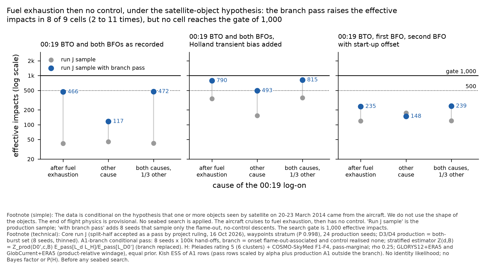
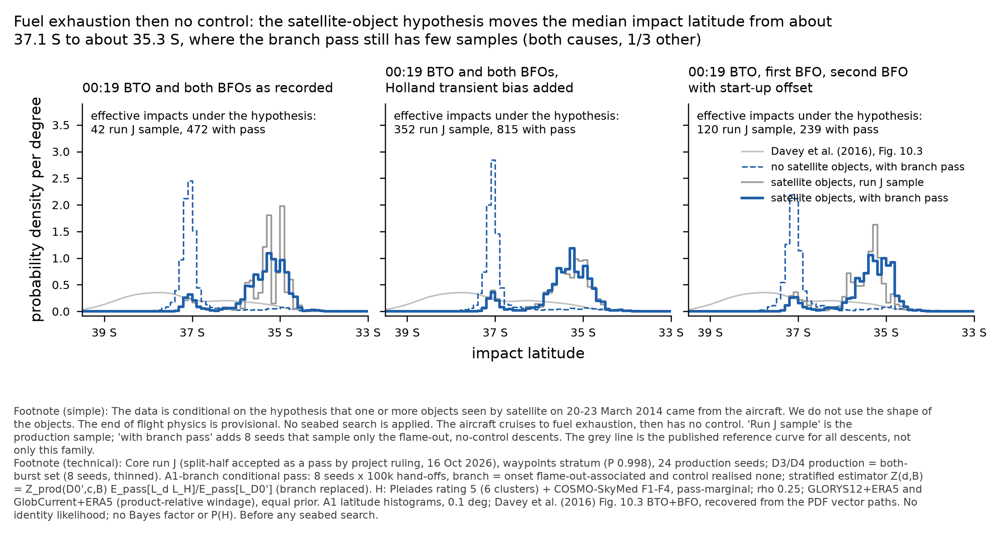

# Pléiades module on end of flight's A1-branch conditional pass: the A1 gap under H is NOT closed (order B2, 19 Oct 2026)

Pléiades module, 19 Oct 2026 (overnight order B2, `threads/work-orders/overnight-2026-10-19.md`; Pete offline). Brief: `threads/master-prompts/pleiades.md` v2.
Scripts (in `engine/hypotheses/pleiades/prepare/`): `score_runj_a1branch.py` (per seed: columns for the pass, sums for the estimator),
`aggregate_runj_a1branch.py` (stratified estimator under H, tension). Every number below is read from `pleiades-a1branch-stratified.json` here.

**Labels (carry them into every product):** conditional on H (at least one imaged object came from 9M-MRO); no identity likelihood; no
absolute Bayes factor or P(H | data); core run J, split-half accepted as a pass by project ruling, 16 Oct 2026; end-of-flight physics
PROVISIONAL, and the uncontrolled-arm dynamics are NOT calibrated (end of flight's caveat: the Boeing leave-one-out gate failed in all
three rounds; this arm is a labelled sensitivity); headline setting ρ 0.25, GLORYS12 + ERA5 and GlobCurrent + ERA5 (product-relative
windage), equal prior, Pléiades rating 5 (6 clusters) + COSMO-SkyMed F1-F4, pass-marginal; GLORYS12 only beside; **before any seabed
search**; waypoints stratum only (core P(family) 0.998). A1 = cruise to fuel exhaustion, then no control. A2 = cruise to fuel exhaustion,
then controlled descent. B = planned descent with a ditching approach begun before fuel exhaustion. D0' = 00:19 values held out,
transmission imposed. Causes: C1 = log-on after fuel exhaustion; C2 silent = log-on from another cause, aircraft silent; total q = 1/3 =
both causes, prior weight 1/3 on the other cause (C2 silent).

## 1. Result

**Under H the gate is not met for A1 under D3, D4 or D5 in any cause.** The branch pass raises the A1 effective impacts under H from
42 to 472 (D3, total q = 1/3), from 352 to 815 (D4) and from 120 to 239 (D5). Against the 1,000 gate of this module every cell fails.
Against the 500 figure quoted in the work order, D4 x C1 (790) and D4 x total (815) pass; D3 (472) and D4 x C2 silent (493) fall just short;
D5 fails. The A1 shares under H by the stratified estimator agree with production within production's noise (D3 0.074 against 0.083;
D4 0.239 against 0.210; D5 0.051 against 0.045), but the split halves of the pass disagree by up to 1.6 times (D3 total: 0.098 against
0.061), so **the magnitude of the A1 share under H is unconverged**. Direction: the share is small (5-10 % of the conditional mass under
D3 and D5, about a quarter under D4), in both halves.

Without H, the same estimator reproduces end of flight's result (D3 total: A1 0.086, ESS 5,284; end of flight 0.085, 5,282).

### Headline setting (ρ 0.25, two ocean models), under H

| 00:19 option | cause | A1 share, run J (ESS) | A1 share, stratified (rescale form) | A1 ESS, stratified | gate 1,000 / 500 | branch pass ESS rows / parents | A1 outside branch: share of A1 (run J ESS) | split halves seeds 1-4 / 5-8: A1 (ESS) |
|---|---|---|---|---|---|---|---|---|
| D3 R600 BTO + both BFOs as recorded (Holland H2 data) | C1 | 0.083 (42) | **0.075** (0.074) | **466** | FAIL / FAIL | 466 / 417 | 0.000 (2.8) | 0.099 (216) / 0.062 (250) |
| D3 R600 BTO + both BFOs as recorded (Holland H2 data) | C2 silent | 0.088 (45) | **0.069** (0.068) | **117** | FAIL / FAIL | 444 / 385 | 0.103 (1.6) | 0.078 (114) / 0.062 (81) |
| D3 R600 BTO + both BFOs as recorded (Holland H2 data) | total q=1/3 (C2 silent) | 0.083 (42) | **0.074** (0.074) | **472** | FAIL / FAIL | 472 / 422 | 0.001 (1.6) | 0.098 (219) / 0.061 (253) |
| D4 R600 BTO + both BFOs, Holland transient bias added (H1 data) | C1 | 0.208 (339) | **0.239** (0.249) | **790** | FAIL / pass | 705 / 436 | 0.162 (97.0) | 0.285 (549) / 0.213 (398) |
| D4 R600 BTO + both BFOs, Holland transient bias added (H1 data) | C2 silent | 0.449 (154) | **0.393** (0.357) | **493** | FAIL / FAIL | 743 / 553 | 0.455 (127.3) | 0.407 (427) / 0.382 (397) |
| D4 R600 BTO + both BFOs, Holland transient bias added (H1 data) | total q=1/3 (C2 silent) | 0.210 (352) | **0.239** (0.249) | **815** | FAIL / pass | 723 / 447 | 0.167 (104.3) | 0.283 (569) / 0.214 (411) |
| D5 R600 BTO + R600 BFO + R1200 BFO with offset | C1 | 0.045 (119) | **0.051** (0.051) | **235** | FAIL / FAIL | 235 / 229 | 0.000 (4.7) | 0.062 (123) / 0.045 (119) |
| D5 R600 BTO + R600 BFO + R1200 BFO with offset | C2 silent | 0.061 (174) | **0.051** (0.050) | **148** | FAIL / FAIL | 148 / 129 | 0.001 (4.6) | 0.063 (57) / 0.040 (210) |
| D5 R600 BTO + R600 BFO + R1200 BFO with offset | total q=1/3 (C2 silent) | 0.045 (120) | **0.051** (0.051) | **239** | FAIL / FAIL | 239 / 232 | 0.000 (4.6) | 0.061 (126) / 0.045 (121) |

### Beside it: GLORYS12 only, ρ 0.25, under H

| 00:19 option | cause | A1 share, run J (ESS) | A1 share, stratified (rescale form) | A1 ESS, stratified | gate 1,000 / 500 | branch pass ESS rows / parents | A1 outside branch: share of A1 (run J ESS) | split halves seeds 1-4 / 5-8: A1 (ESS) |
|---|---|---|---|---|---|---|---|---|
| D3 R600 BTO + both BFOs as recorded (Holland H2 data) | C1 | 0.079 (37) | **0.071** (0.070) | **414** | FAIL / FAIL | 414 / 372 | 0.000 (1.3) | 0.095 (211) / 0.058 (205) |
| D3 R600 BTO + both BFOs as recorded (Holland H2 data) | C2 silent | 0.087 (44) | **0.070** (0.068) | **95** | FAIL / FAIL | 457 / 402 | 0.113 (1.5) | 0.079 (98) / 0.062 (67) |
| D3 R600 BTO + both BFOs as recorded (Holland H2 data) | total q=1/3 (C2 silent) | 0.079 (37) | **0.070** (0.070) | **419** | FAIL / FAIL | 419 / 377 | 0.001 (1.5) | 0.094 (214) / 0.057 (207) |
| D4 R600 BTO + both BFOs, Holland transient bias added (H1 data) | C1 | 0.202 (301) | **0.235** (0.245) | **703** | FAIL / pass | 654 / 407 | 0.158 (73.7) | 0.285 (556) / 0.205 (335) |
| D4 R600 BTO + both BFOs, Holland transient bias added (H1 data) | C2 silent | 0.458 (166) | **0.401** (0.363) | **530** | FAIL / pass | 767 / 558 | 0.452 (136.5) | 0.416 (446) / 0.387 (429) |
| D4 R600 BTO + both BFOs, Holland transient bias added (H1 data) | total q=1/3 (C2 silent) | 0.205 (313) | **0.235** (0.244) | **726** | FAIL / pass | 671 / 418 | 0.163 (79.7) | 0.284 (576) / 0.206 (346) |
| D5 R600 BTO + R600 BFO + R1200 BFO with offset | C1 | 0.043 (112) | **0.048** (0.049) | **225** | FAIL / FAIL | 225 / 218 | 0.000 (3.4) | 0.060 (120) / 0.042 (112) |
| D5 R600 BTO + R600 BFO + R1200 BFO with offset | C2 silent | 0.061 (178) | **0.050** (0.049) | **174** | FAIL / FAIL | 174 / 151 | 0.001 (4.0) | 0.061 (67) / 0.040 (221) |
| D5 R600 BTO + R600 BFO + R1200 BFO with offset | total q=1/3 (C2 silent) | 0.043 (113) | **0.048** (0.048) | **229** | FAIL / FAIL | 229 / 222 | 0.000 (4.0) | 0.059 (123) / 0.042 (113) |

### Without H (check against end of flight's 18 Oct result)

| 00:19 option | cause | A1 share, run J (ESS) | A1 share, stratified (rescale form) | A1 ESS, stratified | gate 1,000 / 500 | branch pass ESS rows / parents | A1 outside branch: share of A1 (run J ESS) | split halves seeds 1-4 / 5-8: A1 (ESS) |
|---|---|---|---|---|---|---|---|---|
| D3 R600 BTO + both BFOs as recorded (Holland H2 data) | C1 | 0.080 (407) | **0.087** (0.087) | **5,247** | pass / pass | 5,247 / 4,775 | 0.000 (2.2) | 0.083 (1,814) / 0.089 (3,440) |
| D3 R600 BTO + both BFOs as recorded (Holland H2 data) | C2 silent | 0.085 (202) | **0.071** (0.070) | **245** | FAIL / FAIL | 3,464 / 2,969 | 0.110 (3.2) | 0.085 (335) / 0.058 (156) |
| D3 R600 BTO + both BFOs as recorded (Holland H2 data) | total q=1/3 (C2 silent) | 0.080 (409) | **0.086** (0.086) | **5,284** | pass / pass | 5,281 / 4,807 | 0.000 (3.2) | 0.081 (1,839) / 0.088 (3,454) |
| D4 R600 BTO + both BFOs, Holland transient bias added (H1 data) | C1 | 0.249 (4,527) | **0.266** (0.272) | **14,633** | pass / pass | 19,261 / 12,402 | 0.246 (1,560.2) | 0.253 (7,460) / 0.272 (12,455) |
| D4 R600 BTO + both BFOs, Holland transient bias added (H1 data) | C2 silent | 0.372 (517) | **0.326** (0.304) | **2,519** | pass / pass | 4,526 / 3,558 | 0.446 (603.6) | 0.327 (1,993) / 0.325 (2,293) |
| D4 R600 BTO + both BFOs, Holland transient bias added (H1 data) | total q=1/3 (C2 silent) | 0.249 (4,584) | **0.265** (0.270) | **14,701** | pass / pass | 19,468 / 12,536 | 0.249 (1,589.5) | 0.251 (7,566) / 0.272 (12,550) |
| D5 R600 BTO + R600 BFO + R1200 BFO with offset | C1 | 0.060 (2,167) | **0.056** (0.055) | **2,897** | pass / pass | 2,897 / 2,775 | 0.000 (4.7) | 0.053 (785) / 0.057 (2,164) |
| D5 R600 BTO + R600 BFO + R1200 BFO with offset | C2 silent | 0.059 (1,483) | **0.047** (0.047) | **2,154** | pass / pass | 2,262 / 2,041 | 0.008 (2.4) | 0.057 (1,022) / 0.038 (1,393) |
| D5 R600 BTO + R600 BFO + R1200 BFO with offset | total q=1/3 (C2 silent) | 0.060 (2,178) | **0.055** (0.055) | **2,920** | pass / pass | 2,920 / 2,797 | 0.000 (2.4) | 0.052 (798) / 0.057 (2,173) |

## 2. Why the gap stays open under H (diagnosis)

1. **H moves A1 to the thin northern tail of the branch.** Without H, branch A1 impacts peak at about 37.1 S (median 37.07 S); under
   H the A1 median moves to 35.3 S (5 / 50 / 95 % = 37.1 / 35.3 / 34.7 S for D3). The pass samples the branch in proportion to the flight
   posterior, which has little mass there. The fall in ESS from without H to under H is 11 times for D3 (5,281 to 472 rows), the same factor
   as in every run J cell (10-14 times, `results/pleiades/run-j` COVERAGE).
2. **The limit is now distinct hand-off parents, not descent diversity.** Under H the pass ESS by parents is close to the ESS by rows
   (D3 total 422 against 472; D5 232 against 239). More descents per parent would not help much; more northern parents would.
3. **A1 outside the branch is a second, separate gap under C2 silent.** Under "log-on from another cause", 10 % of D3's A1 (and 46 % of
   D4's) comes from A1 rows outside the flame-out, no-intervention branch (undemonstrated recoveries and other onsets). Production has an
   ESS of 1.6 (D3) and 127 (D4) for them. This holds without H too: D3 x C2 silent A1 stratified ESS is 245 (outside-branch ESS 3.2).
   End of flight's 18 Oct estimate reported only the total cause, where this part is 0.000-0.001 of A1.

## 3. Validation: the pass against production on the branch (headline setting, under H)

| 00:19 option | cause | ln E[L_d L_H given branch] - ln E[L_D0' given branch], run J branch rows (ESS) | same, branch pass (ESS rows) | pass seed SD (8 seeds) | A1 latitude 5 / 50 / 95 %, run J | stratified |
|---|---|---|---|---|---|---|
| D3 | C1 | -46.591 (42) | -46.703 (466) | 0.48 | 37.02 / 35.23 / 34.73 S | 37.08 / 35.27 / 34.73 S |
| D3 | C2 silent | -47.982 (47) | -48.261 (444) | 0.30 | 36.02 / 35.33 / 34.88 S | 36.02 / 35.38 / 34.77 S |
| D3 | total q=1/3 (C2 silent) | -46.607 (42) | -46.730 (472) | 0.47 | 37.02 / 35.23 / 34.73 S | 37.08 / 35.27 / 34.73 S |
| D4 | C1 | -45.870 (253) | -45.649 (705) | 0.48 | 37.08 / 35.33 / 34.73 S | 37.08 / 35.33 / 34.67 S |
| D4 | C2 silent | -46.136 (74) | -46.523 (743) | 0.34 | 35.88 / 35.27 / 34.62 S | 35.92 / 35.23 / 34.62 S |
| D4 | total q=1/3 (C2 silent) | -45.875 (261) | -45.669 (723) | 0.47 | 37.08 / 35.33 / 34.67 S | 37.08 / 35.33 / 34.67 S |
| D5 | C1 | -47.795 (119) | -47.663 (235) | 0.42 | 37.08 / 35.38 / 34.83 S | 37.08 / 35.27 / 34.73 S |
| D5 | C2 silent | -48.791 (174) | -48.979 (148) | 0.38 | 36.12 / 35.38 / 34.77 S | 36.02 / 35.38 / 34.73 S |
| D5 | total q=1/3 (C2 silent) | -47.809 (120) | -47.688 (239) | 0.41 | 37.08 / 35.38 / 34.83 S | 37.08 / 35.27 / 34.73 S |

Every comparable quantity agrees within Monte Carlo noise: the largest difference in ln E is 0.39 nat (D4 x C2 silent; production branch ESS
74; pass seed SD 0.34, standard error about 0.12). The quantiles of the A1 latitude agree to 0.1 deg.

## 4. Families and tension under H (stratified, headline setting)

| 00:19 option | cause | A1 / A2 / B, run J | A1 / A2 / B, stratified | all-family ESS, run J / stratified |
|---|---|---|---|---|
| D3 | C1 | 0.083 / 0.328 / 0.588 | 0.075 / 0.331 / 0.593 | 611 / 663 |
| D3 | C2 silent | 0.088 / 0.212 / 0.701 | 0.069 / 0.216 / 0.715 | 966 / 1,063 |
| D3 | total q=1/3 (C2 silent) | 0.083 / 0.328 / 0.588 | 0.074 / 0.331 / 0.594 | 617 / 669 |
| D4 | C1 | 0.208 / 0.294 / 0.497 | 0.239 / 0.283 / 0.477 | 3,896 / 5,215 |
| D4 | C2 silent | 0.449 / 0.143 / 0.408 | 0.393 / 0.157 / 0.449 | 704 / 2,262 |
| D4 | total q=1/3 (C2 silent) | 0.210 / 0.293 / 0.496 | 0.239 / 0.282 / 0.478 | 3,961 / 5,314 |
| D5 | C1 | 0.045 / 0.372 / 0.582 | 0.051 / 0.370 / 0.578 | 2,477 / 2,545 |
| D5 | C2 silent | 0.061 / 0.286 / 0.653 | 0.051 / 0.289 / 0.660 | 3,215 / 3,190 |
| D5 | total q=1/3 (C2 silent) | 0.045 / 0.372 / 0.583 | 0.051 / 0.370 / 0.579 | 2,503 / 2,571 |

The pass changes only the A1 branch; A2 and B are rescaled through the total. **D3 stays below the gate for all families together
(669 stratified, 617 run J)**, because A2 (ESS 328) and B (309) under D3 are not touched by this pass.

Tension, total q = 1/3 (C2 silent), headline setting (module measure on the wide grid; waypoints stratum only, so the run J values here differ
slightly from `results/pleiades/run-j`, which mixes all four strata):

| 00:19 option | sample | ln S (p) | mean shift NM | flight-only PDF inside H 90 % | 90 % area under H, km2 (without H) |
|---|---|---|---|---|---|
| D0 | run J | -1.04 (0.22) | 109 | 33 % | 63,154 (158,356) |
| D0 | stratified | -1.04 (0.22) | 109 | 33 % | 63,049 (158,503) |
| D3 | run J | -1.14 (0.15) | 134 | 27 % | 18,677 (37,536) |
| D3 | stratified | -1.19 (0.15) | 134 | 28 % | 19,386 (38,507) |
| D4 | run J | -1.58 (0.15) | 131 | 39 % | 22,773 (42,392) |
| D4 | stratified | -1.56 (0.16) | 130 | 39 % | 22,651 (43,210) |
| D5 | run J | -1.29 (0.17) | 128 | 31 % | 21,945 (45,484) |
| D5 | stratified | -1.28 (0.17) | 129 | 31 % | 21,873 (45,636) |

The stratified tension is the same as production's within noise: ln S -1.19 (p 0.15) for D3, 28 % overlap, 134 NM shift. The conditional
PDF under H stays at 35.4-35.5 S and is reported together with this moderate tension; its narrower 90 % region is partly a symptom of the
tension, not only of precision.

## 5. Figures

- `a1-branch-under-h-ess.png` / `.pdf`: A1 effective impacts under H, run J sample against run J sample with branch pass, D3-D5 x cause, with the 1,000 gate and the 500 figure.
- `a1-branch-under-h-latitude.png` / `.pdf`: A1 impact latitude PDF (total q = 1/3): without H (pass), under H (run J sample and with pass), with Davey et al. (2016), Fig. 10.3 (vector-recovered curve, 5315fde).

## 6. Checks

1. **Run J reproduction:** every per-seed ln Z of every D x C cell and every setting, production and both-burst sets, equals the value in
   `results/pleiades/run-j/pleiades-runj-table.json` (max |difference| 0, 24 + 8 seeds x 18 cells x 5 settings).
2. **Without H reproduction:** D3 / D4 / D5 total A1 share and pass ESS equal end of flight's `a1-branch-combined.json` to 0.002 in share and 0.1 % in ESS
   (0.086 / 5,281 rows / 4,807 parents for D3; end of flight 0.085 / 5,282 / 4,807). The small share difference comes from the cause and survival
   factors in `option_table_0019.seed_terms`, which this module uses for every cell.
3. **Branch definition:** every pass row is in the branch (row fraction 1.0000 in all 8 seeds); production branch row fraction 0.113-0.119.
4. **Surfaces:** `pleiades/run-i/surfaces` has been moved; the copy in `pleiades/run-j/surfaces` was re-verified (16 files, sha256 against
   `pleiades/run-j/SHA256SUMS`) and used.
5. **Columns:** 8 seeds, 13,398,857 rows, 798,294 distinct parents in total, 0 rows outside the grid, 0 not computed; hashes in the exchange SHA256SUMS.

## 7. COVERAGE

- **(a) Feasible set, (b) model reach:** end of flight's run J and A1-branch README and COVERAGE apply unchanged; this module adds no sampling.
  The uncontrolled arm is not calibrated (caveat above).
- **(c) Proposal coverage under H, A1 (headline setting, stratified):** D3 466 / 117 / 472 (C1 / C2 silent / total); D4 790 / 493 / 815;
  D5 235 / 148 / 239. **All are GAPs against 1,000.** Other families and options: unchanged from `results/pleiades/run-j` (D3 all-family 669,
  A2 and B under D3 below the gate).
- **Gaps and status:**
  1. **A1 under H, D3-D5: OPEN** (reduced, not closed). Cause: H's A1 mass lies in the northern tail of the branch (35.3 S), where
     the pass has few distinct parents. Proposed fix (end of flight's to choose): fly the same A1-branch recipe on the run J northern
     supplement hand-offs (order A's `north/seed-*`), or a defensive-mixture component aimed at H's end states with exact re-weighting
     (the H surface is available as a proposal density). More descents per existing parent will not help much (parent ESS ≈ row ESS).
  2. **A1 outside the branch under C2 silent: NEW GAP, also without H.** D3 x C2 silent A1 is not estimable with or without H
     (outside-branch ESS 1.6-3.2). Fix: a second conditional pass on the A1 rows outside the branch (onset other than flame-out, or
     undemonstrated recoveries), raised with end of flight.
  3. Waypoints stratum only (core P 0.998): free, descent-climb and repro-radar strata carry 0.0018 and are not stratified here.
  4. A2 and B under D3: unchanged GAPs (not in this order's scope).
- **Declared regions:** under H all mass lies in 34-38 S, inside the surfaces' computed support (45-5 S, 78-115 E); no row outside the grid.
- **Parameter bounds:** as `results/pleiades/run-j` (windage 0-5 % U10; transport error about 95-120 km per component at 15 d; ρ 0.25 headline,
  0 / 0.5 sensitivity in the JSON; GlobCurrent product-relative offset 0.60-0.75 % U10).
- Every 00:19 option D0'-D5 and every family is estimated from the same sample set; those below the gate are reported, not dropped.

## 8. Deviations and limits

- **Estimator form.** Primary: the branch stratum is REPLACED by the pass estimate (Z = production outside the branch + stratified branch).
  End of flight's rescale form (`a1_branch_combine.py`: total from production, other families rescaled) is given beside it; the two differ by
  at most 0.04 in the A1 share (D4 x C2 silent). Reason: under H production's branch estimate has an ESS of 42-261, so keeping it in the total
  would carry its noise.
- **D0' reference per cause:** E[L_d L_H | branch] is normalised by D0' in the same cause (the log-on cause factor and the survival factor apply).
- **Waypoints stratum only** (see COVERAGE 3). D3 and D4 production = both-burst set (as the run J headline); production-only beside in the JSON.
- **Disk:** the pause floor used was 25 GiB (the stricter shared rule; the 5 GB floor of commit 7e081d4b was not needed). Writes: 0.74 GB
  columns + about 0.05 GB summaries and maps, under the 2 GB cap. Free disk stayed above 61 GiB. Nothing deleted.
- **CPU:** 3 worker processes, single-threaded BLAS (cap 4 threads). Wall time about 13 min (04:06-04:19Z).
- No seeds dropped or subsampled; no searched-areas term; no new transport.

-- Pléiades module (Claude Science), frame 67b1db7b
