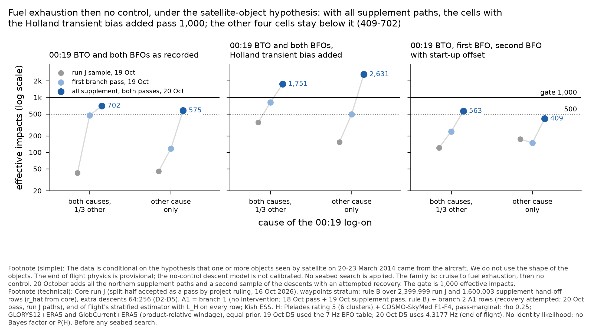
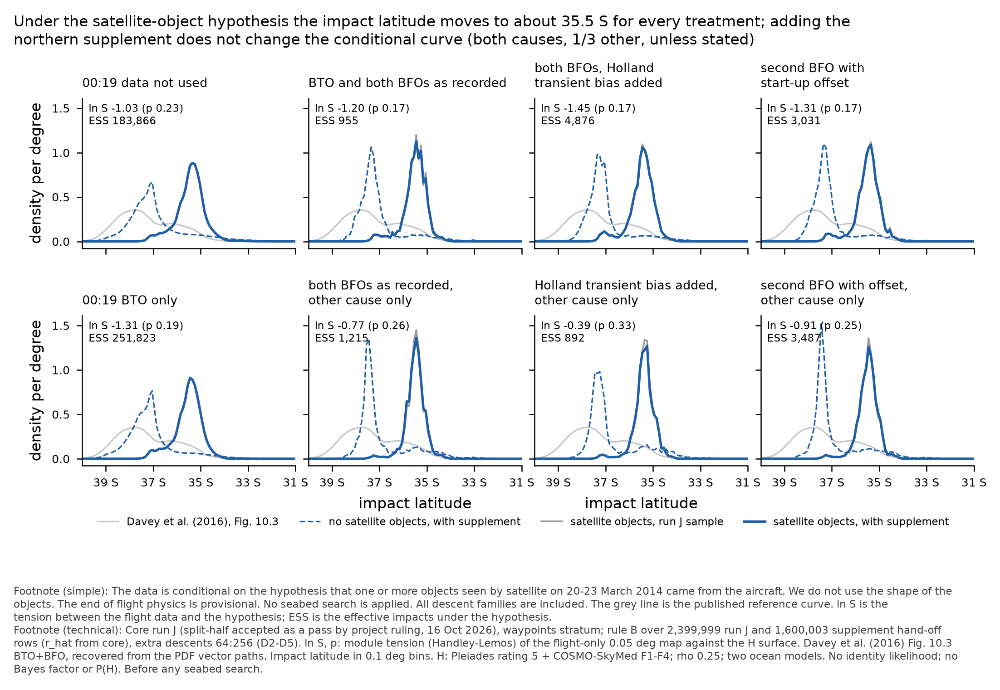

# Pléiades module on the run J northern supplement (all rows, rule B) under H (order B2, 20 Oct 2026)

Pléiades module, overnight order B2 (`threads/work-orders/overnight-2026-10-20.md` section B; Pete away). Brief: `threads/master-prompts/pleiades.md` v2.
Input: end of flight's full northern supplement (`mh370-exchange/end-of-flight/run-j-supplement/`, READY 10:09Z; note
`results/eof-run-j-supplement-oct20`). Scripts (`engine/hypotheses/pleiades/prepare/`): `score_supplement.py` (end of flight's own
`supplement_combine.py` row terms, weights and accumulators, with the H factor on every row), `aggregate_supplement.py` (pooling,
tension, end of flight's two-stratum A1 estimator under H), `columns_supplement.py` (per-impact columns). Every number below is read from
`pleiades-supplement-underH.json` here.

**Labels (carry them into every product):** conditional on H (at least one imaged object came from 9M-MRO); no identity likelihood; **no
absolute Bayes factor and no P(H | D)** (not interpretable until the Poisson and footprint term exists; the tension below is reported in
their place); core run J, split-half accepted as a pass by project ruling, 16 Oct 2026; end-of-flight physics PROVISIONAL; uncontrolled-arm
dynamics NOT calibrated (end of flight's caveat: the Boeing leave-one-out gate failed in all three rounds); headline setting ρ 0.25,
GLORYS12 + ERA5 and GlobCurrent + ERA5 (product-relative windage), equal prior, Pléiades rating 5 (6 clusters) + COSMO-SkyMed F1-F4,
pass-marginal; GLORYS12 only beside; **before any seabed search**; waypoints stratum only. Families: A1 = cruise to fuel exhaustion, then no
control; A2 = cruise to fuel exhaustion, then controlled descent; B = planned descent with a ditching approach begun before fuel exhaustion.
Treatments D0'-D5 are the competing-causes totals (q = 1/3, other cause silent); D3s-D5s are 'log-on from another cause only' (= the
19 Oct "C2 silent" cells).

## 1. Result

1. **H-conditional latitude: unchanged by the supplement.** Under H every treatment lies at 35.37-35.54 S, 92.20-92.54 E (median
   35.4-35.5 S, 95 % limit 34.6-34.9 S). Rule B and production alone agree to 0.01 deg in the mean; the curves overlay. Under H almost no
   mass lies north of 34.5 S, so the supplement's northern paths add effective impacts mainly in 35-34.5 S.
2. **Tension (reported with the conditional, always):** rule B ln S -1.45 to -1.03 for the totals (p 0.17-0.23), -0.91 to -0.39 for
   'other cause only' (p 0.25-0.33); 15-39 % of the flight-only PDF lies inside H's 90 % region; mean shift 106-128 NM. Within 0.15 of
   production alone in every cell (D3 -1.20 against -1.06, the largest change). H still does not separate the 00:19 treatments:
   ln E[L_H] lies within -0.20 to +0.58 of D0' (19 Oct waypoints seed SD of the same quantity 0.33-0.57).
3. **All-family ESS under H (rule B):** every cell rises 1.3-1.8 times over production alone. Below 1,000: **D3 (955)** and **D4s (892)**,
   both above 500. D3s now passes (1,215; 19 Oct 972 with the both-burst set).
4. **A1 under H, end of flight's two-stratum estimator** (branch 1 no intervention, rule B over run J and supplement paths; branch 2
   recovery attempted, run J paths):
   - **pass 1,000:** D4 1,751 (19 Oct 815), D4s 2,631 (493);
   - **pass 500 only:** D3 702 (472), D5 563 (239), D3s 575 (117);
   - **fail both:** D5s 409 (148).
   The A1 shares under H are 0.074 (D3), 0.256 (D4), 0.050 (D5), 0.112 (D3s), 0.511 (D4s), 0.081 (D5s).
5. **D3s A1 outside the branch is not estimable under H:** it carries 0.076 of D3s's A1 with 18 effective rows (end of flight found 51
   without H). The total A1 ESS of 575 hides this part; the share is provisional to that extent.
6. **Change of definition for D5 (not a sampling change):** end of flight's supplement code scores D5 with run J's 00:19 BFO error
   4.3177 Hz; the module's run J and 19 Oct tables used option_table_0019's base 7 Hz table. Production alone under H, D5 ESS
   1,741 (4.3177 Hz) against 2,503 (7 Hz); D5s 2,039 against 3,215. **The 18-19 Oct Pléiades D5 / D5s cells therefore carry the 7 Hz table
   (calibration-smoke fault F1) and are superseded by this note for D5.** The D5 comparisons with 19 Oct in this note mix the two.

## 2. Per treatment under H, headline setting (rule B; production alone in brackets; 19 Oct run J production in square brackets)

| treatment | ESS under H: rule B (run J alone) [19 Oct run J] | gate 1,000 / 500 | mean under H | 5 / 50 / 95 % latitude under H | mass north of 35 S under H (without H) | ln E[L_H] - D0' | ln S (p), rule B | ln S, run J alone | shift NM | flight-only PDF inside H 90 % | 90 % km2 under H (without H) |
|---|---|---|---|---|---|---|---|---|---|---|---|
| D0' 00:19 data not used | 183,866 (140,223) [140,200] | pass / pass | 35.44 S 92.20 E | 36.7 / 35.4 / 34.6 S | 0.189 (0.112) | +0.00 | -1.03 (0.23) | -1.04 | 107 | 33 % | 63,697 (164,091) |
| D1 R600 BTO | 251,823 (190,258) [190,280] | pass / pass | 35.54 S 92.32 E | 36.8 / 35.5 / 34.8 S | 0.141 (0.073) | -0.20 | -1.31 (0.19) | -1.31 | 123 | 33 % | 49,846 (116,318) |
| D2 R600 BTO + BFO | 14,489 (9,891) [9,893] | pass / pass | 35.52 S 92.33 E | 36.8 / 35.5 / 34.8 S | 0.146 (0.084) | -0.07 | -1.22 (0.20) | -1.23 | 115 | 34 % | 39,838 (97,590) |
| D3 both BFOs as recorded | 955 (567) [567] | FAIL / pass | 35.51 S 92.41 E | 36.7 / 35.5 / 34.9 S | 0.108 (0.075) | -0.07 | -1.20 (0.17) | -1.06 | 127 | 29 % | 21,387 (44,524) |
| D4 both BFOs, Holland transient bias added | 4,876 (3,098) [3,097] | pass / pass | 35.50 S 92.38 E | 36.8 / 35.5 / 34.8 S | 0.140 (0.082) | -0.11 | -1.45 (0.17) | -1.46 | 121 | 39 % | 24,148 (51,680) |
| D5 R600 + R1200 BFO with start-up offset | 3,031 (1,741) [2,503] | pass / pass | 35.50 S 92.42 E | 36.7 / 35.5 / 34.8 S | 0.128 (0.078) | -0.09 | -1.31 (0.17) | -1.26 | 128 | 32 % | 22,545 (46,253) |
| D3s, other cause only | 1,215 (677) [678] | pass / pass | 35.50 S 92.54 E | 36.2 / 35.5 / 34.9 S | 0.084 (0.105) | +0.34 | -0.77 (0.26) | -0.64 | 117 | 15 % | 12,361 (31,656) |
| D4s, other cause only | 892 (538) [538] | FAIL / pass | 35.37 S 92.45 E | 36.1 / 35.4 / 34.8 S | 0.165 (0.140) | +0.58 | -0.39 (0.33) | -0.25 | 106 | 18 % | 13,364 (38,079) |
| D5s, other cause only | 3,487 (2,039) [3,215] | pass / pass | 35.49 S 92.52 E | 36.2 / 35.5 / 34.9 S | 0.103 (0.106) | +0.33 | -0.91 (0.25) | -0.83 | 118 | 20 % | 12,859 (31,736) |

### Beside it: GLORYS12 only, ρ 0.25

| treatment | ESS under H: rule B (run J alone) [19 Oct run J] | gate 1,000 / 500 | mean under H | 5 / 50 / 95 % latitude under H | mass north of 35 S under H (without H) | ln E[L_H] - D0' | ln S (p), rule B | ln S, run J alone | shift NM | flight-only PDF inside H 90 % | 90 % km2 under H (without H) |
|---|---|---|---|---|---|---|---|---|---|---|---|
| D0' 00:19 data not used | 179,204 (138,596) [138,571] | pass / pass | 35.44 S 92.24 E | 36.5 / 35.5 / 34.6 S | 0.199 (0.112) | +0.00 | -1.01 (0.23) | -1.02 | 109 | 15 % | 57,054 (164,091) |
| D1 R600 BTO | 237,535 (182,482) [182,492] | pass / pass | 35.52 S 92.38 E | 36.5 / 35.6 / 34.7 S | 0.156 (0.073) | -0.19 | -1.29 (0.19) | -1.29 | 126 | 15 % | 44,845 (116,318) |
| D2 R600 BTO + BFO | 14,049 (9,583) [9,584] | pass / pass | 35.50 S 92.39 E | 36.4 / 35.5 / 34.7 S | 0.163 (0.084) | -0.07 | -1.22 (0.21) | -1.22 | 118 | 17 % | 36,752 (97,590) |
| D3 both BFOs as recorded | 932 (586) [586] | FAIL / pass | 35.49 S 92.44 E | 36.3 / 35.5 / 34.8 S | 0.123 (0.075) | -0.07 | -1.22 (0.17) | -1.09 | 129 | 9 % | 19,333 (44,524) |
| D4 both BFOs, Holland transient bias added | 4,508 (3,013) [3,013] | pass / pass | 35.45 S 92.45 E | 36.2 / 35.5 / 34.7 S | 0.161 (0.082) | -0.12 | -1.48 (0.17) | -1.50 | 125 | 9 % | 22,260 (51,680) |
| D5 R600 + R1200 BFO with start-up offset | 2,788 (1,719) [2,521] | pass / pass | 35.48 S 92.46 E | 36.3 / 35.5 / 34.7 S | 0.145 (0.078) | -0.08 | -1.33 (0.18) | -1.28 | 130 | 9 % | 20,620 (46,253) |
| D3s, other cause only | 1,246 (746) [747] | pass / pass | 35.50 S 92.53 E | 36.1 / 35.6 / 34.9 S | 0.100 (0.105) | +0.33 | -0.85 (0.26) | -0.75 | 117 | 13 % | 12,112 (31,656) |
| D4s, other cause only | 933 (576) [576] | FAIL / pass | 35.36 S 92.47 E | 36.1 / 35.4 / 34.7 S | 0.191 (0.140) | +0.59 | -0.46 (0.31) | -0.33 | 108 | 17 % | 13,667 (38,079) |
| D5s, other cause only | 3,313 (2,083) [3,273] | pass / pass | 35.49 S 92.52 E | 36.2 / 35.6 / 34.9 S | 0.119 (0.106) | +0.33 | -0.97 (0.25) | -0.91 | 118 | 13 % | 12,409 (31,736) |

### Impact bands under H (rule B): mass and ESS rows / paths / distinct 00:11 states; family shares

| treatment | 40-35 S: mass, rows / paths / states | 35-30 S | 30-25 S | A1 / A2 / B share under H (main set) |
|---|---|---|---|---|
| D0' 00:19 data not used | 0.811, 139,406 / 50,357 / 50,352 | 0.189, 49,649 / 21,519 / 21,516 | 0.000, 363 / 265 / 218 | 0.151 / 0.292 / 0.556 |
| D1 R600 BTO | 0.859, 200,801 / 71,891 / 71,881 | 0.141, 67,050 / 31,166 / 31,150 | 0.000, 31 / 29 / 29 | 0.181 / 0.292 / 0.526 |
| D2 R600 BTO + BFO | 0.854, 11,956 / 10,016 / 10,016 | 0.146, 2,661 / 2,480 / 2,480 | 0.000, 4 / 4 / 4 | 0.214 / 0.263 / 0.522 |
| D3 both BFOs as recorded | 0.892, 808 / 801 / 801 | 0.108, 186 / 186 / 186 | 0.000, 3 / 3 / 3 | 0.077 / 0.352 / 0.570 |
| D4 both BFOs, Holland transient bias added | 0.860, 4,429 / 4,086 / 4,086 | 0.140, 514 / 500 / 500 | 0.000, 6 / 6 / 6 | 0.219 / 0.308 / 0.470 |
| D5 R600 + R1200 BFO with start-up offset | 0.872, 2,800 / 2,694 / 2,694 | 0.128, 280 / 279 / 279 | 0.000, 1 / 1 / 1 | 0.044 / 0.374 / 0.581 |
| D3s, other cause only | 0.916, 1,042 / 1,038 / 1,038 | 0.084, 386 / 382 / 382 | 0.000, 1 / 1 / 1 | 0.079 / 0.262 / 0.659 |
| D4s, other cause only | 0.835, 675 / 645 / 645 | 0.165, 309 / 286 / 286 | 0.000, 1 / 1 / 1 | 0.501 / 0.140 / 0.359 |
| D5s, other cause only | 0.897, 2,955 / 2,906 / 2,906 | 0.103, 738 / 721 / 721 | 0.000, 1 / 1 / 1 | 0.066 / 0.285 / 0.648 |

## 3. A1 under H by the two conditional strata (headline; 19 Oct values in square brackets: with the first branch pass; run J sample)

| treatment | A1 share under H, stratified (end of flight's form) [main set] | A1 ESS under H, stratified [19 Oct with first branch pass; run J sample] | gate 1,000 / 500 | branch 1 ESS rows | outside the branch: share of A1, ESS rows | A1 ESS 40-35 S / 35-30 S | branch 1 in 35-30 S rows / paths / states |
|---|---|---|---|---|---|---|---|
| D0' 00:19 data not used | 0.155 (0.156) [0.151] | **33,661**  | pass / pass | 22,758 | 0.407, 11,625 | 23,799 / 10,515 | 7,048 / 1,593 / 1,593 |
| D2 R600 BTO + BFO | 0.213 (0.213) [0.214] | **3,714**  | pass / pass | 1,772 | 0.391, 2,550 | 2,667 / 1,273 | 656 / 475 / 475 |
| D3 both BFOs as recorded | 0.074 (0.074) [0.077] | **702** [472; 42] | FAIL / pass | 701 | 0.001, 18 | 514 / 206 | 206 / 196 / 196 |
| D4 both BFOs, Holland transient bias added | 0.256 (0.268) [0.219] | **1,751** [815; 352] | pass / pass | 1,222 | 0.215, 694 | 1,185 / 1,148 | 853 / 524 / 524 |
| D5 R600 + R1200 BFO with start-up offset | 0.050 (0.051) [0.044] | **563** [239; 120] | FAIL / pass | 563 | 0.000, 3 | 428 / 141 | 141 / 135 / 135 |
| D3s, other cause only | 0.112 (0.116) [0.079] | **575** [117; 45] | FAIL / pass | 603 | 0.076, 18 | 500 / 77 | 73 / 69 / 69 |
| D4s, other cause only | 0.511 (0.522) [0.501] | **2,631** [493; 154] | pass / pass | 1,335 | 0.426, 1,361 | 1,746 / 1,074 | 516 / 372 / 372 |
| D5s, other cause only | 0.081 (0.082) [0.066] | **409** [148; 174] | FAIL / FAIL | 409 | 0.000, 10 | 306 / 252 | 252 / 231 / 231 |

### Beside it: GLORYS12 only

| treatment | A1 share under H, stratified (end of flight's form) [main set] | A1 ESS under H, stratified [19 Oct with first branch pass; run J sample] | gate 1,000 / 500 | branch 1 ESS rows | outside the branch: share of A1, ESS rows | A1 ESS 40-35 S / 35-30 S | branch 1 in 35-30 S rows / paths / states |
|---|---|---|---|---|---|---|---|
| D0' 00:19 data not used | 0.149 (0.150) [0.144] | **30,994**  | pass / pass | 20,885 | 0.405, 10,707 | 20,117 / 12,078 | 8,404 / 1,863 / 1,863 |
| D2 R600 BTO + BFO | 0.203 (0.203) [0.202] | **3,385**  | pass / pass | 1,631 | 0.388, 2,291 | 2,225 / 1,467 | 753 / 543 / 543 |
| D3 both BFOs as recorded | 0.071 (0.070) [0.072] | **598** [419; 37] | FAIL / pass | 597 | 0.001, 19 | 396 / 236 | 236 / 225 / 225 |
| D4 both BFOs, Holland transient bias added | 0.249 (0.261) [0.211] | **1,519** [726; 313] | pass / pass | 1,060 | 0.209, 636 | 931 / 1,271 | 940 / 572 / 572 |
| D5 R600 + R1200 BFO with start-up offset | 0.047 (0.048) [0.042] | **499** [229; 113] | FAIL / FAIL | 499 | 0.000, 3 | 347 / 166 | 166 / 158 / 158 |
| D3s, other cause only | 0.112 (0.116) [0.081] | **563** [95; 44] | FAIL / pass | 587 | 0.078, 18 | 470 / 94 | 90 / 85 / 85 |
| D4s, other cause only | 0.517 (0.531) [0.503] | **2,726** [530; 166] | pass / pass | 1,368 | 0.425, 1,443 | 1,734 / 1,125 | 533 / 378 / 378 |
| D5s, other cause only | 0.081 (0.082) [0.068] | **383** [174; 178] | FAIL / FAIL | 383 | 0.000, 7 | 268 / 277 | 277 / 253 / 253 |

### Without H (check against end of flight's `a1-strata.json`)

| treatment | A1 share under H, stratified (end of flight's form) [main set] | A1 ESS under H, stratified [19 Oct with first branch pass; run J sample] | gate 1,000 / 500 | branch 1 ESS rows | outside the branch: share of A1, ESS rows | A1 ESS 40-35 S / 35-30 S | branch 1 in 35-30 S rows / paths / states |
|---|---|---|---|---|---|---|---|
| D0' 00:19 data not used | 0.169 (0.169) [0.171] | **410,967**  | pass / pass | 279,984 | 0.452, 150,055 | 369,064 / 33,802 | 27,092 / 5,845 / 5,818 |
| D2 R600 BTO + BFO | 0.228 (0.226) [0.237] | **43,703**  | pass / pass | 17,132 | 0.450, 38,869 | 39,719 / 3,891 | 2,245 / 1,574 / 1,570 |
| D3 both BFOs as recorded | 0.085 (0.084) [0.093] | **6,022** [5,284; 409] | pass / pass | 6,018 | 0.000, 54 | 5,361 / 843 | 843 / 770 / 768 |
| D4 both BFOs, Holland transient bias added | 0.268 (0.275) [0.247] | **39,473** [14,701; 4,584] | pass / pass | 25,694 | 0.272, 15,694 | 35,256 / 3,080 | 3,290 / 1,949 / 1,908 |
| D5 R600 + R1200 BFO with start-up offset | 0.053 (0.053) [0.058] | **4,636** [2,920; 2,178] | pass / pass | 4,636 | 0.000, 3 | 4,121 / 684 | 684 / 636 / 636 |
| D3s, other cause only | 0.111 (0.114) [0.087] | **2,551** [245; 202] | pass / pass | 2,792 | 0.063, 51 | 2,155 / 446 | 440 / 411 / 411 |
| D4s, other cause only | 0.438 (0.476) [0.389] | **11,539** [2,519; 517] | pass / pass | 5,858 | 0.380, 6,877 | 8,937 / 2,296 | 1,179 / 785 / 785 |
| D5s, other cause only | 0.075 (0.076) [0.058] | **2,947** [2,154; 1,483] | pass / pass | 2,934 | 0.003, 23 | 2,407 / 766 | 766 / 669 / 669 |

The "end of flight's form" in brackets is Z_H(d, A1) / Z_H(d) with the main set's total; the primary share replaces the main set's own
branch-1 and branch-2 A1 rows by the strata, as on 19 Oct. They differ by at most 0.012 (D4) under H. The main set has no A1 rows outside
the two branches (residual 0 in every cell).

## 4. Checks

1. **End of flight reproduced exactly (flight only):** ln Z and ESS of every treatment, both weightings (max |difference| 0.0); band ESS
   rows / paths / states as its table (e.g. D3 35-30 S 1,334 / 1,313 / 1,311; D4 25-20 S 706 / 573 / 560); A1 strata shares as
   `a1-strata.json` to 4 decimals (P_D0'(b1) 0.09277, P_D0'(b2) 0.10084).
2. **Production alone under H reproduces 19 Oct** (`results/pleiades/run-j-a1branch`, production-only variant): ESS D0' 140,223 / 140,200,
   D3 567 / 567, D4 3,098 / 3,097, D3s 677 / 678, D4s 538 / 538, means to 0.01 deg. D5 and D5s differ by the BFO table (section 1.6).
3. **Longitude alignment:** every row's longitude is read from the same compact file as end of flight's latitude; latitude arrays checked
   equal row by row for every file (the scorer asserts it).
4. **Reduced table under H** (`reduced/impacts-ruleB.npz`, the file end of flight gives downstream modules): means under H within 0.005 deg
   of the full rows in every treatment; ESS within 1-10 % for D3-D5 and D3s-D5s, 28 % lower for D2 (10,410 against 14,489), and 7-12 times lower for
   D0' and D1 (26,182 against 183,866), still far above 1,000. **The composer can use the reduced table under H**; its D0'/D1 ESS under H is that of the thinned file.
5. **Columns:** reduced-table cell indices equal the scorer's row by row; hashes in the exchange SHA256SUMS.
6. **Surfaces:** `pleiades/run-j/surfaces` (16 files, verified 19 Oct against `pleiades/run-j/SHA256SUMS`).

## 5. COVERAGE

- **(a) Feasible set, (b) model reach:** end of flight's oct20 and oct19 COVERAGE apply unchanged (overbank above 90 deg a declared reach gap;
  round-3 laws uncalibrated; planned descent before 00:11 only through joined V2, not used here). This module adds no sampling.
- **(c) Proposal coverage under H (rule B, headline):** all-family ESS per treatment in section 2; per band in the band table; A1 in section 3.
- **Gaps (below 1,000 under H) and status:**
  1. D3 all families 955, D4s all families 892: **OPEN, near the gate** (above 500).
  2. A1 under D3 (702), D5 (563), D3s (575), D5s (409): **OPEN**. Branch 1 limits them (paths ≈ states ≈ rows in 35-30 S: one descent per
     path). Fix (end of flight's to choose): the branch-1 pass on the second half of the supplement (end of flight's deviation 3: not flown),
     or an H-aimed defensive component (Pléiades surface as proposal density, exact re-weighting).
  3. A1 outside the branch under D3s: **not estimable** (18 effective rows; 0.076 of A1). Fix costed by end of flight: the outside pass on the
     supplement paths (4.3 h, about 3 GB).
  4. A1 under D4 and D4s, all treatments D0'-D2, D4, D5, D3s, D5s all families: **closed** (above 1,000).
  5. Waypoints stratum only (core P 0.998).
- **Declared regions:** under H all mass lies in 34-38 S, inside the surfaces' computed support (45-5 S, 78-115 E); no row outside the grid.
- **Parameter bounds:** as `results/pleiades/run-j` (windage 0-5 % U10; transport error about 95-120 km per component at 15 d; ρ 0.25
  headline; GlobCurrent product-relative offset 0.60-0.75 % U10); end of flight's bounds as its note.
- Every 00:19 option and every family is estimated from the same sample set; those below the gate are reported, not dropped.

## 6. Deviations and limits

- **Columns not written for the full-row folders** `north-k2/`, `north-k2b/`, `north-k2-xd256/`, `north-k2b-xd256/` (about 150 M rows,
  about 8 GB in the exchange format): over the 3 GB cap. **Their rows are fully SCORED** (the H factor is the same exact cell lookup, applied
  on the fly). Columns written: the reduced rule-B table (row-aligned, 2,408,038 rows) and the A1 passes `north-k2-a1branch/` (16 seeds) and
  `run-j-a1outside/` (8 seeds); 19 Oct `pleiades/run-j-a1branch/` covers `run-j-a1branch`. Total 0.75 GB.
- The format's one-byte `seed` field: supplement seeds stored as seed - 1000; the reduced table's file sits at `reduced/run-j-waypoints/seed-0/`
  (seed 0, parent = handoff_row; align by row index). Each column builder left an empty `run-j-waypoints/` folder (nothing is deleted).
- Settings scored: none, headline, GLORYS12 only (ρ 0 / 0.5 not run tonight; 19 Oct showed them within the noise of ρ 0.25).
- C1 ('after fuel exhaustion' only) cells are not in end of flight's supplement weights and are not reported.
- A1 shares: primary = replacement form (as 19 Oct); end of flight's form beside.
- D5 BFO table changed between 19 and 20 Oct (section 1.6).
- CPU: 4 worker processes, single-threaded (cap 4); scoring 04:20-04:32Z, about 12 min. Disk free 23-28 GiB during the run (floor 5 GB);
  writes 0.75 GB columns + about 0.1 GB parts and summaries. Nothing deleted.

-- Pléiades module (Claude Science), frame 67b1db7b
