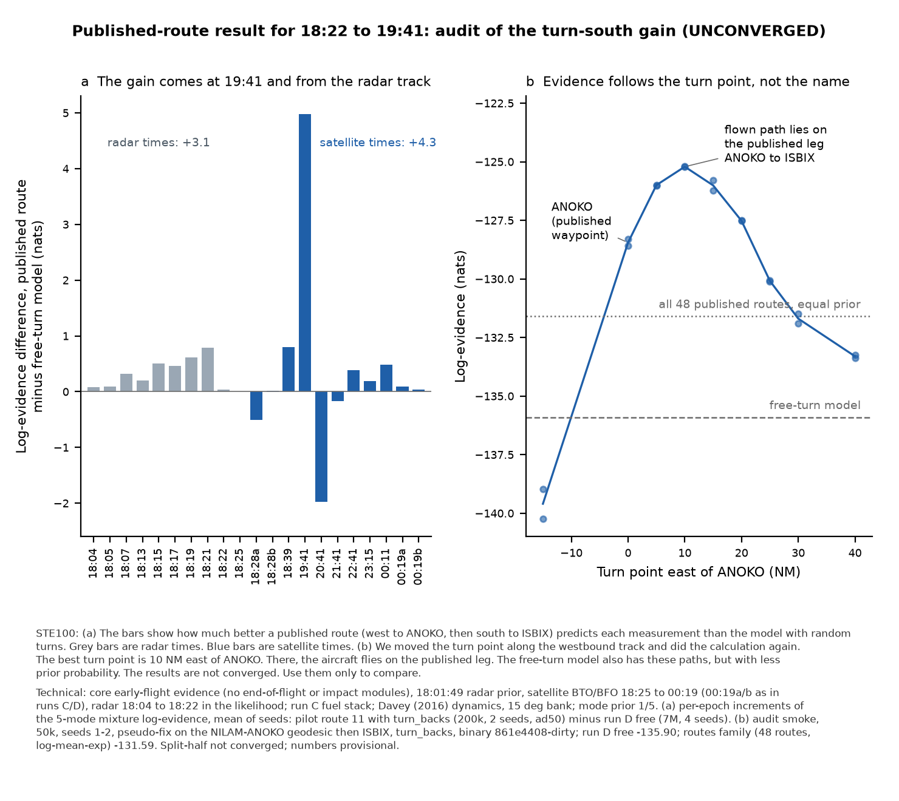

# Routes finding: independent audit (architecture), 11 Oct 2026

**Status: UNCONVERGED.** Core (b) split-half is not converged, and this audit adds smoke-scale runs (50k particles, 2 seeds). Every number below is provisional and is for comparison only.

Audited finding: core, `coordination/CORE_STAGES.md` entries ~07:17, ~10:00 and ~10:01 UTC 11 Oct (overshoot rule `dynamics.early.routes.turn_backs`, commit c60221ca; pilot job 1280fe14). Core reported that the routes family rises from log Z −139.33 to −131.59 (+7.7 nats), that routes 11 (NILAM-ANOKO-ISBIX) and 10 (NILAM-ANOKO-BULVA) together carry P ≈ 0.92 of the family, and that with equal family priors P(routes) = 0.978, against 0.019 in run D.

Scripts and tables: `results/routes-finding-audit/` (`audit_routes_finding.py` reproduces every table; `make_figure.py`; `smoke/` holds the control-smoke configs and run log). Core's code and outputs were read only.

## Verdict

**The computation is not defective. The effect is real as a property of the model as specified, but it is prior concentration (an Occam effect), not a better fit to the data. The physical meaning is undetermined until Pete rules on how the route list was chosen.** The overshoot rule does what the ruling asked: every audited capture, turn and track matches great-circle geometry, and my own geodesy predicts exactly which 34 of the 48 routes the old rule skipped. The cross-family comparison uses the same observations, likelihood, 00:19 treatment, radar, fuel stack and evidence definition. The sampler and seed noise are 0.04–0.4 nats, against a 4.3-nat family margin.

The gain does not come from paths the free-turn model cannot fly. 26–28 % of run D's free posterior paths lie within 3 NM of the published ANOKO–ISBIX leg from 18:51 to 19:21, on the same 186–187° track. A pseudo-fix scan shows that the evidence varies smoothly with where the turn south is made. It peaks 10 NM east of ANOKO (−125.21), where the flown path lies on the published ANOKO–ISBIX leg, and it does not depend on the waypoint name. Prior volume accounts for the whole free-turn deficit to within about 1 nat: the turn point free along the leg costs −2.3 nats, the outbound heading free over 360° costs −3.8 to −4.5, and free's inability to fly the airway bends seen by radar costs −3.1.

The result therefore rests on the routes family putting a point mass on a southbound line that the data select. **What would settle it:**
1. Pete's ruling on whether the 48 routes (in particular ISBIX and BEDAX, which `waypoints.csv` marks as "post-transition candidate") were fixed without reference to the satellite data. If they were selected from earlier analyses of the same data, the family is a conditional hypothesis and must be labelled as such, not compared at an equal family prior.
2. Core's confirmation run, extended with two config-only arms: a fly-by turn geometry, and a matched-volume routes prior that jitters turn point and outbound track with free-like spread.

## Findings

Severity: H = changes how the result may be used; M = changes a per-route number or needs a declared gap; L = record only.

1. **Overshoot rule implementation is correct (L, no defect).**
   - `engine/crates/flight/src/lib.rs` (this branch, aba08d9): `steer()` at 1593. Its only change is at 1609–1619: `behind` (|error| > 90°) captures a fix only when `!overshoot_rule || leg_engaged`, where `overshoot_rule = turn_backs && i > 0` (1610), and `leg_engaged` is set once the fix has been within 90° (1618).
   - Turn direction: `turn_remaining = error` (1625), with `error` wrapped to ±π, so the shorter way.
   - Turn rate: g·tan(bank)/V (1373), with bank 15° (Davey default, 317). That is about 0.62°/s at 470 kt, so a 97° turn takes about 2.6 min.
   - `steer()` runs every integration step (1325, 5–10 s).
   - Only corrections below 1° are applied directly (`DIRECT_CORRECTION_RAD`, 459). Speed and altitude are not touched by guidance, and the random-turn clock and exposure stop while guidance steers (1355).
   - The first waypoint (VAMPI) keeps the old rule. The config is wired at `crates/mh370/src/config.rs:688`.
   - No path reaches a fix by an instant heading change, excess bank or speed jump. No continuation fix lies inside a turn circle (shortest continuation leg 112 NM against a turn diameter of about 24 NM), so no orbiting is possible.
   - Simulated route-11 posterior paths (audit smoke, 2,000 paths) lie 0.01–0.05 NM from the VAMPI–MEKAR–NILAM–ANOKO legs at 18:21 and 18:31, then fly 184.5° (p10–p90 184.4–184.6°) direct to ISBIX, reaching 0.37 NM of the leg end.
   - The geometry check reproduces the mechanism. A route is skipped under the old rule exactly when its continuation turn exceeds 90° (`route-geometry-and-evidence.csv`, column `geometry_predicts_skip_matches_core`, 48/48 true).
2. **Fly-over turn geometry moves the per-route evidence by about 3 nats (M; reach gap, pre-existing, not part of c60221ca).**
   - Capture is at 2 NM (`CAPTURE_NM`, 457), so the turn begins at the fix (fly-over), not 13–14 NM before it as in an FMS fly-by turn.
   - After the 97° turn at ANOKO, route 11's flown line is 12.0 NM west of the published ANOKO–ISBIX leg at 18:41, closing to 2.6 NM by 19:21 (`posterior-paths-vs-route-lines.csv`).
   - A pseudo-fix 10 NM before ANOKO puts the flown line within 1.7 → 0.2 NM of the published leg. It scores −125.21 (2 seeds), against −128.44 for ANOKO itself: +3.2 nats.
   - So the route 10 / 11 / 3 split, and the "ANOKO vs IGOGU" reading, depend on the turn model. Route 27 has the same issue in run D (7.3 NM offset after its 77° turn).
   - The 15° bank is also narrower than the autopilot's feasible bank range. This applies to both families and is declared under Coverage.
3. **Route geometry confirmed; coordinates check out; 2014 epoch not verified for four fixes (L for geometry, M for interpretation).**
   - WGS84 (pyproj), initial / final bearing and distance: NILAM→ANOKO 283.8° / 283.6°, 95.8 NM; ANOKO→ISBIX 186.3°, 406.6 NM, turn 97.3° left; ANOKO→BULVA 189.2°, turn 94.4° left; NILAM→IGOGU 296.1°, IGOGU→ISBIX 186.0°, turn 109.9° left; NILAM→NOPEK 264.5°, NOPEK→ISBIX 186.8°, turn 77.5° left. Core's table (284/186, 98°; 95°; 110°; 77°) agrees to within 1°.
   - ANOKO in `waypoints.csv` (7.1361111, 94.4161111) differs by 2″ in latitude and 2″ in longitude (about 0.05 NM) from the India eAIP ENR 4.4 entry, 070812N 0942500E on airway B466 (AAI, AMDT 01/2018: aim-india.aai.aero/eaip-v2/eAIP/EC-ENR-4.4-en-GB.pdf).
   - ISBIX matches opennav to 0.01″. AirNav Indonesia's UPR trial procedure (2024) lists ISBIX as a Jakarta FIR waypoint, but without coordinates. An Indonesian AIP copy found on a document-sharing site was **not** used (unauthorised copy).
   - BULVA and NOPEK rest on third-party navdata only. For ANOKO, ISBIX, BULVA and NOPEK the March 2014 epoch is unverified (the csv says so), and whether NILAM–ANOKO and ANOKO–ISBIX were published ATS segments is not established here.
   - The evidence slope near ANOKO is about 0.5 nat/NM, so coordinate errors of this size are negligible. The open question is route existence in 2014.
4. **Same-data check passes (L, no defect).**
   - `observations`, `epochs`, `hypotheses` (radar fix), `prior`, `prior_unix_s`, `reference_arcs` and `stop` are byte-identical (sorted JSON) across the four run D strata and the pilot runs (`same-data-check.json`).
   - Config keys that differ between run D routes and pilot route 11 are only `routes.only`, `routes.turn_backs`, `name`, `particles_per_mode`, `seeds`, `sampler.temper_target_ess` (ad50) and output settings (`handoff_rows`, `handoff_lookahead.*`). The look-ahead is output-only: zero look-ahead resamples in every run.
   - Evidence definition: per replicate, log Σ_modes (1/5)·Z_mode. Seeds are combined by log-mean-exp, and the family is logsumexp(routes) − ln 48. Recomputed: −131.594 (seed 1 −131.623, seed 2 −131.566).
   - Sampler: at quarter scale, e16 vs ad50 gives routes −139.363 vs −139.397 and free −135.639 vs −135.657 (≤ 0.04 nats).
   - Builds: run D abd15b6, pilot 16dac97, which contains c60221ca. The engine diff abd15b6..16dac97 is the overshoot rule plus terminal request 9, both off by default.
   - The old-rule pilot reproduces run D's routes family (−139.33 vs −139.35).
   - **The cross-family comparison is valid.**
5. **Estimator noise does not threaten the family result (L).**
   - Leader seeds agree: route 11 −128.474 / −128.481; route 10 −128.647 / −128.420. The audit smoke reproduces route 11 at 50k (−128.59 / −128.31).
   - 18:01 origins surviving at 00:19 are 54–551 per mode; final ESS per mode is 11k–55k.
   - A heavy-tailed overestimate (run C seed 7) needs one lucky seed. Here four independent runs agree within 0.3 nats.
   - The family margin over free is 4.31 nats. P(routes) stays above 0.5 for any routes family prior above 0.0074.
   - Core's confirmation (8 seeds × about 500k, routes 10, 11, 3, 2, 19, 43, run C sampler) is adequate for per-route densities. It does not address findings 6–8.
6. **The gain is prior concentration, not better fit (H).**
   - **Reach:** run D free reaches these paths. Track 18:41–19:31 is p10–p90 185.6–191.0° (leg 186.3°), and 26–28 % of free posterior paths are within 3 NM of the published leg from 18:51 to 19:21.
   - **Per epoch** (route 11 minus run D free, mean over seeds; `per-epoch-log-evidence.csv`):
     - +3.10 at the radar epochs 18:04–18:22. The routes follow the N571 bends, which free cannot without random turns. This part is common to all 48 routes and was already in run D's old routes family.
     - +0.80 at 18:39 and +4.98 at 19:41.
     - −0.51 at 18:28a and −1.98 at 20:41.
     - +1.03 over the remaining epochs.
     - Total +7.43.
   - **Pseudo-fix scan** (figure 1b; `pseudo-fix-control-smoke.csv`): evidence peaks at +10 NM (−125.21) and falls to −133.30 at +40 NM and −139.41 at −15 NM. The effective width is 9.3 NM.
   - **Closure:** start from the peak, −125.2. A uniform turn point along the 96-NM NILAM–ANOKO leg gives −127.6. A free outbound heading (4–8° of 360°) gives −131.4 to −132.1. Removing the radar airway term gives −134.5 to −135.2, against free's −135.90.
   - Analytic cross-check (Davey τ log-uniform 0.1–10 h): the free prior of a first random turn in a 3–10 min window near 18:37 onto a 2–8° heading band is ln P = −6.6 to −9.2. The routes family gives the same behaviour ln(4/48) = −2.5.
   - Separability is assumed, so this decomposition is order-of-magnitude, but no residual fit advantage is needed to explain +7.4.
7. **Route-list provenance decides the meaning (H; needs Pete).**
   - The southbound line the data select coincides (within about 2 NM) with a published leg toward ISBIX. That is notable only if ISBIX entered the list independently of the satellite data.
   - `waypoints.csv` gives ISBIX and BEDAX the role "post-transition candidate" and cites a 2015 J. Navigation analysis of the same data for ISBIX.
   - If the list was data-informed, the routes family double-uses the data. It must then be named as a conditional hypothesis in every label (Pete's coverage rule 2), not given an equal family prior.
8. **Family-prior sensitivity (M):** P(routes) is 0.978, 0.937, 0.876, 0.741, 0.577 and 0.404 at routes family priors of 1/4, 1/10, 1/20, 1/48, 1/100 and 1/200; break-even is 0.0074 (`family-prior-sensitivity.csv`). Core's independent table (CORE_STAGES ~10:40 UTC) agrees to 3 decimals at the shared priors. Core calls the 4.9-nat Bayes factor against the other families "the data's preference" and puts the Occam question on the family prior. Finding 6 adds that most of those 4.9 nats is itself within-family prior concentration, because both models reach the same paths. The family prior alone does not remove the dominance. The decisive modelling choice is the point-mass turn location and track inside the family.
9. **Record (L).**
   - Core cites build c60221ca, while pilot run.json records 16dac97, a descendant that contains c60221ca.
   - Routes 37 and 39 carry log Z ≈ −1.0×10⁶ (hard-reject floor). They contribute zero; this is noted so that no one reads it as a number.

## COVERAGE

- **(a) Feasible set** for 18:22–19:41:
  - a turn south at any point along or off the westbound airway, onto any heading;
  - fly-by (turn anticipation) or fly-over turns;
  - bank up to the autopilot limit, above 15°. The bank limit is not sourced here and is declared as a gap.
- **(b) Model reach:**
  - Free: any turn time and heading (Poisson turns, uniform heading); bank 15° only.
  - Routes: only the 48 named geometries, fly-over capture at 2 NM, bank 15°. Fly-by geometry is not reachable.
- **(c) Proposal coverage:**
  - Free posterior has 26–28 % of its mass within 3 NM of the ANOKO–ISBIX leg.
  - Pilot routes 10, 11 and 3: final ESS per mode 11k–55k of 15k–70k; surviving 18:01 origins 54–551.
- **Gaps:**
  - G1, fly-by turns are outside routes reach: OPEN, declared. It affects per-route shares by about 3 nats.
  - G2, bank fixed at 15° in both families: OPEN, pre-existing, declared.
  - G3, route list possibly data-informed: OPEN. Until Pete rules, label the routes family as a conditional hypothesis.
  - G4, only one 00:19 treatment (as in runs C/D) and only family-level evidence were audited. Other 00:19 options and the A1/A2/B families were **not** estimated by this audit: a coverage gap of the audit, not of the model.
- **Parameter bounds and sources:**
  - τ log-uniform 0.1–10 h (Davey 2016, Table 8.2, via `crates/flight`).
  - Bank 15° (Davey).
  - Capture 2 NM (engine constant; no source).
  - Turn-south track tolerance 2–8° (taken from free's posterior p10–p90; audit assumption).

## Recommended minimal confirmation (specified; not run here beyond smoke scale)

1. Core's run G as planned (routes 10, 11, 3, 2, 19, 43; 8 seeds × about 500k; run C sampler).
2. Plus a config-only pseudo-fix arm: 9 offsets −15 … +40 NM on NILAM–ANOKO then ISBIX, 4 seeds × 200k. It confirms the evidence profile at scale (its peak height, and the 9.3-NM width that sets the Occam factor).
3. Plus a matched-volume arm: the turn point drawn uniformly along NILAM–ANOKO, and the outbound track jittered with free-like spread. This would need a small config option; core decides.
4. Prediction: arm 3 gives about −131 to −132, i.e. within about 4 nats of free once the radar term is removed. If it stays near −125 to −128, finding 6 is wrong.

## Deviations (stand-in honesty)

- The control smoke ran core's **local** binary (`target/release/mh370`, built with the overshoot rule, run.json `code_revision` = 861e4408-dirty), copied to the audit workspace. It ran with cwd = core's checkout (cf9afa2a), read-only. The config files used are identical to 16dac97 (only server-f/g and sampler-ad50 changed since). It reproduces the pilot's route 11 to 0.11 nats at 1/4 scale.
- Smoke scale was 50k particles × 2 seeds × 9 turn points (18 runs, about 1 min each, 2 threads, outside the heavy lock, total output about 100 MB in the audit workspace; only CSVs are committed).
- The March 2014 AIP epoch was not verified for ANOKO, ISBIX, BULVA or NOPEK, and the 15° bank and fly-by alternatives were not run at scale.
- No engine files were edited.
