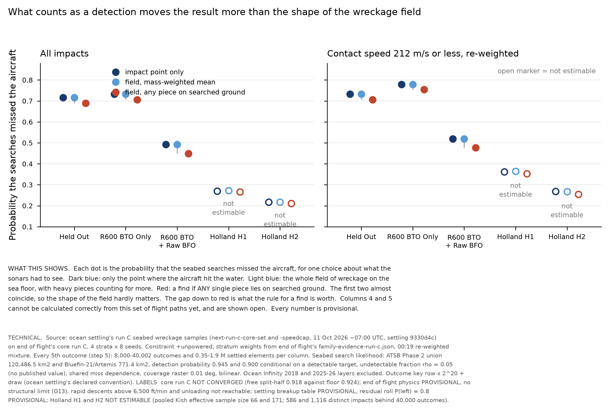
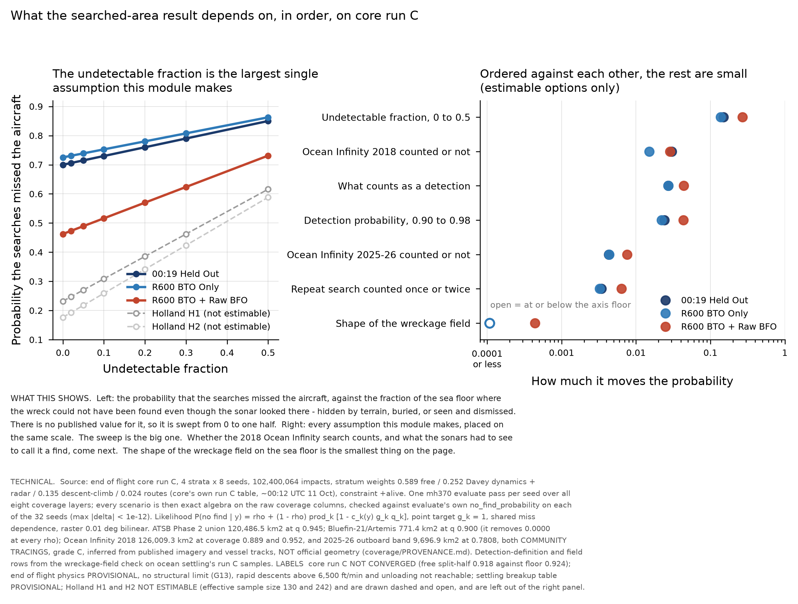

# Searched areas: review of the run C stand-in, and the wreckage-field check on run C

11 October 2026, Searched Areas module. **Every number here is labelled: core run C NOT CONVERGED**
(end of flight free split-half 0.918 against the 0.924 floor; settling reports pooled split-half 0.82-0.86 per stratum).

## 1. The stand-in's run C note: accepted

`results/searched-areas-next-run-c-standin.md` (commit 2f33685) is accepted as the module's run C point-target
result. It ran this module's own `run_release.sh` and imported `impact_map_options` and end of flight's
`option_posteriors` unchanged; its fixed all-rows mixture reproduces the chain's own `impact-map-c-mixture.json`
to 1.1e-16 in Z and 0.0 km2 in area, which is the check that matters. The stratum weights it passed
(0.135 / 0.589 / 0.252 / 0.024) are core's own run C P(family), not the stale run (b) set, and they are named with
their source. Its deviations 2 to 5 (arcs file, binary, narrowed constraint list, recomputed routes evidence) are
disclosed and change no likelihood. Deviation 6 (18.2 GB peak against a 10 GB cap) is a real overrun and is
recorded; this module's own chain stayed at 3.6 GB per seed.

Two substantive readings are adopted: the speed filter is first order for this module (+0.025 to +0.035 in Z,
because fast impacts sit disproportionately on searched ground), and the 00:19 re-weighting of the strata is not
(<= 0.001). Holland H1 and H2 remain not estimable and are reported as a coverage gap, not as a result.

## 2. The two STAND-IN edits: accepted, with one amendment

Run C is end of flight's compact layout (`impacts32.npy`), which `mh370 evaluate` refuses on a core-owned check.
The stand-in's two edits are the minimum that reads it, and they leave the full-format path untouched.

**Verification done here, not taken on trust.** The stand-in's claim is that no rebuilt column enters this module's
likelihood. Tested on `next-c-free/seed-1`, 300,000 rows: `mh370 evaluate` was run on the stub's rebuilt file, and
again on a copy in which every column except latitude and longitude had its rows reversed. Reversal preserves each
column's exact value set, so nothing becomes invalid, and breaks only the row correspondence.
**max |delta ln P(no find)| = 0.000e+00, bit-identical**, and the rebuilt latitude and longitude are bit-equal to the
compact file's own (float32 widens to float64 exactly). The likelihood is a function of position alone, so the
rebuild is a format change and not a physics change. Both edits are kept.

**Amendment (one line, committed here).** `search_loglik` named the temporary directory per RUN and deleted the whole
directory in its `finally` clause. That is safe only while seeds are processed one at a time, which they are today;
the moment seeds are run concurrently it deletes a sibling seed's rebuilt file mid-read. The name is now per SEED.

**Chart defect (stand-in deviation 7) fixed.** The `--labels` string was appended to the technical footnote as one
unwrapped line; run C's label string is about 430 characters, so `bbox_inches="tight"` grew the canvas to fit it
(5,376 x 1,740 px, aspect 3.09). It is now wrapped to the footnote's own width: the same chart renders at
3,534 x 1,782 px, aspect 1.98. The run C charts already in `results/seabed-search-c/` are oversized but their
numbers are unaffected; they are redrawn at the next chain run rather than re-running 54 minutes of compute
against a machine at load 25 for a cosmetic change.

## 3. The outcome key: widened again, to settling's declared convention

The ruling of 17:05 -0600 had already been applied before the stand-in wrote its note: commit b5b9ad2 (10 Oct
17:34 -0600) replaced the fixed `row x 1000 + draw` with a stride taken from the data, and cbc6467a fixed a second,
worse defect in the same block - outcomes were matched to element blocks by RANK rather than by key, which
attached elements to the wrong impacts whenever a mixture mask selected a subset. The stand-in's item 3 is
therefore stale, not outstanding.

It is widened once more here, for a reason the stand-in could not have seen: settling's run C core set, posted at
~07:00 UTC on 11 October (after the stand-in note), **declares the interface convention in its README**:
"build a composite key as row * 2**20 + draw (int64), never row * 1000 + draw". A privately derived stride is
collision-free but is not the same integer the other consumers build. The key is now `row * 2**20 + draw`, widening
to the next power of two if a future set ever exceeds it, with both the stride and the product asserted against the
data. A third assertion was added in the same block: the element table must be in key order, because the block
boundaries are found with `searchsorted`, and an unsorted table would have been read from the wrong rows silently.
Checked on the posted set: both element tables are in key order, keys are unique, and every option's draws are a
subset of them.

On run C the largest draw index is **1,987** (Holland H1) over 586 distinct impacts, against 1,638 on core (b).
The old fixed multiplier of 1,000 would have collided; the declared stride has about 500 times the headroom.

## 4. New result: the wreckage field on run C, including H1 and H2

The stand-in skipped this step because settling had no run C samples on the exchange at 06:05 UTC. They are there
now (`settling/next-run-c-core-set` and `-speedcap`). This is the first run in which the field check covers all five
00:19 options: the widened key is what makes Holland H1 and H2 runnable at all.

Z is the probability that the searches missed the aircraft. "Impact point" is the point target. "Field mean" reads
coverage over the settled wreckage field, mass-weighted. "Any piece" counts a find if any single settled piece lies
on searched ground - the generous end of the bracket, not an estimate.

| 00:19 option | rows | outcomes | settled elements | Z impact point | Z field mean | Z any piece | field - point | any - point | impact off, field on | impact on, field off |
|---|---|---|---|---|---|---|---|---|---|---|
| 00:19 Held Out | all | 39,999 | 1,875,382 | 0.7159 | 0.7159 | 0.6889 | -0.0000 | -0.0270 | 0.0276 | 0.0000 |
| 00:19 Held Out | speed <= 212 | 39,999 | 1,803,586 | 0.7328 | 0.7330 | 0.7055 | +0.0003 | -0.0273 | 0.0288 | 0.0000 |
| R600 BTO Only | all | 8,000 | 375,181 | 0.7326 | 0.7326 | 0.7056 | -0.0000 | -0.0271 | 0.0279 | 0.0000 |
| R600 BTO Only | speed <= 212 | 8,000 | 357,101 | 0.7792 | 0.7792 | 0.7545 | -0.0001 | -0.0247 | 0.0267 | 0.0000 |
| R600 BTO + Raw BFO | all | 8,000 | 367,124 | 0.4928 | 0.4924 | 0.4491 | -0.0004 | -0.0438 | 0.0467 | 0.0000 |
| R600 BTO + Raw BFO | speed <= 212 | 8,002 | 348,035 | 0.5191 | 0.5188 | 0.4769 | -0.0003 | -0.0421 | 0.0407 | 0.0000 |
| Holland H1 **(NOT ESTIMABLE)** | all | 8,000 | 463,313 | 0.2705 | 0.2723 | 0.2666 | +0.0018 | -0.0039 | 0.0018 | 0.0000 |
| Holland H1 **(NOT ESTIMABLE)** | speed <= 212 | 8,002 | 389,132 | 0.3625 | 0.3650 | 0.3528 | +0.0025 | -0.0097 | 0.0076 | 0.0000 |
| Holland H2 **(NOT ESTIMABLE)** | all | 8,000 | 461,315 | 0.2173 | 0.2171 | 0.2108 | -0.0001 | -0.0064 | 0.0044 | 0.0000 |
| Holland H2 **(NOT ESTIMABLE)** | speed <= 212 | 8,000 | 417,395 | 0.2684 | 0.2676 | 0.2547 | -0.0009 | -0.0137 | 0.0115 | 0.0000 |

Every 5th outcome (step 5), 00:19 re-weighted mixture, constraint +unpowered, rho = 0.05.

**Readings.**
1. **The shape of the field is still worth nothing.** Field mean minus point is -0.0009 to +0.0025 across all ten
   rows. On core (b) it was -0.0004 to +0.0001. Reading coverage over the real wreckage field rather than at the
   impact point does not change this module's answer, and the point target is not an approximation that needs
   defending - it is the saturated limit of the size response.
2. **What counts as a detection is worth 30 to 50 times more.** Any-piece minus point is -0.027 (Held Out),
   -0.027 (R600 BTO Only) and -0.044 (R600 BTO + Raw BFO). This is the module's second-largest uncertainty after
   rho, and it is a definition, not a measurement.
3. **The asymmetry found on core (b) holds exactly on run C.** The share of outcomes whose impact lies off searched
   ground while part of the field reaches onto it is 0.0018 to 0.0467; **the reverse is 0.0000 in every one of the
   twenty runs.** A field can only add searched ground, never remove it, because the searched polygons are large
   against the field and the field is centred on the impact.
4. **Holland H1 and H2 run, and are still not a result.** Their any-piece brackets (-0.004 and -0.006 on all rows)
   are an order of magnitude narrower than the estimable options', which is what a field drawn from 586 and 1,116
   distinct impacts looks like: the outcomes repeat, so the field spread is the spread of a handful of places.
   Reported as a coverage gap.
5. **Nothing was carried.** `outcomes_carried_at_impact_position` is 0.0000 in all twenty runs: settling refused no
   impact in this set, so the neutral-carry rule (ruling 1, 16:25 -0600) had nothing to carry here either.

## 5. COVERAGE

**(a) Feasible set.** All 777-200ER end-of-flight states after 00:11, including cruise to fuel exhaustion with an
uncontrolled descent (A1), a controlled or arrested descent (A2), a deliberate descent before exhaustion (B), and
rapid descents to the structural limits. For this module the feasible set also includes the wreckage field, not
only a point, and the detection event is a two-part event: a detectable class, then recognition at campaign level.

**(b) Model's reach.** End of flight's run C physics as they label it: rapid descents above 6,500 ft/min and
unloading not reachable; B only after 00:11; trim at loss and two-tank takeover not applied; no structural limit
(G13). Settling's run C breakup table and residual roll P(left) = 0.8 are provisional. This module's reach:
Phase 2 union and Bluefin-21 only (Ocean Infinity 2018 and 2025-26 excluded by `run.toml`), rho a single value
0.05, shared miss dependence, coverage raster 0.01 deg bilinear.

**(c) Proposal's coverage.** 102,400,064 impacts in the point-target result; 8,000 to 40,002 sampled outcomes and
0.35 to 1.9 M settled elements per field-coverage column. Effective sample sizes per option, family and region are
in the stand-in note section 4 and are not restated here.

**Gaps and status.**

| Gap | Type | Status |
|---|---|---|
| Holland H1 and H2, effective sample size 85-312 (impacts) and 66-171 (settling's pooled Kish) | coverage (c) | OPEN. End of flight's targeted sampler and core's tempering change. Reported, never dropped. |
| Rapid descents above 6,500 ft/min and unloading | reach (b) | OPEN (end of flight) |
| No structural limit, contact speeds above 1.25 VMO (G13) | reach (b) | Stop-gap: both versions shown side by side |
| rho a single value 0.05 on run C | parameter bound, no source | OPEN. The sweep 0 to 0.5 on (b) moved Z by up to +0.26; not re-run on C |
| Ocean Infinity 2018 and 2025-26 layers excluded | declared conditional | Module base; overrides not run on C |
| ATSB Figure 73's three percentages (ledger A-8) | provenance | BLOCKED after five failed fetches of the ATSB server; detection probability stays 0.945 with bound 0.940-0.945 |
| Core run C not converged | source | OPEN (core) |

**Parameter bounds and sources.** Detection probability 0.945 (Phase 2) and 0.900 (Bluefin-21), `run.toml`, derived
in `seabed-search-methods-draft.md` from ATSB Figure 73 (A-8 unverified in primary form); rho = 0.05, no published
value, stated in `run.toml`; speed cap 212 m/s = 1.25 VMO, architecture ruling 20:35 -0600 10 Oct, margin declared
not sourced; effective sample size floor 1,000, this module's `ESS_FLOOR`; outcome key stride 2**20, ocean
settling's run C core-set README.

## 6. The rho sweep and the Ocean Infinity overrides on run C

The stand-in's item 4 ("re-run the rho sweep and the OI overrides on C, if you want them in pass 1"). Done, and the
module's whole labelled sensitivity set with them. 32 seeds, 102,400,064 impacts, 27 min at 2 threads.

**One evaluate pass, not twenty.** `mh370 evaluate` reports `covered_fraction_<campaign>` as the RAW raster coverage
c_k(y), and the likelihood is built from those alone (lib.rs `predict` and `miss_probability_for_field`). So the eight
coverage layers - the Phase 2 union, its four sensor layers, Bluefin-21, Ocean Infinity 2018 and 2025-26 - are
rastered ONCE per impact, and every scenario is then exact algebra on those columns. Re-running evaluate per
scenario would have rastered the same eight layers twenty times over. **The algebra is checked against the Rust on
every one of the 32 seeds** (max |delta| < 1e-12), so it is verified, not trusted. New driver:
`hypotheses/seabed-search/sweep_release.py`.

**Independent reproduction of the stand-in.** The `run.toml` row below reproduces the stand-in's run C fixed-weight
Z to four decimals for all five options (0.7149 / 0.7390 / 0.4894 / 0.2704 / 0.2178), with the same split-halves and
the same effective sample sizes, through a completely different code path.

| Sensitivity | 00:19 Held Out | R600 BTO Only | R600 BTO + Raw BFO | Holland H1 | Holland H2 |
|---|---|---|---|---|---|
| run.toml | 0.7149 | 0.7390 | 0.4894 | 0.2704* | 0.2178* |
| rho 0 | 0.6999 | 0.7252 | 0.4625 | 0.2320* | 0.1767* |
| rho 0.02 | 0.7059 | 0.7307 | 0.4732 | 0.2474* | 0.1931* |
| rho 0.1 | 0.7300 | 0.7527 | 0.5162 | 0.3088* | 0.2590* |
| rho 0.2 | 0.7600 | 0.7802 | 0.5700 | 0.3856* | 0.3413* |
| rho 0.3 | 0.7900 | 0.8077 | 0.6237 | 0.4624* | 0.4237* |
| rho 0.5 | 0.8500 | 0.8626 | 0.7312 | 0.6160* | 0.5883* |
| Phase 2 q 0.90 | 0.7285 | 0.7514 | 0.5137 | 0.3051* | 0.2551* |
| Phase 2 q 0.98 | 0.7044 | 0.7293 | 0.4704 | 0.2434* | 0.1889* |
| Phase 2 split, shared misses | 0.7132 | 0.7374 | 0.4863 | 0.2620* | 0.2072* |
| Phase 2 split, independent misses | 0.7115 | 0.7357 | 0.4830 | 0.2548* | 0.1977* |
| + OI 2025-26 inferred, outboard band only | 0.7107 | 0.7346 | 0.4818 | 0.2692* | 0.2166* |
| + OI 2018 inferred, coverage 0.889 | 0.6868 | 0.7248 | 0.4626 | 0.1696* | 0.1588* |
| + OI 2018 inferred, coverage 0.952 | 0.6848 | 0.7238 | 0.4607 | 0.1625* | 0.1546* |
| alone: bluefin-2014 | 1.0000 | 1.0000 | 1.0000 | 1.0000* | 1.0000* |
| adding, in order: bluefin-2014 | 1.0000 | 1.0000 | 1.0000 | 1.0000* | 1.0000* |
| alone: phase2-2014-2017 | 0.6999 | 0.7252 | 0.4625 | 0.2320* | 0.1767* |
| adding, in order: phase2-2014-2017 | 0.6999 | 0.7252 | 0.4625 | 0.2320* | 0.1767* |
| alone: ocean-infinity-2018 | 0.9702 | 0.9850 | 0.9716 | 0.8925* | 0.9374* |
| adding, in order: ocean-infinity-2018 | 0.6703 | 0.7104 | 0.4343 | 0.1259* | 0.1145* |

Z is the probability that the searches missed the aircraft. `*` marks not estimable (Holland H1 and H2, effective
sample size 130 and 242). Constraint +alive, stratum weights 0.589 / 0.252 / 0.135 / 0.024 from core's own run C
table of ~00:12 UTC 11 October - not the stale run (b) set.

**Ordered uncertainty budget on run C (00:19 Held Out, then R600 BTO Only, then R600 BTO + Raw BFO).**

| Rank | Assumption | Held Out | R600 BTO Only | R600 BTO + Raw BFO |
|---|---|---|---|---|
| 1 | Undetectable fraction rho, 0 to 0.5 | 0.1500 | 0.1374 | 0.2688 |
| 2 | Ocean Infinity 2018 counted or not | 0.0301 | 0.0151 | 0.0287 |
| 3 | What counts as a detection (point against any piece) | 0.0270 | 0.0271 | 0.0438 |
| 4 | Detection probability q, 0.90 to 0.98 | 0.0241 | 0.0221 | 0.0432 |
| 5 | Ocean Infinity 2025-26 counted or not | 0.0043 | 0.0043 | 0.0076 |
| 6 | Repeat search counted once or twice | 0.0034 | 0.0032 | 0.0064 |
| 7 | Shape of the wreckage field | 0.000029 | 0.000002 | 0.00044 |

**Readings.**
1. **rho still dominates, and by more on run C than on (b).** It is 5 to 9 times the next item. It has no published
   value. Until one exists, every headline number this module reports is conditional on it, and the sweep is the
   honest statement of the result, not the single value at 0.05.
2. **Bluefin-21 removes exactly nothing, at full run C scale.** "alone: bluefin-2014" gives **Z = 1.0000 in every
   option**. 771.4 km2 against a posterior spread over hundreds of thousands: the 2014 AUV search is a historical
   fact with no evidential weight here. The 10.3 % discrepancy between its measured and stated area is therefore
   immaterial, which is worth saying once and not revisiting.
3. **Ocean Infinity 2018 is worth 0.015 to 0.030, and its two coverage readings are worth 0.002.** The choice of
   0.889 against 0.952 barely matters; whether the layer is in at all is the second-largest item in the budget.
   Both rest on a community tracing, grade C - which is why the provenance footnote is not optional.
4. **The repeat search is worth 0.0034 (Held Out), 0.0032 (R600 BTO Only) and 0.0064 (R600 BTO + Raw BFO)**, against
   the 0.002 measured on core (b). It comes in two equal halves in every option: splitting the Phase 2 union into
   its four sensor layers, so the 17,391 km2 the union hides is swept twice, moves Z by 0.0017 / 0.0016 / 0.0031;
   choosing independent over shared misses on top of that moves it another 0.0017 / 0.0016 / 0.0033. Raw BFO is
   about twice the other two throughout, because it puts twice as much mass on Phase 2 ground to begin with
   (0.569 against 0.318 and 0.291), which is where the repeat coverage is.
5. **Phase 2 alone removes 30.0 % of the Held Out mass at rho = 0; Ocean Infinity 2018 alone removes 3.0 %.**
   Adding OI after Phase 2 takes the pair to 33.0 %. The ATSB search is still doing nearly all of the work.

## 7. Outputs

- `results/seabed-search-c/field-coverage/`: twenty JSON results, `SUMMARY.json`.
- `results/seabed-search-c/field-coverage-c.png` and `.pdf`.
- `results/seabed-search-c/sensitivity-sweep-c.json`, `sensitivity-table-c.md`, `sensitivity-c.png` and `.pdf`.
- Code: `field_coverage_check.py` (key widened to the declared stride, key-order assertion),
  `impact_map_options.py` (per-seed temporary directory, wrapped LABELS footnote),
  `sweep_release.py` (new: every labelled sensitivity in one evaluate pass, checked against the Rust per seed).

- Searched Areas Module
