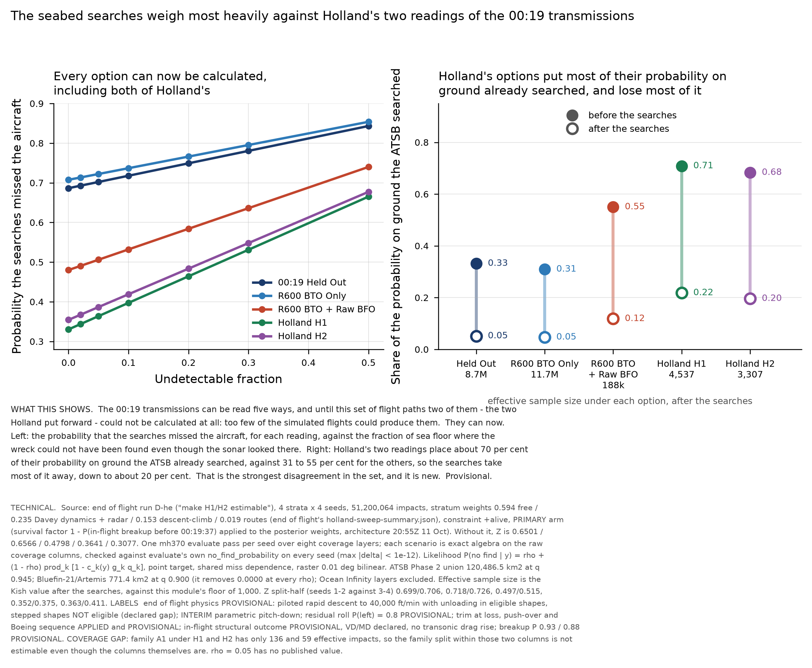

# Searched areas on end of flight's run D-he: Holland H1 and H2 become estimable

12 October 2026, Searched Areas module. Architecture's overnight plan of 00:05Z, step 4.

**The headline. Holland H1 and H2 can be calculated by this module for the first time.** On every earlier run
their effective sample size after the searches was 85 to 312, an order of magnitude below the floor of 1,000,
and they were reported as a coverage gap rather than a result. On run D-he they are **4,537 and 3,307**. End of
flight's targeted burst proposal is what did it.

Labels, carried into everything below: end of flight physics PROVISIONAL (piloted rapid descent to 40,000 ft/min
with unloading in eligible shapes, stepped shapes NOT eligible - a declared gap; INTERIM parametric pitch-down;
residual roll P(left) = 0.8; trim at loss, push-over and Boeing sequence APPLIED and PROVISIONAL; in-flight
structural outcome PROVISIONAL with VD/MD declared and no transonic drag rise; breakup P 0.93 / 0.88).

## 1. The result

4 strata x 4 seeds, 51,200,064 impacts. Stratum weights 0.594 free / 0.235 Davey dynamics + radar / 0.153
descent-climb / 0.019 routes, from end of flight's own `holland-sweep-summary.json` - not the run C set.
Constraint +alive, rho = 0.05, point target, Ocean Infinity excluded.

Z is the probability that the searches missed the aircraft. The **primary** arm carries the survival factor
1 - P(in-flight breakup before 00:19:37), which architecture adopted at 20:55Z on 11 October as part of the
00:19 data model; end of flight ships it as its own column and `option_posteriors` does not apply it, so this
module applies it to the posterior weights and reports both arms.

| 00:19 option | Z (primary) | Z split-half | on Phase 2 before -> after | ESS before -> after | estimable | Z without survival factor | survival factor worth |
|---|---|---|---|---|---|---|---|
| 00:19 Held Out | 0.7021 | 0.6985 / 0.7058 | 0.332 -> 0.052 | 11,604,485 -> 8,719,421 | yes | 0.6501 | +0.0520 |
| R600 BTO Only | 0.7222 | 0.7181 / 0.7264 | 0.309 -> 0.047 | 14,761,314 -> 11,748,152 | yes | 0.6566 | +0.0657 |
| R600 BTO + Raw BFO | 0.5061 | 0.4967 / 0.5154 | 0.550 -> 0.118 | 336,565 -> 187,738 | yes | 0.4798 | +0.0263 |
| Holland H1 | 0.3638 | 0.3522 / 0.3754 | 0.709 -> 0.218 | 7,678 -> 4,537 | yes | 0.3641 | -0.0003 |
| Holland H2 | 0.3867 | 0.3625 / 0.4109 | 0.683 -> 0.196 | 5,321 -> 3,307 | yes | 0.3077 | +0.0790 |

**Readings.**
1. **The searches disagree with Holland's two readings far more than with any other option.** H1 and H2 put
   **0.709 and 0.683** of their probability on ground the ATSB searched, against 0.309 to 0.550 for the other
   three. The searches then remove 64 % and 61 % of their probability, against 28 to 49 % elsewhere, and leave
   0.218 and 0.196 on searched ground. This is the sharpest disagreement this module has produced, and it is new:
   it could not be measured before this set existed.
2. **It is a disagreement, not a refutation.** Z = 0.36 and 0.39 are not small. The searches weigh against these
   readings; they do not rule them out, and nothing here says which reading of the 00:19 transmissions is right -
   that is end of flight's and the composer's question, not this module's.
3. **The survival factor is worth more to this module than most of its own parameters:** +0.052 (Held Out),
   +0.066 (R600 BTO Only), +0.026 (raw BFO), **+0.079 (Holland H2)** and **-0.0003 (Holland H1)**. It pulls mass
   off searched ground in four of the five options. Because it moves Z by more than the Ocean Infinity layer does,
   every product must say which arm it is on. H1 is the exception and is worth noting: for H1 the factor
   re-weights within the option almost exactly orthogonally to position.
4. **H2's effective sample size more than doubles under the primary arm** (1,474 -> 3,307), because the survival
   factor down-weights exactly the impacts that were carrying an outsized share of that option's weight.
5. **Bluefin-21 alone still gives Z = 1.0000 in every option**, as on run C.

## 2. The whole sensitivity set, primary arm

| Sensitivity | 00:19 Held Out | R600 BTO Only | R600 BTO + Raw BFO | Holland H1 | Holland H2 |
|---|---|---|---|---|---|
| run.toml | 0.7021 | 0.7222 | 0.5061 | 0.3638 | 0.3867 |
| rho 0 | 0.6865 | 0.7076 | 0.4801 | 0.3303 | 0.3544 |
| rho 0.02 | 0.6927 | 0.7135 | 0.4905 | 0.3437 | 0.3673 |
| rho 0.1 | 0.7178 | 0.7368 | 0.5321 | 0.3973 | 0.4190 |
| rho 0.2 | 0.7492 | 0.7661 | 0.5841 | 0.4643 | 0.4835 |
| rho 0.3 | 0.7805 | 0.7953 | 0.6360 | 0.5312 | 0.5481 |
| rho 0.5 | 0.8432 | 0.8538 | 0.7400 | 0.6652 | 0.6772 |
| Phase 2 q 0.90 | 0.7163 | 0.7355 | 0.5296 | 0.3941 | 0.4159 |
| Phase 2 q 0.98 | 0.6911 | 0.7119 | 0.4878 | 0.3402 | 0.3640 |
| Phase 2 split, shared misses | 0.7003 | 0.7205 | 0.5029 | 0.3607 | 0.3839 |
| Phase 2 split, independent misses | 0.6985 | 0.7188 | 0.4996 | 0.3572 | 0.3807 |
| + OI 2025-26 inferred, outboard band only | 0.6974 | 0.7171 | 0.4979 | 0.3539 | 0.3770 |
| + OI 2018 inferred, coverage 0.889 | 0.6716 | 0.7072 | 0.4754 | 0.3440 | 0.3676 |
| + OI 2018 inferred, coverage 0.952 | 0.6694 | 0.7062 | 0.4733 | 0.3425 | 0.3663 |
| alone: bluefin-2014 | 1.0000 | 1.0000 | 1.0000 | 1.0000 | 1.0000 |
| adding, in order: bluefin-2014 | 1.0000 | 1.0000 | 1.0000 | 1.0000 | 1.0000 |
| alone: phase2-2014-2017 | 0.6865 | 0.7076 | 0.4801 | 0.3303 | 0.3544 |
| adding, in order: phase2-2014-2017 | 0.6865 | 0.7076 | 0.4801 | 0.3303 | 0.3544 |
| alone: ocean-infinity-2018 | 0.9676 | 0.9841 | 0.9675 | 0.9789 | 0.9797 |
| adding, in order: ocean-infinity-2018 | 0.6543 | 0.6918 | 0.4478 | 0.3094 | 0.3343 |

No asterisks: every scenario is estimable in every option on this set, which has not been true before.

**Ordered budget (the spread each assumption is worth, primary arm).**

| 00:19 option | rho 0 to 0.5 | Ocean Infinity 2018 in or out | q 0.90 to 0.98 | repeat search |
|---|---|---|---|---|
| 00:19 Held Out | 0.1568 | 0.0327 | 0.0252 | 0.0036 |
| R600 BTO Only | 0.1462 | 0.0161 | 0.0235 | 0.0034 |
| R600 BTO + Raw BFO | 0.2600 | 0.0328 | 0.0418 | 0.0064 |
| Holland H1 | 0.3348 | 0.0213 | 0.0539 | 0.0066 |
| Holland H2 | 0.3228 | 0.0204 | 0.0519 | 0.0060 |

rho remains the largest single assumption and remains without a published value. It is worth more under Holland's
readings (0.33 to 0.35) than under the others (0.16 to 0.26), because their mass sits on searched ground where
rho is the only thing keeping probability alive.

## 3. Method

One `mh370 evaluate` pass per seed over all eight coverage layers; every scenario is then exact algebra on the raw
coverage columns, **checked against evaluate's own `no_find_probability` on every seed** (max |delta| < 1e-12).
Driver `hypotheses/seabed-search/sweep_release.py`.

**One defect found and fixed in that driver.** Its split-half assigned seeds by seed NUMBER (<= 4 against > 4).
Run D-he has four seeds per stratum - end of flight's `seed-5` to `seed-8` directories exist but are EMPTY - so
every seed landed in one half and the split-half would have been reported against nothing. It now splits on
position in the stratum's seed list. The run C numbers are unaffected: that release has eight seeds.

## 4. Published for the other modules

`mh370-exchange/searched-areas/next-run-d-he/` (READY, 781 MB, SHA256SUMS, README.md): `seabed-lnL.npy` (float64)
plus the two raw coverage columns, per stratum and seed, row-aligned with `impacts32.npy`, 51,200,064 rows.
**Not-computed weight 0.000** - the column is finite on every row.

## 5. COVERAGE

**(a) Feasible set.** All 777-200ER end-of-flight states after 00:11, including the rapid descents Holland's
readings require. For this module the feasible set also includes the wreckage field, not only a point.

**(b) Model's reach.** End of flight's run D-he physics as they label them (section heading above). This module:
Phase 2 union and Bluefin-21 only, rho a single value at the base, shared miss dependence, point target,
coverage raster 0.01 deg bilinear.

**(c) Proposal's coverage.** 51,200,064 impacts; effective sample size after the searches 3,307 to 11.7 M.
**Every 00:19 option now clears the 1,000 floor.**

**Gaps and status.**

| Gap | Type | Status |
|---|---|---|
| Family A1 within Holland H1 and H2: 136 and 59 effective impacts | coverage (c) | OPEN. The H1/H2 columns are estimable; the family split inside them is not. Every H1/H2 family statement names this. |
| Stepped descent shapes not eligible for the push-over | reach (b) | OPEN (end of flight), declared |
| Wreckage field not applied on run D-he | reach (b) | OPEN. Settling has no run D-he samples on the exchange. Point target only. On run C the field was worth -0.0009 to +0.0025. |
| rho a single value at the base | parameter bound, no source | Swept 0 to 0.5 and reported; no published value exists |
| Ocean Infinity layers excluded from the base | declared conditional | Variants computed in section 2 |
| ATSB Figure 73's three percentages (ledger A-8) | provenance | BLOCKED after five failed fetches; q stays 0.945, bound 0.940-0.945 |
| Only 4 of 8 seed directories carry data | source | Reported to end of flight; split-half is seeds 1-2 against 3-4 |

**Parameter bounds and sources.** q 0.945 and 0.900 from `run.toml`, derived in `seabed-search-methods-draft.md`
from ATSB Figure 73 (A-8 unverified in primary form); rho = 0.05 stated in `run.toml`, no published value;
ESS floor 1,000, this module's `ESS_FLOOR`; stratum weights from end of flight's `holland-sweep-summary.json`.

- Searched Areas Module
