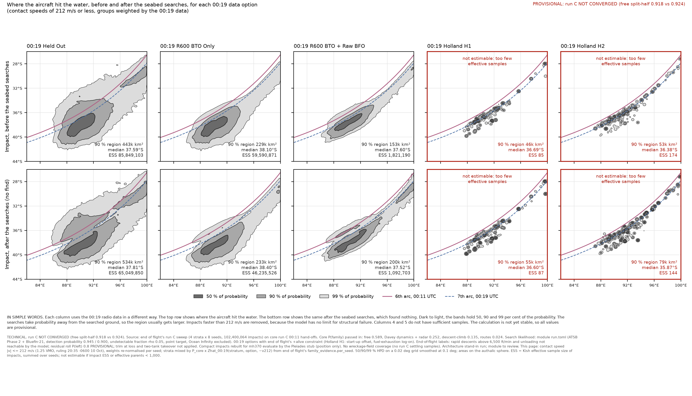
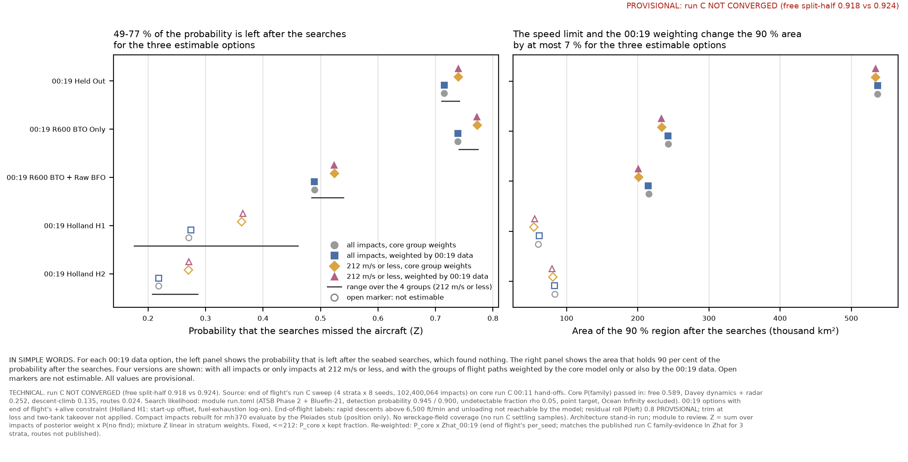
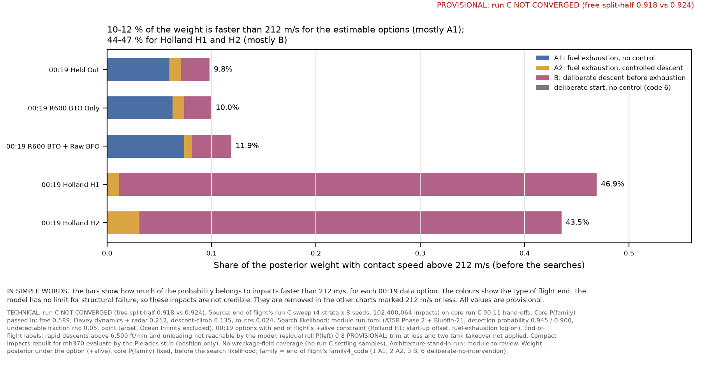

# Searched areas on run C: the module's run_release.sh chain, with the rulings applied (architecture stand-in)

11 October 2026, ~06:05 UTC. Architecture stand-in for the searched-areas module (the module ended its turn after arming run C).
**Every number here is labelled: run C NOT CONVERGED (free split-half 0.918 vs 0.924).** Module to review.

## 1. What ran

- **Input:** end of flight's run C sweep, `mh370-exchange/end-of-flight/next-run-c/`. All four `<stratum>/READY` files and
  `SWEEP-DONE` were present at 04:48 UTC. The data is 4 strata × 8 seeds = **102,400,064 impacts**, all SHA256-verified by the
  module's adapter.
- **Recipe:** the module's `engine/hypotheses/seabed-search/run_release.sh`, run as its header documents, with tag `c`.
  - `WEIGHTS=0.135,0.589,0.252,0.024` were passed in the order that step 1 printed (descent-climb, free, Davey dynamics + radar,
    routes). These are copied from core's `CORE_STAGES.md` entry "~00:12 UTC - core → ALL CHAIN MODULES: run C first results"
    (free 0.589, Davey dynamics + radar 0.252, descent-climb 0.135, routes 0.024), and they sum to 1.000.
  - The run took 54 min (04:50–05:45 UTC) outside the heavy lock, at 2 threads. Peak RSS was 3.6 GB per seed process.
  - The output is in `results/seabed-search-c/`: per-stratum and mixture maps, JSON and logs.
- **Rulings pass:** `results/searched-areas-next-run-c-standin/standin_runc.py`. It imports, unchanged, the module's
  `impact_map_options` and end of flight's `option_posteriors` and `family_evidence.per_seed`. It ran on all 32 seeds (13 min) and
  produced the speed-filtered and 00:19-re-weighted versions, the family shares and the ESS per family and region.
- **Checks:**
  - The stand-in's fixed, all-rows mixture reproduces the module's `impact-map-c-mixture.json` exactly for all five options:
    ΔZ ≤ 1.1e-16, Δ90 % area 0.0 km², Δmedian 0.0000°, ΔESS 0.
  - The stand-in's ln Ẑ_00:19 equals end of flight's published run C `family-evidence-next-c-{free,repro-radar,descent-climb}.json`
    to 0.0 for all five `+alive` options.
- **Field coverage:** SKIPPED. Settling has not posted run C wreckage samples on the exchange (only `next-run-b-*` and
  `reference-289-*`). The results are for a **point target only**.

## 2. Deviations (stand-in rules: disclosed, minimal, left for the module to review)

1. **Compact format (not a physics change).** Run C is end of flight's compact layout (`impacts32.npy`). The module's adapter and
   `mh370 evaluate` need `impacts.npy`, so `run_release.sh` as committed would have adapted no stratum. I made two minimal edits,
   both marked `STAND-IN`. The full-format path is unchanged.
   - `adapt_exchange_run.sh` now links the compact seed files, with the same checksum verification.
   - `impact_map_options.py` `search_loglik` rebuilds a temporary evaluate input through Pléiades' disclosed stub
     `hypotheses/pleiades/prepare/compact_eval.py` and deletes it after each seed. The row count also reads `impacts32.npy`.
   - This module reads position only, so no rebuilt column enters its likelihood. Pléiades verified the stub on next-free seed 1
     (|Δ ln L| ≤ 1.2e-3 on 3.6 % of rows, Z unchanged to 7 digits).
2. **Arcs input.** `run_release.sh` reads `runs/fixture-8/run.json` for the 6th/7th-arc lines. That file is not in a fresh
   checkout (`runs/` is git-ignored), so I linked it to core's `mh370-exchange/core/next-run-c/next-c-free/run.json`. The
   reference arcs are geometry and are the same in every run. This changes the drawing only.
3. **Binary.** `target/release/mh370` was built from this checkout (`cargo build --release -p mh370`, branch head 956575a).
4. **`family_evidence.CONSTRAINTS_ALL`** was narrowed at run time to `('alive', 'alive ~v212')`. Only the keys that are
   computed change; the function is unchanged.
5. **Re-weighted mixture source.** End of flight has published run C per-stratum family evidence for three strata only;
   **routes is not published.** All four strata use ln Ẑ from end of flight's own `per_seed`, run by the stand-in. Where a published
   value exists, it agrees exactly. The `~v212` (speed-capped) evidence is not published for run C, so it is computed the same way.
6. **RAM cap exceeded.** The rulings pass peaked at **18.2 GB RSS**, against the 10 GB cap. The cause was the per-stratum density
   accumulators plus end of flight's per-seed arrays held together. The pass completed, and no other job was disturbed that I
   could see (load fell from ~26 to ~10 during the run). The release chain itself stayed at 3.6 GB.
7. **Module chart defect caused by the stand-in's inputs.** The module's `impact-map-c-*.png` footnote prints `--labels` on one
   line. The long run C label string runs off the right edge, and the PNG canvas grows to fit it. The numbers are unaffected.
   **Fix for the module:** wrap the LABELS line. The stand-in's own charts (below) carry the labels and footnotes as required.
8. Mixture densities (76 MB) are kept on the exchange (`mh370-exchange/searched-areas/next-run-c/`), not in git. To redraw the
   charts, copy the `.npz` file back beside `standin_charts_c.py`.

## 3. Results (UNCONVERGED; point target; ρ = 0.05; Phase 2 + Bluefin-21; Ocean Infinity excluded)

The mixture of the four strata uses the `+alive` constraint. Z is the probability that the searches missed the aircraft. Version
"all" uses every impact. Version "≤212" uses only impacts with contact speed ≤ 212 m/s, re-weighted (ruling 8dbefed2 / 20:35 -0600).
Version "fixed" uses core's P(family): for ≤212 it is multiplied by each stratum's kept fraction. Version "re-wtd" uses
P_core × Ẑ_00:19(stratum, option).

| 00:19 option | rows | strata | Z | Z split-half | Z spread over strata | median before → after (°S) | 90 % area before → after | on Phase 2 before → after | ESS after | eff. parents (00:19) | estimable |
|---|---|---|---|---|---|---|---|---|---|---|---|
| Held Out | all | fixed | 0.7149 | 0.7165 / 0.7134 | 0.0345 | 37.50 → 37.72 | 436k → 537k | 0.318 → 0.048 | 70,025,530 | 3,191,179 | yes |
| Held Out | all | re-wtd | 0.7150 | 0.7165 / 0.7134 | 0.0345 | 37.50 → 37.72 | 436k → 537k | 0.318 → 0.048 | 70,025,530 | 3,191,179 | yes |
| Held Out | ≤212 | fixed | 0.7394 | 0.7408 / 0.7381 | 0.0310 | 37.59 → 37.81 | 443k → 534k | 0.290 → 0.043 | 65,049,850 | 3,182,028 | yes |
| Held Out | ≤212 | re-wtd | 0.7395 | 0.7408 / 0.7381 | 0.0310 | 37.59 → 37.81 | 443k → 534k | 0.290 → 0.043 | 65,049,850 | 3,182,028 | yes |
| R600 BTO Only | all | fixed | 0.7390 | 0.7404 / 0.7375 | 0.0366 | 37.98 → 38.33 | 227k → 243k | 0.291 → 0.043 | 49,448,009 | 2,418,249 | yes |
| R600 BTO Only | all | re-wtd | 0.7388 | 0.7403 / 0.7373 | 0.0366 | 37.99 → 38.34 | 227k → 242k | 0.291 → 0.043 | 49,448,009 | 2,418,249 | yes |
| R600 BTO Only | ≤212 | fixed | 0.7721 | 0.7730 / 0.7711 | 0.0330 | 38.09 → 38.39 | 230k → 234k | 0.254 → 0.036 | 46,235,526 | 2,439,449 | yes |
| R600 BTO Only | ≤212 | re-wtd | 0.7720 | 0.7730 / 0.7710 | 0.0330 | 38.10 → 38.40 | 229k → 233k | 0.254 → 0.036 | 46,235,526 | 2,439,449 | yes |
| R600 BTO + Raw BFO | all | fixed | 0.4894 | 0.4902 / 0.4885 | 0.0568 | 37.48 → 37.43 | 153k → 215k | 0.569 → 0.127 | 1,189,037 | 778,804 | yes |
| R600 BTO + Raw BFO | all | re-wtd | 0.4885 | 0.4889 / 0.4880 | 0.0568 | 37.49 → 37.45 | 153k → 215k | 0.570 → 0.127 | 1,189,037 | 778,804 | yes |
| R600 BTO + Raw BFO | ≤212 | fixed | 0.5241 | 0.5261 / 0.5221 | 0.0552 | 37.59 → 37.50 | 153k → 201k | 0.530 → 0.111 | 1,092,703 | 763,078 | yes |
| R600 BTO + Raw BFO | ≤212 | re-wtd | 0.5231 | 0.5247 / 0.5215 | 0.0552 | 37.60 → 37.52 | 153k → 200k | 0.531 → 0.111 | 1,092,703 | 763,078 | yes |
| Holland H1 | all | fixed | 0.2704 | 0.2847 / 0.2561 | 0.2324 | 36.56 → 36.18 | 44k → 60k | 0.813 → 0.534 | 130 | 135 | **NO** |
| Holland H1 | all | re-wtd | 0.2739 | 0.2823 / 0.2655 | 0.2324 | 36.50 → 36.18 | 45k → 61k | 0.809 → 0.524 | 130 | 135 | **NO** |
| Holland H1 | ≤212 | fixed | 0.3622 | 0.3272 / 0.3972 | 0.2848 | 36.69 → 36.60 | 45k → 54k | 0.710 → 0.450 | 87 | 85 | **NO** |
| Holland H1 | ≤212 | re-wtd | 0.3647 | 0.3306 / 0.3987 | 0.2848 | 36.69 → 36.60 | 46k → 55k | 0.708 → 0.443 | 87 | 85 | **NO** |
| Holland H2 | all | fixed | 0.2178 | 0.2209 / 0.2148 | 0.0549 | 36.57 → 35.85 | 51k → 84k | 0.871 → 0.486 | 242 | 312 | **NO** |
| Holland H2 | all | re-wtd | 0.2184 | 0.2223 / 0.2145 | 0.0549 | 36.57 → 35.87 | 50k → 83k | 0.871 → 0.486 | 242 | 312 | **NO** |
| Holland H2 | ≤212 | fixed | 0.2695 | 0.2634 / 0.2757 | 0.0790 | 36.38 → 35.85 | 54k → 80k | 0.814 → 0.417 | 144 | 172 | **NO** |
| Holland H2 | ≤212 | re-wtd | 0.2709 | 0.2655 / 0.2762 | 0.0790 | 36.38 → 35.87 | 53k → 79k | 0.812 → 0.416 | 144 | 172 | **NO** |

Areas are in km² (k = thousand). "Z split-half" is seeds 1–4 against seeds 5–8. Estimable means that the impact ESS after the
search and the effective parents of the 00:19 weighting are both ≥ 1,000 (the module's floor).

**Reading (all provisional):**
1. **Run C's reproduction of the module's (b) result.** Run C is close to (b): Held Out Z is 0.7149 against (b)'s 0.6883, R600
   BTO Only 0.7390 against 0.6713, and raw BFO 0.4894 against 0.5070. Run C's strata spread at ρ = 0.05 is 0.035–0.057 for the
   estimable options (0.033–0.062 in (b)). The Z split-half halves agree within 0.003 for the estimable options.
2. **The speed filter (ruling (b)) is first order for Z:** +0.025 (Held Out), +0.033 (R600 BTO Only) and +0.035 (raw BFO). The
   fast impacts lie disproportionately on searched ground: on Phase 2, before the search, the share falls from 0.291 to 0.254
   (R600 BTO Only). The filter changes the 90 % area after the search by ≤ 7 % (raw BFO 215k → 200k km²).
3. **The 00:19 re-weighting of the strata moves Z by ≤ 0.001** for the estimable options. This is the same finding as in (b)
   (≤ 0.0007). The weights move most for raw BFO: descent-climb 0.135 → 0.154, free 0.589 → 0.606, Davey dynamics + radar
   0.252 → 0.218, routes 0.024 → 0.0215.
4. **Holland H1 and H2: not estimable (ruling (c)).** The impact ESS after the search is 87–242, and the effective parents are
   85–312. Both are far below 1,000 in every version. The H1 strata spread is 0.23–0.28 in Z, and the H1 Z split-half halves
   differ by 0.03–0.07, which is the not-estimable signature. These rows are a COVERAGE GAP, not a result.
5. **Not-computed weight (ruling (a)):** 0.000 for every option and stratum. The seabed-search log-likelihood is finite on all
   102,400,064 rows. The neutral-carry rule is implemented, but it had nothing to carry.

### Weight with contact speed above 212 m/s (fixed core P(family), before the search; ruling (b))

| 00:19 option | all | A1 | A2 | B | code 6 | kept fraction per stratum (dc / free / radar / routes) |
|---|---|---|---|---|---|---|
| Held Out | 9.8 % | 5.96 % | 1.11 % | 2.74 % | 0.01 % | 0.899 / 0.902 / 0.904 / 0.908 |
| R600 BTO Only | 10.0 % | 6.25 % | 1.13 % | 2.62 % | 0.01 % | 0.898 / 0.899 / 0.903 / 0.904 |
| R600 BTO + Raw BFO | 11.9 % | 7.39 % | 0.72 % | 3.78 % | 0.00 % | 0.880 / 0.882 / 0.880 / 0.875 |
| Holland H1 | 46.9 % | 0.09 % | 1.07 % | 45.76 % | 0.00 % | 0.366 / 0.496 / 0.712 / 0.406 |
| Holland H2 | 43.5 % | 0.00 % | 3.11 % | 40.43 % | 0.00 % | 0.579 / 0.565 / 0.559 / 0.544 |

Families are end of flight's `family4_code`: 1 A1, 2 A2, 3 B, 6 deliberate start with no intervention.

### Family shares after the search (re-weighted mixture)

| 00:19 option | rows | A1 | A2 | B | code 6 | ESS after: A1 / A2 / B / code 6 |
|---|---|---|---|---|---|---|
| Held Out | all | 0.083 | 0.367 | 0.550 | 0.000 | 6.3M / 26.5M / 37.3M / 15k |
| Held Out | ≤212 | 0.048 | 0.384 | 0.567 | 0.000 | 3.4M / 25.8M / 35.9M / 12k |
| R600 BTO Only | all | 0.062 | 0.368 | 0.569 | 0.000 | 3.5M / 18.8M / 27.2M / 3.9k |
| R600 BTO Only | ≤212 | 0.031 | 0.383 | 0.587 | 0.000 | 1.6M / 18.4M / 26.3M / 2.4k |
| R600 BTO + Raw BFO | all | 0.041 | 0.195 | 0.764 | 0.000 | 85k / 218k / 902k / **110** |
| R600 BTO + Raw BFO | ≤212 | 0.018 | 0.201 | 0.781 | 0.000 | 26k / 212k / 857k / **75** |
| Holland H1 | all / ≤212 | 0.000 | 0.011 / 0.003 | 0.989 / 0.997 | 0.000 | ≤ 127 in every family (not estimable) |
| Holland H2 | all / ≤212 | 0.000 | 0.093 / 0.078 | 0.907 / 0.922 | 0.000 | ≤ 238 in every family (not estimable) |

Family shares are mostly end of flight's prior until coverage gaps G1–G4 close (ruling 6, 16:25 -0600). They are not an A-against-B
test.

### Charts

The module's own maps (fixed weights, all rows) are in `seabed-search-c/impact-map-c-mixture.png` and in one file per stratum.
See deviation 7 for their footnote overflow.

## 4. COVERAGE

**(a) Feasible set.** All 777-200ER end-of-flight states after 00:11. These include cruise to fuel exhaustion followed by an
uncontrolled descent (A1), a controlled or arrested descent (A2), a deliberate descent before exhaustion (B), and rapid descents
with high descent rates, up to the structural limits (VD/MD, CS-25.335). The impact location is anywhere inside the reach from
the 00:11 hand-off. For this module, the feasible set also includes a wreckage field (debris spread), not only a point.

**(b) Model's reach.** End of flight's run C physics, as labelled by end of flight:
- rapid descents above 6,500 ft/min and unloading are not reachable;
- B covers only onsets after 00:11;
- trim at loss and two-tank takeover are not applied;
- there is no structural limit (G13), so contact speeds above ~1.25 VMO are produced but are not credible.

The search likelihood is a point target with the undetectable fraction ρ = 0.05 (single value; the module's ρ sweep was not
re-run on C). Ocean Infinity 2018 and 2025-26 layers are excluded in `run.toml` (the module's declared base).

**(c) Proposal's coverage.** 102.4 M impacts. Region ESS after the search (re-weighted, ≤212):

| 00:19 option | Phase 2 searched (cov ≥ 0.5) | not on Phase 2 | N of 33°S | 33–36°S | 36–39°S | S of 39°S |
|---|---|---|---|---|---|---|
| Held Out | 23.5M | 59.8M | 7.7M | 8.1M | 34.3M | 15.0M |
| R600 BTO Only | 15.0M | 43.1M | 3.8M | 2.4M | 26.4M | 13.8M |
| R600 BTO + Raw BFO | 873k | 871k | 133k | 103k | 729k | 134k |
| Holland H1 | 73 | 61 | 41 | 47 | 78 | 40 |
| Holland H2 | 140 | 69 | 46 | 69 | 110 | 37 |

**Gaps and status:**

| Gap | Type | Status | Labels it affects |
|---|---|---|---|
| Holland H1/H2: ESS 85–312 (within-parent sampling) | coverage (c) | OPEN. This is end of flight's targeted sampler and core's tempering change. Rows are reported as not estimable, not dropped. | every H1/H2 row |
| Rapid descents > 6,500 ft/min and unloading | reach (b) | OPEN (end of flight) | all rows |
| No structural limit; contact speeds > 212 m/s (G13) | reach (b) | Stop-gap: the ≤212 versions are shown beside all rows. OPEN until end of flight's breakup end state exists. | all rows |
| Wreckage field (debris spread) not applied | reach (b) | OPEN. Settling has no run C samples on the exchange. Point target only. In (b) the field changed Z by −0.0004 to +0.0001. | all rows |
| code 6 (deliberate start, no intervention) | coverage (c) | ESS 75–110 under raw BFO; 2.4k–15k under Held Out and R600 BTO Only | code 6 shares under raw BFO |
| ρ single value (0.05) on run C | parameter bound, no source | The module's ρ sweep (0 to 0.5) on (b) moved Z by up to +0.26. It is not re-run on C. | all Z values |
| Ocean Infinity layers excluded | declared conditional | Module base; the OI overrides were not run on C | all rows |
| Routes 00:19 evidence not published by end of flight | provenance | Recomputed with end of flight's own function (deviation 5) | re-weighted rows |
| Core run C not converged | source | OPEN (core sampler change) | everything |

**Parameter bounds, with their sources:**
- detection probability 0.945 (Phase 2) and 0.900 (Bluefin-21): the module's `run.toml`; Phase 2 is derived in `seabed-search-methods-draft.md` from ATSB Figure 73 (its three percentages not yet verified in primary form, A-8);
- ρ = 0.05: no published value (stated in `run.toml`);
- speed cap 212 m/s = 1.25 VMO: architecture ruling 20:35 -0600 10 Oct (212 / 1.25 = 170 m/s, about 330 kt; the stand-in did not re-check
  the VMO source, and the 1.25 margin is declared, not sourced);
- ESS floor 1,000: the module's `ESS_FLOOR`.

## 5. Outputs

- `results/seabed-search-c/`: the module's chain output (maps, JSON, logs, `LABELS.txt`, `field-coverage.skipped`).
- `results/searched-areas-next-run-c-standin/`: `standin_runc.py`, `standin_charts_c.py`, `standin-runc.json` and figures 1–3
  (PNG + PDF).
- `mh370-exchange/searched-areas/next-run-c/`: the JSON files, the mixture densities (`.npz`), `SHA256SUMS`, `README.md` and
  **READY**.

## 6. For the module

1. Review the two `STAND-IN` edits (deviation 1). Either keep them or replace them with your own compact reader.
2. Wrap the LABELS footnote line in `impact_map_options.py` (deviation 7).
3. When settling posts run C wreckage samples, run step 3 (`run_release.sh … <settling dir>`). Widen the outcome key
   `row×1000+draw` first, as ruled at 17:05 -0600.
4. Re-run the ρ sweep and the OI overrides on C, if you want them in pass 1.

- Modular Architecture (stand-in for Searched Areas)
