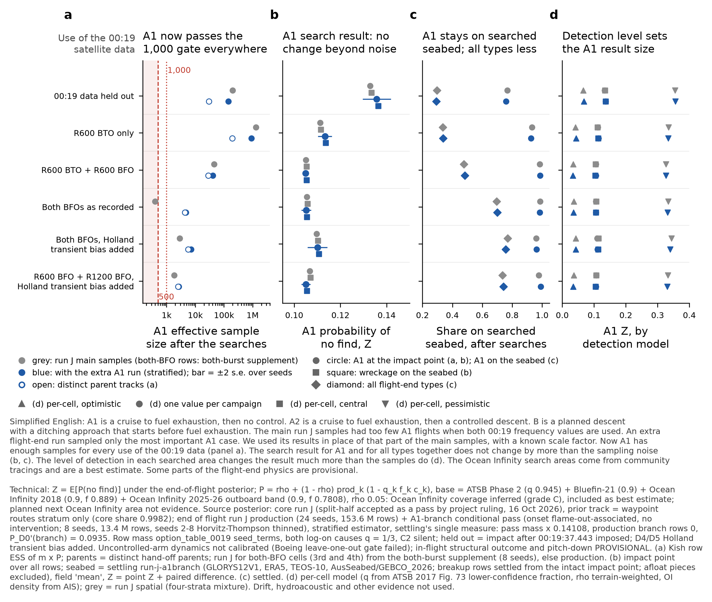

# Searched areas on end of flight's A1-branch conditional pass: the D3 × A1 gap is closed

19 October 2026, Searched Areas module (sub-agent of the coordination session), work order
`threads/work-orders/overnight-2026-10-19.md` §B3. Inputs: end of flight `end-of-flight/run-j-a1branch/run-j-waypoints` (note
`results/eof-a1-branch-oct18`, commit 4605cc21) beside run J production `end-of-flight/run-j/run-j-waypoints`; settling
`settling/run-j-a1branch/run-j-waypoints` (note `results/settling-run-j-a1branch`, commit f04577fc; READY 04:46Z). Code:
`engine/hypotheses/seabed-search/a1branch/` (`score_a1branch.py`, `reduce_a1branch.py`). Exchange: `searched-areas/run-j-a1branch/` (READY).

**Labels for every number here.** "Ocean Infinity coverage inferred (grade C), included as best estimate": base = ATSB Phase 2 +
Bluefin-21 + Ocean Infinity 2018 + Ocean Infinity 2025–26 (outboard band), enforced by `base_guard.py` (four campaigns); without Ocean
Infinity is a labelled sensitivity; the planned next Ocean Infinity area is a map layer only. Core run J split-half **accepted as a pass
by project ruling, 16 Oct 2026**. **Conditional on the waypoint-routes stratum** (core share 0.9982), as end of flight's and settling's
A1-branch results. End of flight's caveat (verbatim): *the uncontrolled-arm dynamics are not calibrated: the Boeing leave-one-out gate
failed in all three rounds.* Settling's labels travel with the settled numbers: breakup rows settled from the intact impact point (G-bf);
P(left) = 0.8 PROVISIONAL. D0 is D0' (impact after 00:19:37.443 imposed). D4 and D5: "Holland transient bias added". Core × seabed
searches only — not all evidence (the all-evidence views are the composer's).

Family codes: **A1** = cruise to fuel exhaustion, then no control; **A2** = cruise to fuel exhaustion, then a controlled descent; **B** =
planned descent with a ditching approach begun before fuel exhaustion.

## Result

1. **D3 × A1 is estimable for searched areas, at the impact point and at the settled positions.** After the searches, the A1 row ESS
   under D3 (both BFOs as recorded) is **4,763** (distinct parents 4,367) at the impact point, against **401** in run J (both-burst
   supplement). At the settled positions, settling's A1 product has row ESS 5,283 before the searches and a distinct-row ESS of
   **4,260** after them (run J: 409 before). **The 500 gate and the 1,000 gate are both met.** D4 × A1: 7,178 rows / 5,730 parents
   after (run J 2,902). D5 × A1: 2,690 / 2,558 (run J 1,838). Every A1 cell, D0'–D5, is above 1,000 in every measure (Table 1).
2. **The search result for A1 does not change beyond Monte Carlo noise.** Z(A1) under D3 = **0.1052** (seed s.e. 0.0010) at the impact
   point and **0.1055** settled, against 0.1054 / 0.1058 in run J. D4: 0.1100 (0.0021) / 0.1106 (run J 0.1097 / 0.1102). D5: 0.1051
   (0.0010) / 0.1054 (run J 0.1068 / 0.1070; −1.2 s.e.). The search evidence against A1 is as strong as run J said; it is now measured.
3. **The share of the remaining A1 probability on searched ground stays near 1** under the both-frequency treatments (settled, after
   the searches: D3 0.985, D4 0.962, D5 0.990; run J 0.987 / 0.962 / 0.978). For all flight-end types together the share after the
   searches is D3 0.700, D4 0.757, D5 0.741 (run J 0.697 / 0.769 / 0.734).
4. **Totals move by at most 0.0012 in Z.** All families: Z at the impact point D3 0.1506 (run J 0.1506), D4 0.1378 (0.1366), D5 0.1438
   (0.1436); settled D3 0.1513, D4 0.1383, D5 0.1444 (run J 0.1513 / 0.1372 / 0.1441). A1's share after the searches: D3 0.060, D4 0.207,
   D5 0.040 (single measure).
5. **The per-cell detection field (V0–V3) behaves as on run J.** For A1 at the settled positions, V1 central differs from V0 by +0.0002
   (D3), +0.0023 (D4), −0.0005 (D5); V2 pessimistic gives Z ≈ 0.33–0.34 and V3 optimistic ≈ 0.035–0.042. The level of q and ρ, not the
   sampling, sets the size of the A1 search factor (Table 6), as the spatial-detection note found.
6. **Normalisation.** This note uses **settling's single measure** (one resampleable mixture: production rows outside the branch + pass
   rows × SCALE, so the branch part of Z(d) is the pass estimate), because the settled products are built on it. End of flight's form
   (production's Z(d) in the denominator, A2/B rescaled) is computed beside it. **Z(A1) is identical under both** (the A1 composition does
   not depend on the denominator). The difference is only in the family shares: A1 share before the searches 0.0860 against 0.0851 (D3),
   0.2595 against 0.2629 (D4), 0.0551 against 0.0548 (D5); in total Z it is ≤ 0.00013 and in the share on searched ground ≤ 0.0008
   (Table 3).

Tables 1–8 are in [`tables.md`](tables.md) (generated by `make_tables.py`). The four most-quoted:

**Table 1 (extract). A1 after the searches.**

| 00:19 treatment | run J impact point: row ESS after | stratified impact point: row ESS before / after | parents after | settled: row ESS before / distinct-row ESS after | gate 500 / 1,000 |
|---|---|---|---|---|---|
| D0' held out | 199,190 | 658,188 / 141,664 | 29,601 | 658,188 / 4,251 | met / met |
| D1 R600 BTO only | 1,287,554 | 823,034 / 905,822 | 197,143 | 823,034 / 6,584 | met / met |
| D2 R600 BTO + BFO | 45,373 | 41,988 / 40,990 | 28,545 | 41,988 / 8,820 | met / met |
| **D3 both BFOs as recorded** | **401** (both-burst) | 5,283 / **4,763** | 4,367 | 5,283 / 4,260 | **met / met** |
| D4 both BFOs, Holland transient bias added | 2,902 (both-burst) | 11,395 / 7,178 | 5,730 | 11,395 / 4,620 | met / met |
| D5 R600 + R1200 BFO, Holland transient bias added | 1,838 | 2,920 / 2,690 | 2,558 | 2,920 / 2,508 | met / met |

(The settled distinct-row ESS is bounded by the product size: N = 10,000 outcomes for A1, 40,000 for all families.)

**Table 2 (extract). Impact point and settled, base, ρ 0.05.**

| 00:19 treatment | family | Z run J (point / settled) | Z stratified, point (seed s.e.) / settled | on searched ground after, settled: run J → stratified |
|---|---|---|---|---|
| D3 | all | 0.1506 / 0.1513 | 0.1506 / 0.1513 | 0.697 → 0.700 |
| D3 | A1 | 0.1054 / 0.1058 | 0.1052 (0.0010) / 0.1055 | 0.987 → 0.985 |
| D4 | all | 0.1366 / 0.1372 | 0.1378 / 0.1383 | 0.769 → 0.757 |
| D4 | A1 | 0.1097 / 0.1102 | 0.1100 (0.0021) / 0.1106 | 0.962 → 0.962 |
| D5 | all | 0.1436 / 0.1441 | 0.1438 / 0.1444 | 0.734 → 0.741 |
| D5 | A1 | 0.1068 / 0.1070 | 0.1051 (0.0010) / 0.1054 | 0.978 → 0.990 |
| D0' | A1 | 0.1328 / 0.1335 | 0.1357 (0.0031) / 0.1364 | 0.768 → 0.760 |

**Table 4. Validation: the search factor on the branch rows, production (24 seeds) against the pass (8 seeds).**

| 00:19 treatment | Z(branch) production (seed s.e.) | Z(branch) pass (seed s.e.) | difference / combined s.e. |
|---|---|---|---|
| D0' | 0.1335 (0.0033) | 0.1387 (0.0050) | +0.88 |
| D1 | 0.1111 (0.0012) | 0.1150 (0.0026) | +1.34 |
| D2 | 0.1053 (0.0005) | 0.1051 (0.0010) | −0.17 |
| D3 | 0.1045 (0.0009) | 0.1052 (0.0010) | +0.50 |
| D4 | 0.1090 (0.0024) | 0.1087 (0.0025) | −0.09 |
| D5 | 0.1068 (0.0010) | 0.1051 (0.0010) | −1.21 |

The pass reproduces production's search factor on the branch within 1.4 combined s.e. in every treatment. The dominant noise is
between seeds (core hand-off seeds), not between rows: the seed s.d. of Z(branch) under D0' is 0.017–0.018 in both sets.

## Method

- **Row mass** — settling's `wf_a1branch` / `wf_runj.seed_masses` imported read-only from settling's work tree (option_table_0019
  seed_terms, primary cell 'D<d> total q=0.333 (C2 silent)'; per-seed ln Z asserted equal to seed_terms, worst 3.6e-15). Branch =
  `latent:onset_mechanism == 2` and `latent:control_realised == 2`. Production rows in the branch: mass 0; pass rows: mass × SCALE,
  SCALE = M_prod(D0', branch) / S_pass(D0') = 0.1410766 (settling 0.1410766; relative difference 2e-16); P_D0'(branch) = 0.093481.
- **Impact point, every row** (153,599,936 production + 13,398,857 pass): P(no find) by the run.toml base, c_k bilinear on the 0.01°
  `.cov` rasters (centre-registered), ρ 0 / 0.05 / 0.25 / 0.5 and without Ocean Infinity. On every production row the result equals the
  published run J column `searched-areas/run-j/run-j-waypoints/seed-k/seabed-lnL.npy` to **3.6e-15** (float64; float32 columns to 2.4e-7).
  The pass columns are published in the same format (`pass/seed-k/`).
- **Production alone reproduces run J**: reduced without the branch replacement, the production rows give the published run J waypoints
  Z for D0', D1, D2 and D5 to ≤ 6e-17 (all families and A1).
- **Settled**: settling's 12 products (D0'–D5 × {all families with A1 stratified, N 40,000; A1, N 10,000}); 252,895 table rows,
  287,137 outcomes, 16,248,867 settled pieces (fate 0) scored, afloat pieces excluded (ocean drift's evidence). Field 'mean' treatment;
  per outcome, the mass-weighted mean over pieces; the row likelihood is the **mean** over the row's draws. Z settled = Z point (all
  rows, same measure and subset) + paired Δ (run J settled recipe); V1–V3 = Z settled (V0) + paired (V − V0) (run J spatial recipe,
  `spatial/score_spatial_run_j.py` Lookup and VARIANTS unchanged; fields `searched-areas/spatial-fields/fields.npz`).
- **Checks (settled)**: point arm at the impact position against the impact-point columns (production: published run J; pass: this
  order's), max |Δ ln L| 2.2e-15; V0 equals the base algebra exactly; two identical draws = one; 20,061 off-ground outcomes return ln L =
  0 in every variant; 0 outcomes carried; every input SHA256 verified against its producer's SHA256SUMS before use.
- **ESS**: Kish over rows of m × P (after the searches); parents = Kish over distinct hand-off parents per seed; settled distinct-row ESS
  = Kish over table rows of the P-weighted outcome counts in the product. Seed s.e. of Z(A1): ratio-estimator s.e. over seeds, pass and
  production parts combined by mass.

## COVERAGE

**(a) Feasible set.** Searched ground as run J (coverage/PROVENANCE.md): Phase 2 union 120,486.5 km²; Bluefin-21 771.4 km²; OI 2018
126,009 km² beyond Phase 2 (grade C, reported "over 112,000 km²"); OI 2025–26 7,571 km² on the 9,696.9 km² outboard band (grade C). Not
searched ground: the planned next area, the contract area, bathymetric mapping, the surface search (ocean drift's). Flight end: as end
of flight's A1-branch note (fuel exhaustion with no pilot input; every descent the 777 can show — spiral up to 90° bank, phugoid, steep
dive) and its run J note for A2 and B.

**(b) Model's reach.** Impact point and settled wreckage field (settled reach gap closed for the resampled rows). Declared reach gaps,
unchanged: G-bf (in-flight breakup settled from the intact impact point); detection definition 'mean' (the 'any' bound was not
recomputed here); passive acoustic (beacon) search of April 2014 not modelled; ρ has no published value (swept 0–0.5; per-cell V2/V3
bracket); per-cell model gaps G-LPD, G-OI25, G-ρ, G-terrain-OI as the spatial-detection note.

**(c) Proposal's coverage** (waypoints stratum; ESS after the searches at the impact point, rows, base):

| family | D0' | D1 | D2 | D3 | D4 | D5 |
|---|---|---|---|---|---|---|
| A1 (stratified) | 141,664 | 905,822 | 40,990 | **4,763** | 7,178 | 2,690 |
| A2 (production) | 425,340 | 702,652 | 12,809 | 2,083 | 12,482 | 7,637 |
| B (production) | 375,878 | 428,388 | 16,510 | **773** | 6,895 | 3,462 |
| all | 854,234 | 1,171,436 | 34,874 | 2,154 | 22,695 | 9,142 |

- **Gap "D3 × A1 not estimable" for searched areas: CLOSED** at the impact point (4,763) and settled (5,283 before / 4,260 after).
- **Remaining gap: D3 × B** = 773 rows after the searches on production (run J's both-burst figure: 499–500). It meets the 500 gate and
  not the 1,000 gate. This order does not touch B (no B pass exists). Fix, if wanted: a B-conditioned pass by end of flight in the same
  way, or more both-burst seeds. **Status: OPEN, declared.**
- D3/D4 rows for A2 and B here come from production, not the both-burst supplement that run J used for D3/D4; their Z differs from
  run J's by up to 0.003 (D3 B 0.1639 against 0.1607), within the noise of two independent sets of that size (ESS 773 and 499).
- Other strata (free, descent-climb, Davey dynamics with radar; 0.0018 of core mass) keep their run J A1 gaps under D3–D5: no branch pass
  there. Their effect on any mixture value here is below the precision shown.
- The northern tail (north of 33 S) is thin (end-of-flight gap 2); this order adds no ESS by region.
- Sensitivity without Ocean Infinity: A1 row ESS after D3 2,866, D4 1,654, **D5 1,012** (at the 1,000 gate).

**Parameter bounds and sources.** q: Phase 2 0.945, Bluefin-21 0.9, OI 0.9; f: OI 2018 0.889, OI 2025–26 0.7808; ρ ∈ {0, 0.05, 0.25,
0.5}, no source (0.05 Pete's reference, 8 Oct). Per-cell: q_hi 0.95 / q_lpd 0.70 (V1), 0.90 / 0.50 with ρ0 0.25 and OI q 0.63 (V2), 0.99 /
0.90 with ρ0 0.02 and OI q 0.95 (V3); judgement values (spatial-detection note). End-of-flight bounds as its A1-branch note.

## Deviations and cuts (declared)

1. **Waypoints stratum only** — the pass exists only there; no four-strata mixture is formed (run J's mixture values are quoted for the
   spatial comparison only, Table 6, and differ from the waypoints values by the 0.0018 minor-strata share).
2. **The planned next Ocean Infinity area layer was not recomputed** for the pass rows (map layer only; it changes no number). The
   frozen-snapshot geojson is not in this session's sparse checkout.
3. **The 'any piece' optimistic bound was not recomputed** at the settled positions (run J settled published it; the reported 'mean'
   treatment is unchanged).
4. **No A2/B or cause-split settled products** — settling emitted totals and A1 only (A2 and B unchanged from run J settled).
5. **Run J comparators for D3/D4 come from the both-burst supplement** (8 thinned seeds), as run J published them; the stratified values
   use production for A2/B. Comparisons for those cells are between two sample sets, not a reproduction.
6. Impact-point ρ-sweep and without-OI columns for the pass are float32 (≤ 2.4e-7 in ln L), the base column float64, as run J.
7. No smoke result is quoted; every number is from the full inputs (24 production + 8 pass seeds; all 12 settled products).

## Run and disk

Mac, 4 processes × 1 thread (impact point, 05:03–05:10Z), then 1 process (settled, 31 s). Exchange output 380 MB (cap 2 GB). Disk free
45 → 37 GiB over the period (other orders were writing); the 5 GB pause floor was never approached. Nothing deleted.

## Files

`a1branch-reduced.json`, `tables.md` / `make_tables.py`, `make_figure.py`, `searched-areas-a1branch-gate.{png,pdf}`. Exchange
`searched-areas/run-j-a1branch/`: `point_terms.json` (per-seed sums), `pass/seed-k/` (impact-point columns, row-aligned with
`end-of-flight/run-j-a1branch/run-j-waypoints/seed-k/impacts32.npy`), `settled-rows.npz` (row-aligned with settling's
`rja1_impacts.f64`; map rows via `rja1_source.npy`), `settled_summary.json`, `a1branch-reduced.json`, README.md, SHA256SUMS, READY.
Commands (from `engine/`): `python hypotheses/seabed-search/a1branch/score_a1branch.py point <exchange out> 4`, then `... settled <exchange
out>`, then `reduce_a1branch.py <exchange out> ../results <out.json>`.

---
*Footnote (STE100).* These numbers come from the end-of-flight run J samples plus an extra run that samples only the case "fuel
exhaustion, then no control". The extra run replaces that part of the main samples, with a known scale factor. We use the four seabed
searches. The Ocean Infinity areas are a best estimate from community tracings. A wreck field counts as one object. The planned next
Ocean Infinity area does not change a number. Some parts of the flight-end physics are provisional.
*Footnote (technical).* P(no find | y) = ρ + (1 − ρ) Π_k [1 − q_k f_k c_k(y)] (point) or with c̄_k = settled-mass-weighted mean over
fate-0 pieces (field); L(row) = mean over settling draws; ρ = 0.05 unless stated. Row mass option_table_0019 seed_terms, both causes q =
1/3, C2 silent; stratified estimator, settling's single measure (SCALE 0.14108; P_D0'(branch) 0.0935). Waypoints stratum (core 0.9982).
Run J convergence accepted as a pass by project ruling, 16 Oct 2026. Uncontrolled-arm dynamics not calibrated. Breakup rows settled from
the intact impact point (G-bf).

— Searched Areas Module (sub-agent, coordination session ac78e73d), 2026-10-19
