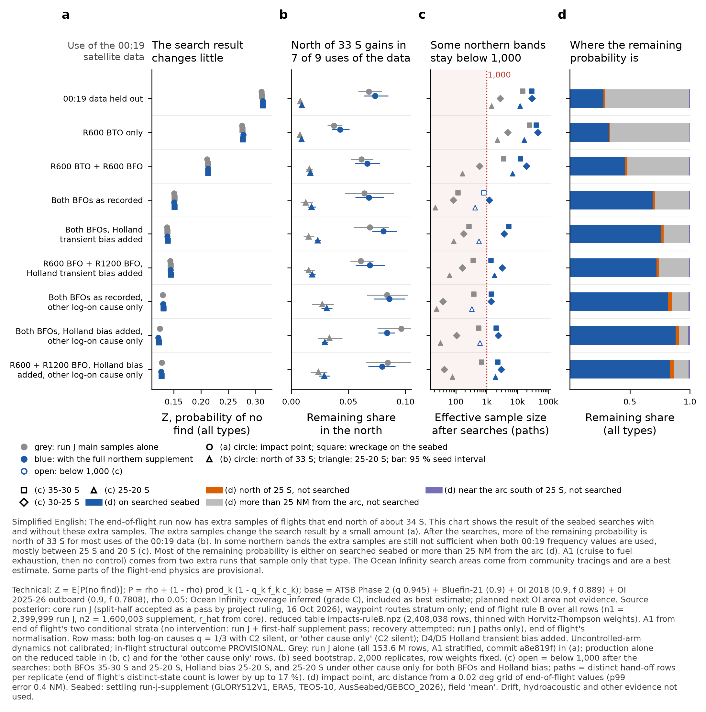

# Searched areas on the full run J northern supplement (rule B): impact point, settled positions, per-cell field

20 October 2026, Searched Areas module (sub-agent of coordination session ac78e73d), work order
`threads/work-orders/overnight-2026-10-20.md` §B (B3). Inputs: end of flight `end-of-flight/run-j-supplement/` (READY 10:09Z; note
`results/eof-run-j-supplement-oct20`, 45ea4af0): the reduced rule-B table `reduced/impacts-ruleB.npz` and the A1 strata passes
`run-j-a1branch`, `north-k2-a1branch`, `run-j-a1outside`; settling `settling/run-j-supplement/` (`ruleB-waypoints/`, `a1-stratified/`,
d0660ec2). Comparator "run J alone": this module's a8e819f results (`results/searched-areas-run-j-a1branch`). Code:
`engine/hypotheses/seabed-search/supplement/` (`score_supplement.py`, `reduce_supplement.py`). Exchange: `searched-areas/run-j-supplement/` (READY).

**Labels for every number here.** "Ocean Infinity coverage inferred (grade C), included as best estimate" — base = ATSB Phase 2 +
Bluefin-21 + Ocean Infinity 2018 + Ocean Infinity 2025–26 (outboard band), enforced by `base_guard.py` (four campaigns); without Ocean
Infinity = labelled sensitivity; the planned next Ocean Infinity area is a map layer only. Core run J split-half **accepted as a pass by
project ruling, 16 Oct 2026**. **Waypoint-routes stratum only.** End of flight's caveat: *the uncontrolled-arm dynamics are not
calibrated: the Boeing leave-one-out gate failed in all three rounds.* Breakup rows settled from the intact impact point (G-bf); P(left) =
0.8 PROVISIONAL. D0 = D0' (impact after 00:19:37.443 imposed). D4/D5: "Holland transient bias added". D3s–D5s = log-on from another cause
only (C2 silent, no q mixture). Core × seabed searches only, not all evidence. **A1** = cruise to fuel exhaustion, then no control; **A2**
= cruise to fuel exhaustion, then a controlled descent; **B** = planned descent with a ditching approach begun before fuel exhaustion.

## Result

1. **The search factor moves by at most +0.0026 with the full supplement.** Impact point, all families (end of flight's normalisation):
   Z = 0.3131 (D0'), 0.2777 (D1), 0.2132 (D2), **0.1508 (D3), 0.1383 (D4), 0.1446 (D5)**, against run J alone (a8e819f, all 153.6 M rows)
   0.3105 / 0.2753 / 0.2113 / 0.1506 / 0.1378 / 0.1438. Settled: 0.3132 / 0.2766 / 0.2129 / **0.1516 / 0.1389 / 0.1450** (run J alone settled
   0.3117 / 0.2761 / 0.2123 / 0.1513 / 0.1383 / 0.1444). Other cause only: D3s 0.1306, D4s 0.1219, D5s 0.1273 (production alone on the
   same table 0.1303 / 0.1248 / 0.1284). The supplement adds probability in the north, where nothing was searched, so Z rises slightly.
2. **The share on searched ground after the searches is unchanged within 0.005** (impact point): D0' 0.281 (run J 0.284), D3 0.689
   (0.689), D4 0.757 (0.758), D5 0.722 (0.727).
3. **More of the remaining probability lies north of 33 S** in 7 of the 9 treatments (Table 4, 95 % seed-bootstrap intervals): D0'
   0.068 → **0.073**, D3 0.064 → **0.068**, D4 0.069 → **0.081**, D5 0.061 → **0.069** (production alone → rule B). In 25–20 S under D4 the
   remaining share is 0.0152 [0.0108, 0.0202] → **0.0231 [0.0207, 0.0260]**: the intervals do not overlap, as end of flight found before
   the searches (production alone: 85 paths there after the searches). D4s and D5s north of 33 S fall (0.096 → 0.084, 0.084 → 0.080), within the
   production-alone interval.
4. **Band ESS after the searches (paths; target 1,000)** rises in every northern band (Table 6). **Below 1,000 after the searches:**
   - **D3 25–20 S: 423** (production alone 21) and **D4 25–20 S: 559** (85) — end of flight's two remaining gaps; reported, not dropped.
   - **D3 35–30 S: 804** (116). New with the search likelihood: it was 1,311 before the searches; the searches down-weight the
     searched part of that band.
   - D3s 25–20 S: 329; D4s 25–20 S: 596 (other cause only).
   Every D0'–D2 band and every D5 band is above 1,000 (D5 1,358 / 3,208 / 1,814).
5. **Where the remaining probability is** (four-way split after the searches, impact point, base; Table 3). D3: on searched ground
   0.689, north of 25 S 0.018, more than 25 NM from the arc 0.285, near the arc south of 25 S 0.008. D0': 0.281 / 0.010 / 0.703 / 0.007.
   Against production alone the north-of-25-S part rises in D3–D5 by 0.003–0.008 (D4 0.016 → 0.023); under D4s it falls (0.035 → 0.031).
6. **A1 by the two conditional strata** (end of flight's estimator; A1 shares reproduce end of flight's: D4 0.2755, D4s 0.4760). Z(A1):
   D3 **0.1066** (row ESS 6,260, parents 5,679; run J alone 0.1052), D4 0.1121 (34,147), D5 0.1067 (4,780). The A1 north stays thin
   after the searches: D3 35–30 / 30–25 / 25–20 S = 666 / 397 / 152 rows; D5 748 / 211 / 40; D4 1,790 / 879 / 498 (Table 7). The
   reason is that branch 1 has a supplement pass on the first half only, and branch 2 has run J paths only (end of flight's declared
   reductions 2–3).
7. **Per-cell detection field at the settled positions** (Table 9): V1 central − V0 = −0.0019 to −0.0040 (D0'–D5), as on run J; V2
   pessimistic gives 0.36–0.49 and V3 optimistic 0.07–0.26. The detection level still sets the size of the result.

All tables are in [`tables.md`](tables.md) (generated by `reduce_supplement.py`). The JSON is `supplement-reduced.json`.

**Table A (extract of Tables 1, 4 and 6). Both-frequency treatments, base, after the searches.**

| 00:19 treatment | Z impact, run J alone → rule B | Z settled, rule B | north of 33 S, production alone → rule B [95 %] | 25–20 S | paths ESS 35-30 / 30-25 / 25-20 S, rule B |
|---|---|---|---|---|---|
| D3 both BFOs as recorded | 0.1506 → 0.1508 | 0.1516 | 0.0641 → 0.0679 [0.0560, 0.0809] | 0.0128 → 0.0180 [0.0148, 0.0216] | **804** / 1,231 / **423** |
| D4 both BFOs, Holland transient bias added | 0.1378 → 0.1383 | 0.1389 | 0.0688 → 0.0807 [0.0707, 0.0923] | 0.0152 → 0.0231 [0.0207, 0.0260] | 5,209 / 3,707 / **559** |
| D5 R600 + R1200 BFO, Holland transient bias added | 0.1438 → 0.1446 | 0.1450 | 0.0609 → 0.0687 [0.0564, 0.0819] | 0.0154 → 0.0184 [0.0157, 0.0212] | 1,358 / 3,208 / 1,814 |

## Method

- **Impact point, every row of the reduced rule-B table** (2,408,038 rows: run J 1,130,253, supplement 614,229, extra descents 663,556;
  end of flight's README directs downstream modules to it). Weights `lnw:comb/<d>` (rule B: n1 = 2,399,999, n2 = 1,600,003, u2 = w/16,
  r_hat from core) and `lnw:alone/<d>` (production alone). P(no find) from the base, the ρ sweep, without OI, and the per-cell V1–V3, by
  `spatial/score_spatial_run_j.py`'s Lookup (unchanged).
- **A1 strata, every row** (branch 1: run-j-a1branch 13,398,857 rows + north-k2-a1branch 8,003,126; branch 2: run-j-a1outside 3,202,633).
  Row masses use settling's `wf_supp_a1.raw_masses` (end of flight's `supplement_combine.row_terms`, rule B for branch 1), imported
  read-only, × exp(lnZ_D0 − lnZ_d) P_b / S_b. They are in the reduced table's units, and the strata sums reproduce the strata shares
  (D0: 0.0928 + 0.0764).
- **Totals: end of flight's convention (headline)** = reduced rows outside the strata × s_d (`eof-convention-weights.json`, 0.858–1.014)
  + strata rows; mass sums = 1 to 2e-16. Settling's single measure (rest + strata, self-normalised) is reported beside it; the Z
  difference is ≤ 0.0007 (D4s), ≤ 0.0003 elsewhere.
- **Settled**: settling's 33 rule-B products (totals, A1, A2, B, north of 33 S, D3s–D5s) and 15 a1-stratified products. Field 'mean';
  row likelihood = the mean over the row's draws. The outcomes of the a1-stratified totals are weighted by end of flight's convention
  (settling's instruction). Z settled = Z point (all rows, same measure) + paired Δ. D0'–D2 totals come from the rule-B set (A1
  unstratified, well sampled there). D3–D5 and D3s–D5s totals come from a1-stratified.
- **Four-way split**: searched / north of 25 S / more than 25 NM from the 7th arc / near the arc south of 25 S, as in the spatial-detection
  note. The reduced table has no arc-distance column. So the distance comes from a 0.02° grid of end of flight's own `arc_distance_nm`
  (binned from 6 end-of-flight seeds: run J 1 and 3, supplement 1001, 1003, 1005, A1-outside 1). On held-out seeds the grid gives a p99 error of 0.11 NM (run J seed 2) and 0.37 NM (supplement
  seed 1002), and the 25 NM flag disagrees on 0.02–0.06 % of rows. Strata rows use their own exact column.
- **ESS**: rows = Kish over rows; paths = Kish over distinct hand-off rows per replicate. My paths reproduce end of flight's full-set
  path counts before the searches within 1 % (D3 1,311 / 2,463 / 427 against 1,313 / 2,467 / 427; D4 3,670 / 2,386 / 570 against 3,681 /
  2,389 / 573). End of flight's "distinct 00:11 states" merge duplicate hand-off states and are lower, by up to 17 % (D4 30–25 S: 1,993
  states against 2,389 paths). They cannot be reproduced from the reduced table. So paths are an upper bound on states.
- **Seed bootstrap** (northern masses): 2,000 replicates. Production replicates 1–24 and supplement replicates 1001–1016 are resampled
  independently, with the row weights held fixed and the A1 strata held fixed.

**Checks.**
- This code reproduces the published run J impact-point column on all 6.4 M rows of production seed 1 to 3.1e-15.
- The branch-1 production pass equals the a8e819f columns exactly (0.0).
- The settled point arm equals the impact-point columns (0.0, both sets).
- No carried outcomes. Off-ground outcomes (45,795 + 2,743) give P = 1 in every variant.
- Every input SHA256 was verified against its producer's SHA256SUMS before use.

## COVERAGE

**(a) Feasible set.** Searched ground as run J (coverage/PROVENANCE.md): Phase 2 120,486.5 km²; Bluefin-21 771.4 km²; OI 2018 126,009 km²
beyond Phase 2 (grade C); OI 2025–26 7,571 km² on the outboard band (grade C). Not searched: the planned next area, contract area,
bathymetric mapping, surface search. Flight end: as end of flight's run J and supplement notes (overbank above 90° a declared reach gap).

**(b) Model's reach.** Impact point and settled field. Gaps, unchanged:
- G-bf.
- 'Any piece' bound not recomputed.
- Passive acoustic search not modelled.
- ρ has no source (swept; V2 / V3 bracket).
- Per-cell gaps G-LPD, G-OI25, G-ρ, G-terrain-OI.

**(c) Proposal's coverage** (after the searches, base, paths unless stated; Tables 6–7):

| cell | below 1,000 | status |
|---|---|---|
| D3 25–20 S (all families) | 423 | OPEN, reported (end of flight's gap) |
| D4 25–20 S (all families) | 559 | OPEN, reported (end of flight's gap) |
| D3 35–30 S (all families) | 804 after the searches (1,311 before) | OPEN, new; the search likelihood lowers it |
| D3s / D4s 25–20 S | 329 / 596 | OPEN, other cause only |
| A1 under D3 / D5 north of 30 S; D4 A1 30–20 S | 40–498 rows | OPEN (strata thin in the north) |
| A1 D3 overall | 6,260 rows / 5,679 parents | estimable |

Families A2 and B under D3 (rule B rows): 2,564 / 1,049 rows after the searches (was 2,065 / 770 production alone). D3 × B now passes
the 1,000 gate at the row level. The northern family cells are as end of flight's family table and are not re-derived here.
- **Fix, costed by end of flight:** the A1-outside pass on the supplement paths (about 4.3 h, 3 GB); more supplement paths for D3/D4
  in 25–20 S.

**Bounds and sources.** q: Phase 2 0.945, Bluefin-21 0.9, OI 0.9. f: OI 2018 0.889, OI 2025–26 0.7808. ρ ∈ {0, 0.05, 0.25, 0.5}, no
source (0.05 = Pete's reference). Per-cell V1 / V2 / V3 as in the spatial-detection note.

## Deviations and cuts (declared)

1. **Impact point on the reduced rule-B table, not on the full impact rows** (2.41 M rows that represent the full set with
   Horvitz-Thompson weights). End of flight directs downstream modules to this table, and settling used it. End of flight states that
   band masses are within 0.0004 of the full set and that D2–D5 band ESS stays within 1 %.
2. **Arc distance for the reduced table is interpolated** (grid above), not read from the impact rows.
3. **Band ESS in paths, not distinct states** (see Method). The states count is lower by up to 17 %.
4. **The northern-mass bootstrap holds the row weights and the A1 strata fixed.** It is not a full rule-B re-combination per replicate.
5. **Run J alone, where shown, has two sources.** One is a8e819f (all rows, A1 stratified, totals and A1; settled the same). The other
   is production alone on the reduced table (bands, ESS, families, D3s–D5s, which a8e819f did not have).
6. **The planned next OI area layer and the 'any piece' bound were not recomputed.**
7. **Waypoints stratum only. No four-strata mixture.**
8. No smoke result is quoted. Every number is from the full inputs named above.

## Run and disk

Mac. Strata: 3 processes. Reduced table: 1 process. Settled: 1 process with 4 BLAS threads. Total wall time about 4 min. Exchange output
**633 MB** (cap 2 GB). Free disk 23 → 21 GiB; the 5 GB pause floor was not approached. Nothing deleted.

## Files

- In this folder: `supplement-reduced.json`, `tables.md`, `make_figure.py`, `searched-areas-supplement.{png,pdf}`.
- Exchange `searched-areas/run-j-supplement/`:
  - `reduced-impact-columns.npz` (row-aligned with `reduced/impacts-ruleB.npz`: lnL base f64; ρ sweep, without OI and V1–V3 f32;
    searched fraction; interpolated arc distance).
  - `strata/<b1p|b1s|b2>/seed-k/` (impact-point lnL per pass row).
  - `settled-rows-ruleB-waypoints.npz` and `settled-rows-a1-stratified.npz` (per row of settling's tables; `source` = settling's
    source.npy).
  - `reduced_terms.json`, `strata_terms.json`, `settled_summary.json`, `arc-grid.npz`, `arc-grid-check.json`, `supplement-reduced.json`.
  - README.md, SHA256SUMS, READY.

Commands (from `engine/`), in order:
1. `python hypotheses/seabed-search/supplement/score_supplement.py arcgrid <out>`
2. `... reduced <out>`
3. `... strata <out> 3`
4. `... settled <out>`
5. `reduce_supplement.py <out> ../results <json> <tables.md>`

---
*Footnote (STE100).* These numbers come from the end-of-flight run J samples plus extra samples of flights that end north of about 34 S.
We use the four seabed searches. The Ocean Infinity areas are a best estimate from community tracings. A wreck field counts as one object.
The planned next Ocean Infinity area does not change a number. Some parts of the flight-end physics are provisional.
*Footnote (technical).*
- P(no find | y) = ρ + (1 − ρ) Π_k [1 − q_k f_k c_k(y)] (point), or with c̄_k = the settled-mass-weighted mean over fate-0 pieces (field);
  L(row) = the mean over settling draws; ρ = 0.05 unless stated.
- Rule B (core run-j-supplement §5), reduced table impacts-ruleB.npz; A1 by end of flight's two strata, with end of flight's
  normalisation.
- Waypoints stratum only. Run J convergence accepted as a pass by project ruling, 16 Oct 2026. Uncontrolled-arm dynamics not calibrated.

— Searched Areas Module (sub-agent of coordination ac78e73d), 2026-10-20
