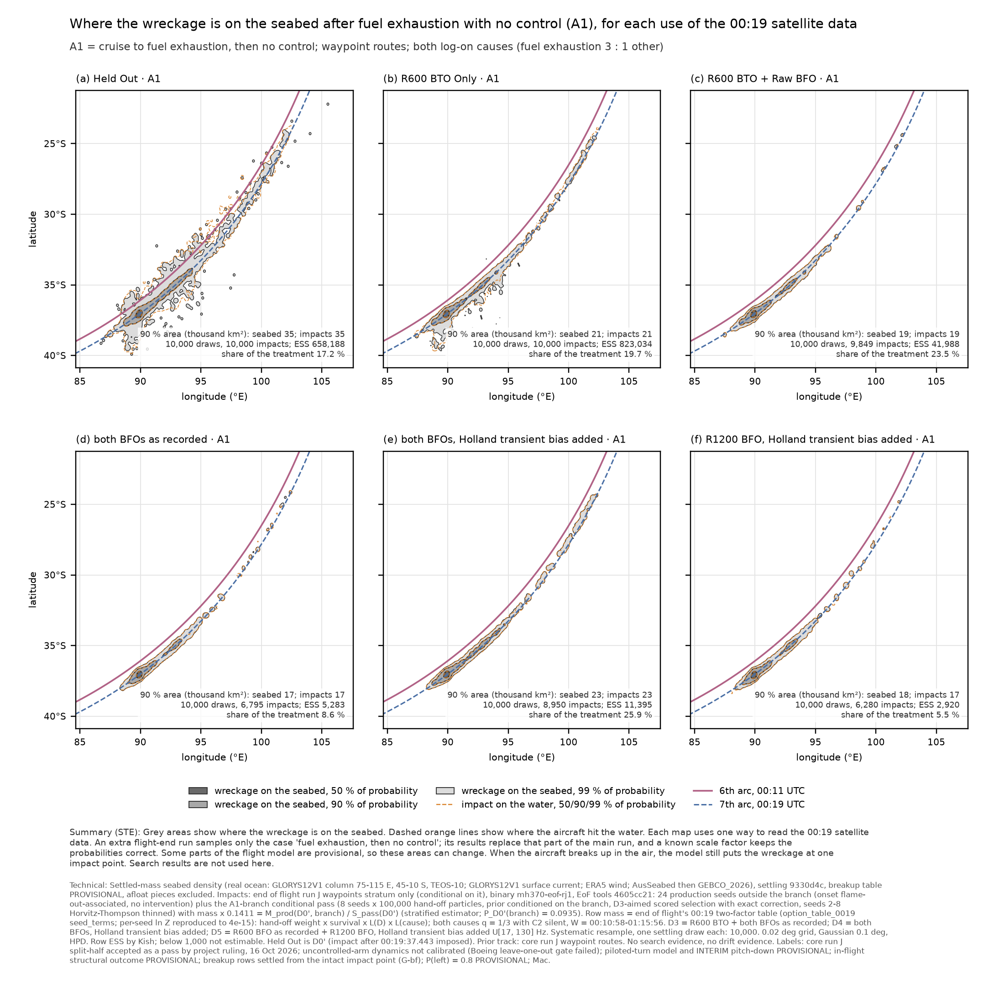
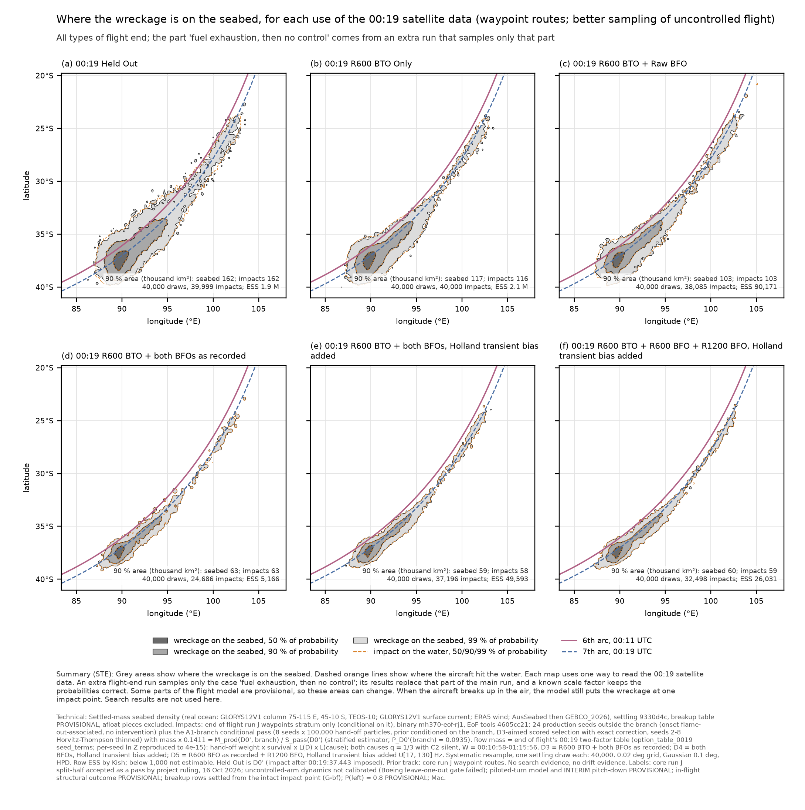
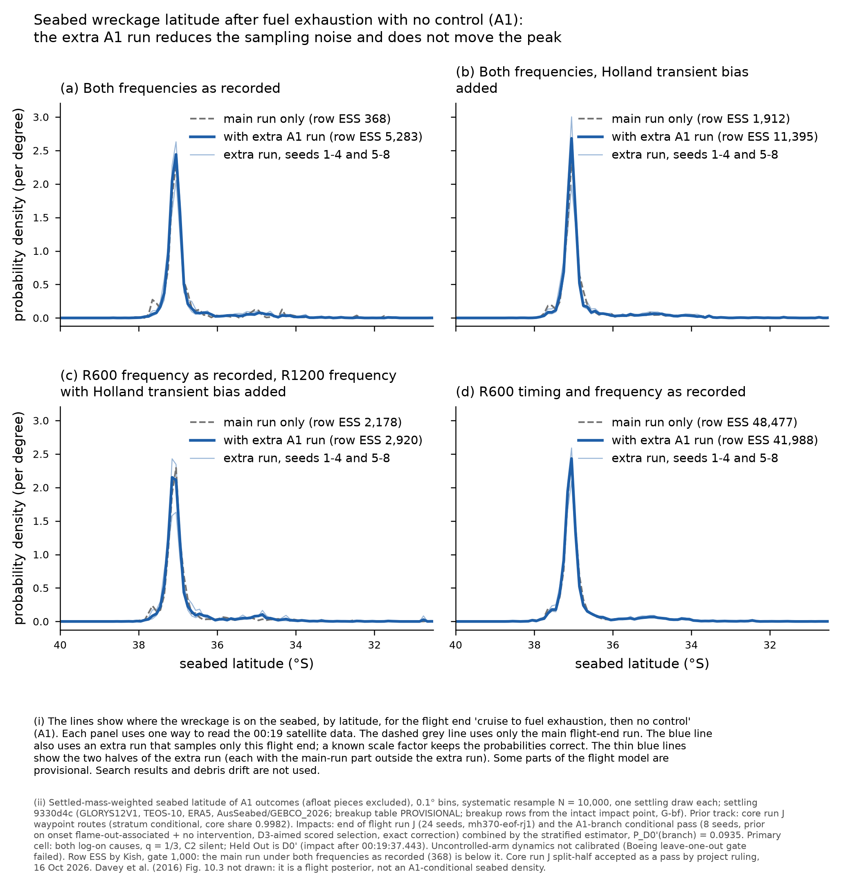

# Ocean settling on end of flight's A1-branch conditional pass (work order overnight-2026-10-19, B1)

Ocean Settling, 19 Oct 2026, 04:50Z. Settling `hypothesis/settling` 9330d4c (real ocean; unchanged since run I), end-of-flight tools 4605cc21, binary
mh370-eof-rj1. Samples: `mh370-exchange/settling/run-j-a1branch/run-j-waypoints/` (README.txt, SHA256SUMS, READY; top-level README and READY).
Driver `scripts/wf_a1branch.py` (from run J's `wf_runj.py`), run script `scripts/run_a1.sh`, comparison `scripts/comp_a1.py`.

**Labels (carry):** core run J split-half accepted as a pass by project ruling, 16 Oct 2026. End of flight's caveat: the uncontrolled-arm dynamics are
not calibrated (Boeing leave-one-out gate failed in all three rounds). Piloted-turn model and INTERIM pitch-down PROVISIONAL; in-flight structural
outcome PROVISIONAL; breakup rows settled from the intact impact point (G-bf); P(left) = 0.8 PROVISIONAL. D0 is D0' (impact after 00:19:37.443
imposed). D4/D5 "Holland transient bias added". Conditional on the waypoints stratum (core share 0.9982).

## Method

End of flight's stratified estimator (`results/eof-a1-branch-oct18`), applied row by row so that the result is a resampleable sample:

- Branch = onset flame-out-associated and control "no intervention" (a subset of A1 = cruise to fuel exhaustion, then no control). The pass
  (8 seeds x 100,000 hand-off particles) conditions the prior on the branch, so for every likelihood l (00:19 treatment x cause x survival)
  sum over production branch rows of m_l = M_prod(D0', branch) x S_pass(l) / S_pass(D0').
- Row mass m = the run J settling recipe (option_table_0019 seed_terms; primary cell: both log-on causes, q = 1/3, C2 silent), seeds pooled
  equally inside each source; thinned pass seeds 2-8 normalised by `thinning.weight_sum_in`.
- Production rows in the branch get mass 0. Pass rows get mass x SCALE, SCALE = M_prod(D0', branch) / S_pass(D0') = 0.14108 (one scalar for
  every treatment).
- Products per treatment D0'-D5: "all families, A1 stratified" (N 40,000) and "A1" (N 10,000; pass rows + production A1 rows outside the
  branch, the undemonstrated recoveries). Systematic resample, one settling draw each, as run J. A2 and B are unchanged from `settling/run-j`.

## Checks

- P_D0'(branch) = 0.093481, end of flight 0.093481 (equal to 3e-17). Pass ln E[L_d | branch]: D2 -11.299, D3 -21.151, D4 -20.210,
  D5 -22.179, the same as end of flight's table (-11.299 / -21.151 / -20.210 / -22.179).
- Per-seed ln Z of every cell equals option_table_0019 seed_terms to 4e-15 (asserted, all 32 seeds, both passes).
- Every positive-mass pass row is in the branch; the production branch lies inside A1 (asserted). Each A1 product's share equals the pass-0
  stratified share to 1e-9 (asserted).
- Elements: 252,895 table rows (198,506 production, 54,389 pass), 287,137 draws, 19.0 M elements; every product outcome present; element masses
  sum to impact mass (ratio 1 +/- 2e-15); fates 0 and 1 only; 0 outcomes not computed; every impact after 00:19:37.443. SHA256SUMS verified.
- A1 shares against end of flight's `a1-branch-combined.json`: D2 0.2354 (EoF 0.2346), D3 0.0860 (0.0851), D4 0.2595 (0.2629),
  D5 0.0551 (0.0548). The differences (up to 0.0034) are a declared method difference, not an error: end of flight divides by production's
  Z(d) and rescales A2/B; a resampleable mixture must use one measure, so here the branch part of Z(d) is the pass estimate. Both are
  consistent; the differences are smaller than the spread between pass seed halves (D4 0.245 / 0.267; D3 0.081 / 0.088).

## Result: A1 under every treatment is now estimable

| 00:19 treatment | A1 share, production | A1 share, stratified (seed halves) | A1 row ESS, production -> stratified | A1 seabed 90 % area (thousand km²), production -> stratified | A1 seabed latitude 5/50/95 %, stratified | Total row ESS, production -> stratified | Total seabed 90 % area, production -> stratified |
|---|---|---|---|---|---|---|---|
| 00:19 Held Out (D0') | 0.172 | 0.172 | 997,405 -> 658,188 | 34.0 -> 35.1 | | 1,941,487 -> 1,885,402 | 160.2 -> 162.3 |
| R600 BTO only (D1) | 0.199 | 0.197 (0.195 / 0.198) | 1,244,077 -> 823,034 | 20.9 -> 21.1 | | 2,140,205 -> 2,062,311 | 116.6 -> 116.7 |
| R600 BTO + BFO as recorded (D2) | 0.238 | 0.235 (0.227 / 0.240) | 48,477 -> 41,988 | 18.8 -> 19.1 | -37.45 / -37.06 / -34.84 | 91,999 -> 90,171 | 103.4 -> 103.3 |
| Both BFOs as recorded (D3) | 0.095 | **0.086** (0.081 / 0.088) | **368 (not estimable) -> 5,283** | 16.6 (n.e.) -> **17.1** | -37.35 / -37.05 / -34.83 | 4,696 -> 5,166 | 63.5 -> 63.4 |
| Both BFOs, Holland transient bias added (D4) | 0.250 | 0.260 (0.245 / 0.267) | 1,912 -> 11,395 | 25.2 -> 23.5 | -37.34 / -37.03 / -34.00 | 21,169 -> 49,593 | 59.5 -> 58.6 |
| R600 BFO + R1200 BFO, Holland transient bias added (D5) | 0.060 | 0.055 (0.052 / 0.057) | 2,178 -> 2,920 | 17.7 -> 17.7 | -37.40 / -37.07 / -34.86 | 25,885 -> 26,031 | 59.8 -> 59.6 |

(Production values from `results/settling-run-j` §1 and §3, waypoints. Seabed latitude quantiles are settled-mass weighted; the production
D3 quantiles were -37.53 / -37.04 / -34.91 on ESS 368.)

- **D3 x A1 is closed for settling**: row ESS 5,283 against the gate of 1,000 (and 500 for searched areas). Its seabed peak (37.05 S) and
  90 % area (17 thousand km²) agree with production's unestimable values; production's secondary bump near 37.6 S was sampling noise and is
  gone (comparison chart, panel a). Settling adds 0.1-0.3 thousand km² to every A1 area; settled-offset p50/p90 0.30/1.96 km.
- D4 total row ESS doubles (21,169 -> 49,593) and the D4 A1 95 % latitude moves from -33.54 to -34.00 (thin northern tail, now better sampled).
- Afloat pieces (excluded from the seabed products) are 14.5 % of elements by count (as run J, 14.2-14.5 %) and 18.6 % of element mass in the
  file; by mass 17.7-19.0 % within the totals and 19.9-20.0 % within A1.

## COVERAGE

- **(a) Feasible set.** Fuel exhaustion with no pilot input and every descent the 777 can show (spiral up to 90 deg bank, phugoid, steep dive),
  as end of flight's A1-branch note; other families as end of flight's run J note.
- **(b) Settling's reach.** Every row reaching the water, settled as an intact impact through the real ocean (GLORYS12V1, TEOS-10, ERA5,
  AusSeabed then GEBCO_2026). Reach gaps: G-bf (in-flight breakup rows settled from the intact impact point), attitude-dependent breakup
  (declared), impact pitch not used (G6). No impact refused by the ocean window.
- **(c) Proposal coverage.** Row Kish ESS per product in the table and in the exchange README. All 12 products are above 1,000.
  Remaining gaps, unchanged by this order: free flight, descent-climb and Davey dynamics with radar keep their run J A1 gaps under D3-D5
  (no branch pass there; those strata carry 0.0018 of core mass); the cause-split products (C1 alone, C2 silent alone) were not re-emitted for
  A1 (the run J recipe has no family x cause products). A1 north of 35 S is thin in every pass (end of flight gap 2).
- **Status of "D3 x A1 not estimable" for settling (waypoints): CLOSED** (row ESS 5,283).
- **Bounds and sources.** Settling unchanged from run I (9330d4c; `results/settling-run-c/README.md` §COVERAGE). End-of-flight bounds as its
  A1-branch note (bank limit U[52, 90] deg; p = 0.5; q = 1/3, C2 silent).

## Run and disk

Mac, under `lockf -k /tmp/.mh370-heavy.lock`: estimator terms 04:07-04:10Z (4 processes); prep 04:11-04:38Z (1 thread); settling 04:38-04:42Z
(4 threads); render and publish 04:42-04:43Z; READY 04:46Z. Disk added: 1.2 GB on the exchange + 0.17 GB work files (cap 4 GB). Free space
63 -> 52 GiB over the period (df; the rest is other orders). Nothing deleted.

## Deviations

- Waypoints stratum only (the pass exists only there), as end of flight's estimator.
- A1 shares differ from end of flight's by up to 0.0034 (method difference above, within the seed-half spread).
- Products: totals and A1 per treatment only; no A2/B (unchanged) and no family x cause split (not in the run J recipe). N per product as run J.
- `<tag>_impacts.f64` column 14 (stratum*10+seed) is ambiguous for this two-source table; `rja1_source.npy` and the draws npz carry the
  unambiguous stratum and seed (stated in the exchange README).
- No smoke result is quoted; every number above is from the full input (24 + 8 seeds).

- Ocean Settling, 2026-10-19
