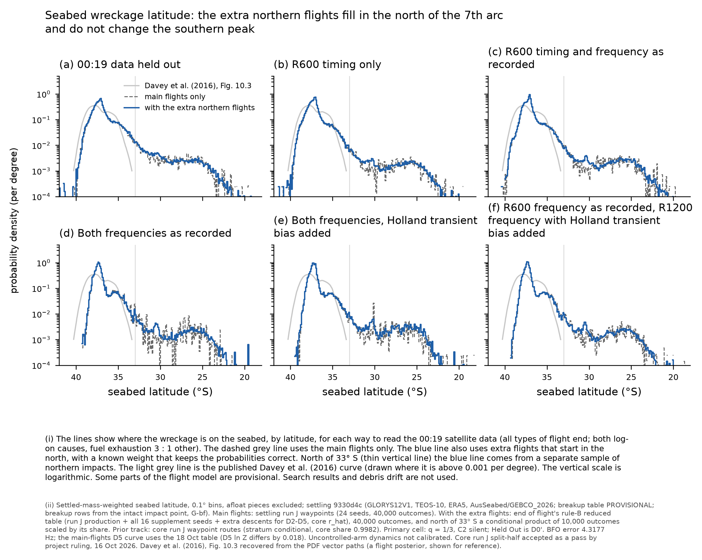

# Ocean settling on the run J northern supplement, full rule-B set (work order overnight-2026-10-20, B1)

Ocean Settling, 20 Oct 2026, 10:45Z. Settling `hypothesis/settling` 9330d4c (real ocean; unchanged since run I). End-of-flight tools 45ea4af0
(rule B, reduced table, A1 strata). Samples: `mh370-exchange/settling/run-j-supplement/` with two folders, `ruleB-waypoints/` and
`a1-stratified/`. Each folder has README.txt, SHA256SUMS and READY, and the top level has its own README and READY. Drivers:
`scripts/wf_supp.py`, `scripts/wf_supp_a1.py`. Run scripts: `scripts/run_supp.sh`, `scripts/run_supp_a1.sh`.

**Labels (carry):**
- Core run J split-half is accepted as a pass by project ruling, 16 Oct 2026.
- End of flight's caveat: the uncontrolled-arm dynamics are not calibrated (the Boeing leave-one-out gate failed in all three rounds).
- PROVISIONAL: piloted-turn model and INTERIM pitch-down; in-flight structural outcome; P(left) = 0.8; breakup table.
- Breakup rows are settled from the intact impact point (G-bf).
- D0 is D0': impact after 00:19:37.443 is imposed and was checked in every product.
- D4 and D5 are labelled "Holland transient bias added".
- Waypoints stratum only, so every result is conditional on it (core share 0.9982).

## Declared reductions and substitutions

1. **Input = end of flight's reduced rule-B table.** This is `end-of-flight/run-j-supplement/reduced/impacts-ruleB.npz`, 2,408,038 rows, which end of flight's README names for downstream modules. It is one Horvitz-Thompson thinning of the full set (C = 150,000 per 5-degree band), so row ESS on it is not comparable with the unthinned run J row ESS. For D0' and D1 the row ESS falls from about 2 M to about 0.2 M. End of flight's distinct-state band ESS on the full set is the authoritative coverage figure. Row weights are end of flight's stored `lnw:comb/<d>`, used without change, so rule B and the 64 : 256 extra-descent pooling are exactly end of flight's.
2. **A1 under D3-D5 uses a separate folder.** The unconditional rule-B A1 under D3 has row ESS 408 and is not estimable. A1 is therefore built from end of flight's two conditional strata in `a1-stratified/`:
   - Branch 1 (no intervention): run-j-a1branch plus north-k2-a1branch, combined by rule B. N1 = 799,999 hand-off rows, N2 = 800,004, K = 2.
   - Branch 2 (recovery attempted, A1 part): run-j-a1outside, run J paths only. Its northern tail is thin, as end of flight states.
3. **A1-share convention.** The `a1-stratified` totals are self-normalised mixtures. Their A1 share therefore differs from end of flight's published share, which divides by the main set's Z(d) and rescales the other families:
   - D4: 0.268 against 0.276.
   - D4s: 0.438 against 0.476.
   - D3: 0.085 against 0.084.
   `eof-convention-weights.json` gives per-outcome weights that reproduce end of flight's convention exactly: weight 0.858-1.014 on outcomes from the reduced table, weight 1 on strata outcomes. The A1-only products are unaffected because the reduced table has no A1 rows outside the two strata. Recommendation for searched areas and the composer: use end of flight's convention, so that one A1 share is used across modules.
4. **Comparison basis for the main run.** "Run J alone" is the 18 Oct settling run J waypoints products (unthinned, 24 seeds). That D5 used the earlier D5 table: its D5 ln Z is -29.168, against -29.186 with the 4.3177 Hz BFO error (calibration-smoke fault F1). The D5 comparison includes that change.
5. **Products.** No cause-split C1 products were made (the reduced table carries only the q = 1/3 totals and the 'other cause only' cells). "Other cause only" (D3s-D5s) is emitted as totals only, with A1 for it in `a1-stratified`.
6. **Disk over the cap.** The exchange folders total 2.9 GB, inside the 3 GB cap. The work-directory histogram arrays add 0.57 GB (`mh370-settling-work-j/field/rjs*_H_*.npy`), so the order used 3.5 GB in all. The arrays were left in place, because the rule is not to delete under /Users/pete. Pete may remove them.

## Checks

- **Bit-identical with run J.** Production rows settle exactly as in run J settling: 2,000 random production rows matched to the run J table had equal impact columns and equal draw-0 element sets (`scripts/repro_check.py`). The parent column is `handoff_row` and unix time is `t_impact_s` + T0, which matches the compact loader.
- **Elements, `ruleB-waypoints`.** 398,749 rows, 492,493 draws, 32.9 M elements. Every product outcome is present; element masses sum to impact mass (ratio 1 ± 2e-15); 0 outcomes not computed; every impact after 00:19:37.443.
- **Elements, `a1-stratified`.** 161,531 rows, 192,810 draws, 13.9 M elements, with the same checks passing.
- **A1 strata.** The branch-1 and branch-2 shares for D0', D2-D5 and D3s-D5s reproduce end of flight's `a1-strata.json` to 1e-6 relative (asserted). This also validates the rule-B reconstruction of the branch-1 pass.
- **Weights.** Stored weight sums are 0.997-1.001, which is Horvitz-Thompson noise as end of flight reports. The products are self-normalised.

## Results: run J alone against run J + northern supplement (seabed)

| 00:19 treatment | seabed 90 % area (thousand km²) | seabed latitude 5 / 50 / 95 % | north of 33 S, seabed | 30-25 S | 25-20 S | impact ESS north of 33 S (rows, alone -> combined) |
|---|---|---|---|---|---|---|
| D0' 00:19 held out | 160.2 -> 165.1 | -38.38 / -37.12 / -33.86 -> -38.41 / -37.12 / -33.76 | 0.0328 -> 0.0349 | 0.0139 -> 0.0127 | 0.0027 -> 0.0030 | 32,505 -> 97,492 |
| D1 R600 BTO | 116.6 -> 119.1 | -38.47 / -37.20 / -34.58 -> -38.47 / -37.21 / -34.52 | 0.0187 -> 0.0208 | 0.0090 -> 0.0084 | 0.0020 -> 0.0026 | 36,942 -> 93,035 |
| D2 R600 BTO + BFO | 103.4 -> 106.8 | -38.15 / -37.12 / -34.31 -> -38.17 / -37.12 / -34.28 | 0.0240 -> 0.0255 | 0.0115 -> 0.0107 | 0.0034 -> 0.0038 | 2,157 -> 39,114 |
| D3 both BFOs as recorded | 63.5 -> 64.0 | -38.03 / -37.29 / -34.43 -> -38.04 / -37.29 / -34.46 | 0.0218 -> 0.0218 | 0.0102 -> 0.0087 | 0.0021 -> 0.0027 | 125 -> 2,947 |
| D4 both BFOs, Holland transient bias added | 59.5 -> 61.9 | -37.98 / -37.21 / -34.40 -> -37.98 / -37.21 / -34.29 | 0.0254 -> 0.0279 | 0.0123 -> 0.0127 | 0.0018 -> 0.0035 | 66 -> 4,082 |
| D5 R600 BFO + R1200 BFO, Holland transient bias added | 59.8 -> 60.7 | -38.00 / -37.28 / -34.47 -> -38.00 / -37.28 / -34.47 | 0.0203 -> 0.0220 | 0.0093 -> 0.0089 | 0.0024 -> 0.0027 | 398 -> 7,843 |

How each column was computed:
- **Seabed band masses, combined:** from the conditional 'north of 33 S' product (10,000 outcomes), scaled by its share.
- **Seabed band masses, run J alone:** from the 40,000-outcome total, with resampling SE about ±0.0002-0.0009. Under D3-D5 these rest on 22-398 effective impact rows north of 33 S, so their noise is larger than that SE.
- **Impact-level band masses** (`comp_supp.json`, `rjs_info.json` impact_level) agree with the seabed values to ≤0.0002 (combined), because settling offsets are kilometres (p90 2.6-4.5 km).
- **Distinct-state band ESS** for the full set is end of flight's figure (results/eof-run-j-supplement-oct20 §3): D3 25-20 S 424, D4 25-20 S 560 (below 1,000); all other bands are above 1,000. The northern band masses are limited by the 16 replicates' mode probabilities, not by the sampler (end of flight).

Reading:
1. **The southern peak does not change.** The 5 % and 50 % seabed latitudes move by ≤0.03°.
2. **The 95 % latitude moves north by 0.03-0.11°** under D0', D1, D2 and D4. It does not move under D3 or D5.
3. **The 90 % seabed areas grow by 0.5-4.9 thousand km² (1-3 %).** That is the northern shelf now being sampled.
4. **Mass north of 33 S rises by 0.0015-0.0025** in every treatment except D3 (no change). It is consistent with end of flight's impact-level masses (D0' 0.0349, D4 0.0280).
5. **Under D4, 25-20 S doubles (0.0018 -> 0.0035)**, as end of flight found at impact level (0.0021 -> 0.0036). The run J alone value rests on 104 effective rows there.
6. **Northern coverage under the two-BFO treatments goes from very thin to estimable.** Impact row ESS north of 33 S rises from 66-398 to 2,947-7,843 under D3-D5.

### A1 by the conditional strata (`a1-stratified`)

| 00:19 treatment | A1 share (end of flight convention) | A1 row ESS | A1 seabed 90 % area (thousand km²) | Total with A1 stratified, row ESS / 90 % area |
|---|---|---|---|---|
| D0' | 0.169 | 410,962 | 39.8 | - |
| D2 | 0.226 | 43,703 | 19.4 | - |
| D3 | 0.084 | **6,022** (unconditional 408) | 19.6 | 5,942 / 65.7 |
| D4 | 0.276 | 39,473 | 24.8 | 65,811 / 59.7 |
| D5 | 0.053 | 4,636 | 20.7 | 19,346 / 60.8 |
| D3s / D4s / D5s | 0.114 / 0.476 / 0.076 | 2,551 / 11,539 / 2,947 | 32.0 / 36.4 / 31.2 | 6,686 / 50.4; 19,662 / 52.7; 14,617 / 45.2 |

All 15 resampled products in `a1-stratified` are above the gate. In `ruleB-waypoints` one product of 33 is below it: A1 under D3, row ESS 408. That gap is closed by `a1-stratified`.

## COVERAGE

- **(a) Feasible set.** As end of flight's run J and supplement notes. Over-bank above 90° is a declared reach gap there.
- **(b) Settling's reach.** Every row that reaches the water is settled as an intact impact (GLORYS12V1, TEOS-10, ERA5, AusSeabed then GEBCO_2026). No impact was refused by the ocean window; impacts span 11.6-42.4 S. Reach gaps: G-bf, attitude-dependent breakup, impact pitch not used (G6).
- **(c) Proposal coverage.** Row ESS per product is in the exchange READMEs.
  - Below the gate: `ruleB-waypoints` A1 x D3 only (408); use `a1-stratified` (6,022).
  - Remaining gaps, from end of flight: distinct states in 25-20 S under D3 (424) and D4 (560); A1 branch 2 north of 35 S on run J paths only (191 / 45 / 36 distinct states under D4); family cells in 25-20 S under D3-D5. None of these gaps can be closed by settling.
- **Status:** northern coverage of the seabed field is now estimable for every treatment north of 33 S as a whole (row ESS ≥ 2,947). The two 25-20 S cells are still below 1,000 distinct states. They are reported, not dropped.
- **Bounds and sources.** Settling is unchanged from run I (`results/settling-run-c/README.md` §COVERAGE). End-of-flight bounds are as in its oct20 note.

## Figures

- `settling-seabed-wreckage-run-j-supplement-waypoints-{core,family,north,other}` (PNG + PDF)
- `settling-seabed-wreckage-run-j-supplement-a1-stratified-{a1,total}` (PNG + PDF)
- `settling-supplement-latitude-comparison` (PNG + PDF)

## Run

Mac, under `lockf -k /tmp/.mh370-heavy.lock`, at most 4 threads:
- Main: prep 10:19Z, settling 10:19-10:24Z, render and publish to 10:26Z.
- A1 strata: terms 10:27Z, prep 10:29Z, settling 10:31-10:33Z.
- READY written about 10:40Z.

Mac free space went from 28 to 23 GiB (df) over the run, which includes other orders. Nothing was deleted.

- Ocean Settling, 2026-10-20
